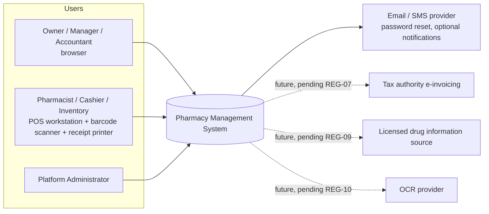
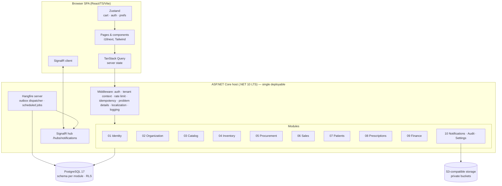
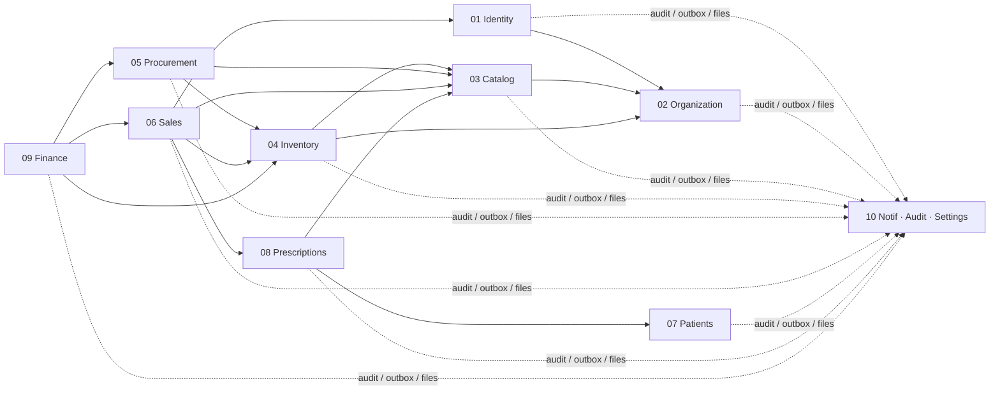
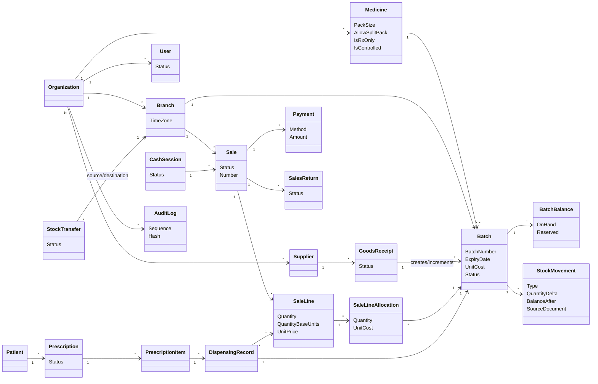
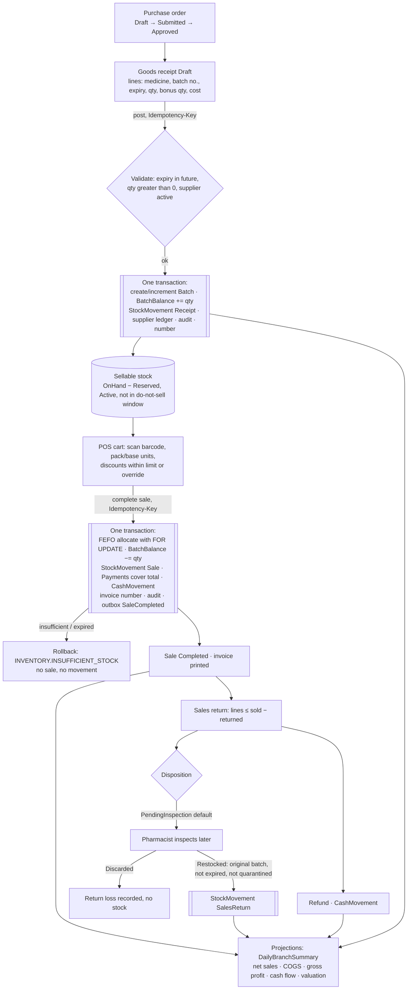
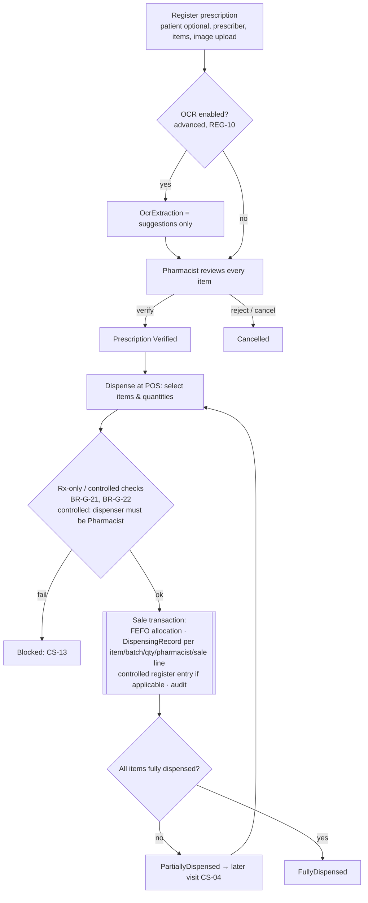
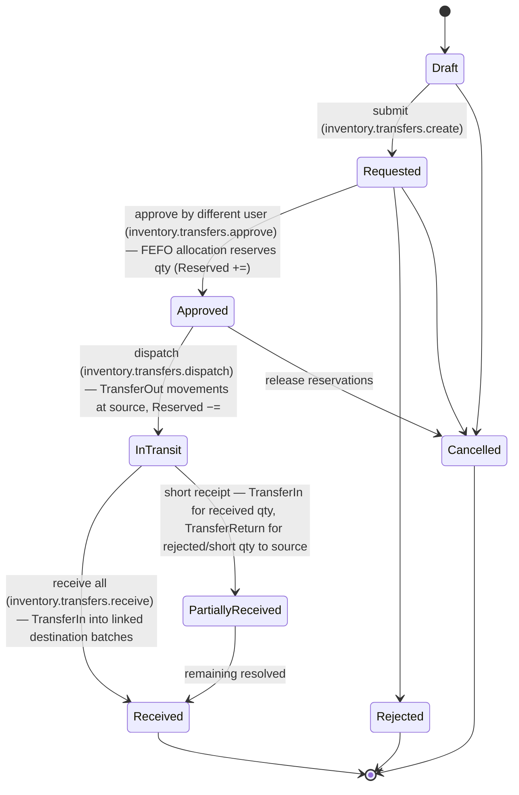

# Pharmacy Management System — Master Software Design Document (SDD)

| Field | Value |
|---|---|
| Version | 2.0 (consolidated) |
| Status | Baseline for specification and implementation planning |
| Date | 2026-11-09 |
| Architecture style | Modular monolith + Clean Architecture per module ([ADR-001](architecture/decisions/ADR-001-ARCHITECTURE-STYLE.md)) |
| Source | Builds on the product owner's original `docs/2. Master SDD.md` (v1.0, Initial Draft), which remains unchanged as the source input. Its principles, module responsibilities, critical business rules, security, file, localization, NFR, testing, and Definition of Done sections are preserved here and resolved against the canonical conventions and ADRs. The "Architectural Decisions Pending" list of the original is resolved by ADR-001 … ADR-010 (see §15). |
| Authority | [DOCUMENTATION-CONVENTIONS.md](DOCUMENTATION-CONVENTIONS.md) wins on any conflict. |

---

## 1. System Overview

The Pharmacy Management System is a multi-organization, multi-branch platform that manages medicine catalog, batch-level inventory, procurement, point of sale, patients, prescriptions and dispensing, finance and reporting, notifications, audit, and settings for pharmacies in Egypt. It runs as a **single deployable ASP.NET Core host** (.NET 10 LTS) with a **React/TypeScript SPA**, **PostgreSQL 17**, and **S3-compatible object storage**, packaged with Docker.

The same software supports three deployment models — single pharmacy, chain, and SaaS ([PROJECT-VISION.md §4](PROJECT-VISION.md)) — distinguished only by data (number of Organizations and Branches) and hosting.

Dashed integrations are **not** part of v1 and are listed only as extension points subject to their REG items.

## 2. Architecture Principles

Original principles retained, with how they are applied:

| Principle | Application |
|---|---|
| Clean Architecture | Per module: Domain ← Application ← Infrastructure; Api contracts; dependency rule enforced by architecture tests |
| DDD where useful | Aggregates for documents (Sale, GoodsReceipt, StockTransfer, Prescription); value objects (Money, Quantity, BatchNumber); ubiquitous language = [GLOSSARY.md](GLOSSARY.md) |
| Separation of concerns / SOLID / DIP | Interfaces for storage, clock, tenant context, file storage, job scheduler, notification channels |
| Explicit module boundaries | Schema per module, public facades, integration events via outbox (ADR-001) |
| API-first | OpenAPI contract per module, REST conventions (conventions §7) |
| Specification-driven | Every feature traces SPEC → FR → US → AC → TS ([SPEC-STORY-TRACEABILITY.md](SPEC-STORY-TRACEABILITY.md)) |
| TDD for critical logic | FEFO allocation, money rounding, return limits, transfer state machine, idempotency, authorization |
| Transaction integrity | Atomic workflows (BR-G-09, BR-G-19, BR-G-35); pessimistic locks for allocation (ADR-004) |
| Secure by default | Deny-by-default authorization, tenant context mandatory, RLS defense in depth (ADR-002) |
| *(added)* Immutability of records | Ledgers and completed documents are append-only; corrections by compensation (BR-G-11, BR-G-25) |
| *(added)* Configurable regulation | Regulatory behavior behind organization settings with documented defaults (REG-xx) |

## 3. Technology Stack (decided)

### 3.1 Backend
| Concern | Choice | Decision |
|---|---|---|
| Runtime / framework | C#, ASP.NET Core on **.NET 10 LTS** | ADR-001 |
| Data access | Entity Framework Core (Npgsql provider); one DbContext per module; raw SQL only for reports, through tenant-safe helpers | ADR-001, ADR-002 |
| Database | **PostgreSQL 17** (`timestamptz`, `numeric`, `jsonb`, RLS, `xmin` concurrency) | ADR-002, ADR-003 |
| Validation | FluentValidation (Application layer) | — |
| In-module messaging | MediatR-style request/handler pipeline (internal to a module) | ADR-001 |
| AuthN | ASP.NET Core Identity core + JWT (RS256/ES256, 15 min) + rotating opaque refresh tokens | ADR-005 |
| AuthZ | Permission-based policies + branch scope + organization scope | Conventions §5.3 |
| Real-time | SignalR hub `/hubs/notifications` | Conventions §7 |
| Background jobs | **Hangfire** with `Hangfire.PostgreSql` storage | ADR-007 |
| Files | S3-compatible storage (MinIO in dev/on-prem) | ADR-006 |
| Logging / observability | Serilog (JSON), OpenTelemetry traces/metrics, health checks | NFR-G-10 |
| API docs | OpenAPI (Swagger UI in non-production) | — |

### 3.2 Frontend
| Concern | Choice | Decision |
|---|---|---|
| Framework | React + TypeScript + Vite | — |
| Routing | React Router | — |
| Server state | TanStack Query | ADR-010 |
| Client state | **Zustand** (POS cart, auth session, UI prefs) | ADR-010 |
| Forms / validation | React Hook Form + Zod | — |
| Styling | Tailwind CSS with logical properties; light/dark/system themes | ADR-009 |
| i18n | i18next + react-i18next (`ar`, `en`) | ADR-009 |
| Real-time | `@microsoft/signalr` client | — |
| Tests | Vitest, React Testing Library, Playwright (E2E) | §12 |

### 3.3 Infrastructure
Docker images, Docker Compose (app, PostgreSQL 17, MinIO; optional worker host), EF Core migration bundles applied by a deployment step, CI/CD pipeline (build, test, architecture tests, security scans, image publish), PostgreSQL WAL archiving/PITR backups (NFR-G-05), bucket versioning for files. Details: [architecture/DEPLOYMENT-ARCHITECTURE.md](architecture/DEPLOYMENT-ARCHITECTURE.md).

## 4. High-Level Architecture

**Request path:** HTTPS → authentication (JWT) → tenant context (organization, branches, permissions) → authorization policy → idempotency check (for listed commands) → module endpoint → application handler → domain → EF Core (shared transaction when crossing modules) → commit (business data + ledger + audit + outbox) → response. Post-commit side effects (notifications, SignalR, projections) flow through the outbox.

Detailed architecture: [architecture/SYSTEM-ARCHITECTURE.md](architecture/SYSTEM-ARCHITECTURE.md).

## 5. Module Catalog

Each module owns its schema, entities (conventions §6), permissions (conventions §5.2), error codes (`MODULE.ERROR_NAME`), and spec/epic. "Published contracts" are public facades (synchronous, in-transaction) and integration events (asynchronous via outbox). Event names are indicative; each spec defines the final list.

| # | Module (schema) | Spec / Epic | Responsibilities | Owned entities | Published contracts & events | Consumes |
|---|---|---|---|---|---|---|
| 01 | Identity & Access (`identity`) | SPEC-01 / EPIC-01 | Authentication, password management, lockout, JWT/refresh rotation, sessions, roles, permissions, user–branch assignments | User, Role, Permission, RolePermission, UserRole, UserBranchAssignment, RefreshToken, UserSession, PasswordResetToken, LoginAttempt | `IPermissionService` (effective permissions, branch scope), `ICurrentUser`, `IReauthenticationService` (manager override); events `UserDeactivated`, `UserRolesChanged`, `RefreshTokenFamilyRevoked` | Org (organization/branch existence, status); Audit writer |
| 02 | Organization & Branches (`org`) | SPEC-02 / EPIC-02 | Organization profile, branches, branch & organization settings, document numbering, tenant context, platform onboarding, support access grants, subscriptions (P3) | Organization, Branch, BranchSettings, OrganizationSettings, DocumentSequence, SupportAccessGrant, Subscription | `ITenantContext`, `IBranchSettingsQuery` (time zone, business date, near-expiry, do-not-sell window, value thresholds), `IDocumentNumberService` (gapless numbers, BR-G-24); events `OrganizationCreated`, `BranchCreated`, `BranchDeactivated`, `BranchSettingsChanged` | Identity (owner user creation); Audit |
| 03 | Medicine Catalog (`catalog`) | SPEC-03 / EPIC-03 | Medicines, barcodes, generic names, active ingredients/strengths, dosage forms, categories, manufacturers, pack size/split pack, Rx-only/controlled flags, prices (org + branch override), tax categories, alternatives, import/export, search | Medicine, MedicineBarcode, MedicineCategory, Manufacturer, ActiveIngredient, MedicineIngredient, DosageForm, MedicineAlternative, MedicinePrice, BranchMedicinePrice, TaxCategory | `ICatalogQuery` (medicine snapshot: pack size, flags, price, tax for a branch), `IMedicineSearch`; events `MedicineCreated`, `MedicineUpdated`, `MedicineDeactivated`, `MedicinePriceChanged` | Org (settings); Files (import); Audit |
| 04 | Batch & Inventory (`inventory`) | SPEC-04 / EPIC-04 | Batches, balances, stock ledger, FEFO allocation, adjustments, write-offs, stocktakes, transfers, reorder settings, expiry flagging, reconciliation, valuation data | Batch, BatchBalance, StockMovement, StockAdjustment(+Line), WriteOff(+Line), Stocktake(+Line), StockTransfer(+Line, +Allocation), ReorderSetting | `IInventoryLedger` (receive, deduct, reverse, return-to-stock), `IStockAllocationService` (FEFO allocate with locks), `IStockQuery` (sellable quantity, batches); events `LowStockDetected`, `BatchNearExpiry`, `BatchExpired`, `TransferRequested`, `TransferDispatched`, `TransferReceived`, `ReconciliationMismatchDetected` | Catalog (medicine snapshot); Org (business date, settings, numbering); Audit |
| 05 | Suppliers & Procurement (`procurement`) | SPEC-05 / EPIC-05 | Suppliers, purchase orders, goods receipts (partial, bonus quantities, batch registration), supplier invoices, supplier returns, payments, supplier ledger and balances | Supplier, SupplierContact, PurchaseOrder(+Line), GoodsReceipt(+Line), SupplierInvoice(+Line), SupplierReturn(+Line), SupplierPayment, SupplierPaymentAllocation, SupplierLedgerEntry | `ISupplierBalanceQuery`; events `GoodsReceiptPosted`, `SupplierInvoicePosted`, `SupplierReturnPosted`, `SupplierPaymentRecorded` | Inventory (`IInventoryLedger` receive/return); Catalog; Org (numbering); Files (invoice scans); Audit |
| 06 | Sales & POS (`sales`) | SPEC-06 / EPIC-06 | POS search and cart completion, pricing snapshot, discounts and overrides, payments, invoice numbering/printing, voids, sales returns with disposition, refunds, cash sessions and cash movements, idempotency infrastructure | Sale, SaleLine, SaleLineAllocation, Payment, SalesReturn(+Line), Refund, CashSession, CashMovement, DiscountRule (P2), IdempotencyRecord | `ISalesQuery` (sales, lines, returns for reports), `ICashMovementQuery`; events `SaleCompleted`, `SaleVoided`, `SalesReturnCompleted`, `CashSessionClosed` | Inventory (allocation, ledger); Catalog (price/tax snapshot); Prescriptions (`IDispensingService` within sale transaction); Identity (re-authentication for override); Org (numbering, business date); Audit |
| 07 | Patient Records (`patients`) | SPEC-07 / EPIC-07 | Patient profiles (minimal data), allergies, conditions, notes, consent, timeline, access logging, export/anonymization | Patient, PatientAllergy, PatientCondition, PatientNote, PatientConsent, PatientAccessLog | `IPatientQuery` (identity summary; medical data with access logging); events `PatientAnonymized` | Sales/Prescriptions (history via queries); Audit |
| 08 | Prescriptions (`prescriptions`) | SPEC-08 / EPIC-08 | Prescribers, prescription registration, attachments, items, pharmacist verification, partial/complete dispensing, controlled-medicine register, OCR suggestions (advanced) | Prescriber, Prescription, PrescriptionItem, PrescriptionAttachment, DispensingRecord, OcrExtraction, ControlledMedicineRegisterEntry | `IDispensingService` (validate & record dispensing inside the sale transaction), `IPrescriptionQuery`; events `PrescriptionVerified`, `PrescriptionDispensed`, `PrescriptionFullyDispensed` | Patients; Catalog (Rx-only/controlled flags); Files; Audit |
| 09 | Finance & Reporting (`finance`) | SPEC-09 / EPIC-09 | Expenses, cash flow, net sales, COGS, gross profit, inventory valuation, supplier balances, branch comparison, daily summaries, exports | Expense, ExpenseCategory, DailyBranchSummary, ReportExport | `IReportService`; events `ReportExportCompleted` | Sales, Procurement, Inventory queries; events `SaleCompleted`, `SalesReturnCompleted`, `GoodsReceiptPosted`, … (projection updates); Files (exports) |
| 10 | Notifications, Audit & Settings (`platform`) | SPEC-10 / EPIC-10 | Notification center and rules, SignalR delivery, audit log and verification, user preferences (language, theme), file storage, outbox, background job monitoring, backup/restore operations, operational monitoring | Notification, NotificationRecipient, NotificationRule, AuditLog, UserPreference, FileObject, OutboxMessage, BackgroundJobRun | `IAuditWriter`, `INotificationPublisher`, `IFileStorage`, `IOutbox`, `IJobScheduler` | Events from all modules (alerts); Identity (recipients by permission/branch) |

Arrows denote synchronous facade dependencies (caller → provider). No cycles are permitted; Notifications/Audit/Settings is a platform module every module may call.

## 6. Core Domain Model Overview

The canonical entity list and status enums are in [conventions §6](DOCUMENTATION-CONVENTIONS.md); physical design in [architecture/DATABASE-DESIGN.md](architecture/DATABASE-DESIGN.md). The overview below shows the central relationships (attributes abbreviated). Note the original SDD names map to canonical names: `MedicineBatch` → `Batch`, `InventoryBalance` → `BatchBalance`, `UserBranch` → `UserBranchAssignment`, `Doctor` → `Prescriber`, `SaleItem` → `SaleLine`, `PurchaseOrderItem` → `PurchaseOrderLine`.

**Entity conventions** (conventions §6): UUIDv7 `Id`; `OrganizationId` on every tenant-owned table; `BranchId` on branch-scoped tables; `CreatedAt/By`, `UpdatedAt/By`; `xmin` concurrency token on mutable aggregates; soft delete for master data only; snake_case plural tables per module schema.

## 7. Global Business Rules (Summary)

The authoritative list is BR-G-01 … BR-G-35 in [conventions §4](DOCUMENTATION-CONVENTIONS.md). Grouped summary:

| Group | Rules | Essence |
|---|---|---|
| Organization & branch isolation | BR-G-01, 02, 17 | Branch belongs to one organization; inventory per branch; backend-enforced authorization |
| Batch & inventory integrity | BR-G-03, 04, 05, 08, 09, 10, 25 | Batch = one medicine + one branch; every change is an immutable movement in the same transaction; no negative stock; locked allocation |
| Expiry & allocation | BR-G-06, 07, 27 | FEFO default with permissioned override; expired / do-not-sell-window batches unsellable; configurable thresholds |
| Sales integrity | BR-G-11, 12, 20, 32, 35 | Completed sales immutable; returns reference original lines with quantity limits; snapshots; discount limits with override; sale completes atomically with full payment |
| Transfers & approvals | BR-G-13, 28 | Explicit transfer workflow; segregation of duties for approvals |
| Prescriptions & dispensing | BR-G-14, 15, 21, 22 | OCR suggestions only; partial dispensing with full trace; Rx-only and controlled controls (pending REG-01/02) |
| Procurement | BR-G-31 | Supplier returns only from that supplier's batches |
| Audit & privacy | BR-G-16, 29, 30, 33, 34 | Same-transaction audit; patient-data access logging; immediate revocation; no hard deletes; retention pending REG-05 |
| Money & time | BR-G-18, 23, 24, 26 | Decimal-only money with defined rounding; UTC storage with branch business date; gapless document numbers; immutable closed cash sessions |
| Atomicity | BR-G-19 | All critical workflows roll back completely on failure |

The original SDD's critical rules are all covered: e.g., "stock must never become negative unless an explicitly approved business exception is defined" is resolved by BR-G-08 (no exception in v1); "sale cancellation and returns must restore stock according to the return inspection process" by BR-G-11/12 and the REG-11 default disposition model (conventions §10).

## 8. Cross-Cutting Concerns

| Concern | Design | Reference |
|---|---|---|
| **Tenancy** | `OrganizationId` discriminator; mandatory tenant context from JWT; EF Core global query filters; PostgreSQL RLS (`SET LOCAL app.organization_id`) enabled from the Foundation phase (MVP, ADR-002 amended 2026-11-10); cross-organization → 404 | ADR-002, CS-08 |
| **Authorization** | Effective access = permission ∧ branch scope ∧ organization; branch-scoped routes `/api/v1/branches/{branchId}/...`; 403 within organization; permission cache keyed by `perm_ver`; segregation of duties for approvals (approver ≠ requester) | Conventions §5.3, BR-G-17, BR-G-28, CS-07 |
| **Audit** | Same-transaction `AuditLog` with hash chain; explicit business audit events + field-level changes; patient access log | ADR-008, BR-G-16, BR-G-29 |
| **Idempotency** | `Idempotency-Key` required on listed commands; `IdempotencyRecord` (24 h, OrganizationId+UserId+Key, request hash); replay or 422 `COMMON.IDEMPOTENCY_KEY_REUSED`; record written in the business transaction | Conventions §7, CS-11 |
| **Concurrency** | Pessimistic locks for stock allocation; `xmin`/ETag + `If-Match` for mutable resources (412 on mismatch) | ADR-004 |
| **Localization** | `ar`/`en`, RTL/LTR, stable error codes + localized messages, bilingual medicine names, Arabic search normalization | ADR-009, BRQ-13 |
| **Time zones** | Store UTC `timestamptz`; branch time zone (default `Africa/Cairo`) determines business date for expiry, cash sessions, reports, document year; `IClock` abstraction for tests | BR-G-23 |
| **Money** | `decimal`/`numeric(19,4)` unit values, `numeric(19,2)` document amounts; `AwayFromZero` at line level; totals are sums of rounded lines; currency per organization (default EGP); no floating point | BR-G-18, BR-G-20 |
| **Quantities** | Integer base units; pack vs base-unit selling; `QuantityBaseUnits` on lines | Conventions §6.3 |
| **Files** | S3-compatible private storage, pre-signed URLs ≤ 5 min after authorization, type/size validation, `FileObject` metadata | ADR-006 |
| **Notifications** | Rules (`NotificationRule`) evaluate integration events/jobs; in-app notification center; SignalR push per organization/branch/user groups; SignalR never authoritative for stock | SPEC-10, conventions §7 |
| **Background jobs** | Hangfire queues `critical`/`default`/`reports`; tenant context per job; idempotent jobs; outbox dispatcher | ADR-007 |
| **Error handling** | RFC 9457 Problem Details with `code`, `traceId`, `errors`; no stack traces to clients | [architecture/API-DESIGN.md](architecture/API-DESIGN.md) |
| **Observability** | Serilog JSON with `traceId`, `organizationId`, `branchId`, `userId`; no secrets/tokens/patient medical data in logs; OpenTelemetry metrics (sale latency, lock waits, job failures); health checks (`/health/live`, `/health/ready`) | NFR-G-10 |
| **Data retention** | Records never hard-deleted by users; retention periods configurable once REG-05 is confirmed | BR-G-34 |

## 9. Key Workflows

### 9.1 Receive → stock → sell → return → report

### 9.2 Prescription → verify → dispense

### 9.3 Branch-to-branch stock transfer

In-transit quantities are visible in organization stock reports (CS-06). The destination batch keeps the source batch number, expiry, and unit cost (BR-G-04). Detailed inventory design: [architecture/INVENTORY-ARCHITECTURE.md](architecture/INVENTORY-ARCHITECTURE.md).

## 10. Non-Functional Requirements Summary

Global NFR baseline (conventions §7.1); module NFRs (`NFR-SS-NNN`) refine these in each spec.

| ID | Area | Target |
|---|---|---|
| NFR-G-01 | POS search | p95 ≤ 300 ms at 50,000 medicines / 500,000 batches per organization |
| NFR-G-02 | Sale completion | p95 ≤ 800 ms, p99 ≤ 1.5 s; 20 concurrent cashiers/branch, 50 active branches |
| NFR-G-03 | APIs and reports | Lists/details p95 ≤ 500 ms; reports ≤ 1 year/1 branch ≤ 5 s; larger as background exports |
| NFR-G-04 | Availability | 99.5% monthly, single region |
| NFR-G-05 | Recoverability | RPO ≤ 15 min, RTO ≤ 4 h, monthly restore test |
| NFR-G-06 | Stock correctness | Zero oversell/negative balances under concurrency tests — hard gate |
| NFR-G-07 | Authentication | All endpoints authenticated except login, refresh, password forgot/reset, health |
| NFR-G-08 | Accessibility | WCAG 2.2 AA for login, POS, receiving, dispensing |
| NFR-G-09 | Frontend performance | Initial load ≤ 3 s on 10 Mbps; POS interactive ≤ 2 s after login |
| NFR-G-10 | Logging | Structured, correlated, no secrets or patient medical data |

The original SDD's qualitative NFRs (pagination, indexing, background processing, stateless API, horizontal scaling readiness, keyboard navigation, focus states, contrast) are realized through conventions §7 (pagination limits) and the above measurable targets.

## 11. Security Summary

Detailed in [architecture/SECURITY-ARCHITECTURE.md](architecture/SECURITY-ARCHITECTURE.md).

| Control | Design |
|---|---|
| Password storage | ASP.NET Core Identity hasher (PBKDF2, Identity v3); lockout; password policy per SPEC-01 |
| Tokens | JWT 15 min, asymmetric signing, key rotation; refresh tokens hashed, rotated, family reuse detection (CS-12); HttpOnly/Secure/SameSite=Strict cookie scoped to `/api/v1/auth`; access token in memory only (ADR-005) |
| Authorization | Permission + branch + organization checks on every request (BR-G-17); deny by default; 404 cross-organization, 403 cross-branch |
| Tenant isolation | Query filters + RLS (ADR-002) |
| Input validation | FluentValidation server-side (authoritative) + Zod client-side; validation rule IDs `VR-SS-NNN` |
| Rate limiting | ASP.NET Core rate limiter on auth endpoints and expensive queries |
| Files | Private buckets, allow-lists, size limits, content sniffing, pre-signed URLs ≤ 5 min (ADR-006) |
| Transport & headers | TLS only; HSTS; CSP; `X-Content-Type-Options: nosniff`; `Referrer-Policy: no-referrer` |
| Secrets | Outside source control (environment/secret store) |
| Sensitive data | Patient data minimization, consent, access logging (BR-G-29); masking in audit and logs |
| Platform admin | No business-data access without Owner-approved, time-limited, audited support grant |
| Supply chain | Dependency and container image scanning in CI |

## 12. Testing Summary

Detailed in [test-plans/](test-plans/).

| Level | Scope | Tooling |
|---|---|---|
| Domain unit | FEFO ordering, money rounding, return limits, state machines, eligibility rules | xUnit (or equivalent), no infrastructure |
| Application | Handlers with fakes; authorization policies | xUnit |
| Integration | API + real PostgreSQL 17 (Testcontainers), RLS, transactions, idempotency, outbox | Testcontainers, WebApplicationFactory |
| Concurrency | CS-01, CS-10, CS-11 with parallel clients and fault injection | Dedicated suite, run in CI |
| Architecture | Module dependency rules, no cross-schema access, no `IgnoreQueryFilters` outside platform | Architecture test library |
| Frontend | Components, forms (Zod), stores (Zustand), RTL/LTR and theme snapshots | Vitest, React Testing Library |
| End-to-end | Login, receiving, POS sale/return, dispensing, transfers, multi-branch authorization | Playwright |
| Performance | NFR-G-01/02/03 load profiles | Load-testing tool (k6 or equivalent) |
| Security | CS-07, CS-08, CS-12, OWASP ASVS-guided checks, penetration test before production | — |

Every story declares `TS-SS-NNN` scenarios; CS-01 … CS-13 must each be covered by at least one owning-epic scenario.

## 13. Delivery Approach

1. **Phases** (from the original vision/roadmap): Foundation & Architecture → Medicine Catalog & Inventory → Suppliers & Purchasing → Sales & POS → Patients & Prescriptions → Finance & Reporting → Multi-Branch Operations → Notifications & Advanced Features → Security Hardening & Production Readiness. Foundation includes tenancy, identity, audit, outbox, idempotency, document numbering, and localization scaffolding because every later module depends on them. Plans: [roadmap/](roadmap/).
2. **Workflow** (per `docs/4. Superpowers Workflow Prompt.md`): brainstorming → specification design → story design → implementation plans → test-driven development → verification before completion.
3. **Traceability**: every implementation item references SPEC, US, ACs, dependencies, endpoints, entities, tests, and ADRs ([SPEC-STORY-TRACEABILITY.md](SPEC-STORY-TRACEABILITY.md)).
4. **Definition of Done** (original, retained): acceptance criteria satisfied; business rules implemented; validation implemented; authorization verified (including CS-07/CS-08 negative tests); unit tests passing; relevant integration tests passing; API documentation updated; error handling with stable error codes; localization (`ar` and `en`) complete; audit entries for sensitive operations verified; no unresolved critical regression; documentation updated.
5. **Non-bypass rule** (original): no module may bypass core security, audit, inventory, or transaction-integrity requirements.

## 14. Regulatory Considerations

Behavior that depends on Egyptian legal, tax, or pharmaceutical requirements is configurable with documented defaults and tracked as REG-01 … REG-11 in [REGULATORY-CONSIDERATIONS-EGYPT.md](REGULATORY-CONSIDERATIONS-EGYPT.md). This SDD does not claim compliance with any law or regulation.

## 15. Resolution of the Original "Architectural Decisions Pending"

| Pending item in `docs/2. Master SDD.md` §14 | Resolution |
|---|---|
| Single organization vs SaaS multi-tenancy | ADR-002 |
| Modular monolith module communication | ADR-001 |
| Inventory balance concurrency strategy | ADR-003, ADR-004 |
| Background job framework | ADR-007 |
| File storage provider | ADR-006 |
| Frontend state management choice | ADR-010 (Zustand) |
| Audit log retention | ADR-008 (mechanism); periods pending REG-05 |
| Payment integration boundaries | v1 records non-cash payments manually; candidate future ADR ([decisions/README](architecture/decisions/README.md)) |
| Database migration and deployment strategy | Candidate future ADR; see [architecture/DEPLOYMENT-ARCHITECTURE.md](architecture/DEPLOYMENT-ARCHITECTURE.md) |
| OCR provider and human verification workflow | Human verification fixed by BR-G-14; provider pending REG-10 ([ADVANCED-FEATURES.md](ADVANCED-FEATURES.md)) |

## 16. Document Map

| Document | Purpose |
|---|---|
| [README.md](README.md) | Entry point and progress checklist |
| [DOCUMENTATION-CONVENTIONS.md](DOCUMENTATION-CONVENTIONS.md) | Authoritative IDs, terminology, BRQ, BR-G, roles, permissions, domain model, technical baseline, NFR-G, CS, REG |
| [PROJECT-VISION.md](PROJECT-VISION.md) | Problem, vision, personas, deployment models, objectives, scope, metrics, MVP |
| [MASTER-SDD.md](MASTER-SDD.md) | This document |
| [REQUIREMENTS.md](REQUIREMENTS.md) | Consolidated requirements catalog |
| [GLOSSARY.md](GLOSSARY.md) | Domain, finance, and technical terms with Arabic equivalents |
| [ASSUMPTIONS-AND-OPEN-DECISIONS.md](ASSUMPTIONS-AND-OPEN-DECISIONS.md) | Assumptions `A-NN`, open decisions `OD-G-NN` / `OD-SS-NN` |
| [RISKS-AND-MITIGATIONS.md](RISKS-AND-MITIGATIONS.md) | Risks `R-NN` |
| [SPEC-STORY-TRACEABILITY.md](SPEC-STORY-TRACEABILITY.md) | BRQ → FR → US → AC → TS matrix |
| [ADVANCED-FEATURES.md](ADVANCED-FEATURES.md) | Evaluation of advanced features with go/no-go criteria |
| [REGULATORY-CONSIDERATIONS-EGYPT.md](REGULATORY-CONSIDERATIONS-EGYPT.md) | REG-01 … REG-11 review items |
| [architecture/SYSTEM-ARCHITECTURE.md](architecture/SYSTEM-ARCHITECTURE.md) | Detailed system architecture |
| [architecture/DATABASE-DESIGN.md](architecture/DATABASE-DESIGN.md) | Schemas, tables, constraints, indexes |
| [architecture/API-DESIGN.md](architecture/API-DESIGN.md) | REST conventions, error model, pagination, idempotency |
| [architecture/SECURITY-ARCHITECTURE.md](architecture/SECURITY-ARCHITECTURE.md) | Authentication, authorization, tenant isolation, threat model |
| [architecture/INVENTORY-ARCHITECTURE.md](architecture/INVENTORY-ARCHITECTURE.md) | Ledger, allocation, locking, transfers, reconciliation |
| [architecture/DEPLOYMENT-ARCHITECTURE.md](architecture/DEPLOYMENT-ARCHITECTURE.md) | Environments, Docker, CI/CD, backup and restore |
| [architecture/decisions/README.md](architecture/decisions/README.md) | ADR index: ADR-001 … ADR-010 |
| [specs/](specs/) | SPEC-01 Identity & Access · SPEC-02 Organization & Branches · SPEC-03 Medicine Catalog · SPEC-04 Batch & Inventory · SPEC-05 Suppliers & Procurement · SPEC-06 Sales & POS · SPEC-07 Patient Records · SPEC-08 Prescriptions · SPEC-09 Finance & Reporting · SPEC-10 Notifications, Audit & Settings |
| [stories/](stories/) | `EPIC-01` … `EPIC-10` folders, each with `README.md` and `US-SS-NN-*.md` stories |
| [test-plans/](test-plans/) | Test strategy, CS coverage, performance and security test plans |
| [roadmap/](roadmap/) | Phases, release plan, Definition of Done |
| Source inputs (unchanged) | `1. Project Vision.md`, `2. Master SDD.md`, `3. Specs & Stories Roadmap.md`, `4. Superpowers Workflow Prompt.md` |
