# Database Design

| Field | Value |
|---|---|
| Version | 1.1 |
| Status | Draft for review |
| Date | 2026-11-10 (aligned with SPEC-01…SPEC-10 and amended ADR-002/005/008) |
| DBMS | PostgreSQL 17 |
| Related ADRs | ADR-002 (multi-tenancy), ADR-003 (inventory ledger), ADR-004 (FEFO), ADR-005 (authentication), ADR-006 (file storage), ADR-007 (background jobs), ADR-008 (audit logging) |
| Authoritative inputs | [DOCUMENTATION-CONVENTIONS.md](../DOCUMENTATION-CONVENTIONS.md) §4, §6, §7 |

This document defines the conceptual and logical data model for all canonical entities, constraints, indexing, transaction boundaries, concurrency, numbering, partitioning, migrations, seed data, and Row-Level Security. Module specifications (SPEC-01..10) may add columns; they may not contradict the constraints here without an ADR. SQL fragments are specification, not implementation.

---

## 1. Global Design Rules

### 1.1 Naming and types

| Item | Rule |
|---|---|
| Schemas | One per module: `identity`, `org`, `catalog`, `inventory`, `procurement`, `sales`, `patients`, `prescriptions`, `finance`, `platform`; plus `reporting` (read-only views, SYSTEM-ARCHITECTURE §4.4) and `hangfire` (job storage) |
| Tables / columns | `snake_case`, tables plural (`inventory.batch_balances`); EF Core maps PascalCase properties via naming convention |
| Constraint names | `pk_<table>`, `fk_<table>_<column>`, `ux_<table>_<cols>` (unique), `ix_<table>_<cols>` (index), `ck_<table>_<rule>` (check). Names are stable because the API error translator maps them to error codes (SYSTEM-ARCHITECTURE §8.1) |
| Primary keys | `id uuid` generated by the application as **UUIDv7** (time-ordered → append-friendly B-tree inserts). Exceptions: 1:1 extension tables use the parent id as PK (`batch_balances.batch_id`, `branch_settings.branch_id`, `organization_settings.organization_id`, `user_preferences.user_id`); join tables use composite PKs; partitioned tables use `(id, <partition key>)` (§11) |
| Money | Unit prices / unit costs `numeric(19,4)`; document and line amounts `numeric(19,2)`; percentages `numeric(7,4)`; never `float`/`real`/`money` (BR-G-18) |
| Quantities | Stock in base units `integer` (max 2,147,483,647; > 10⁶× any realistic batch). Pack quantities on lines `integer` |
| Enumerations | `text` + `CHECK (col IN (...))` with the canonical status names from conventions §6.1 (readable in SQL, additive changes via expand/contract) |
| Timestamps | `timestamptz` in UTC (BR-G-23). Business dates `date` computed from branch time zone at write time and stored (`business_date`) |
| Text | `text` with `CHECK (char_length(col) <= n)` for bounded fields; case-insensitive identifiers stored with a `normalized_*` column (upper-invariant / Arabic-normalized) |
| JSON | `jsonb` only for non-relational payloads (audit diffs, outbox payloads, OCR suggestions, report parameters, rule params) |
| Encrypted columns | `bytea`, suffix `_enc` (application-level AES-256-GCM, SECURITY-ARCHITECTURE §8.3); blind index suffix `_bidx` (HMAC-SHA-256) |

### 1.2 Standard column sets (abbreviations used in the entity tables)

| Abbreviation | Columns |
|---|---|
| ⟨T⟩ tenant key | `id uuid PK`, `organization_id uuid NOT NULL FK → org.organizations(id)`; plus `UNIQUE (organization_id, id)` on every table that is the target of a tenant-safe FK (§2.4) |
| ⟨B⟩ branch scope | `branch_id uuid NOT NULL FK (organization_id, branch_id) → org.branches(organization_id, id)` |
| ⟨A⟩ audit | `created_at timestamptz NOT NULL DEFAULT now()`, `created_by uuid NULL FK → identity.users` (NULL = system), `updated_at timestamptz NULL`, `updated_by uuid NULL` |
| ⟨V⟩ row version | PostgreSQL system column `xmin` mapped as concurrency token `RowVersion` (exposed as `ETag`) |
| ⟨S⟩ soft delete (master data only) | `is_active boolean NOT NULL DEFAULT true`, `deactivated_at timestamptz NULL`, `deactivated_by uuid NULL`, `CHECK (is_active OR deactivated_at IS NOT NULL)` |
| ⟨N⟩ document number | `number text NULL` (assigned when the owning spec says — completion, posting, submit or start; §9), `business_date date NULL`; `UNIQUE (branch_id, number)` partial `WHERE number IS NOT NULL` |

Ledger tables (`stock_movements`, `cash_movements`, `payments`, `refunds`, `supplier_ledger_entries`, `audit_logs`, `patient_access_logs`, `patient_consents`, `allergy_alert_acknowledgements`, `dispensing_records`, `controlled_medicine_register_entries`, `login_attempts`) have **only** `created_at`/`created_by` (no `updated_*`, no ⟨V⟩, no ⟨S⟩) and are protected by triggers that reject `UPDATE`/`DELETE` (§10.1) in addition to application rules (BR-G-25). The only exception is the one-time sealing of `audit_logs` seal columns by `pms_audit_sealer` (§10.1).

### 1.3 Soft-deletion policy

| Category | Policy |
|---|---|
| Master data (users, roles, branches, medicines, barcodes, reference data, suppliers, supplier contacts, patients, prescribers, expense categories, tax categories, notification rules) | ⟨S⟩ or a status column (`Inactive`/`Deactivated`). Never hard-deleted once referenced (BR-G-33). Unreferenced rows created in error may be hard-deleted only by a platform maintenance script (not by application users) |
| Documents (POs, receipts, invoices, returns, sales, transfers, adjustments, write-offs, stocktakes, prescriptions, expenses, cash sessions) | No soft delete. Drafts may be hard-deleted by their creator while `Draft` and never numbered; after leaving `Draft` they are only cancelled/rejected/reversed via status (BR-G-34) |
| Ledgers | Append-only; never updated or deleted (BR-G-25) |
| Operational/transient (idempotency, outbox/inbox, notifications, login attempts, expired tokens, orphan files) | Hard-deleted by cleanup jobs after their retention (SYSTEM-ARCHITECTURE §12) |

Global query filters exclude inactive master data only in **lookup** queries (pickers, POS search); detail and document queries must still resolve inactive rows.

---

## 2. Conceptual Model and Cross-Cutting Structure

### 2.1 Context-level ER (cross-module)

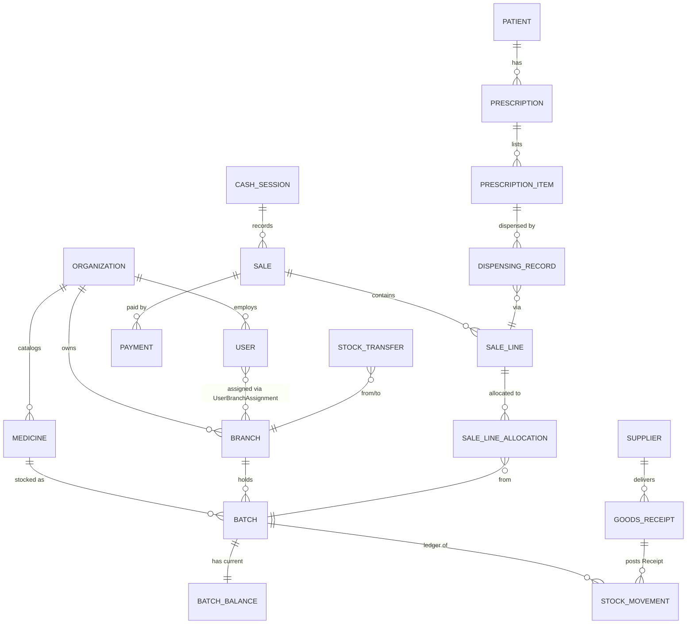

### 2.2 Tenancy columns

- `organization_id` is present and `NOT NULL` on **every** tenant-owned table, including child/line tables (enables RLS without joins and tenant-safe FKs).
- `branch_id` is present on every branch-scoped table, including line tables of branch documents (enables branch-level filters and reporting without joins).
- Tables **without** a mandatory `organization_id` (allowlist, verified by architecture test): `org.organizations` (its `id` is the tenant key), `identity.permissions`, `identity.platform_users`, `identity.platform_sessions`, `identity.platform_refresh_tokens` (SPEC-01 FR-01-045), `identity.login_attempts` (organization unknown for unknown e-mails), `platform.outbox_messages`, `platform.inbox_messages`, `platform.background_job_runs`, `platform.audit_chain_heads`, `platform.audit_logs` (rows of the `platform` chain only), `hangfire.*`. Every other table carries `organization_id NOT NULL` and the uniform RLS policy (§12).

### 2.3 Organization and the platform

`org.organizations` is the tenant root (its `id` is the tenant key). Users log in with their **e-mail**, which is unique across the whole platform (SPEC-01 BR-01-001); the organization is resolved from the user record, so no organization code is needed at login. Platform administrators are separate principals stored in `identity.platform_users` with their own sessions and refresh tokens (SPEC-01 FR-01-045); they have no organization membership and reach organization data only through a `SupportAccessGrant` (SPEC-02 BR-02-017).

### 2.4 Foreign key policy

1. **Tenant-safe FKs:** every FK to a tenant-owned table includes the organization: `FOREIGN KEY (organization_id, medicine_id) REFERENCES catalog.medicines (organization_id, id)`. A row can therefore never reference another organization's row, even through an application bug. Branch references use the composite key `(organization_id, branch_id) → org.branches (organization_id, id)` (SPEC-02 FR-02-030).
2. **Cross-schema FKs** are allowed only from consumer to provider in the dependency direction of SYSTEM-ARCHITECTURE §4.2, plus to `org.organizations`, `org.branches` and `identity.users` (actor columns), and only to rows that are never hard-deleted. All FKs use `ON DELETE RESTRICT` (default `NO ACTION`); no cascades across modules. Intra-aggregate child rows use `ON DELETE CASCADE` only for `Draft` documents' lines.
3. Every FK column has a supporting index (B-tree, usually leading with `organization_id` or the parent id).
4. Migrations are applied in the topological module order (§13) so cross-schema FK targets exist.

---

## 3. Logical Model per Module

Notation: `NN` = NOT NULL, `N` = nullable. Only columns beyond the standard sets are listed per table. "Ux" lists unique constraints, "Ck" check constraints. Column names are the snake_case forms of the entity attributes defined in the owning specification; where a specification and this document differ, the specification wins and this document is a defect.

### 3.1 Identity (`identity`) — SPEC-01

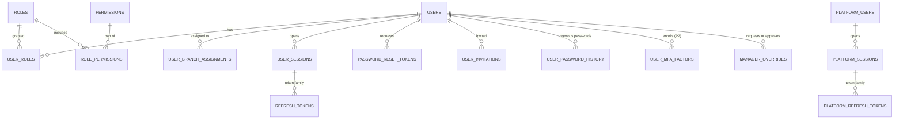

**users** — ⟨T⟩ ⟨A⟩ ⟨V⟩

| Column | Type | Null | Notes |
|---|---|---|---|
| email / normalized_email | text(254) | NN | Login identifier; `normalized_email` unique platform-wide (BR-01-001) |
| full_name | text(150) | NN | |
| phone_number | text(20) | N | E.164 |
| password_hash | text | N | ASP.NET Core Identity v3 (PBKDF2-HMAC-SHA512, ≥ 100,000 iterations); NULL while `Invited` |
| security_stamp | text | NN | Rotated on password change/reset, role/branch/scope change, deactivation, MFA reset |
| status | text | NN | `Invited`, `Active`, `Locked`, `Deactivated` |
| has_organization_wide_scope | boolean | NN | `User.BranchScope` = `AllBranches` (SPEC-02); always true for `OWNER` holders |
| must_change_password | boolean | NN | |
| email_verified_at | timestamptz | N | |
| access_failed_count | smallint | NN | Lockout counter (5 failures → `Locked` for 15 min) |
| locked_until | timestamptz | N | |
| last_login_at | timestamptz | N | |
| mfa_enabled | boolean | NN | MFA is P2, scheduled for V1 (SPEC-01 note) |
| deactivated_at, deactivated_by, deactivation_reason | various | N | |
| authz_version | integer | NN | Incremented on any role/assignment/scope/status change (authorization cache key) |

Ux: `(normalized_email)` global. Ck: `status IN (...)`.

**roles** — ⟨T⟩ ⟨A⟩ ⟨V⟩: `system_code text(32) N` (`OWNER`…`ACCOUNTANT`, NULL for custom roles), `name_en text(80) NN`, `name_ar text(80) NN`, `description text(400) N`, `is_system boolean NN`, `cloned_from_role_id uuid N`. Ux `(organization_id, lower(name_en))`, `(organization_id, name_ar)`, partial `(organization_id, system_code) WHERE system_code IS NOT NULL`. System roles are immutable (FR-01-020). Per-role discount limits are the organization setting `RoleDiscountLimits` (SPEC-06 §8.7; OD-01-04), not a role column.

**permissions** (global, not tenant-owned): `code text(100) PK`, `module text(32) NN`, `name_en`, `name_ar`, `description_en`, `description_ar` (all NN), `is_override_eligible boolean NN`. Seeded from module permission catalogs (§14).

**role_permissions**: `organization_id NN`, `role_id NN`, `permission_code NN`, ⟨A⟩ (created only). PK `(role_id, permission_code)`.

**user_roles**: `organization_id NN`, `user_id NN`, `role_id NN`, ⟨A⟩. PK `(user_id, role_id)`.

**user_branch_assignments** — ⟨T⟩ ⟨A⟩: `user_id NN`, `branch_id NN`, `is_default boolean NN`. Ux `(user_id, branch_id)`; partial Ux `(user_id) WHERE is_default` (SPEC-02 §8.1).

**user_sessions** — ⟨T⟩: `id` (= `sid` claim), `user_id NN`, `created_at NN`, `last_activity_at NN`, `ip_address inet N`, `user_agent text(512) N`, `device_label text(100) N`, `auth_methods text[] NN` (`pwd`, `mfa`), `restriction text NN` (`None`, `PasswordChangeRequired`, `MfaEnrollmentRequired`), `revoked_at N`, `revoked_by N`, `revoke_reason text N` (`Logout`, `LogoutAll`, `UserRevoked`, `AdminRevoked`, `Deactivated`, `PasswordChanged`, `PasswordReset`, `TokenReuse`, `SessionLimit`, `MfaReset`, `Expired`). Partial index `(user_id) WHERE revoked_at IS NULL` (max 10 active, FR-01-006).

**refresh_tokens** — ⟨T⟩: `user_id NN`, `session_id NN`, `family_id NN`, `token_hash bytea NN` Ux (SHA-256 of the opaque 256-bit token), `issued_at NN`, `expires_at NN` (sliding, +14 d), `family_expires_at NN` (+30 d from family creation), `rotated_at N`, `replaced_by_token_id N`, `revoked_at N`, `revoke_reason N`. Index `(family_id)`.

**password_reset_tokens** — ⟨T⟩: `user_id NN`, `token_hash bytea NN` Ux, `expires_at NN` (+30 min), `consumed_at N`, `invalidated_at N`, `requested_from_ip inet N`, `issued_by_user_id N`, `created_at NN`.

**user_invitations** — ⟨T⟩: `user_id NN`, `kind text NN` (`Invitation`, `SignupVerification`), `token_hash bytea NN` Ux, `expires_at NN` (+72 h), `invited_by N`, `sent_at NN`, `accepted_at N`, `revoked_at N`. Partial Ux `(user_id) WHERE accepted_at IS NULL AND revoked_at IS NULL`.

**user_password_history** — ⟨T⟩: `user_id NN`, `password_hash NN`, `created_at NN` (last 5 retained).

**user_mfa_factors** (P2) — ⟨T⟩: `user_id NN`, `type text NN` (`Totp`), `encrypted_secret bytea NN` (data-protection keys stored outside the database), `confirmed_at N`, `last_used_time_step bigint N`, `disabled_at N`. **mfa_recovery_codes** (P2) — ⟨T⟩: `user_id NN`, `code_hash bytea NN`, `used_at N`.

**manager_overrides** (`ManagerOverride`, owned by Identity, consumed by Sales — SPEC-01 FR-01-037..039, SPEC-06 §8.5) — ⟨T⟩ ⟨B⟩: `scope text NN` (`Discount`, `ReturnApproval`, `RefundMethod`, `SaleVoid`), `permission_code NN`, `context_type text NN`, `context_hash bytea NN`, `requested_by_user_id NN`, `approved_by_user_id NN`, `approved_max_discount_percent numeric(7,4) N`, `reason text(250) N`, `issued_at NN`, `expires_at NN` (issued + `ManagerOverrideTtlSeconds`, default 120 s), `consumed_at N`, `consumed_by_document_type N`, `consumed_by_document_id N`. Ck `approved_by_user_id <> requested_by_user_id`, `expires_at > issued_at`. Consumption is a conditional update (`consumed_at IS NULL AND expires_at > now()`) inside the business transaction, so a grant is used at most once.

**login_attempts** (append-only): `id`, `organization_id N`, `user_id N`, `email_hash bytea NN` (SHA-256 of normalized e-mail), `occurred_at NN`, `ip_address inet NN`, `user_agent text(512) N`, `outcome text NN` (`Succeeded`, `Failed`, `Locked`, `NotVerified`, `MfaRequired`, `MfaFailed`, `RateLimited`), `failure_code N`. Index `(email_hash, occurred_at DESC)`, `(ip_address, occurred_at DESC)`. Retention 180 days by default (NFR-01-013, pending REG-05).

**platform_users** (not tenant-owned): `id`, `email`, `normalized_email` Ux, `full_name`, `password_hash` (≥ 14-character policy), `security_stamp`, `status` (`Active`, `Locked`, `Deactivated`), `access_failed_count`, `locked_until N`, `mfa_enabled`, ⟨A⟩ ⟨V⟩. **platform_sessions** and **platform_refresh_tokens**: same shape as `user_sessions` / `refresh_tokens` without `organization_id`. Readable only by the `pms_platform` role (§12.1).

### 3.2 Organization (`org`) — SPEC-02

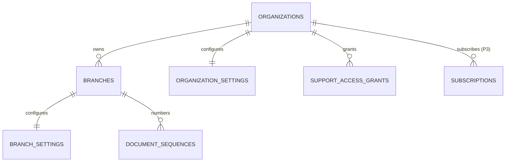

**organizations**: `id uuid PK` (= tenant id), `name_ar text(150) NN`, `name_en text(150) NN`, `legal_name text(250) NN`, `tax_registration_number text(20) N`, `commercial_registration_number text(30) N`, `governorate NN`, `city NN`, `address_line text(250) NN`, `phone NN`, `email NN`, `status text NN` (`Active`, `Suspended`), `suspended_at N`, `suspended_by N`, `suspension_reason text(500) N`, ⟨A⟩ ⟨V⟩.

**branches** — ⟨T⟩ ⟨A⟩ ⟨V⟩: `code text(8) NN` (used in document numbers, immutable after the first numbered document), `name_ar NN`, `name_en NN`, `governorate NN`, `city NN`, `address_line NN`, `phone NN`, `email N`, `time_zone text NN DEFAULT 'Africa/Cairo'` (IANA, validated), `license_number N`, `license_issuer N`, `license_expiry_date date N`, `status text NN` (`Active`, `Inactive`), `deactivated_at N`, `deactivated_by N`, `deactivation_reason N`. Ux `(organization_id, upper(code))`; Ux `(organization_id, id)` (target of composite branch FKs). BR-G-01: `organization_id` is immutable (trigger rejects update).

**branch_settings** (key/value, SPEC-10 §8 registry — decision 2026-11-10): `id uuid PK`, `organization_id NN`, `branch_id uuid NN FK`, `key text NN` (must exist in the settings registry with scope `Branch` or `OrgWithBranchOverride`), `value jsonb NN` (validated against the registry type and constraints before write), ⟨A⟩ ⟨V⟩. Ux `(organization_id, branch_id, key)`. One row per explicitly set key; absence means the organization value or registry default applies. Semantics of each key are owned by the spec listed in the SPEC-10 settings catalog (e.g., `NearExpiryThresholdDays` and `DoNotSellWindowDays` and `AdjustmentApprovalThresholdAmount` default **1,000.00** by SPEC-04; `ReceiptFooterAr/En`, `DefaultTaxCategoryId`, `TransfersOutEnabled/InEnabled`, `TimeZone` by SPEC-02; `OpeningBalanceLocked` by SPEC-04; `ReturnApprovalThresholdAmount`, `CashVarianceTolerance`, receipt settings by SPEC-06). Every change writes an audit entry with before/after values (SPEC-10).

**organization_settings** (key/value, SPEC-10 §8 registry): `id uuid PK`, `organization_id NN`, `key text NN` (registry scope `Organization` or `OrgWithBranchOverride`), `value jsonb NN`, ⟨A⟩ ⟨V⟩. Ux `(organization_id, key)`. Examples: `DefaultLanguage`, `Currency` (= `EGP`, locked after the first posted financial document), `TransferApproverScope`, `EnforcePrescriptionForRxOnly` (default true), `AllowDirectRestockOnReturn` (default false), `PricesIncludeTax` (organization-level only), `RoleDiscountLimits`, `ManagerOverrideTtlSeconds`, `ReturnWindowDays` (SPEC-06), `RequireConsentForMedicalData`, `AllergyAlertMode`, `CollectNationalId` (SPEC-07), prescription settings (SPEC-08), `RequireMfaForOwnerAndManager` (SPEC-01). Effective value resolution: branch row → organization row → registry default. Typed read access goes through `ISettingsReader` (Platform module contract) so callers never parse JSON directly.

**document_sequences** — ⟨T⟩ ⟨B⟩: `document_type text(8) NN` (`INV` sale invoice, `SRN` sales return, `GRN` goods receipt, `SRT` supplier return, `SPY` supplier payment, `PO` purchase order, `TRF` transfer, `ADJ` adjustment, `OPB` opening balance, `WOF` write-off, `STK` stocktake, `CTL` controlled register), `year integer NN`, `current_value bigint NN DEFAULT 0 CHECK (current_value >= 0)`, `updated_at NN`. Ux `(organization_id, branch_id, document_type, year)`. Rows are created on first use in a year (§9).

**support_access_grants** — ⟨T⟩: `platform_admin_user_id uuid NN` (FK → `identity.platform_users`; exactly one named administrator), `reason text NN` (10–500 characters), `granted_by NN` (Owner), `granted_at NN`, `expires_at NN`, `revoked_at N`, `revoked_by N`, `first_used_at N`. Ck `expires_at >= granted_at + interval '1 hour' AND expires_at <= granted_at + interval '72 hours'`. At most one active grant per (organization, administrator), enforced in the application because status is time-derived (`Active`, `Expired`, `Revoked`). Grants are always read-only, cover all branches and always exclude patient, prescription and export permissions (BR-02-017, OD-02-04); there are no columns to widen them. Never deleted.

**subscriptions** (P3) — ⟨T⟩ ⟨A⟩ ⟨V⟩: `plan_code text NN`, `status text NN` (`Trial`, `Active`, `PastDue`, `Cancelled`), `starts_at NN`, `ends_at N`, `max_branches int N`, `max_users int N`.

### 3.3 Catalog (`catalog`) — SPEC-03

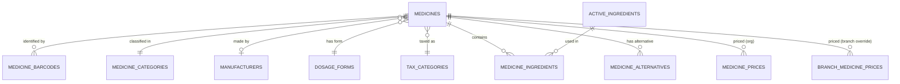

**medicines** — ⟨T⟩ ⟨A⟩ ⟨V⟩ ⟨S⟩

| Column | Type | Null | Notes |
|---|---|---|---|
| code | text(32) | NN | Internal code; Ux `(organization_id, code)` |
| name_en / name_ar | text(200) | NN / N | At least one required: Ck `name_en IS NOT NULL OR name_ar IS NOT NULL` |
| generic_name | text(200) | N | |
| search_text | text | NN | Generated by application: normalized concatenation of names, generic name, ingredient names (Arabic normalization: strip tashkeel, unify أ/إ/آ→ا, ى→ي, ة→ه; lower-case Latin) |
| category_id, manufacturer_id, dosage_form_id, tax_category_id | uuid | NN, N, NN, NN | Tenant-safe FKs |
| strength_text | text(100) | N | Display, e.g., "500 mg" |
| base_unit_code | text(16) | NN | `TABLET`, `CAPSULE`, `AMPOULE`, `BOTTLE`, `SACHET`, `TUBE`, `VIAL`, `PIECE`, … |
| pack_size | integer | NN | Ck `pack_size >= 1` |
| allow_split_pack | boolean | NN | Ck `NOT allow_split_pack OR pack_size > 1` |
| is_prescription_only | boolean | NN | BR-G-21 |
| is_controlled | boolean | NN | BR-G-22; Ck `NOT is_controlled OR is_prescription_only` |
| controlled_schedule | text(16) | N | Pending REG-02 |
| last_purchase_cost | numeric(19,4) | N | Per base unit; reference only |
| status | text | NN | `Active`, `Inactive` (mirrors ⟨S⟩) |

**medicine_barcodes** — ⟨T⟩ ⟨A⟩ ⟨S⟩: `medicine_id NN`, `barcode text(64) NN` (digits/`[A-Za-z0-9-]`), `symbology text NN` (`EAN13`, `EAN8`, `UPCA`, `GTIN14`, `CODE128`, `INTERNAL`), `applies_to text NN` (`Pack`, `BaseUnit`), `is_primary boolean NN`. **Ux `(organization_id, barcode)`** — unique per organization including inactive rows (a deactivated barcode cannot be silently reused for another medicine; reactivation or explicit reassignment is an audited operation). Partial Ux `(medicine_id) WHERE is_primary AND is_active`.

**medicine_categories** — ⟨T⟩ ⟨A⟩ ⟨S⟩: `parent_id N` (self FK, max depth 3 enforced in app), `name_en NN`, `name_ar NN`, `sort_order int NN`. Ux `(organization_id, parent_id, name_en) NULLS NOT DISTINCT`.

**manufacturers** — ⟨T⟩ ⟨A⟩ ⟨S⟩: `name_en NN`, `name_ar N`, `country_code char(2) N`. Ux `(organization_id, lower(name_en))`.

**active_ingredients** — ⟨T⟩ ⟨A⟩ ⟨S⟩: `name_en NN` (INN), `name_ar N`. Ux `(organization_id, lower(name_en))`.

**medicine_ingredients** — ⟨T⟩ ⟨A⟩: `medicine_id NN`, `active_ingredient_id NN`, `strength_value numeric(18,6) N`, `strength_unit text(16) N` (`mg`, `mcg`, `g`, `ml`, `IU`, `%`, `mg/ml`, …), `per_quantity numeric(18,6) N`, `per_unit text(16) N`. Ux `(medicine_id, active_ingredient_id)`. Ck `strength_value > 0`.

**dosage_forms** — ⟨T⟩ ⟨A⟩ ⟨S⟩: `code text(32) NN`, `name_en NN`, `name_ar NN`. Ux `(organization_id, code)`. Seeded per organization at provisioning.

**medicine_alternatives** — ⟨T⟩ ⟨A⟩: `medicine_id NN`, `alternative_medicine_id NN`, `kind text NN` (`SameComposition`, `Therapeutic`), `note text(400) N`. Ux `(medicine_id, alternative_medicine_id)`. Ck `medicine_id <> alternative_medicine_id`. Reference only (decision support).

**medicine_prices** (organization default; effective-dated history) — ⟨T⟩ ⟨A⟩: `medicine_id NN`, `price_per_pack numeric(19,4) NN`, `price_per_base_unit numeric(19,4) N` (required when `allow_split_pack`; explicit, not derived, to avoid rounding drift), `effective_from timestamptz NN`, `effective_to timestamptz N`, `change_reason text(200) N`. Ck `price_per_pack >= 0`, `effective_to IS NULL OR effective_to > effective_from`. Partial Ux `(medicine_id) WHERE effective_to IS NULL` (one current price). Exclusion constraint `EXCLUDE USING gist (medicine_id WITH =, tstzrange(effective_from, effective_to) WITH &&)` (requires `btree_gist`).

**branch_medicine_prices** — same columns as `medicine_prices` + ⟨B⟩. Partial Ux `(branch_id, medicine_id) WHERE effective_to IS NULL`; same exclusion per `(branch_id, medicine_id)`.

**tax_categories** — ⟨T⟩ ⟨A⟩ ⟨S⟩: `code text(16) NN`, `name_en NN`, `name_ar NN`, `rate_percent numeric(7,4) NN CHECK (rate_percent BETWEEN 0 AND 100)`. Ux `(organization_id, code)`. Seed: `EXEMPT` 0% only; real rates pending REG-06.

**SPEC-03 alignment (normative corrections and additional catalog entities):** All catalog tables below are tenant tables with `organization_id uuid NOT NULL`, RLS enabled and forced. Mutable master rows carry `id uuid PK`, `created_at/by`, `updated_at/by`, and `xmin` concurrency; only master data may be soft-deleted (`is_active`/`deactivated_at/by/reason`). Prices/history/import jobs are not soft-deleted. Replace the abbreviated definitions above where they conflict with these SPEC-03 definitions:

- `medicines`: `code varchar(20)`, unique `(organization_id, code)`; `trade_name_en varchar(200) NOT NULL`, `trade_name_ar varchar(200) NULL` (at least one name required), `generic_name varchar(300) NULL`; required `category_id`, `dosage_form_id`, `tax_category_id`, optional `manufacturer_id`; `strength_text varchar(100)`, `pack_size integer CHECK (1..10000)`, `base_unit_name_en varchar(30) NOT NULL`, `base_unit_name_ar varchar(30) NULL`, `allow_split_pack boolean NOT NULL DEFAULT false`, `pack_description varchar(100)`, `description_en/ar varchar(2000)`, `prescription_class varchar(24) NOT NULL DEFAULT 'PrescriptionOnly' CHECK IN ('OTC','PrescriptionOnly','Controlled')`, `default_min_stock integer NOT NULL DEFAULT 0 CHECK (0..1000000)`, `storage_condition varchar(32)` (`RoomTemperature`, `Refrigerated2To8C`, `Frozen`), `protect_from_light boolean NOT NULL DEFAULT false`, `storage_instructions_en/ar varchar(500)`, `last_purchase_cost numeric(19,4)`, `last_purchase_cost_at timestamptz`, `status varchar(8) CHECK IN ('Active','Inactive')`, deactivation audit fields and normalized `search_text text NOT NULL`.
- `medicine_barcodes`: `medicine_id`, `code varchar(32)`, `normalized_code varchar(32)`, `format varchar(8) CHECK IN ('Gtin','Internal')`, `source varchar(9) CHECK IN ('Manual','Import','Generated')`, `is_primary boolean`; unique `(organization_id, normalized_code)` and partial unique `(medicine_id) WHERE is_primary`. Do not use the former `barcode/symbology/applies_to` columns.
- `medicine_categories`: bilingual names `varchar(100)`, nullable `parent_id`, `level smallint CHECK (level BETWEEN 1 AND 3)`, `sort_order integer`; normalized sibling-name uniqueness with NULL parent treated as one value. `manufacturers`: bilingual names `varchar(150)`, optional `country_code char(2)`. `active_ingredients`: bilingual names `varchar(200)`. `dosage_forms`: `code varchar(30)`, bilingual names `varchar(100)`, `is_active`, `is_seeded`. Each reference table has organization-scoped normalized/code uniqueness and master audit/soft-delete fields.
- `medicine_ingredients`: `medicine_id`, `active_ingredient_id`, `strength numeric(12,4) NOT NULL CHECK (>0)`, `strength_unit varchar(16) NOT NULL`, `sort_order integer NOT NULL`; unique `(medicine_id, active_ingredient_id)`, at most 10 rows per medicine.
- `tax_categories`: `code varchar(20)`, bilingual names `varchar(100)`, `rate_percent numeric(5,2) CHECK (0..100)`, `requires_review boolean`, `is_active`; seed `DEFAULT` at 0.00 pending REG-06 (not `EXEMPT`).
- `medicine_prices`: current organization default, unique `medicine_id`, `pack_price numeric(19,4) NOT NULL`, nullable `base_unit_price numeric(19,4)`, updated audit fields and `xmin`. `branch_medicine_prices` has the same price columns plus required `branch_id`, unique `(branch_id, medicine_id)`. Both prices are mutable current values; there are no effective date intervals or exclusion constraints.
- `medicine_price_history`: append-only `medicine_id`, nullable `branch_id` (NULL means organization default), `change_type` (`Initial`,`Change`,`OverrideSet`,`OverrideRemoved`,`Import`), nullable old and required new pack/base-unit prices `numeric(19,4)`, `reason varchar(200)`, nullable `import_job_id`, `changed_at/by`; no update/delete.
- `medicine_alternatives`: `medicine_id`, `alternative_medicine_id`, `note varchar(200)`, unique pair and check ids differ.
- `catalog_import_jobs`: tenant-owned job with source/report `file_object_id` references, format, mode, match key, status, import flags, row counters, file hash, idempotency key, lifecycle timestamps and report expiry; no soft delete.

The earlier catalog shorthand is superseded only for Catalog by this subsection; all money follows BR-G-18 and all quantities are integer base units.

### 3.4 Inventory (`inventory`) — SPEC-04 (deep dive: [INVENTORY-ARCHITECTURE.md](INVENTORY-ARCHITECTURE.md))

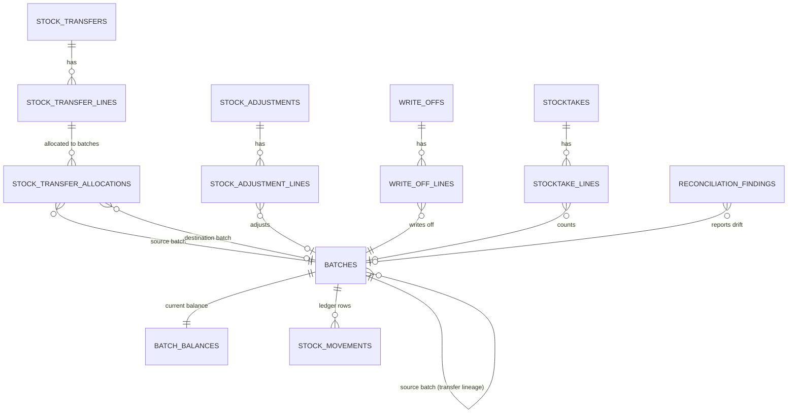

`reorder_settings`, `inventory_valuation_snapshots` and `rebalancing_suggestions` are keyed by branch + medicine and have no relationship to the document aggregates above.

**batches** — ⟨T⟩ ⟨B⟩ ⟨A⟩ ⟨V⟩ (SPEC-04 FR-04-001, §8.1)

| Column | Type | Null | Notes |
|---|---|---|---|
| medicine_id | uuid | NN | Tenant-safe FK → catalog.medicines |
| batch_number | text(40) | NN | Normalized: trimmed, Latin letters upper-cased, 1–40 characters (BR-04-004) |
| expiry_date | date | NN | Month/year input stored as the last calendar day of that month (BR-04-003, OD-04-09) |
| unit_cost | numeric(19,4) | NN | Cost per base unit, Ck `>= 0`; immutable after creation (BR-04-031) |
| supplier_id | uuid | N | FK → procurement.suppliers; NULL for opening balance or found stock without supplier |
| source_batch_id | uuid | N | Set for transfer-created destination batches (BR-04-005) |
| selling_price_override | numeric(19,4) | N | Per-pack price override, Ck `> 0` (BR-04-012) |
| quarantined_at, quarantined_by | timestamptz, uuid | N | Quarantine marker; eligibility uses `quarantined_at IS NULL` |
| quarantine_reason | text(500) | N | Ck `quarantined_at IS NULL OR quarantine_reason IS NOT NULL` |
| recall_reference | text(100) | N | |
| status | text | NN | Derived and stored: `Quarantined` > `Expired` > `Depleted` > `Active` (BR-04-002) |

**Batch identity (SPEC-04 BR-04-004, BR-04-005):**

```sql
-- inbound receipt key: directly received / opening balance / found stock
CREATE UNIQUE INDEX ux_batches_receipt_key ON inventory.batches
  (organization_id, branch_id, medicine_id, batch_number, expiry_date, unit_cost, supplier_id)
  NULLS NOT DISTINCT WHERE source_batch_id IS NULL;
-- transfer lineage key: one destination batch per source batch and branch
CREATE UNIQUE INDEX ux_batches_lineage ON inventory.batches (branch_id, source_batch_id)
  WHERE source_batch_id IS NOT NULL;
```

Including `supplier_id` keeps BR-G-31 enforceable (supplier returns only from that supplier's batches); a receipt of the same physical batch at a different cost creates a separate batch so specific-cost valuation stays exact. A transfer-created batch never merges with directly received stock, even with identical number/expiry/cost (separate lineage, SPEC-04 E-10). A batch number that already exists in the branch for the same medicine with a different expiry is rejected (`INVENTORY.BATCH_EXPIRY_MISMATCH`, FR-04-013).

**batch_balances** (1:1 with batches; the only mutable stock row)

| Column | Type | Null | Notes |
|---|---|---|---|
| batch_id | uuid | NN | PK, FK → batches(id) |
| organization_id, branch_id, medicine_id | uuid | NN | Denormalized for RLS and indexes; immutable |
| on_hand | integer | NN | |
| reserved | integer | NN | Approved-not-dispatched transfers + draft supplier returns (conventions §10 note) |
| last_movement_sequence | bigint | NN | `BatchSequence` of the last movement applied (FR-04-002), 0 before the first movement |
| updated_at | timestamptz | NN | |

Ck: `ck_batch_balances_on_hand_nonneg CHECK (on_hand >= 0)` (BR-G-08/10 final guard), `ck_batch_balances_reserved_nonneg CHECK (reserved >= 0)`, `ck_batch_balances_reserved_le_on_hand CHECK (reserved <= on_hand)`. No ⟨V⟩ (pessimistic locking only, §8).

**stock_movements** (append-only; range-partitioned monthly by `business_date`, §11)

| Column | Type | Null | Notes |
|---|---|---|---|
| id | uuid | NN | UUIDv7; PK `(id, business_date)` |
| organization_id, branch_id, batch_id, medicine_id | uuid | NN | |
| batch_sequence | bigint | NN | Per-batch gap-free sequence = previous `last_movement_sequence` + 1 (FR-04-006); unique `(batch_id, batch_sequence, business_date)` per the partitioning rule, with global uniqueness of `(batch_id, batch_sequence)` guaranteed by the balance row lock and verified by reconciliation (`SEQUENCE_GAP`) |
| type | text | NN | Conventions §6.2 list; sign per SPEC-04 §6.3 (Ck `quantity_delta <> 0`) |
| quantity_delta | integer | NN | Signed base units |
| unit_cost | numeric(19,4) | NN | = batch unit cost (BR-04-031) |
| balance_after | integer | NN | Ck `balance_after >= 0` |
| source_document_type | text(32) | NN | `Sale`, `SalesReturn`, `GoodsReceipt`, `StockTransfer`, `StockAdjustment`, `WriteOff`, `Stocktake`, `SupplierReturn`, `OpeningBalance` |
| source_document_id | uuid | NN | |
| source_line_id | uuid | N | |
| occurred_at | timestamptz | NN | |
| business_date | date | NN | Branch-local business date at posting (BR-04-029); partition key |
| user_id | uuid | NN | |
| correlation_id | uuid | NN | |
| created_at | timestamptz | NN | |

**stock_adjustments** — ⟨T⟩ ⟨B⟩ ⟨A⟩ ⟨V⟩ ⟨N⟩: `kind text NN` (`Standard`, `OpeningBalance`), `status NN` (`Draft`, `PendingApproval`, `Posted`, `Rejected`), `note text(1000) N`, `value_amount numeric(19,2) NN DEFAULT 0` (Σ abs(quantity) × unit cost, BR-04-013), `submitted_by/at N`, `approved_by/at N`, `rejected_by/at N`, `rejection_reason N`, `origin_transfer_id N` (TransitLoss follow-up). Ck BR-G-28: `approved_by IS NULL OR approved_by <> submitted_by`.
**stock_adjustment_lines** — ⟨T⟩ ⟨B⟩: `adjustment_id NN`, `batch_id N` (NULL = new batch), new-batch fields `new_batch_number`, `new_expiry_date`, `new_unit_cost`, `new_supplier_id`, `new_selling_price_override` (N; required together when `batch_id IS NULL`), `direction text NN` (`Increase`, `Decrease`), `quantity int NN CHECK (> 0)`, `reason_code text(32) NN` (`CountCorrection`, `DataEntryError`, `FoundStock`, `TheftOrLoss`, `TransitLoss`, `Reclassification`, `Other`), `line_note text(500) N`, `pair_key uuid N` (reclassification pairs, FR-04-038).

**write_offs** — ⟨T⟩ ⟨B⟩ ⟨A⟩ ⟨V⟩ ⟨N⟩: `type text NN` (`Damaged`, `Expired`), statuses and approval fields as adjustments, `evidence_file_id N`, `origin_transfer_id N`. **write_off_lines** — ⟨T⟩ ⟨B⟩: `write_off_id NN`, `batch_id NN`, `quantity int NN CHECK (> 0)`, `note text(500) N`.

**stocktakes** — ⟨T⟩ ⟨B⟩ ⟨A⟩ ⟨V⟩ ⟨N⟩: `type text NN` (`Full`, `Cycle`), `scope_medicine_ids uuid[] N`, `scope_category_ids uuid[] N`, `status NN` (`Draft`, `Counting`, `PendingApproval`, `Posted`, `Cancelled`), `started_at/by N`, `submitted_at/by N`, `approved_at/by N`. Ck `approved_by IS NULL OR approved_by <> submitted_by`.
**stocktake_lines** — ⟨T⟩ ⟨B⟩: `stocktake_id NN`, `medicine_id NN`, `batch_id N` (NULL for a found batch until posting), found-batch fields `found_batch_number`, `found_expiry_date`, `found_unit_cost`, `found_supplier_id` (N), `snapshot_on_hand int N`, `snapshot_sequence bigint N` (= `last_movement_sequence` at start, FR-04-059), `counted_quantity int N CHECK (>= 0)`, `counted_at N`, `counted_by N`, `excluded boolean NN DEFAULT false`, `exclude_reason N` (`NotAccessible`, `CountedInOtherStocktake`, `Other`), `recount_requested boolean NN DEFAULT false`, `expected int N` and `variance int N` (computed at submit and at post per BR-04-023), `variance_value numeric(19,2) N`. Ux `(stocktake_id, batch_id) WHERE batch_id IS NOT NULL`.

**stock_transfers** — ⟨T⟩ ⟨A⟩ ⟨V⟩: `branch_id NN` (= `source_branch_id`, scope column), `destination_branch_id NN`, `number N`, `business_date N`, `status NN` (`Draft`, `Requested`, `Approved`, `Rejected`, `InTransit`, `PartiallyReceived`, `Received`, `Cancelled`), `created_by NN`, `approved_by/at N`, `dispatched_by/at N`, `rejection_reason N`, `cancel_reason N`. Ck `branch_id <> destination_branch_id`; Ck `approved_by IS NULL OR approved_by <> created_by` (BR-04-018). Ux `(branch_id, number) WHERE number IS NOT NULL`. Index `(destination_branch_id, status)` for incoming/in-transit views (readable from the destination branch).
**stock_transfer_lines** — ⟨T⟩: `branch_id NN` (source), `transfer_id NN`, `medicine_id NN`, `requested_qty int NN CHECK (> 0)`.
**stock_transfer_allocations** — ⟨T⟩: `branch_id NN` (source), `transfer_line_id NN`, `source_batch_id NN`, `destination_batch_id N`, `reserved_qty int NN CHECK (> 0)`, `dispatched_qty int NN DEFAULT 0`, `received_qty int NN DEFAULT 0`, `rejected_qty int NN DEFAULT 0`, `reject_reason_code N` (`Damaged`, `WrongItem`, `Other`), `short_qty int NN DEFAULT 0`. Ck `dispatched_qty <= reserved_qty`, `received_qty + rejected_qty + short_qty <= dispatched_qty` (BR-04-020). Outstanding (in transit) = dispatched − received − rejected − short.

**reorder_settings** — ⟨T⟩ ⟨B⟩ ⟨A⟩ ⟨V⟩: `medicine_id NN`, `min_quantity int NN CHECK (>= 0)`, `max_quantity int NN`, `is_active boolean NN`, `low_stock_state text NN` (`Normal`, `Low`), `low_stock_since N`, `last_evaluated_at N`. Ux `(branch_id, medicine_id)`. Ck `max_quantity > min_quantity`.

**reconciliation_findings** (`ReconciliationFinding`, SPEC-04 §8.1) — ⟨T⟩ ⟨B⟩: `run_id NN` (FK → `platform.background_job_runs`), `run_date date NN`, `batch_id N`, `transfer_id N`, `check_code text NN` (`ON_HAND_SUM`, `BALANCE_AFTER`, `SEQUENCE_GAP`, `RESERVED_SUM`, `STATUS_DERIVATION`, `TRANSFER_CONSERVATION`), `expected_value bigint N`, `actual_value bigint N`, `detected_at NN`, `first_detected_run_id NN`, `resolved boolean NN DEFAULT false`. Upsert key `(coalesce(batch_id, transfer_id), check_code, run_date)`; never deleted.

**inventory_valuation_snapshots** (`InventoryValuationSnapshot`, FR-04-062) — ⟨T⟩ ⟨B⟩: `business_date date NN`, `medicine_id NN`, quantity and value pairs per bucket: `sellable_qty`/`sellable_value`, `near_expiry_qty`/`near_expiry_value`, `expired_qty`/`expired_value`, `quarantined_qty`/`quarantined_value`, `in_transit_outbound_qty`/`in_transit_outbound_value` (int / numeric(19,2), NN DEFAULT 0). Ux `(branch_id, business_date, medicine_id)`; only medicines with a non-zero bucket; range-partitioned monthly by `business_date`.

**rebalancing_suggestions** (`RebalancingSuggestion`, P3, FR-04-064) — ⟨T⟩: `source_branch_id NN`, `destination_branch_id NN`, `medicine_id NN`, `suggested_quantity int NN CHECK (> 0)`, `rationale text NN` (`SourceAboveMax`, `NearExpirySurplus`), `status text NN` (`Open`, `Converted`, `Expired`), `generated_run_id NN`, `converted_transfer_id N`.

### 3.5 Procurement (`procurement`) — SPEC-05

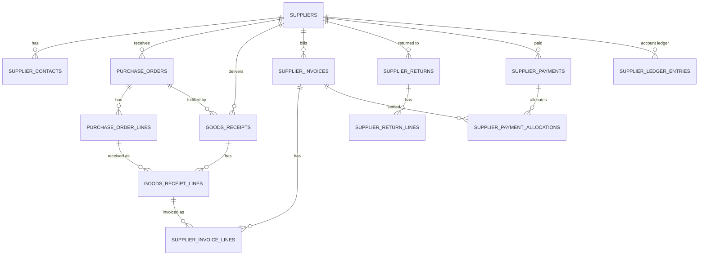

**suppliers** — ⟨T⟩ ⟨A⟩ ⟨V⟩ ⟨S⟩: `code text(32) NN`, `name_ar NN`, `name_en N`, `tax_registration_number N`, `commercial_registration_number N`, `phone N`, `email N`, `address N`, `payment_terms_days smallint NN DEFAULT 0`, `current_balance numeric(19,2) NN DEFAULT 0` (maintained with ledger, locked `FOR NO KEY UPDATE` when appending ledger entries). Ux `(organization_id, code)`.
**supplier_contacts** — ⟨T⟩ ⟨A⟩ ⟨S⟩: `supplier_id NN`, `name NN`, `role N`, `phone N`, `email N`, `is_primary boolean NN`.

**purchase_orders** — ⟨T⟩ ⟨B⟩ ⟨A⟩ ⟨V⟩ ⟨N⟩: `supplier_id NN`, `status NN` (`Draft`, `Submitted`, `Approved`, `PartiallyReceived`, `Received`, `Closed`, `Cancelled`), `expected_date date N`, `notes N`, `subtotal`, `discount_total`, `tax_total`, `total` (numeric(19,2) NN), `approved_by/at N`, `cancelled_by/at/reason N`.
**purchase_order_lines** — ⟨T⟩ ⟨B⟩: `purchase_order_id NN`, `line_no smallint NN`, `medicine_id NN`, `quantity_packs int NN CHECK (> 0)`, `quantity_base_units int NN CHECK (> 0)`, `received_base_units int NN DEFAULT 0`, `unit_cost_per_pack numeric(19,4) NN CHECK (>= 0)`, `discount_percent numeric(7,4) NN DEFAULT 0`, `line_amount numeric(19,2) NN`. Ck `received_base_units >= 0` (over-receipt policy in SPEC-05). Ux `(purchase_order_id, line_no)`.

**goods_receipts** — ⟨T⟩ ⟨B⟩ ⟨A⟩ ⟨V⟩ ⟨N⟩: `supplier_id NN`, `purchase_order_id N`, `status NN` (`Draft`, `Posted`, `Reversed`), `supplier_document_ref text(64) N`, `received_at NN`, `posted_by/at N`, `reversed_by/at/reason N`, totals numeric(19,2).
**goods_receipt_lines** — ⟨T⟩ ⟨B⟩: `goods_receipt_id NN`, `purchase_order_line_id N`, `medicine_id NN`, `batch_number NN`, `expiry_date NN`, `quantity_packs int NN CHECK (> 0)`, `quantity_base_units int NN`, `bonus_base_units int NN DEFAULT 0 CHECK (>= 0)` (supplier free goods), `unit_cost_per_pack numeric(19,4) NN`, `discount_percent numeric(7,4) NN DEFAULT 0`, `line_amount numeric(19,2) NN`, `effective_unit_cost numeric(19,4) NN` (= line_amount ÷ (quantity_base_units + bonus_base_units), rounded half away from zero to 4 dp; becomes `Batch.unit_cost`), `batch_id uuid N` (set on posting), `selling_price_per_pack numeric(19,4) N` (optional price update proposal). Ck on posting enforced by app: `expiry_date > business_date`.

**supplier_invoices** — ⟨T⟩ ⟨A⟩ ⟨V⟩ (`branch_id N` — invoice may cover one branch or be org-level): `supplier_id NN`, `supplier_invoice_number text(64) NN`, `invoice_date NN`, `due_date N`, `status NN` (`Draft`, `Posted`, `PartiallyPaid`, `Paid`, `Cancelled`), `subtotal`, `discount_total`, `tax_total`, `total`, `paid_amount` (numeric(19,2) NN), `attachment_file_id N`. Ux `(organization_id, supplier_id, supplier_invoice_number)`. Ck `paid_amount BETWEEN 0 AND total`.
**supplier_invoice_lines** — ⟨T⟩: `supplier_invoice_id NN`, `goods_receipt_line_id N`, `medicine_id N`, `description text(200) N`, `quantity int NN`, `unit_price numeric(19,4) NN`, `tax_amount numeric(19,2) NN`, `line_amount numeric(19,2) NN`.

**supplier_returns** — ⟨T⟩ ⟨B⟩ ⟨A⟩ ⟨V⟩ ⟨N⟩: `supplier_id NN`, `status NN` (`Draft`, `Posted`), `reason_code NN`, `notes N`, `total numeric(19,2) NN`, `posted_by/at N`.
**supplier_return_lines** — ⟨T⟩ ⟨B⟩: `supplier_return_id NN`, `batch_id NN` (must have `batches.supplier_id = supplier_returns.supplier_id`, BR-G-31, checked in-transaction), `medicine_id NN`, `quantity_base_units int NN CHECK (> 0)`, `unit_cost numeric(19,4) NN`, `line_amount numeric(19,2) NN`. Ux `(supplier_return_id, batch_id)`.

**supplier_payments** — ⟨T⟩ ⟨A⟩ (`branch_id N`) ⟨N⟩ (numbered per paying branch, or per org branch "HQ" when org-level — SPEC-05): `supplier_id NN`, `payment_date date NN`, `method text NN` (`Cash`, `BankTransfer`, `Cheque`, `Wallet`), `amount numeric(19,2) NN CHECK (> 0)`, `reference text(64) N`, `cash_session_id uuid N` (when paid from a till → Sales `CashMovement`), `notes N`. Immutable after creation; corrections by reversal entry.
**supplier_payment_allocations** — ⟨T⟩: `supplier_payment_id NN`, `supplier_invoice_id NN`, `amount numeric(19,2) NN CHECK (> 0)`. Ux `(supplier_payment_id, supplier_invoice_id)`.
**supplier_ledger_entries** (append-only) — ⟨T⟩: `supplier_id NN`, `branch_id N`, `entry_type text NN` (`OpeningBalance`, `Invoice`, `Payment`, `Return`, `Reversal`), `debit numeric(19,2) NN DEFAULT 0`, `credit numeric(19,2) NN DEFAULT 0`, `balance_after numeric(19,2) NN`, `source_document_type NN`, `source_document_id NN`, `occurred_at NN`, `business_date NN`, `created_by NN`. Ck `(debit = 0) <> (credit = 0)`, both ≥ 0. Index `(supplier_id, occurred_at, id)`.

**SPEC-05 alignment (normative corrections and additional procurement attributes):** Every procurement table has `organization_id uuid NOT NULL`, RLS enabled and forced. Branch documents have `branch_id uuid NOT NULL` and same-organization branch FKs; this includes invoices, payments, and ledger rows. All documents have UUID PK, created audit, mutable headers have updated audit and `xmin`; posted lines, allocations and ledger entries are immutable. Only supplier/contact master records are soft-deleted. Below replaces contradictory shorthand above:

- `suppliers`: `code varchar(32)`, `name_en/name_ar varchar(200)` (at least one), normalized `tax_registration_number` and `commercial_registration_number`, contact/address/notes, `payment_terms_days smallint`, `credit_limit numeric(19,2)`, `is_active` and deactivation fields. Unique `(organization_id, upper(code))`; partial unique `(organization_id, normalized_tax_registration_number) WHERE ... IS NOT NULL`. No stored balance; ledger is the balance source.
- `supplier_contacts`: `supplier_id`, name, `job_title`, phone/email/notes, `is_primary`; partial unique primary contact per supplier.
- `purchase_orders`: required supplier and branch; `number` assigned at submit, unique `(organization_id, branch_id, document_type, document_year, number)`; canonical PO status enum from conventions §6.1; expected delivery date, notes, `total_amount numeric(19,2)`, creator/submission/approval actors and timestamps, approval mode (`Manual`,`BelowThreshold`), rejection/cancellation/close metadata, credit-limit acknowledgement actor.
- `purchase_order_lines`: PO, medicine, `pack_size_snapshot integer`, ordered and expected bonus packs as integers, `expected_unit_cost_per_pack numeric(19,4)`, `line_amount numeric(19,2)`, received paid/bonus packs integer defaults 0; unique PO+medicine; checks positive ordered packs, nonnegative bonus/received and received not above configured tolerance.
- `goods_receipts`: required branch/supplier, nullable PO, number null until posting and then unique per branch/type/year, canonical `Draft/Posted/Reversed`; delivery note/reference, supplier delivery date, posting business date, `total_net_amount numeric(19,2)`, posted/reversed actors/times and invoicing state.
- `goods_receipt_lines`: receipt, optional PO line, medicine, pack-size snapshot, batch number and normalized batch number, expiry/manufacture dates, paid and bonus packs integers, `unit_cost_per_pack numeric(19,4)`, discount percent, gross/discount/net amounts `numeric(19,2)`, received base units integer, effective unit cost `numeric(19,4)`, optional inventory batch id, shelf-life override fields and invoiced paid packs integer.
- `supplier_invoices`: required branch/supplier, internal branch/type/year number, external supplier invoice number, invoice/due dates, canonical invoice status, subtotal/header discount/tax/total/stated total/paid/outstanding and variance amounts all `numeric(19,2)`, variance flags and cancellation fields. Unique `(organization_id,supplier_id,supplier_invoice_number)` for non-cancelled invoices.
- `supplier_invoice_lines`: invoice, required receipt line and medicine, invoiced packs integer, unit cost `numeric(19,4)`, discount, net amount `numeric(19,2)`, tax category and tax-rate snapshot, tax amount `numeric(19,2)`, receipt/PO cost snapshots `numeric(19,4)`, price variance `numeric(19,2)` and flag. Unique invoice+receipt-line; this is the receipt matching record.
- `supplier_returns`: required branch/supplier, number null until posted and unique per branch/type/year, Draft/Posted status, reason code, notes, total `numeric(19,2)`, posting actor/time. Return lines include batch and medicine, integer base-unit quantity, unit-cost snapshot `numeric(19,4)`, line value `numeric(19,2)`, selection mode (`Fefo`,`Manual`); unique return+batch. Enforce supplier ownership of batch per BR-G-31.
- `supplier_payments`: required branch/supplier, number unique per branch/type/year, payment date, `method` CHECK IN (`Cash`,`BankTransfer`,`Cheque`), amount and allocated amount `numeric(19,2)`, bank reference, cheque number/due date, notes and reversal metadata. `Wallet` is not a valid method; no cash-session FK.
- `supplier_payment_allocations`: payment and invoice FKs, signed `amount numeric(19,2)` (negative rows are compensating reversals), created audit; no uniqueness that prevents compensating allocations; invoice and payment must share supplier and branch.
- `supplier_ledger_entries`: append-only, required branch, entry type CHECK IN (`OpeningBalance`,`Invoice`,`InvoiceCancellation`,`Payment`,`PaymentReversal`,`DebitNote`), debit/credit/balance_after `numeric(19,2)`, source document type/id, occurred_at, business_date and created_by. Exactly one of debit/credit is positive. No mutable `suppliers.current_balance`.

Index every FK (including organization and branch composite FKs); do not add `|` inside Markdown table cells.

### 3.6 Sales (`sales`) — SPEC-06

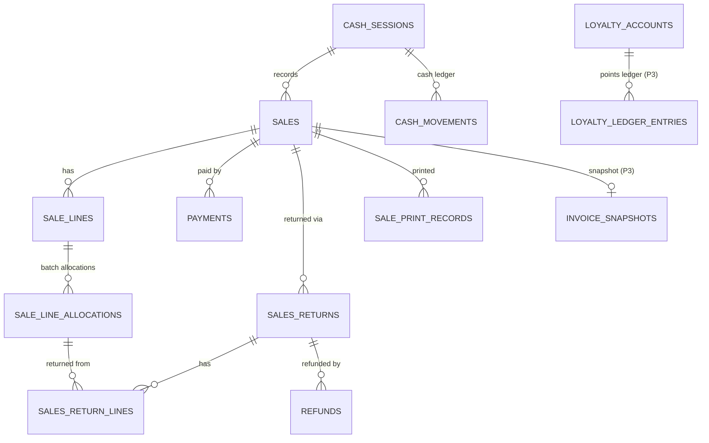

All sales tables carry `organization_id` and `branch_id` and are protected by RLS. Entity attributes follow SPEC-06 §8.1–§8.5; the columns below are their snake_case forms.

**sales** — ⟨T⟩ ⟨B⟩ ⟨A⟩ ⟨V⟩: `invoice_number text NN` (Ux `(organization_id, branch_id, invoice_number)`), `status NN` (`Completed`, `PartiallyReturned`, `Returned`, `Voided`), `business_date NN`, `completed_at NN`, `cashier_user_id NN`, `cash_session_id NN`, `patient_id N`, `prescription_id N`, `prices_include_tax boolean NN`, `gross_amount`, `line_discount_total`, `invoice_discount_amount`, `net_amount`, `tax_amount`, `total_amount`, `paid_amount`, `change_amount` (numeric(19,2) NN, ≥ 0), `invoice_discount_type NN` (`None`, `Percent`, `Amount`), `invoice_discount_value numeric(19,4) N`, `discount_override_id N` (FK → `identity.manager_overrides`), `voided_at`, `voided_by_user_id`, `void_reason`, `void_cash_session_id` (N), `e_invoice_status NN DEFAULT 'NotApplicable'` (P3), `idempotency_key uuid NN`, `correlation_id uuid NN`. Ck `total_amount = net_amount + tax_amount`. Amount columns are immutable after insert (trigger, BR-G-11, BR-06-016).

**sale_lines** — ⟨T⟩ ⟨B⟩: `sale_id NN`, `line_number smallint NN`, `medicine_id NN`, `medicine_name_ar`, `medicine_name_en` (snapshots), `unit NN` (`Pack`, `BaseUnit`), `pack_size int NN`, `quantity int NN CHECK (> 0)`, `quantity_base_units int NN CHECK (> 0)`, `unit_price numeric(19,4) NN`, `gross_amount`, `line_discount_type`, `line_discount_value`, `line_discount_amount`, `invoice_discount_share`, `discount_amount_ex_tax`, `net_amount`, `tax_category_code`, `tax_rate numeric(7,4)`, `tax_amount`, `total_amount`, `is_rx_only`, `is_controlled`, `prescription_item_id N`, `explicit_batch_id N`, `fefo_override_reason N`, `allergy_warning_acknowledged_by N`, `returned_quantity_base_units int NN DEFAULT 0`. Ck `returned_quantity_base_units BETWEEN 0 AND quantity_base_units` (BR-G-12). Ux `(sale_id, line_number)`. A cart line whose allocations resolve to different unit prices is stored as several sale lines (BR-06-033).

**sale_line_allocations** — ⟨T⟩ ⟨B⟩: `sale_line_id NN`, `batch_id NN`, `batch_number`, `expiry_date` (snapshots), `quantity_base_units int NN CHECK (> 0)`, `unit_cost numeric(19,4) NN`, `cost_amount numeric(19,2) NN`, `stock_movement_id uuid NN`, `returned_quantity_base_units int NN DEFAULT 0`, `restocked_quantity_base_units int NN DEFAULT 0`. Ck `restocked_quantity_base_units <= returned_quantity_base_units <= quantity_base_units`.

**payments** (append-only) — ⟨T⟩ ⟨B⟩: `sale_id NN`, `sequence smallint NN`, `method NN` (`Cash`, `Card`; `LoyaltyPoints` P3), `amount numeric(19,2) NN` (negative only for void reversals), `tendered_amount N`, `change_amount N` (cash), `terminal_reference text(40) N`, `card_last4 char(4) N`, `reversal_of_payment_id N`, ⟨A⟩ (created only). Card numbers are never stored (BR-06-012).

**sales_returns** — ⟨T⟩ ⟨B⟩ ⟨A⟩ ⟨V⟩: `return_number text N` (assigned when `Completed`; Ux `(organization_id, branch_id, return_number)`), `sale_id NN`, `status NN` (`PendingApproval`, `Completed`, `Rejected`; `Draft` not persisted in v1), `business_date NN`, `reason NN`, `out_of_window boolean NN`, `override_reason N`, `created_by NN`, `approved_by/at N`, `rejected_by N`, `rejection_reason N`, `approval_override_id N`, `refund_total`, `tax_refund_total` (numeric(19,2) NN), `cash_session_id N`.

**sales_return_lines** — ⟨T⟩ ⟨B⟩: `sales_return_id NN`, `sale_line_id NN`, `sale_line_allocation_id NN`, `batch_id NN`, `quantity_base_units int NN CHECK (> 0)`, `refund_amount`, `tax_refund_amount` (numeric(19,2) NN), `unit_cost numeric(19,4) NN` (snapshot from allocation), `disposition text NN DEFAULT 'PendingInspection'` (`PendingInspection`, `Restocked`, `Discarded`), `disposition_by N`, `disposition_at N`, `disposition_note text(250) N`, `stock_movement_id N`. Ck `disposition <> 'Restocked' OR stock_movement_id IS NOT NULL`. `Restocked` is allowed only into a sale-eligible original batch (not expired, outside the do-not-sell window, not `Quarantined`; BR-06-024, BR-04-032).

**refunds** (append-only) — ⟨T⟩ ⟨B⟩: `sales_return_id NN`, `method NN`, `amount numeric(19,2) NN CHECK (> 0)`, `terminal_reference N`, `cash_session_id NN`, `override_id N`, ⟨A⟩ (created only).

**cash_sessions** — ⟨T⟩ ⟨B⟩ ⟨A⟩ ⟨V⟩: `user_id NN`, `status NN` (`Open`, `Closed`), `opened_at NN`, `opening_business_date NN`, `opening_float numeric(19,2) NN CHECK (>= 0)`, `closed_at N`, `closed_by_user_id N`, `closing_type N` (`Normal`, `Forced`), `counted_cash N`, `denomination_breakdown jsonb N`, `expected_cash N`, `variance N`, `variance_note N`, `force_close_reason N`. Partial Ux `(organization_id, branch_id, user_id) WHERE status = 'Open'` (BR-06-003). After `Closed`, a trigger rejects any update (BR-G-26).

**cash_movements** (append-only) — ⟨T⟩ ⟨B⟩: `cash_session_id NN`, `type text NN` (`OpeningFloat`, `SaleCash`, `SaleVoid`, `RefundCash`, `CashIn`, `CashOut`), `amount numeric(19,2) NN CHECK (<> 0)` (signed), `reason_category N`, `note N`, `source_document_type NN`, `source_document_id NN`, `business_date NN`, `occurred_at NN`, `user_id NN`. Index `(cash_session_id, occurred_at)`. Supplier payments and expenses paid from the drawer are recorded as `CashOut` with the paying document as source (SPEC-05, SPEC-09).

**sale_print_records** — ⟨T⟩ ⟨B⟩: `sale_id N`, `sales_return_id N` (exactly one set), `format NN` (`Thermal80mm`, `A4`), `language NN` (`ar`, `en`), `output NN` (`Html`, `Pdf`), `copy_number int NN` (0 = original; Ux per document), `printed_at NN`, `printed_by NN`.

**invoice_snapshots** (P3, immutable) — ⟨T⟩ ⟨B⟩: `document_type NN` (`Sale`, `SalesReturn`), `document_id NN`, `schema_version NN`, `payload jsonb NN`, `original_snapshot_id N`, `created_at NN`.

**loyalty_accounts** / **loyalty_ledger_entries** (P3, subject to OD-06-08) — ⟨T⟩: account per patient with `points_balance int NN CHECK (>= 0)` (row-locked on redemption) and ⟨V⟩; append-only entries `account_id`, `points int NN` (signed), `source_document_type`, `source_document_id`, `reason N`, `created_at`.

**discount_rules** (P2) — ⟨T⟩ ⟨A⟩ ⟨V⟩ ⟨S⟩: `branch_id N`, `name NN`, `kind NN` (`Percent`, `FixedAmount`), `value numeric(19,4) NN`, `scope jsonb NN`, `valid_from N`, `valid_to N`, `priority int NN`.

`ManagerOverride` is stored in `identity.manager_overrides` (§3.1) and referenced from Sales by id.

### 3.7 Patients (`patients`) — SPEC-07

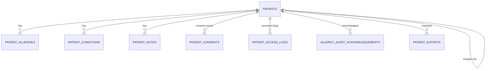

**patients** — ⟨T⟩ ⟨A⟩ ⟨V⟩: `patient_code NN` (Ux per organization), `full_name NN`, `name_normalized NN` (trigram), `mobile_phone_e164 N`, `phone_digits N` (suffix search), `email N`, `address_line N`, `date_of_birth date N`, `birth_year smallint N`, `birth_date_precision N` (`Exact`, `YearOnly`), `gender N` (`Male`, `Female`), `national_id_enc bytea N` + `national_id_bidx bytea N` (HMAC blind index) + `national_id_last4 char(4) N` (only when `CollectNationalId` is ON, FR-07-034), `allergy_status NN` (`Unknown`, `NoKnownAllergies`, `HasAllergies`), `status NN` (`Active`, `Inactive`, `Merged`, `Anonymized`), `merged_into_patient_id N`, `deactivated_at N`, `anonymized_at N`. Indexes: `(organization_id, mobile_phone_e164)`, trigram on `name_normalized`, trigram or reverse index on `phone_digits`; partial Ux `(organization_id, national_id_bidx) WHERE national_id_bidx IS NOT NULL`.

**patient_allergies** — ⟨T⟩ ⟨A⟩ ⟨V⟩: `patient_id NN`, `substance_type NN` (`Ingredient`, `FreeText`), `active_ingredient_id N` (plaintext, used for decision-support matching), `substance_text_enc bytea N`, `reaction_enc bytea N`, `severity NN`, `source NN`, `status NN` (`Active`, `Inactive`, `EnteredInError`), `status_reason N`, `recorded_by_user_id NN`, `recorded_at NN`. Partial Ux `(patient_id, active_ingredient_id) WHERE status = 'Active'`.

**patient_conditions** — ⟨T⟩ ⟨A⟩ ⟨V⟩: `patient_id NN`, `name_enc bytea NN`, `code N`, `code_system N` (external coding pending REG-09), `onset_year smallint N`, `status NN` (`Active`, `Resolved`, `EnteredInError`), `status_reason N`, `recorded_by_user_id NN`, `recorded_at NN`.

**patient_notes** (immutable; amendments create new rows) — ⟨T⟩: `patient_id NN`, `text_enc bytea NN`, `amends_note_id N`, `author_user_id NN`, `branch_id NN` (context), `created_at NN`.

**patient_consents** (append-only events) — ⟨T⟩: `patient_id NN`, `purpose NN` (`MedicalDataStorage`, `Notifications`), `status NN` (`Granted`, `Withdrawn`), `method NN` (`Verbal`, `Written`, `Electronic`, `SystemMerge`), `note text(500) N`, `recorded_by_user_id NN`, `branch_id NN`, `recorded_at NN`. Effective consent = latest event per purpose (FR-07-010). Legal basis pending REG-04.

**patient_access_logs** (append-only, BR-G-29, fail-closed BR-07-004) — ⟨T⟩: `patient_id NN`, `user_id NN`, `branch_id N`, `support_grant_id N`, `access_type NN` (`View`, `AllergyCheck`, `Export`, `Reveal`), `data_categories text[] NN`, `endpoint NN`, `trace_id NN`, `occurred_at NN`. Index `(organization_id, patient_id, occurred_at DESC)`.

**allergy_alert_acknowledgements** (append-only, FR-07-026) — ⟨T⟩ ⟨B⟩: `patient_id NN`, `patient_allergy_id NN`, `active_ingredient_id NN`, `medicine_id NN`, `sale_id NN`, `sale_line_id NN`, `prescription_item_id N`, `reason_code NN`, `reason_text N`, `acknowledged_by_user_id NN`, `acknowledged_at NN`. Written in the sale transaction.

**patient_exports** (FR-07-038) — ⟨T⟩: `patient_id NN`, `requested_by_user_id NN`, `status NN` (`Queued`, `Ready`, `Failed`, `Expired`), `file_object_id N`, `created_at NN`, `ready_at N`, `expires_at NN` (file deleted 7 days after generation).

Application-level encryption (`_enc` columns: national ID, free-text allergy substance/reaction, condition names, notes) follows SECURITY-ARCHITECTURE §8.3 (per-organization AES-256-GCM envelope keys).

### 3.8 Prescriptions (`prescriptions`) — SPEC-08

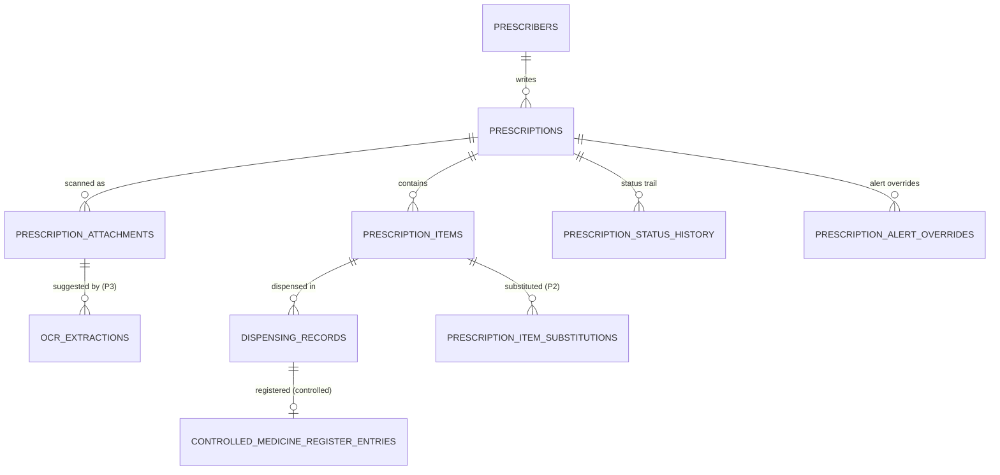

Entity attributes follow SPEC-08 §8 (snake_case). Key constraints:

**prescribers** — ⟨T⟩ ⟨A⟩ ⟨S⟩: `full_name NN`, `normalized_name NN`, `specialty N`, `clinic_name N`, `phone N`, `license_number N`.
**prescriptions** — ⟨T⟩ ⟨B⟩ ⟨A⟩ ⟨V⟩: `number NN` (Ux `(organization_id, branch_id, number)`), `status NN` (`Draft`, `PendingVerification`, `Verified`, `PartiallyDispensed`, `FullyDispensed`, `Cancelled`, `Expired`), `patient_id N`, `prescriber_id NN`, `prescriber_name_snapshot NN`, `prescriber_license_snapshot N`, `prescription_date date NN`, `validity_days int NN`, `expires_on date NN`, `notes_enc bytea N`, `verified_by/at N`, `checklist_version N`, `checklist_acknowledgements jsonb N`, `refills_allowed int NN DEFAULT 0`, `refills_used int NN`, `current_fill_number int NN DEFAULT 0`, `cancel_reason/cancelled_by/cancelled_at N`.
**prescription_items** — ⟨T⟩ ⟨B⟩ ⟨V⟩: `prescription_id NN`, `line_no NN`, `medicine_id N`, `free_text_medicine_name N`, `resolved_by/at N`, `dosage`, `frequency`, `duration_days`, `route`, `instructions` (N), `prescribed_quantity NN`, `prescribed_unit NN`, `prescribed_quantity_base_units N`, `dispensed_quantity_base_units int NN DEFAULT 0`, `remaining_quantity_base_units int NN`, `item_verified_by/at N`, `is_removed NN`. Ck `medicine_id IS NOT NULL OR free_text_medicine_name IS NOT NULL`, `dispensed_quantity_base_units >= 0`, `remaining_quantity_base_units >= 0`.
**prescription_attachments** — ⟨T⟩ ⟨B⟩: `prescription_id NN`, `file_object_id NN`, `content_type`, `size_bytes`, `sha256`, `scan_status`, `scan_completed_at N`, `is_removed NN`, `uploaded_by NN`.
**prescription_status_history** (append-only) — ⟨T⟩ ⟨B⟩: `prescription_id NN`, `from_status N`, `to_status NN`, `changed_by N` (NULL = System), `changed_at NN`, `reason N`.
**dispensing_records** (append-only) — ⟨T⟩ ⟨B⟩: `prescription_id NN`, `prescription_item_id NN`, `sale_id NN`, `sale_line_id NN`, `sale_line_allocation_id NN`, `batch_id NN`, `prescribed_medicine_id N`, `dispensed_medicine_id NN`, `substitution_id N`, `quantity_base_units int NN` (negative for reversal), `rounding_excess_base_units int NN DEFAULT 0`, `rounding_reason N`, `pharmacist_user_id NN`, `dispensed_at NN`, `business_date NN`, `fill_number int NN`, `reverses_dispensing_record_id N`. Ck `(reverses_dispensing_record_id IS NULL) = (quantity_base_units > 0)`.
**prescription_item_substitutions** (P2) and **prescription_alert_overrides** (P2/P3, append-only) — per SPEC-08 §8; one active substitution per item.
**ocr_extractions** (P3) — ⟨T⟩ ⟨B⟩: `prescription_id NN`, `prescription_attachment_id NN`, `status NN` (`Queued`, `Processing`, `Completed`, `Failed`), `provider_name NN`, `provider_version N`, `attempts int NN`, `failure_code N`, `fields jsonb N` (suggestions with decisions; values are suggestions only, BR-G-14), `requested_by NN`, `completed_at N`.
**controlled_medicine_register_entries** (append-only; format pending REG-02) — ⟨T⟩ ⟨B⟩: `entry_number NN` (sequence `CTL`, Ux `(organization_id, branch_id, entry_number)`), `entry_type NN` (`Dispensing`, `Reversal`), `occurred_at NN`, `business_date NN`, `medicine_id NN` + name/strength snapshots, `batch_id NN` + batch number snapshot, `quantity_base_units int NN` (signed), `balance_after_base_units int NN CHECK (>= 0)`, `patient_id NN` + name snapshot, prescriber snapshots, `prescription_id NN`, `prescription_number NN`, `sale_id NN`, `sale_number NN`, `pharmacist_user_id NN`, `dispensing_record_id NN`, `reverses_entry_id N`.

### 3.9 Finance (`finance`) — SPEC-09

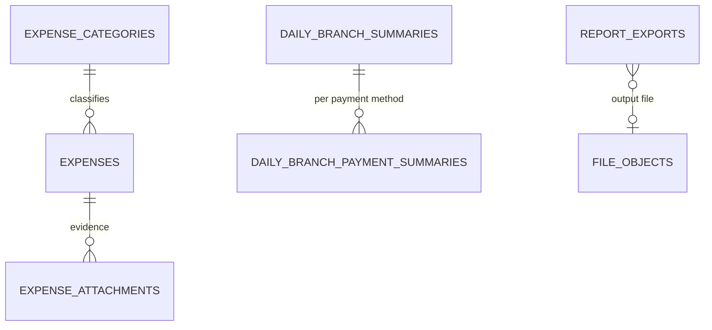

**expense_categories** — ⟨T⟩ ⟨A⟩ ⟨V⟩ ⟨S⟩: `name_ar text(100) NN`, `name_en text(100) NN`. Ux `(organization_id, lower(name_ar))`, `(organization_id, lower(name_en))`.
**expenses** — ⟨T⟩ ⟨B⟩ ⟨A⟩ ⟨V⟩: `expense_category_id NN`, `amount numeric(19,2) NN CHECK (> 0)`, `expense_date date NN`, `payment_method NN` (`Cash`, `Card`, `BankTransfer`, `MobileWallet`, `Other`), `payment_source NN` (`CashDrawer`, `External`), `cash_session_id N`, `description text(500) NN`, `reference_number text(50) N`, `status NN` (`PendingApproval`, `Approved`, `Rejected`, `Reversed`), approval/rejection/reversal fields (N) incl. `reversal_business_date`, `reversal_cash_session_id`.
**expense_attachments** (append-only) — ⟨T⟩: `expense_id NN`, `file_object_id NN`, `created_at`, `created_by`.
**daily_branch_summaries** (projection) — PK `(organization_id, branch_id, business_date)`; amounts per SPEC-09 §8.1 (`sale_count`, `gross_sales`, `discounts`, `sales_returns`, `net_sales`, `tax_on_sales`, `tax_reversed`, `cogs_sold`, `cogs_restocked`, `cogs`, `gross_profit`, `return_loss`, `write_off_loss`, `stocktake_variance_value`, `expenses`, `void_count`, `voided_amount`, `return_count`, `supplier_payments`, `purchases`, `cash_variance_total`), `version int NN`, `last_recomputed_at NN`, `last_event_id N`. Rebuildable from sources; never authoritative for postings.
**daily_branch_payment_summaries** (projection child) — PK `(organization_id, branch_id, business_date, payment_method)`; `payments_received`, `refunds_paid`.
**projection_inbox_records** — `event_id` PK, `projection NN`, `processed_at NN` (retained 30 days).
**report_exports** — ⟨T⟩: `branch_id N`, `requested_by NN`, `report_type NN`, `parameters jsonb NN`, `format NN` (`Csv`, `Xlsx`, `Pdf`), `status NN` (`Queued`, `Running`, `Completed`, `Failed`, `Expired`), `row_count N`, `file_object_id N`, `failure_code N`, `requested_at NN`, `started_at N`, `completed_at N`, `expires_at N` (= completed + 24 h).

### 3.10 Platform (`platform`) — SPEC-10 and BuildingBlocks

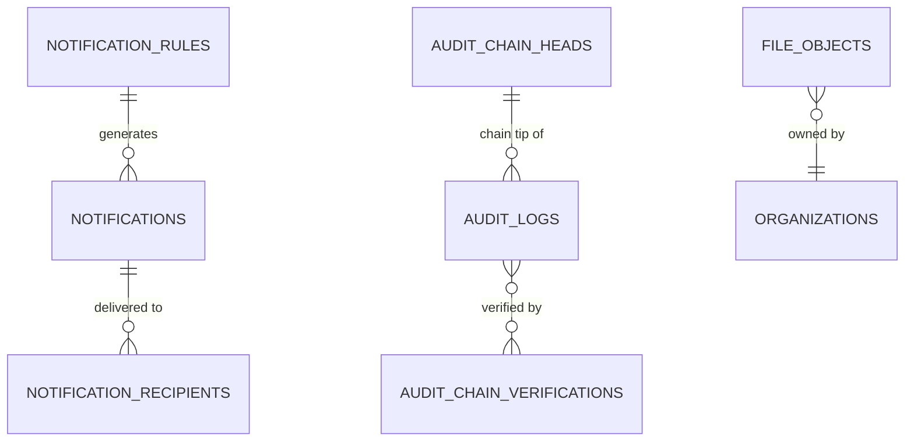

**notifications** — ⟨T⟩: `branch_id N`, `type NN`, `severity NN` (`Info`, `Warning`, `Critical`), `title_key NN`, `body_key NN`, `parameters jsonb NN`, `entity_type N`, `entity_id N`, `dedup_key N`, `source_event_id N`, `created_at NN`. Partial Ux `(organization_id, source_event_id, type) WHERE source_event_id IS NOT NULL`.
**notification_recipients** — `organization_id NN`, `notification_id NN`, `user_id NN`, `status NN` (`Unread`, `Read`, `Dismissed`), `read_at N`, `dismissed_at N`, `email_status N`. PK `(notification_id, user_id)`; index `(user_id, status, created_at DESC)`.
**notification_rules** — ⟨T⟩ ⟨V⟩: `branch_id N` (NULL = organization default), `type NN`, `enabled NN`, `recipient_roles text[] NN`, `recipient_user_ids uuid[] NN`, `delivery_mode NN` (`Immediate`, `DailyDigest`), `channels text[] NN`. Ux `(organization_id, branch_id, type) NULLS NOT DISTINCT`.
**notification_dedup_states** — PK `(organization_id, dedup_key)`, `last_created_at NN`. **user_notification_preferences** (P2), **system_announcements** (P2, platform-level), **customer_notifications** (P3) — per SPEC-10 §8.

**audit_logs** (append-only; monthly range partitions on `occurred_at`) — SPEC-10 `AuditLog`: `id`, `chain_key text NN` (organization id or `platform`), `organization_id N` (NULL only for the `platform` chain), `branch_id N`, `event_code NN`, `category NN`, `outcome NN`, `actor_user_id N`, `actor_type NN`, `support_grant_id N`, `entity_type NN`, `entity_id N`, `changes jsonb N` (medical values stored as SHA-256 hashes, secrets never), `metadata jsonb N`, `ip_address inet N`, `user_agent varchar(512) N`, `correlation_id NN`, `occurred_at NN`, `business_date N`, **seal columns** `chain_sequence bigint N`, `previous_hash char(64) N`, `hash char(64) N`, `sealed_at N`. PK `(id, occurred_at)`; unique `(chain_key, chain_sequence, occurred_at)` with global uniqueness of `(chain_key, chain_sequence)` guaranteed by the single sealer per chain (`audit_chain_heads` row lock) and checked by verification. Indexes `(organization_id, occurred_at DESC, id)`, `(organization_id, entity_type, entity_id)`, `(organization_id, actor_user_id, occurred_at)`, `(organization_id, event_code, occurred_at)`, `(organization_id, correlation_id)`, partial `(chain_key, occurred_at, id) WHERE sealed_at IS NULL` (sealer work queue).
**audit_chain_heads** — `chain_key text PK`, `last_sequence bigint NN`, `last_hash char(64) NN`, `last_sealed_at NN`. Updated only by the `pms_audit_sealer` role.
**audit_chain_verifications** — ⟨T⟩: `trigger NN` (`Scheduled`, `OnDemand`), `requested_by N`, `from_sequence NN`, `to_sequence NN`, `entries_checked NN`, `result NN` (`Running`, `Passed`, `Failed`), `first_failing_sequence N`, `failure_reason N`, `started_at NN`, `completed_at N`.
**audit_chain_anchors** (V1 hardening, ADR-008 amendment) — `chain_key NN`, `anchor_date date NN`, `last_sequence NN`, `head_hash char(64) NN`, `signature bytea NN` (signed digest), `object_key NN` (WORM object in the anchor bucket), `created_at NN`. PK `(chain_key, anchor_date)`.
**api_action_logs** (operational; monthly partitions; 180-day retention) — ⟨T⟩: `branch_id N`, `user_id NN`, `method`, `route_template`, `status_code`, `duration_ms`, `correlation_id`, `ip_address`, `user_agent`, `occurred_at` (NN).
**user_preferences** — `user_id uuid PK`, `organization_id NN`, `language N` (`ar`, `en`), `theme NN` (`light`, `dark`, `system`), `updated_at NN`.
**file_objects** — ⟨T⟩ ⟨A⟩ (ADR-006): `branch_id N`, `owner_entity_type N`, `owner_entity_id N`, `purpose NN`, `original_file_name text(255) N` (sanitized, display only), `content_type NN` (sniffed), `size_bytes bigint NN CHECK (> 0)`, `sha256 bytea N`, `storage_key NN` (`{organizationId}/{purpose}/{yyyy}/{mm}/{fileObjectId}`), `status NN` (`Pending`, `Active`, `Deleted`; plus scan states per SECURITY-ARCHITECTURE §7), `uploaded_by/at`, `retention_class NN`.
**outbox_messages** — `id uuid PK` (UUIDv7), `organization_id N`, `event_type text(128) NN`, `payload jsonb NN`, `occurred_at NN`, `correlation_id N`, `traceparent N`, `processed_at N`, `attempt_count int NN DEFAULT 0`, `next_attempt_at N`, `last_error N`, `status NN` (`Pending`, `Processed`, `Failed`). Partial index `(next_attempt_at NULLS FIRST, id) WHERE status = 'Pending'`.
**inbox_messages** — PK `(message_id, consumer_name)`, `processed_at NN`.
**background_job_runs** — `id`, `organization_id N`, `branch_id N`, `job_name NN`, `run_key text NN` Ux (e.g., `inventory.expiry-flagging:{branchId}:{businessDate}`), `business_date N`, `status NN` (`Running`, `Succeeded`, `Failed`, `Skipped`), `started_at NN`, `completed_at N`, `duration_ms N`, `items_processed N`, `error N` (no secrets), `hangfire_job_id N`.
**backup_run_records**, **restore_drill_records** (platform-level, SPEC-10 §8) — reported by backup tooling and operators.
**idempotency_records** (BuildingBlocks; conventions list it under Sales as "shared infra" — placed in `platform`) — PK `(organization_id, user_id, idempotency_key)`, `endpoint text(200) NN`, `request_hash bytea NN` (SHA-256 of canonical body + route values), `response_status smallint NN`, `response_body jsonb NN`, `response_headers jsonb N`, `resource_type N`, `resource_id N`, `created_at NN`, `expires_at NN` (+24 h). Only 2xx responses are stored (SPEC-06 §7.3). Index `(expires_at)`.

---

## 4. Indexing Strategy

### 4.1 Principles

1. Every tenant query filters by `organization_id` (and usually `branch_id`); composite indexes lead with `organization_id` or `branch_id` (branch ids are globally unique, so `branch_id` alone is selective).
2. Partial indexes for "active" working sets (active batches, open sessions, pending outbox, current prices).
3. Cursor pagination indexes match the sort `(…, occurred_at DESC, id DESC)`.
4. No index on low-selectivity boolean/status columns alone.
5. Every index is justified in the migration comment with the query it serves; unused indexes (pg_stat_user_indexes `idx_scan = 0` for 30 days in prod) are reviewed quarterly.

### 4.2 Key indexes

| Table | Index | Purpose |
|---|---|---|
| `catalog.medicines` | `GIN (search_text gin_trgm_ops) WHERE is_active` | POS name/generic/ingredient search (NFR-G-01; `pg_trgm`) |
| `catalog.medicines` | GIN `pg_trgm` on `trade_name_en`, `trade_name_ar`, `generic_name`; partial indexes where status = `Active` | Exact/prefix/trigram catalog search in English and Arabic |
| `catalog.medicines` | `(organization_id, code)` unique | Code lookup |
| `catalog.medicine_ingredients` | `(active_ingredient_id, medicine_id)` and `(medicine_id, sort_order)` | Ingredient search and ordered medicine detail |
| `catalog.medicine_barcodes` | `(organization_id, normalized_code)` unique; `(medicine_id) WHERE is_primary` unique partial | Barcode scan exact match; primary barcode |
| `catalog.medicine_categories` | `(organization_id, parent_id, normalized_name)` unique; `(organization_id, is_active, sort_order)` | Sibling uniqueness and active category tree |
| `catalog.medicine_prices` | `(medicine_id)` unique | Organization current-price lookup |
| `catalog.branch_medicine_prices` | `(branch_id, medicine_id)` unique | Branch override lookup |
| `catalog.medicine_price_history` | `(medicine_id, changed_at DESC, id DESC)`; `(branch_id, medicine_id, changed_at DESC, id DESC)` | Price history pages |
| `catalog.medicine_alternatives` | `(medicine_id, alternative_medicine_id)` unique; reverse `(alternative_medicine_id, medicine_id)` | Alternative links both directions |
| `catalog.catalog_import_jobs` | `(organization_id, created_at DESC, id DESC)`; `(status, created_at)` partial active jobs | Tenant import history and worker queue |
| `procurement.suppliers` | `(organization_id, upper(code))` unique; partial normalized tax number unique; trigram name indexes | Supplier lookup and search |
| `procurement.supplier_contacts` | `(supplier_id, id)`; partial unique `(supplier_id) WHERE is_primary` | Contact list and single primary contact |
| `procurement.purchase_orders` | `(branch_id, status, created_at DESC, id DESC)`; `(organization_id, branch_id, document_year, number)` unique | PO work queues and document lookup |
| `procurement.purchase_order_lines` | `(purchase_order_id, id)`; `(medicine_id, purchase_order_id)` | PO detail and medicine history |
| `procurement.goods_receipts` | `(branch_id, status, received_at DESC, id DESC)`; `(organization_id, branch_id, document_year, number)` unique partial | Receipt history and posted-number lookup |
| `procurement.goods_receipt_lines` | `(goods_receipt_id, id)`; `(purchase_order_line_id)` partial; `(batch_id)` partial | Receipt detail, PO receiving and batch traceability |
| `procurement.supplier_invoices` | `(branch_id, supplier_id, status, due_date, id)`; partial unique supplier external number where not cancelled | Invoice lists, matching and aging |
| `procurement.supplier_invoice_lines` | `(supplier_invoice_id, id)`; unique `(supplier_invoice_id, goods_receipt_line_id)` | Invoice detail and receipt matching |
| `procurement.supplier_returns` | `(branch_id, status, created_at DESC, id DESC)`; `(organization_id, branch_id, document_year, number)` unique partial | Return queue and document lookup |
| `procurement.supplier_return_lines` | `(supplier_return_id, id)`; `(batch_id)` | Return detail and batch validation |
| `procurement.supplier_payments` | `(branch_id, supplier_id, payment_date DESC, id DESC)`; `(organization_id, branch_id, document_year, number)` unique | Payment history and numbering |
| `procurement.supplier_payment_allocations` | `(supplier_invoice_id, created_at, id)`; `(supplier_payment_id, created_at, id)` | Invoice settlement and payment detail |
| `procurement.supplier_ledger_entries` | `(branch_id, supplier_id, occurred_at DESC, id DESC)`; `(source_document_type, source_document_id)` | Supplier account statement and source trace |
| `inventory.batches` | **FEFO:** `(organization_id, branch_id, medicine_id, expiry_date, created_at, id)` (SPEC-04 §8.1), recommended partial `WHERE quarantined_at IS NULL` | FEFO candidate scan in order `ExpiryDate, CreatedAt, Id` (ADR-004, BR-04-009) |
| `inventory.batches` | `ux_batches_receipt_key`, `ux_batches_lineage` (§3.4) | Inbound find-or-create, transfer lineage |
| `inventory.batch_balances` | PK `(batch_id)` | Single ordered lock step (`= ANY … ORDER BY batch_id FOR UPDATE`) |
| `inventory.batch_balances` | `(branch_id, medicine_id) INCLUDE (on_hand, reserved) WHERE on_hand > 0` | Stock-on-hand per medicine (POS display, overview) |
| `inventory.stock_movements` | `(batch_id, batch_sequence)` (per partition) | Stock card, reconciliation chain |
| `inventory.stock_movements` | `(batch_id, occurred_at DESC, batch_sequence DESC)` | As-of valuation |
| `inventory.stock_movements` | `(branch_id, medicine_id, occurred_at DESC, id DESC)` | Medicine movement history |
| `inventory.stock_movements` | `(organization_id, source_document_type, source_document_id)` | Document → movements |
| `sales.sales` | `(branch_id, business_date DESC, id DESC)`; `(organization_id, branch_id, invoice_number)` unique | Sales lists, invoice lookup |
| `sales.sales` | `(organization_id, patient_id, completed_at DESC) WHERE patient_id IS NOT NULL` | Patient history |
| `sales.cash_sessions` | partial unique open session | Session guard |
| `patients.patients` | `GIN (name_normalized gin_trgm_ops)`; `(organization_id, mobile_phone_e164)`; trigram on `phone_digits` | Patient search at POS |
| `prescriptions.prescriptions` | `(branch_id, status, prescription_date DESC)`; `(organization_id, patient_id, prescription_date DESC)` | Work queues, patient history |
| `platform.audit_logs` | see §3.10 | Audit queries (cursor), sealer queue |
| `platform.notification_recipients` | `(user_id, status, created_at DESC)` | Bell count and list |

Extensions required: `pg_trgm`, `btree_gist`, `pgcrypto` (only for `gen_random_uuid()` fallback in scripts; application generates UUIDv7). PostgreSQL 17 does not include a native `uuidv7()` function (added in 18); keys are therefore generated by the application.

---

## 5. Audit Columns

- ⟨A⟩ columns are set by an EF Core `SaveChanges` interceptor from `ICurrentUser` and `IClock` (UTC). Raw SQL writes (rare, Inventory balance updates) set `updated_at` explicitly.
- `created_by`/`updated_by` reference `identity.users(id)`; `NULL` means "system" (job), and the job name is recorded in the audit log entry.
- Audit columns are **not** a substitute for `audit_logs`: sensitive operations (SPEC-10 catalog) always produce an `audit_logs` row in the same transaction (BR-G-16).

---

## 6. Organization and Branch Scoping (summary)

| Scope class | Tables | Enforced by |
|---|---|---|
| Organization-scoped (org-level master data and documents) | catalog.*, procurement.suppliers/contacts, patients.*, prescriptions.prescribers, identity.roles/users, finance.expense_categories, platform.notification_rules | `organization_id` filter (EF global filter + RLS) |
| Branch-scoped | inventory.*, procurement.purchase_orders/lines, goods_receipts/lines, supplier_invoices/lines, supplier_returns/lines, supplier_payments/allocations, supplier_ledger_entries, sales.*, prescriptions.prescriptions & children, finance.expenses/daily_branch_summaries, org.document_sequences, identity.manager_overrides | `organization_id` filter + application branch authorization (`branch_id ∈ assigned branches`) |
| Platform | org.organizations (self row), identity.permissions, identity.platform_*, platform.outbox/inbox/job runs/audit chain heads, hangfire.* | Platform role / internal only |

Branch authorization is **not** implemented in RLS in v1 (user branch sets are an application concern and change often); RLS enforces the organization boundary only (§12).

---

## 7. Transaction Boundaries per Business Operation

Isolation level is READ COMMITTED unless stated; correctness relies on explicit row locks, check constraints and unique constraints, which are effective under READ COMMITTED. Lock order follows §8.3. All rows listed are written in **one** transaction; any failure rolls everything back (BR-G-19, CS-10). Every operation also writes `platform.audit_logs` (when sensitive), `platform.outbox_messages` (when events are published) and, for idempotent endpoints, `platform.idempotency_records`. Inventory postings are specified normatively in SPEC-04 §6.5 and sale operations in SPEC-06 §7.3.

| Operation | Tables written (single transaction) | Locks taken (in order) | Isolation |
|---|---|---|---|
| Complete sale (incl. dispensing) | idempotency_records; sales.sales, sale_lines, sale_line_allocations, payments, cash_movements; identity.manager_overrides (consume); inventory.batch_balances, stock_movements; prescriptions.prescription_items, dispensing_records, controlled_medicine_register_entries; patients.allergy_alert_acknowledgements; org.document_sequences (`INV`); audit; outbox | IdempotencyRecord → CashSession `FOR SHARE` → ManagerOverride → PrescriptionItems (id asc) → BatchBalances (one statement, batch_id asc) → DocumentSequence (last) | RC |
| Void sale | idempotency; sales.sales (status, void fields), payments (negative), cash_movements (`SaleVoid`), stock_movements (`SaleVoid` into original batches), batch_balances; dispensing_records (reversal), prescription_items; audit; outbox | IdempotencyRecord → Sale → CashSession → ManagerOverride → PrescriptionItems → BatchBalances | RC |
| Complete sales return (incl. direct restock) | sales_returns (number `SRN`), sales_return_lines, sale_lines/allocations (returned qty), sales.sales (status), refunds, cash_movements (`RefundCash`); if `Restocked` into an eligible batch: stock_movements (`SalesReturn`), batch_balances; dispensing reversal if linked; document_sequences; audit; outbox | IdempotencyRecord → Sale → CashSession → ManagerOverride → BatchBalances → DocumentSequence | RC |
| Set return disposition (later restock) | sales_return_lines; sale_line_allocations (restocked qty); stock_movements; batch_balances; audit | return line → BatchBalances (restock rejected unless the original batch is sale-eligible, BR-06-024) | RC |
| Post goods receipt | goods_receipts (status, number `GRN`), goods_receipt_lines (batch_id, effective cost); inventory.batches (find-or-create by receipt key), batch_balances, stock_movements (`Receipt`); purchase_order_lines, purchase_orders; catalog.medicines.last_purchase_cost; document_sequences; audit; outbox | Receipt row → PO row and PO lines (id asc) → batch creation (unique receipt key) → BatchBalances (one statement) → DocumentSequence | RC |
| Reverse goods receipt | goods_receipts (Reversed), stock_movements (`ReceiptReversal`), batch_balances, PO lines/status, audit | Receipt row → BatchBalances (fails with `INVENTORY.INSUFFICIENT_STOCK` if `OnHand − Reserved` < quantity) | RC |
| Post supplier invoice / cancel invoice | supplier_invoices and matching lines; receipt-line invoiced quantities; supplier_ledger_entries (`Invoice` / `InvoiceCancellation`); invoice paid/outstanding state; audit; outbox | Invoice → DocumentSequence (post) → receipt lines (id asc) → supplier ledger sequence | RC |
| Supplier payment / allocation / reversal | supplier_payments (number `SPY`), signed allocations; supplier_invoices (paid/outstanding/status); supplier_ledger_entries (`Payment` / `PaymentReversal`); document_sequences; audit; outbox | Payment → DocumentSequence → invoices (id asc) | RC |
| Supplier return draft / post | Draft: supplier_return_lines + batch reservations. Post: return number `SRT`, release reservations, stock_movements (`SupplierReturn`), balances, supplier_ledger_entries (`DebitNote`), document_sequences, audit, outbox | Return header → one batch balance lock statement ordered by batch_id → DocumentSequence | RC |
| Adjustment / write-off submit (≤ threshold) or approve | Header (status; number `ADJ`/`WOF`/`OPB` assigned at submit, or at post for opening balance), stock_movements, batch_balances, batches (new batch / status), document_sequences, audit, outbox | Document row → BatchBalances (one statement) → DocumentSequence | RC |
| Adjustment / write-off submit (> threshold or controlled) / reject | Header → `PendingApproval` (number assigned) or `Rejected`; audit; outbox | Document row → DocumentSequence | RC |
| Transfer submit | stock_transfers → `Requested`, number `TRF` (source branch sequence), audit, outbox | Transfer row → DocumentSequence | RC |
| Transfer approve | stock_transfers (Approved), stock_transfer_allocations (FEFO `TransferReservation`), batch_balances.reserved +=, audit, outbox | Transfer row → BatchBalances (source) | RC |
| Transfer dispatch | stock_transfers (InTransit), allocations (dispatched_qty), batch_balances (on_hand −, reserved −; undispatched reservation released), stock_movements (`TransferOut`), audit, outbox | Transfer row → BatchBalances (source) | RC |
| Transfer receipt (full/partial) | allocations (received/rejected/short), stock_transfers (status), inventory.batches (destination by lineage key), batch_balances (both branches), stock_movements (`TransferIn`; `TransferReturn` at source for rejected and short), draft write-off / TransitLoss adjustment in source branch, audit, outbox | Transfer row → destination batch creation → BatchBalances (union of both branches, one statement) | RC |
| Stocktake start | stocktake_lines (snapshot_on_hand, snapshot_sequence), stocktakes (Counting, number `STK`), audit | Stocktake row → BatchBalances `FOR SHARE` (batch_id asc) → DocumentSequence | RC |
| Stocktake: record count line | stocktake_lines (counted quantity, counted_at) | none on balances | RC |
| Stocktake approve | stocktakes (Posted), stock_movements (`StocktakeVariance` applied to current balance), batch_balances, batches (found stock), audit, outbox | Stocktake row → BatchBalances | RC |
| Open / close cash session | cash_sessions, cash_movements (`OpeningFloat`), audit; close: expected/counted/variance, audit, outbox | Session row `FOR UPDATE` (close waits for in-flight sales holding `FOR SHARE`) | RC |
| Prescription verification | prescriptions, prescription_items, prescription_status_history, audit, patient_access_logs | Prescription row (xmin) | RC |
| Refresh token rotation | refresh_tokens (rotate + insert), user_sessions.last_activity_at; on reuse: revoke family + session, audit (own committed transaction) | Token row `FOR UPDATE` by hash | RC |
| Audit chain sealing (sealer, every 10 s per chain) | platform.audit_logs (seal columns, once), platform.audit_chain_heads | `audit_chain_heads` row `FOR UPDATE` for the chain key | RC |
| Financial report snapshot / export | none (read) | none | REPEATABLE READ, READ ONLY |
| Reconciliation job (per branch, chunked) | inventory.reconciliation_findings | none | REPEATABLE READ, READ ONLY for checks; findings in a separate short RC transaction |

---

## 8. Concurrency Strategy

### 8.1 Optimistic concurrency (aggregates)

- Mutable aggregates (drafts, master data, settings, status workflows) use `xmin` as `RowVersion`. The API exposes it as a strong `ETag` (`"<xmin>"`), clients send `If-Match`; EF Core raises `DbUpdateConcurrencyException` → 412 `COMMON.CONCURRENCY_CONFLICT`.
- Workflow transitions (approve, dispatch, post) load the aggregate, verify `If-Match`, and additionally lock the header row `FOR UPDATE` to serialize concurrent transitions.

### 8.2 Pessimistic locks (balances, sequences, counters)

- `inventory.batch_balances`, `org.document_sequences`, `procurement.suppliers.current_balance`, `prescriptions.prescription_items.dispensed_quantity_base_units`, `sales.sale_line_allocations.returned_quantity_base_units`, `identity.manager_overrides.consumed_at` and `platform.audit_chain_heads` are counters or single-use markers; they are updated only under a row lock inside the business transaction.
- Every balance update re-reads the row **after** acquiring the lock (READ COMMITTED returns the latest committed version after the wait), so check-then-act is safe.
- DB check constraints (`on_hand >= 0`, `reserved <= on_hand`, `returned <= quantity`, `dispensed >= 0`, `remaining >= 0`) are the final guard.

### 8.3 Deterministic global lock order

Every transaction acquires locks in this class order, and within a class by ascending `id` (SPEC-04 BR-04-007 refined by SPEC-06 §7.3):

1. `platform.idempotency_records` (insert; unique key)
2. The business document row(s) being posted or transitioned (`sales.sales` for void/return, `stock_transfers`, `goods_receipts`, adjustments, stocktakes, …), then `procurement.purchase_orders`
3. `sales.cash_sessions` (`FOR SHARE` for sales/refunds; `FOR UPDATE` for close)
4. `identity.manager_overrides` (consumption)
5. Child counters: `prescriptions.prescription_items`, `procurement.purchase_order_lines`, `procurement.suppliers`, `procurement.supplier_invoices`, `catalog.medicines` (`last_purchase_cost` only)
6. `inventory.batches` creation (find-or-create through the unique receipt or lineage key)
7. `inventory.batch_balances` — **one statement**, ascending `batch_id`, across all branches involved; no balance row may be locked after this step
8. `org.document_sequences` — always last, to minimize hold time on the per-branch hot row

Integration tests assert the order through an SQL-capturing interceptor for each operation in §7.

### 8.4 Timeouts and retry policy

| Setting | Value | Scope |
|---|---|---|
| `lock_timeout` | 3 s | `SET LOCAL` in every command transaction (SPEC-04 FR-04-026, SPEC-06 FR-06-037) |
| `statement_timeout` | 15 s POS/sales commands, 60 s other commands, 300 s report/export jobs | `SET LOCAL` |
| `idle_in_transaction_session_timeout` | 30 s | DB role setting |
| Deadlock (`40P01`) / serialization failure (`40001`) | Retry whole unit of work up to 2 additional times with 50–200 ms jittered backoff; then 503 `COMMON.TRANSIENT_CONFLICT` | UoW behavior |
| Lock timeout (`55P03`) | No server retry; 503 `COMMON.LOCK_TIMEOUT` + `Retry-After: 1`; client retries with the same `Idempotency-Key` | UoW behavior |
| `deadlock_timeout` | 1 s (default) | Server |

Retries are safe because the whole transaction (including the idempotency record) rolled back; handlers perform no external side effects inside transactions (those go through the outbox).

---

## 9. Document Sequences (gapless numbering)

Format (BR-G-24): `{BranchCode}-{DocType}-{Year}-{Seq:000000}`, e.g., `CAI01-INV-2026-000123`. `Year` = business-date year in the branch time zone. Sequence width grows beyond 6 digits automatically (no wrap).

Algorithm (inside the numbering transaction, as the last lock):

```sql
INSERT INTO org.document_sequences (id, organization_id, branch_id, document_type, year, current_value, updated_at)
VALUES (:newId, :org, :branch, :type, :year, 0, now())
ON CONFLICT (organization_id, branch_id, document_type, year) DO NOTHING;

UPDATE org.document_sequences
   SET current_value = current_value + 1, updated_at = now()
 WHERE organization_id = :org AND branch_id = :branch AND document_type = :type AND year = :year
RETURNING current_value AS assigned;
```

- The `UPDATE` holds the row lock until commit; on rollback the increment is undone → **no gaps**. PostgreSQL `SEQUENCE` objects are not used because they are non-transactional.
- Hold time is minimized by acquiring the sequence last; target hold ≤ 10 ms p95. At NFR-G-02 load this serializes at most ~100 commits/s per branch, an order of magnitude above the expected peak (~2 sales/s per branch).
- **When numbers are assigned** (owning specs): sale invoice at completion (SPEC-06); sales return when `Completed` (SPEC-06); goods receipt, supplier return, supplier payment at posting (SPEC-05); adjustment, write-off and transfer at **submit**, stocktake at **start**, opening balance at **post** (SPEC-04 BR-04-030); rejected and cancelled documents keep their numbers. Drafts have no number.
- Prescriptions and purchase orders use the same mechanism for uniformity.

---

## 10. Append-Only Enforcement and Integrity

### 10.1 Ledger protection

```sql
-- applied to every ledger table
CREATE TRIGGER trg_<table>_no_update_delete
BEFORE UPDATE OR DELETE ON <schema>.<table>
FOR EACH ROW EXECUTE FUNCTION platform.reject_ledger_mutation();
```

The application DB role has only `INSERT, SELECT` grants on ledger tables. Partition maintenance (detach/archive) runs under the owner role. For `platform.audit_logs` the trigger additionally permits exactly one `UPDATE` per row, by the `pms_audit_sealer` role, setting the four seal columns from NULL (SPEC-10 FR-10-004).

### 10.2 Immutable completed documents

Triggers on `sales.sales`/`sale_lines` reject changes to amounts and lines after insert (BR-G-11); `sales.cash_sessions` rejects any update once `Closed` (BR-G-26); posted inventory/procurement documents reject changes except allowed status transitions (`Posted → Reversed` for receipts).

### 10.3 Audit hash chain

Asynchronous sealer per SPEC-10 FR-10-009 and ADR-008 (amended 2026-11-10): every 10 s, per chain key, committed unsealed rows are sealed in visibility order with a gapless `chain_sequence`, `previous_hash` and `hash = hex(SHA-256(canonical ‖ previous_hash))`, and `audit_chain_heads` is updated in the same transaction. A daily signed head digest per chain is written to `audit_chain_anchors` and exported to WORM object storage (V1 hardening). Canonical serialization: SPEC-10 §8.5. Security view: SECURITY-ARCHITECTURE §13.

---

## 11. Partitioning and Retention

### 11.1 Decision

| Table | Partitioning | Key |
|---|---|---|
| `inventory.stock_movements` | Monthly range | **`business_date`** (ADR-003, SPEC-04 §8.1) |
| `inventory.inventory_valuation_snapshots` | Monthly range | `business_date` (SPEC-04 §8.1) |
| `platform.audit_logs` | Monthly range | `occurred_at` (SPEC-10 §8.1) |
| `platform.api_action_logs` | Monthly range, dropped after 180 days | `occurred_at` (SPEC-10) |

No other table is partitioned in v1.

Justification:

| Factor | Estimate / reason |
|---|---|
| Volume | A 50-branch chain at ~600 sales/day/branch × 3 lines × 1.2 allocations ≈ 108,000 movements/day ≈ 3.3 M/month; audit rows for the same chain ≈ 0.5–1 M/month. In SaaS with 100+ organizations, both tables reach 10⁸–10⁹ rows within 2–3 years |
| Retention | Retention is pending REG-05 but will be multi-year; monthly partitions allow detaching/archiving whole months (`DETACH PARTITION … CONCURRENTLY`) without bulk `DELETE` |
| Query pattern | Stock cards, valuation, COGS and reports filter by business date (statement periods); `business_date` partitions prune for those queries and align with the branch-local accounting day. Stock-card queries by batch use the `(batch_id, batch_sequence)` index in each partition |
| Maintenance | Autovacuum and index maintenance per partition; old partitions are frozen and effectively read-only |
| Why monthly | Weekly creates > 50 partitions/year; yearly partitions are too large (> 40 M rows) to archive individually |
| Why not by organization | List/hash partitioning by tenant does not help retention; RLS plus leading `organization_id`/`branch_id` indexes already isolate access |

Consequences: the primary key of `stock_movements` is `(id, business_date)` and every unique constraint includes `business_date`; per-batch uniqueness of `batch_sequence` across partitions is guaranteed by the balance row lock and verified by reconciliation (`SEQUENCE_GAP`). No FK references partitioned tables (`sale_line_allocations.stock_movement_id`, `sales_return_lines.stock_movement_id` are logical references verified by tests and reconciliation). Back-dating is not supported (BR-04-029), so new rows always land in the current or next partition.

### 11.2 Partition management

- Partitions are created **3 months ahead** by the Hangfire job `platform.partition-maintenance` (daily 00:30 UTC; idempotent `CREATE TABLE IF NOT EXISTS … PARTITION OF`) and by migrations for the first 12 months. A `DEFAULT` partition exists and is monitored (alert if it contains rows).
- Naming: `stock_movements_y2026m11`, `audit_logs_y2026m11`.
- Retention: no automatic drop of ledger or audit partitions. After the legal retention period (REG-05) partitions are detached, exported (compressed, encrypted, checksummed) to cold object storage, and dropped only by a documented, dual-approved runbook. Until REG-05 is answered, all partitions stay online.
- Other high-volume tables (`sales.sale_lines`, `cash_movements`, `patient_access_logs`) are monitored; partitioning is re-evaluated at 100 M rows.

---

## 12. Row-Level Security (RLS) Design

Enabled and forced from Phase 0 / MVP (ADR-002, amended 2026-11-10): policies, `ENABLE ROW LEVEL SECURITY` and `FORCE ROW LEVEL SECURITY` are created in the same migration that creates each tenant-owned table, and CI and every environment run with RLS enabled from the first commit. There is no migration flag to disable RLS.

### 12.1 Roles

| DB role | Purpose | Privileges |
|---|---|---|
| `pms_owner` | Owns schemas/tables; runs migrations | DDL; migrations never run application queries |
| `pms_app` | API and worker runtime | DML on module tables (`INSERT/SELECT` only on ledgers and `audit_logs`); **not** owner, **no** `BYPASSRLS`; RLS forced on all tenant tables |
| `pms_audit_sealer` | Audit chain sealer and anchor job (SPEC-10 FR-10-004, ADR-008) | `SELECT` on `platform.audit_logs`; `UPDATE` limited to the four seal columns (column privilege + trigger allowing NULL → value once); `SELECT/UPDATE/INSERT` on `audit_chain_heads` and `audit_chain_anchors`; `BYPASSRLS` only for reading across chains, no other DML |
| `pms_platform` | Platform console operations and cross-organization enumeration by job schedulers (list organizations, subscriptions, outbox dispatch, partition maintenance), platform identity tables | `BYPASSRLS`; separate, narrowly scoped connection string used only by platform-console endpoints and schedulers; every use is audited on the `platform` chain |
| `pms_readonly` | Support diagnostics / BI replica | `SELECT` only, subject to RLS |
| `pms_backup` | Base backups / WAL archiving | Replication privileges only |

### 12.2 Session context

ADR-002 requires the tenant variable to be set by a connection interceptor. The request- or job-scoped connection:

1. on open executes `SELECT set_config('app.organization_id', :orgId, false), set_config('app.user_id', :userId, false);` (covers reads that run outside explicit transactions);
2. at the start of every explicit transaction re-asserts the values with `SET LOCAL` (covers code paths that open transactions on pooled connections);
3. is reset by Npgsql on return to the pool (`DISCARD ALL`, enabled by default).

Jobs set the context per organization iteration on a fresh connection. A connection without `app.organization_id` sees **no** tenant rows and cannot insert any (fail closed).

### 12.3 Policies

```sql
ALTER TABLE inventory.batch_balances ENABLE ROW LEVEL SECURITY;
ALTER TABLE inventory.batch_balances FORCE ROW LEVEL SECURITY;

CREATE POLICY tenant_isolation ON inventory.batch_balances
  USING      (organization_id = nullif(current_setting('app.organization_id', true), '')::uuid)
  WITH CHECK (organization_id = nullif(current_setting('app.organization_id', true), '')::uuid);
```

- Same policy template for every table with `organization_id NOT NULL` (generated by a migration helper; architecture test verifies coverage).
- `org.organizations`: `USING (id = current organization)`.
- `platform.audit_logs`: `USING (organization_id = current organization)`; rows of the `platform` chain (`organization_id IS NULL`) are visible only to `pms_platform` and `pms_audit_sealer`.
- **Login and refresh** run before a tenant context exists. They call `SECURITY DEFINER` functions owned by `pms_owner` that return only what authentication needs: `identity.find_user_for_login(normalized_email)` (user id, organization id, status, password hash, lockout fields) and `identity.find_refresh_token(token_hash)` (token, session and organization ids). The handler then sets `app.organization_id` to the returned organization before any further query. Login is by platform-unique e-mail (SPEC-01 BR-01-001), so no organization code is needed.
- Platform identity tables (`identity.platform_users`, `platform_sessions`, `platform_refresh_tokens`) have no `organization_id`; they are not granted to `pms_app` and are reached only through the `pms_platform` connection used by `/api/v1/platform/*`.
- Support access (SECURITY-ARCHITECTURE §15): support requests run as `pms_app` with `app.organization_id` = the granted organization after the grant is validated; never as `pms_platform`.
- Performance: policies are simple equality on a leading index column; overhead target ≤ 5% on the NFR-G-01/02 benchmarks, verified in the performance test plan from the first release.

---

## 13. Migrations Strategy

| Aspect | Decision |
|---|---|
| Tool | EF Core migrations, **one migrations history per module** (`__ef_migrations_history` table inside each module schema, `MigrationsHistoryTable("__ef_migrations_history", "<schema>")`) |
| Order | Topological module order (SYSTEM-ARCHITECTURE §4.2 rule 1): platform (base infra tables) → org → identity → catalog → inventory → procurement → patients → prescriptions → sales → finance → platform (module tables) → reporting views; RLS policies are created in the same migration as each tenant table |
| Raw SQL | Allowed in migrations for: partitions, triggers, RLS, `pg_trgm`/GIN indexes, exclusion constraints, reporting views, grants. Kept in `Migrations/Sql/<timestamp>_<name>.sql` and referenced from the migration |
| Packaging | CI produces an **EF Core migration bundle** (`efbundle`, self-contained, linux-x64) per module plus an orchestrating script that applies bundles in order; bundles are versioned with the application image tag |
| Execution | **Never at application startup in staging/production.** A pre-deploy job (`migrate` container / CI job) runs bundles with the `pms_owner` connection; the app deploys only if it succeeds (DEPLOYMENT-ARCHITECTURE §6). Local/dev may auto-migrate on startup (`Database__AutoMigrate=true`) |
| Zero-downtime | **Expand/contract**: (1) expand — add nullable columns/new tables/new indexes `CONCURRENTLY` (separate non-transactional migration), backfill in batches (≤ 10,000 rows per batch via job); (2) deploy code that writes both / reads new; (3) contract — enforce `NOT NULL` via `CHECK … NOT VALID` then `VALIDATE CONSTRAINT`, drop old columns one release later. Renames are done as add-copy-drop. Destructive changes require two releases |
| Safety rules (CI-linted) | No `DROP COLUMN`/`DROP TABLE` in the same release that stops using it; no `ALTER TYPE` rewriting large tables; `CREATE INDEX` on tables > 1 M rows must be `CONCURRENTLY`; `lock_timeout = '3s'` set at the top of every migration; migration review checklist in PR template |
| Rollback | Forward-only. Each release is backward compatible with the previous app version (N−1) so the app can be rolled back without schema rollback |
| Testing | Integration tests run on a database created by applying all bundles from empty; a CI job additionally applies the new migrations on a copy of the previous release's schema with seed data (upgrade path test) |

---

## 14. Seed Data

| Seed | Scope | Source / mechanism |
|---|---|---|
| Permissions catalog | Global | Generated from each module's permission list at startup of the migration job (upsert by `code`; never deletes — removed permissions are flagged `deprecated`) |
| Platform administrator bootstrap | Global (`identity.platform_users`) | Deployment provisioning command (`pharmacy admin bootstrap --email`, SPEC-01 FR-01-045) run by operations; no default password in any image |
| System roles (`OWNER`, `MANAGER`, `PHARMACIST`, `CASHIER`, `INVENTORY`, `ACCOUNTANT`) with default permission sets | Per organization, at provisioning | Organization provisioning handler (versioned role templates) |
| Organization settings and branch settings defaults | Per organization / branch at creation | Defaults from §3.2 |
| Dosage forms, base unit codes, default medicine categories (bilingual), expense categories, tax category `EXEMPT` (0%) | Per organization at provisioning | Versioned seed templates (JSON) in Organization/Catalog modules |
| Default notification rules (low stock, near expiry, expired, transfer incoming, approvals) | Per organization | Platform handler of `OrganizationProvisioned` |
| Document sequences | Lazy (first use) | §9 |
| Medicine master data | **Not seeded** | Imported per organization via catalog import (source licensing pending REG-09) |
| Demo/test data | Local/dev/staging only | `pharmacy seed demo` command; refused when `ASPNETCORE_ENVIRONMENT=Production` |

---

## 15. Data Volume and Sizing Assumptions

| Entity | Per organization (large chain) | Basis |
|---|---|---|
| Medicines | ≤ 50,000 | NFR-G-01 |
| Batches | ≤ 500,000 | NFR-G-01 |
| Sales | ~10 M/year | 50 branches × 600/day |
| Stock movements | ~40 M/year | §11.1 |
| Audit logs | ~10 M/year | Sensitive ops + field changes |
| Patients | ≤ 500,000 | Estimate |

Storage estimate for such a chain: ~60–80 GB/year including indexes; the deployment sizing in DEPLOYMENT-ARCHITECTURE §9 is based on these figures.
