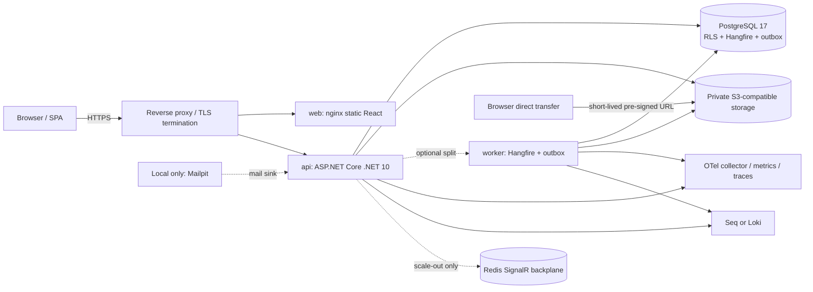

# Deployment Architecture

## 1. Purpose and deployment principles

This document defines environment topology and the operational lifecycle for the Pharmacy Management System (PMS). The product is a .NET 10 modular monolith with a React SPA, PostgreSQL 17, private S3-compatible file storage, and Hangfire background processing. The same application image supports combined, API-only, and worker-only roles.

Deployment principles:

1. Keep the local/on-premises runtime small; scale vertically first.
2. Keep production application containers stateless and immutable.
3. Keep secrets out of source control and container images.
4. Run production EF Core migration bundles as a controlled pre-deploy job, never automatically at application startup.
5. Enable and force PostgreSQL RLS on each tenant-owned table from the MVP.
6. Preserve backward compatibility with the immediately previous application release during schema changes.
7. Treat audit/access logging, backups, restore tests, and operational alerts as production requirements, not optional enhancements.
8. Deployment location and provider selection must be reviewed against REG-04/REG-10 with qualified professionals; this document makes no legal-compliance claim.

## 2. Environments

| Environment | Purpose | Data and access | Runtime/configuration |
|---|---|---|---|
| Local | Developer workstation, integration testing, and UI/API iteration. | Synthetic data only. Local credentials and signing keys are throwaway and unshared. Network-bound services stay on loopback/private Docker networks. | Docker Compose: API, web, PostgreSQL 17 with RLS enabled, MinIO, Mailpit, and Seq. Optional worker container. Hot reload may run outside containers. |
| Dev | Shared team integration and automated post-merge deployment. | Synthetic or explicitly sanitized fixtures only. No production patient data. Team access through SSO/VPN or protected environment controls. | Same container images as production; smaller isolated database/object store; email captured or routed to a test sink; automatic deployment from the development branch after CI gates. |
| Staging | Production-like release validation, upgrade-path testing, and smoke/E2E checks. | Synthetic/sanitized data; restricted operator access; production-like secret management and TLS. No copy of production health data unless separately authorized and sanitized. | Production-equivalent PostgreSQL major version, RLS policies, migration bundle, worker role, observability, and deployment strategy. Candidate image is promoted unchanged to production. |
| Production | Live pharmacy or SaaS workload. | Actual tenant data is protected by token-derived tenant context, branch authorization, database RLS, encrypted storage/backups, and least-privilege operator controls. | HA/backed PostgreSQL deployment, private S3-compatible object store, TLS at the edge, managed secrets, production observability, scheduled backup/WAL archiving, and a tested restore/rollback procedure. |

Build once and promote the same immutable image digest from dev through staging to production. Environment-specific behavior belongs in configuration, not image tags or ad-hoc production rebuilds.

## 3. Containers and runtime topology

| Service | Technology | Responsibility |
|---|---|---|
| `api` | ASP.NET Core, .NET 10 | REST `/api/v1`, SignalR `/hubs/notifications`, health endpoints, authentication, and (default role) Hangfire server/outbox dispatcher. One modular-monolith host; not one service per business module. |
| `web` | nginx unprivileged image + static React build | Serves the Vite SPA, applies static security headers, and routes SPA fallback. API and hub traffic is routed to `api` by the edge proxy/load balancer. |
| `worker` (optional) | Same image as `api`, `Host__Role=Worker` | Runs Hangfire queues and outbox dispatch without public HTTP endpoints. Split from `api` when background load needs isolation. |
| `postgres` | PostgreSQL 17 | Business schemas, transactional outbox/idempotency/audit data, and Hangfire storage. RLS is enabled and forced from the first deployable release. |
| `minio` | MinIO, S3-compatible | Local development/on-prem object storage using private buckets. Production may use a selected S3-compatible provider after residency and operational review. |
| `mailpit` | Mailpit (local/dev only) | Captures outbound email for developer/test workflows; never receives real production messages or credentials. |
| `seq` or `grafana-loki` | Seq locally/dev; Grafana/Loki or managed equivalents in staging/prod | Centralized structured log search. OpenTelemetry metrics/traces are sent to a collector and compatible backend. |

Redis is **not** required in single-instance deployments. When more than one API instance is introduced, add a Redis SignalR backplane and distributed cache invalidation for authorization changes. Do not use Redis as the source of truth for inventory or financial records.



### Docker Compose specification for local development

This is a topology specification; values shown are environment-variable names/placeholders, not secrets. Keep `.env.local` untracked and use Docker secrets or a developer secret manager for credentials.

```yaml
name: pharmacy

services:
  postgres:
    image: postgres:17
    env_file: .env.local
    environment:
      POSTGRES_DB: ${POSTGRES_DB}
      POSTGRES_USER: ${POSTGRES_BOOTSTRAP_USER}
      POSTGRES_PASSWORD: ${POSTGRES_BOOTSTRAP_PASSWORD}
    ports:
      - "127.0.0.1:5432:5432"
    volumes:
      - postgres-data:/var/lib/postgresql/data
      - ./docker/postgres/init:/docker-entrypoint-initdb.d:ro
    healthcheck:
      test: ["CMD-SHELL", "pg_isready -U \"$${POSTGRES_USER}\" -d \"$${POSTGRES_DB}\""]
      interval: 5s
      timeout: 3s
      retries: 20
    networks: [private]

  minio:
    image: minio/minio
    command: server /data --console-address ":9001"
    env_file: .env.local
    ports:
      - "127.0.0.1:9000:9000"
      - "127.0.0.1:9001:9001"
    volumes:
      - object-data:/data
    healthcheck:
      test: ["CMD", "mc", "ready", "local"]
      interval: 10s
      timeout: 5s
      retries: 12
    networks: [private]

  mailpit:
    image: axllent/mailpit
    ports:
      - "127.0.0.1:8025:8025"
      - "127.0.0.1:1025:1025"
    networks: [private]

  seq:
    image: datalust/seq
    environment:
      ACCEPT_EULA: "Y"
      SEQ_FIRSTRUN_ADMINPASSWORD: ${SEQ_LOCAL_ADMIN_PASSWORD}
    ports:
      - "127.0.0.1:5341:80"
    volumes:
      - seq-data:/data
    networks: [private]

  api:
    image: pharmacy-api:local
    build:
      context: .
      target: api
    env_file: .env.local
    environment:
      ASPNETCORE_ENVIRONMENT: Development
      Host__Role: All
      Database__AutoMigrate: "true"
      ConnectionStrings__Application: ${PMS_APP_CONNECTION}
      ConnectionStrings__Migration: ${PMS_OWNER_CONNECTION}
      FileStorage__Endpoint: http://minio:9000
      Email__SmtpHost: mailpit
      Email__SmtpPort: "1025"
      Observability__OtlpEndpoint: ${OTEL_EXPORTER_OTLP_ENDPOINT}
    depends_on:
      postgres:
        condition: service_healthy
      minio:
        condition: service_healthy
    ports:
      - "127.0.0.1:5080:8080"
    healthcheck:
      test: ["CMD", "curl", "-fsS", "http://localhost:8080/health/ready"]
      interval: 10s
      timeout: 3s
      retries: 12
    networks: [private]

  web:
    build:
      context: ./web
      target: nginx
    depends_on: [api]
    ports:
      - "127.0.0.1:8080:8080"
    networks: [private]

  worker:
    image: pharmacy-api:local
    profiles: ["worker"]
    env_file: .env.local
    environment:
      ASPNETCORE_ENVIRONMENT: Development
      Host__Role: Worker
      Database__AutoMigrate: "false"
      ConnectionStrings__Application: ${PMS_APP_CONNECTION}
    depends_on:
      postgres:
        condition: service_healthy
    networks: [private]

volumes:
  postgres-data:
  object-data:
  seq-data:

networks:
  private:
    internal: true
```

The local PostgreSQL bootstrap creates separate migration-owner and application roles, plus tenant policies. Local and CI tests do not disable RLS to simplify test setup. Local development may apply migrations automatically with a migration-owner credential; dev/staging/prod use the pre-deploy job in §7.

## 4. Configuration and secret handling

Configuration precedence is checked-in non-secret `appsettings.json` → environment-specific `appsettings.{Environment}.json` → environment variables / mounted secret files. Validate all required options at host startup and fail readiness/startup explicitly when invalid; do not silently fall back to an insecure default.

Environment variables use .NET double-underscore nesting (for example `ConnectionStrings__Application`). Secrets are injected through a managed secret store, Docker/Kubernetes secrets, or protected CI environment variables. Never commit secrets, signing keys, real connection strings, production exports, or `.env.local` to the repository or image.

| Setting category | Local | Dev | Staging | Production |
|---|---|---|---|---|
| Database | PostgreSQL 17 Compose; local migration and app roles | Isolated PostgreSQL 17, RLS on, synthetic data | Production-equivalent topology and RLS; migration-upgrade tests | Managed/HA PostgreSQL 17; TLS; separate owner/app/platform/backup roles; RLS enabled and forced |
| Object storage | MinIO Compose | Isolated bucket/MinIO or test S3 endpoint | Production-compatible private bucket and encryption settings | Private S3-compatible provider chosen after REG-04 review; encryption, versioning/retention, scoped credentials |
| Authentication keys | Local throwaway key files/user secrets | Dedicated non-production secret set | Staging-only keys, separate from prod | Managed KMS/secret store, asymmetric signing keys with `kid` rotation/overlap |
| Email | Mailpit | Captured or test-only delivery | Test sink or restricted test mailbox | Approved SMTP/provider credentials and monitored delivery |
| Logging/telemetry | Seq; local OTLP endpoint | Shared dev Seq/Loki and telemetry | Production-like dashboards and alerts | Centralized JSON log, trace, and metric backends with restricted access |
| Background processing | API in-process by default; optional worker profile | Separate worker may be enabled for test coverage | Worker deployment enabled and queue isolation tested | In-process for small single-instance deployment or separately scaled worker host |
| Migrations | Optional local auto-migrate | CI/deploy migration job preferred | Mandatory pre-deploy bundle job | Mandatory approved pre-deploy bundle job; no app-start migration |
| Diagnostics | Local authenticated tools | Restricted team access | Restricted release/operator access | Private network/operator access only; never expose Hangfire dashboard publicly |

## 5. Container and platform security

- Run as a non-root UID, use read-only root filesystems where supported, drop unnecessary Linux capabilities, pin image digests for release, and scan base images/dependencies.
- Terminate TLS at a controlled edge. Require TLS for external DB/object-storage connections and encrypt persistent volumes/backups.
- Keep PostgreSQL, MinIO administration, Seq/Loki, Hangfire dashboard, and health dependency details on private networks. Public health checks expose only aggregate status.
- Use separate least-privilege DB roles: `pms_owner` for migrations, `pms_app` for runtime, tightly scoped `pms_platform` only for audited platform operations, and `pms_backup` for base backup/WAL replication. The runtime application role is never the table owner and has no `BYPASSRLS`.
- Tenant table creation, `ENABLE ROW LEVEL SECURITY`, `FORCE ROW LEVEL SECURITY`, and its tenant policy are committed in the same migration. CI architecture tests fail on missing policies/coverage.
- Never include patient data, passwords, bearer/refresh tokens, pre-signed URLs, or raw request/response bodies in logs.

## 6. CI/CD pipeline and quality gates

Assume GitHub Actions with protected branches/environments, least-privilege workflow tokens, and immutable image artifacts. A release proceeds through:

1. **Build** — restore pinned .NET/npm dependencies; compile the .NET 10 solution and build the static React bundle with strict TypeScript.
2. **Unit tests** — run domain/application and frontend unit tests; fail on test failures or agreed coverage regression.
3. **Architecture tests** — enforce module boundaries, forbidden cross-module table access, API conventions, migration/RLS coverage, and secret/logging rules.
4. **Integration tests** — use Testcontainers PostgreSQL 17. Apply module migrations and execute tests with `ENABLE` and `FORCE ROW LEVEL SECURITY`; include cross-tenant fail-closed and pooled-connection reuse checks. Test object storage and job/outbox behavior where applicable.
5. **SAST and dependency scan** — scan .NET, npm, container base layers, and IaC/workflow configuration; block critical/high findings unless a documented, time-bounded exception is approved.
6. **Contract and frontend checks** — validate OpenAPI, generated client, localization key parity, accessibility checks, and representative browser/E2E journeys.
7. **Image build and publish** — build `api`/`worker` and `web` artifacts once; SBOM, provenance, image scan, signing, and immutable digest tagging.
8. **Migration bundle** — produce versioned self-contained Linux x64 EF Core bundles per module and an ordered orchestrator; validate both empty-database and previous-release upgrade paths.
9. **Deploy** — promote the same digest; run migration bundle as a pre-deploy job using `pms_owner`; deploy only if migrations succeed and prior health/backup gates pass.
10. **Smoke tests** — verify `/health/live`, `/health/ready`, authentication, representative authorized tenant paths, RLS isolation, SignalR negotiation, and a harmless read/write workflow in the target environment.

**Release gates:** no failing required tests; no unreviewed critical/high security findings; migration bundle succeeds on empty and upgrade-path databases; RLS enabled/forced for every tenant table; OpenAPI/client generation has no breaking drift without an approved API version plan; readiness and smoke tests pass; backup/WAL status is within RPO; release is approved by the protected environment owner. Do not deploy from an untrusted pull-request context to production secrets.

## 7. Database migrations and zero-downtime changes

- Use EF Core migrations with one history per module schema and an orchestrator in the topological module order in [DATABASE-DESIGN.md](DATABASE-DESIGN.md) §13.
- Production migrations run before application rollout in a short-lived deploy job/container using `pms_owner`. Production API/worker startup must not apply migrations.
- Set migration `lock_timeout` to 3 seconds. Large-table indexes use `CREATE INDEX CONCURRENTLY` where required; long backfills run in bounded batches (at most 10,000 rows per batch).
- Create tenant table, grants, RLS `ENABLE`/`FORCE`, and policy together. The runtime role is subject to those policies.
- Use expand/contract: add nullable/new schema first; deploy code compatible with old and new; backfill; switch reads/writes; enforce constraints; remove old schema only in a later release after the prior version no longer needs it. Renames use add-copy-drop.
- Each release remains compatible with the immediately previous application version (N−1), enabling application rollback without schema rollback. Migrations are forward-only; repair by a reviewed forward migration.
- Test migration bundles against an empty database and a restored copy of the previous release schema with representative seed data.

## 8. Logging, monitoring, health, and alerting

**Logs:** Serilog structured JSON to stdout, one event per line. Include `traceId`, `spanId`, correlation ID, tenant/branch/user identifiers as permitted, module, endpoint, host role, and version. Keep request/response bodies out of logs; redact secrets and patient medical data. Default application level is Information; ASP.NET Core and EF SQL command logging are Warning in production. Operational-log retention follows the system baseline (30 days hot; security-focused operational logs 90 days); audit records remain in the database with their separate retention policy.

**Telemetry:** OpenTelemetry traces and metrics for ASP.NET Core, HttpClient, Npgsql, EF Core, Hangfire, and outbox dispatch; export OTLP. Capture 100% of errors and POS completion traces; other request sampling follows the system baseline (10% parent-based). Use low-cardinality metric labels; do not label metrics with organization IDs.

**Health endpoints:**

- `GET /health/live`: process liveness only; no deep dependency probes.
- `GET /health/ready`: readiness for API traffic, including essential database connectivity and critical startup/configuration state.
- Detailed platform dependency/backup/job status remains authenticated and private; do not disclose secrets or topology publicly.

**Initial alert thresholds** (evaluate over the indicated rolling window; page on-call for critical failures):

| Signal | Alert threshold |
|---|---|
| HTTP 5xx rate | >1% of requests for 5 minutes, with a minimum request volume to avoid low-traffic noise. |
| Sale-completion p95 | >800 ms for 5 minutes; hard NFR-G-02 target. Escalate immediately if p99 >1.5 s under target workload. |
| Standard list/detail p95 | >500 ms for 10 minutes (NFR-G-03). |
| POS medicine search p95 | >300 ms at NFR-G-01 target dataset/workload. |
| PostgreSQL connections | >80% of configured connection capacity for 10 minutes; critical at >90% or connection exhaustion. |
| Hangfire failures | Any failed `critical` queue/outbox job; or >10 failed jobs in 5 minutes for other queues. |
| Inventory reconciliation | Any reconciliation mismatch (`pms_reconciliation_mismatches > 0`) is critical; never auto-correct. |
| Audit sealing | Unsealed audit age >15 minutes is an alert; hash-chain verification break is critical. |
| WAL archive / backup | No successfully archived WAL segment for 10 minutes (preserve ≤15-minute RPO); daily base backup failure or missing base backup is critical. |
| Storage capacity | Persistent disk/object-storage use >80% warning, >90% critical; page on projected exhaustion before recovery window. |
| Readiness / availability | Readiness failure across all instances for 2 minutes; monthly service availability objective 99.5% (NFR-G-04). |

Dashboards cover request rate/error/latency by endpoint class, sale p95/p99, POS search, DB pool/locks/replication/WAL, Hangfire queues and failures, outbox backlog/dead letters, reconciliation, audit-seal age, storage capacity, backups, and release/migration status.

## 9. Backup and restore

Production data protection target (NFR-G-05):

- Take a PostgreSQL base backup at least daily and archive WAL continuously to support point-in-time recovery. Alert if WAL archive freshness reaches 10 minutes; the recovery point objective is **RPO ≤15 minutes**.
- Retain encrypted base backups and WAL for at least 35 days. Keep an encrypted, access-controlled off-site copy in an approved location, separate from the primary failure domain.
- Back up object storage consistently with database metadata (versioning or equivalent protection). Restore object storage to a point at least as recent as the selected database PITR point, then run file-object reconciliation.
- Test a full restore monthly and record restore point, measured RPO, measured RTO, data-integrity results, and approver. **RTO ≤4 hours** is the target; alert/escalate any failed or over-target drill.
- Protect backup credentials separately from application credentials. The backup role is replication/backup-only and cannot bypass application tenant policy to serve API requests.
- A single-organization physical PITR restore is **not supported in v1** because tenants share the database. Per-organization data portability uses a separately authorized logical export, not a claim of isolated point-in-time restore.

### Disaster-recovery runbook outline

1. Declare incident, identify scope, assign incident commander and data/security owner, and stop risky deploys or writes when needed.
2. Select the most recent verified base backup and WAL recovery point; state the expected RPO before restore.
3. Provision a clean isolated PostgreSQL target with correct major version, encryption, roles, extensions, and network policy.
4. Restore base backup and replay WAL to the chosen recovery point; validate schema, migration history, RLS policies, `ENABLE`/`FORCE`, and runtime role privileges.
5. Restore/roll forward object storage to a compatible point; run metadata-to-object checks and audit/inventory reconciliation.
6. Deploy the known-good compatible image; verify readiness, tenant isolation, authentication, critical API paths, outbox/Hangfire state, and no reconciliation drift.
7. Route traffic only after sign-off. Preserve the failed environment for investigation; record the actual RPO/RTO, data gaps, and corrective actions.

## 10. Scaling and data residency

**Scaling path:**

1. Start with one API instance, one PostgreSQL primary, and in-process Hangfire/outbox processing. Tune indexes, query plans, connection pools, and worker queue concurrency before adding services.
2. Split the worker using `Host__Role=Worker` when exports/OCR/reconciliation or other background load materially consumes API CPU, causes queue delays, or threatens the NFR-G-02 sale p95.
3. Add API instances behind a load balancer when sustained peak utilization exceeds 70% CPU/memory for 15 minutes or service latency approaches 80% of the relevant SLO for 15 minutes after query/index tuning. Maintain enough capacity to meet NFR-G-02 at the expected peak.
4. At the point of >1 API instance, configure a Redis SignalR backplane and cross-instance authorization-cache invalidation; verify token validation, idempotency, job locking, and health behavior in staging before production. Workers may scale independently by queue.
5. Consider a PostgreSQL read replica for reporting only after measured OLTP contention, with explicit freshness bounds and no use for authoritative stock, sale, or authorization decisions. Keep business writes and RLS enforcement on the primary.

**Data residency:** REG-04 and REG-10 flag personal/health-data location and third-party processing as professional-review items. Choose the database, object-storage, backup, logging, and telemetry region per deployment after that review. The product architecture supports on-premises MinIO and S3-compatible providers, but that is not a statement of legal compliance, residency suitability, or regulatory approval.

## 11. Release, rollback, and operational ownership

**Release procedure**

1. Confirm required CI gates, security review, approved target digest, database/object-storage backup freshness, and an operator rollback decision-maker.
2. Deploy the versioned migration bundle as a pre-deploy job. Stop release if it fails; do not start the new application version against a partially migrated schema.
3. Roll out the immutable API/worker/web image using rolling or blue/green deployment. Keep the previous application image available and schema-compatible.
4. Wait for readiness and run smoke tests, RLS tenant-isolation checks, critical transaction/health checks, and queue/error dashboards.
5. Observe elevated monitoring for at least 30 minutes after release. Record release digest, migration bundle version, outcome, and any approved exception.

**Rollback procedure**

1. If smoke tests fail or critical error/latency/financial-integrity alerts fire, stop further rollout and route traffic back to the previous compatible image.
2. Do not attempt an automatic schema downgrade. Expand/contract changes preserve N−1 compatibility; fix forward with a reviewed migration if schema repair is required.
3. If data integrity or tenant isolation is in doubt, disable affected writes or isolate the service, preserve evidence, invoke the DR runbook, and require explicit data-owner approval before restoring.
4. Re-run smoke, RLS, audit, inventory-reconciliation, and background-job checks before re-opening writes. Document the incident and follow-up actions.

**Operational ownership:** a named release owner approves production promotion; a database operator owns migration/backup access; security/data owners review secrets, support-grant access, and residency decisions. Hangfire dashboard, database consoles, object-store administration, and backup controls are restricted to authenticated operators on private networks and audited.

## 12. Source references

- [DOCUMENTATION-CONVENTIONS.md](../DOCUMENTATION-CONVENTIONS.md) §7 and §7.1, including NFR-G-02 through NFR-G-05 and NFR-G-10.
- [SYSTEM-ARCHITECTURE.md](SYSTEM-ARCHITECTURE.md) §§3, 7–8, 11–12.
- [DATABASE-DESIGN.md](DATABASE-DESIGN.md) §§12–13.
- [ADR-001](decisions/ADR-001-ARCHITECTURE-STYLE.md), [ADR-002](decisions/ADR-002-MULTI-TENANCY.md), [ADR-005](decisions/ADR-005-AUTHENTICATION.md), [ADR-006](decisions/ADR-006-FILE-STORAGE.md), [ADR-007](decisions/ADR-007-BACKGROUND-JOBS.md), [ADR-008](decisions/ADR-008-AUDIT-LOGGING.md).
- [REGULATORY-CONSIDERATIONS-EGYPT.md](../REGULATORY-CONSIDERATIONS-EGYPT.md), especially REG-04 and REG-10.
