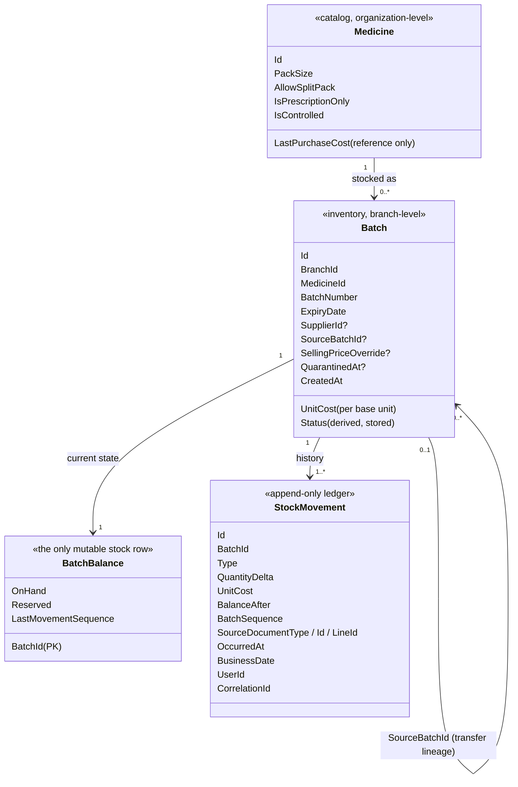
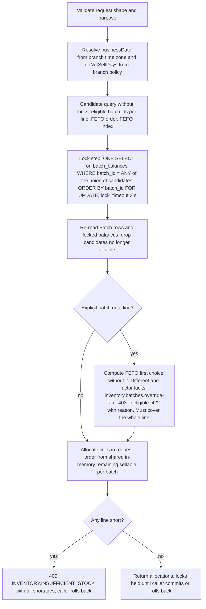
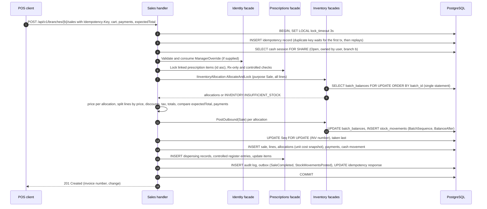
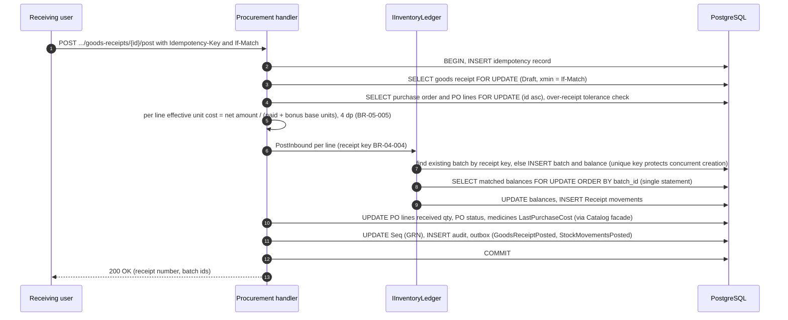
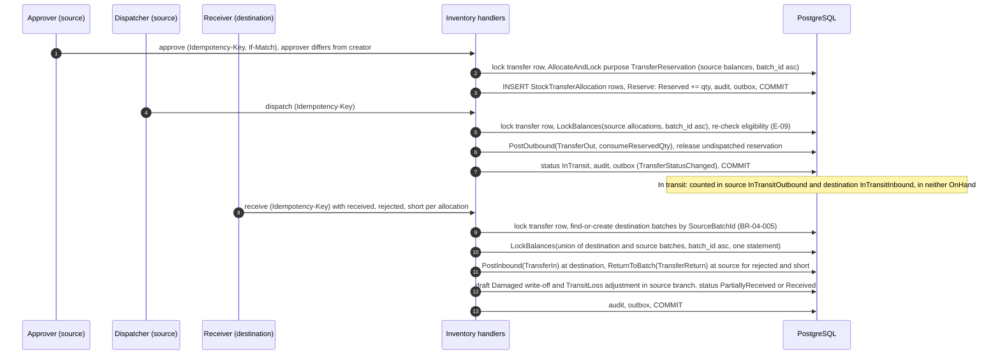
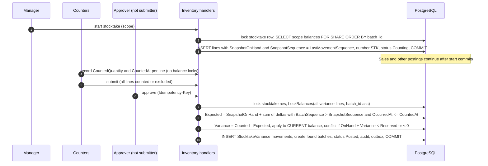
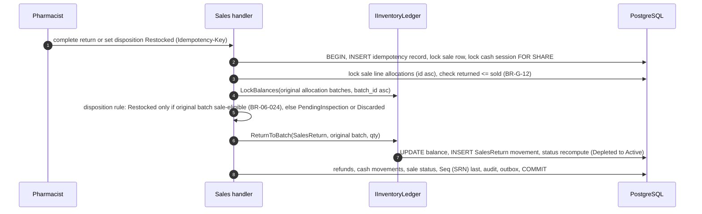
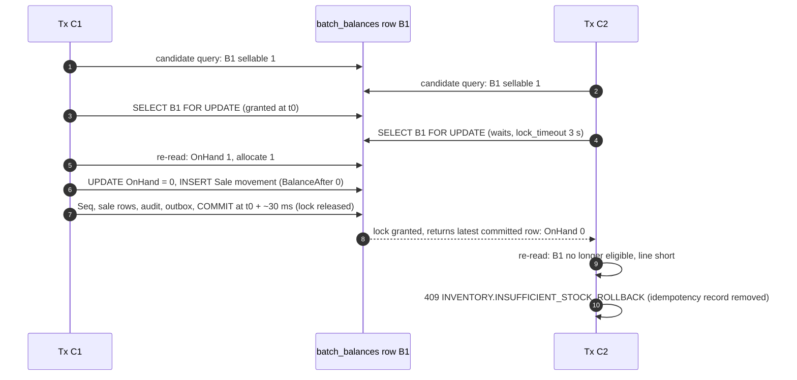

# Inventory Architecture

| Field | Value |
|---|---|
| Version | 1.1 |
| Status | Draft for review |
| Date | 2026-11-10 |
| Related ADRs | ADR-001 (modular monolith, shared transaction), ADR-003 (inventory ledger), ADR-004 (FEFO and locking), ADR-007 (background jobs), ADR-008 (audit) |
| Related specs | SPEC-04 Batch & Inventory (normative for contracts and rules), SPEC-05 Suppliers & Procurement, SPEC-06 Sales & POS, SPEC-08 Prescriptions, SPEC-09 Finance & Reporting |
| Related BR-G | BR-G-02..10, BR-G-19, BR-G-20, BR-G-23..25, BR-G-27, BR-G-31 |
| Critical scenarios | CS-01, CS-02, CS-06, CS-10, CS-11 |

This document is the technical deep dive of the inventory core: the data concepts, ledger invariants, the FEFO allocation algorithm, the posting flows of every stock-changing operation, concurrency and failure analysis, idempotency, reconciliation, valuation/COGS, expiry handling, and performance. Business rules and API surfaces are owned by SPEC-04 (and SPEC-05/06 for their documents); where this document restates them it cites the rule id, and SPEC-04 wins on conflict. Section 14 records the consistency findings resolved on 2026-11-10.

---

## 1. Concepts

| Concept | What it is | What it is not | Who writes it |
|---|---|---|---|
| **Medicine** | Organization-level catalog definition: names, pack size, flags, prices | Physical stock; has no quantity | Catalog module (SPEC-03) |
| **Batch** | A received quantity of one medicine in one branch with one batch number, expiry date, unit cost and origin (supplier or source batch). Identity rules: receipt key BR-04-004, transfer lineage BR-04-005 | Shared across branches (never, BR-G-02, BR-G-04) | Inventory only, via `PostInbound` find-or-create |
| **BatchBalance** | Current `OnHand` and `Reserved` in integer base units, plus `LastMovementSequence`; guarded by check constraints `on_hand >= 0`, `reserved >= 0`, `reserved <= on_hand` | A cache — it is authoritative and maintained in the same transaction as the ledger | Inventory only, under row lock |
| **StockMovement** | Immutable ledger row per batch per source line, with signed delta, cost snapshot, `BalanceAfter`, and a per-batch gap-free `BatchSequence` | Updatable; corrections are compensating movements (BR-G-25) | Inventory only, `INSERT` privilege only |

Derived quantities (SPEC-04 BR-04-001, FR-04-005, FR-04-054):

| Quantity | Definition |
|---|---|
| Sale-eligible batch | `QuarantinedAt IS NULL` AND `ExpiryDate > businessDate + DoNotSellWindowDays` AND `OnHand − Reserved > 0` |
| Sellable (batch) | `OnHand − Reserved` if sale-eligible, else 0 |
| Sellable (medicine, branch) | Σ sellable of its batches in the branch |
| In-transit outbound / inbound | Σ over open transfer allocations of `DispatchedQty − ReceivedQty − RejectedQty − ShortQty`; belongs to the **source** branch for valuation (BR-04-020) and is never part of either branch's `OnHand` |

The stored `Batch.Status` (`Quarantined` > `Expired` > `Depleted` > `Active`, BR-04-002) is for display and filtering only. **No eligibility decision reads the stored status alone**; every decision recomputes expiry against the branch business date at decision time (FR-04-023).

---

## 2. Ledger Invariants

The following invariants hold after every committed transaction. They are enforced by construction (single write path, locks, constraints) and verified by the reconciliation job (§9) and by tests (reconciliation runs as a test oracle after every integration test class, SPEC-04 §18).

| ID | Invariant | Enforcement | Verified by check code |
|---|---|---|---|
| INV-1 | For every batch: `OnHand = Σ QuantityDelta` of its movements | Balance and movement written by the same `IInventoryLedger` call in the same transaction | `ON_HAND_SUM` |
| INV-2 | Movements of a batch ordered by `BatchSequence` form a chain: `BalanceAfter(n) = BalanceAfter(n−1) + QuantityDelta(n)`, with `BalanceAfter(0) = 0`; the last `BalanceAfter = OnHand` | Computed under the balance row lock | `BALANCE_AFTER` |
| INV-3 | `BatchSequence` is contiguous 1..`LastMovementSequence`, unique per batch | `BatchSequence = LastMovementSequence + 1` under the row lock; unique (batch_id, batch_sequence) | `SEQUENCE_GAP` |
| INV-4 | `0 ≤ Reserved ≤ OnHand` and `OnHand ≥ 0`; every `BalanceAfter ≥ 0` | DB check constraints (final guard, BR-G-10) | Constraint (cannot be violated in committed data) |
| INV-5 | `Reserved` = open transfer reservations (Approved, not yet dispatched) + open supplier-return draft reservations of the batch | `Reserve`/`ReleaseReservation` only from those documents | `RESERVED_SUM` |
| INV-6 | Stored status = derived status for the reconciliation business date | Recomputed in every posting; nightly flagging job | `STATUS_DERIVATION` |
| INV-7 | Per transfer allocation: `Dispatched = Received + Rejected + Short + Outstanding`, `Outstanding ≥ 0`; Σ `TransferOut` = Σ `TransferIn` + Σ `TransferReturn` + outstanding | Receipt validation `INVENTORY.TRANSFER_OVER_RECEIPT` | `TRANSFER_CONSERVATION` |
| INV-8 | `QuantityDelta ≠ 0`, sign and source document type match the movement-type matrix (SPEC-04 §6.3) | Checked before any write (FR-04-010) | Constraint + unit tests |
| INV-9 | `StockMovement.UnitCost = Batch.UnitCost` (BR-04-031); batch unit cost never changes after creation | Batch cost immutable (metadata correction excludes cost) | Reconciliation spot check (optional) |
| INV-10 | Every movement references an existing source document and line in the owning module | Same-transaction write | Integration tests |

---

## 3. Inventory Contracts (summary)

The Inventory module exposes two in-process transactional facades (SYSTEM-ARCHITECTURE §5.1). Both **join the caller's open transaction** and never commit (FR-04-011). Full definitions: SPEC-04 §6.2 and §6.4.

| Contract | Operation | Purpose |
|---|---|---|
| `IInventoryAllocation` | `Allocate(request)` with mode `AllocateAndLock` or `Preview` and purpose `Sale`, `TransferReservation`, `SupplierReturn` | FEFO selection and the **single lock step** for outbound documents |
| `IInventoryLedger` | `PostOutbound(batchId, type, qty, source…, consumeReservedQty)` | OnHand −, optional Reserved −, movement |
| | `PostInbound(receiptKey or batchId, type, qty, source…)` | Find-or-create batch, OnHand +, movement |
| | `ReturnToBatch(batchId, type, qty, source…)` | OnHand + into the original batch: `SaleVoid` and `TransferReturn` irrespective of batch status; `SalesReturn` only when the batch is sale-eligible, otherwise 422 `INVENTORY.BATCH_NOT_SELLABLE` (BR-04-032) |
| | `Reserve` / `ReleaseReservation` | Reserved ±, no movement |
| | `LockBalances(batchIds)` | The lock step for inbound/return-only documents that do not need FEFO (receipts, voids, restocks) |

Rules shared by every posting operation:

1. Assert tenant context and that `organizationId`/`branchId` arguments equal the ambient context.
2. All balance rows the document touches are locked **once**, in one statement, ordered by `BatchId` ascending (BR-04-007). Posting to a batch not locked in the current transaction is a programming error (500, logged).
3. Write movement + balance + status recomputation; append the batch to the transaction's single `Inventory.StockMovementsPosted.v1` outbox message.
4. No external call (HTTP, e-mail, file storage) while locks are held (ADR-004 §4.2.4).

---

## 4. FEFO Allocation Algorithm

### 4.1 Inputs and outputs

| Input | Rules |
|---|---|
| `organizationId`, `branchId`, `actorUserId` | Must match tenant context and branch authorization |
| `purpose` | `Sale`, `TransferReservation`, `SupplierReturn` |
| `mode` | `AllocateAndLock` (locks, inside caller transaction) or `Preview` (no locks, no writes, informational) |
| `lines[]` | 1–200 lines; `lineKey`, `medicineId`, `quantityBaseUnits` (1–1,000,000), optional `explicitBatchId`, `supplierId` (required iff purpose `SupplierReturn`) |

| Output | Content |
|---|---|
| Success | `businessDate`; per line ordered allocations `{batchId, batchNumber, expiryDate, quantityBaseUnits, unitCost, sellingPriceOverride, isFefoOverride}` |
| Failure | 409 `INVENTORY.INSUFFICIENT_STOCK` with `shortages[]` (all short lines, nothing allocated); 422 `INVENTORY.BATCH_NOT_SELLABLE` with `reason` for an ineligible explicit batch; 403 `INVENTORY.FEFO_OVERRIDE_NOT_PERMITTED`; 503 `COMMON.LOCK_TIMEOUT` |

### 4.2 Eligibility and ordering

| Purpose | Eligible batches | Excluded |
|---|---|---|
| `Sale`, `TransferReservation` | Same branch and medicine; `QuarantinedAt IS NULL`; `ExpiryDate > businessDate + DoNotSellWindowDays`; `OnHand − Reserved > 0` | Expired by date (even if the nightly job has not flagged it), inside the do-not-sell window, quarantined, zero sellable |
| `SupplierReturn` | Same branch and medicine; `SupplierId = request.supplierId` (BR-G-31); `OnHand − Reserved > 0`; **Expired and Quarantined included** | Other suppliers' batches, transfer-created batches not carrying that supplier |

Ordering (BR-04-009, deterministic): `ExpiryDate ASC, Batch.CreatedAt ASC, Batch.Id ASC`.

### 4.3 Steps (normative summary of SPEC-04 §6.2)

Design notes:

- **One lock statement per request.** All candidates of all lines are locked in a single `SELECT … ORDER BY batch_id FOR UPDATE`. Two transactions therefore acquire overlapping rows in the same global order and cannot deadlock on balances (SPEC-04 E-05). PostgreSQL acquires row locks of an ordered `FOR UPDATE` in the order rows are emitted; the statement uses the primary key index on `batch_id` (a sorted `= ANY` scan), which this document requires to be verified by an `EXPLAIN` regression test.
- **Same medicine on two lines** shares the in-memory remaining quantity per batch (E-04), so a batch is never double-counted.
- **Stock committed after the candidate query** (a receipt between steps C and D) is not considered; the result may be a false `INSUFFICIENT_STOCK`, and a retry succeeds (E-06). A second candidate query was rejected to keep the lock step single and the latency bounded.
- **Locking superset.** Candidates beyond what is finally allocated are locked as well (e.g., three batches locked for a line served by the first). This marginally widens contention but guarantees deterministic order; candidate lists are capped by quantity: the candidate query returns batches in FEFO order only until their cumulative `OnHand − Reserved` covers the requested quantity plus one extra batch (headroom for rows that become ineligible between C and E). The cap is an optimization, not a correctness rule; if after step E the locked set is insufficient, the request fails with `INSUFFICIENT_STOCK` rather than taking a second lock step (consistent with E-06).
- **Preview** runs steps A–C and H on unlocked data and is used by POS, dispensing and transfer-approval screens (FR-04-021). It never reserves.
- **Override** allocations carry `isFefoOverride = true`; the caller writes the audit entry in the same transaction (FR-04-024, FR-06-038).
- **Pricing is not part of FEFO.** The allocation returns `sellingPriceOverride`; Sales resolves prices per allocation and splits a cart line into one sale line per distinct price (BR-06-033, OD-04-01).

---

## 5. Posting Flows (sequence diagrams)

Notation: all steps inside the box run in **one** READ COMMITTED transaction on one connection shared by all module DbContexts (SYSTEM-ARCHITECTURE §5.3) with `SET LOCAL lock_timeout = '3s'`. "Seq" is the `org.document_sequences` row, always locked last.

### 5.1 Sale completion (SPEC-06 §7.3)

Lock order (SPEC-06 §7.3): IdempotencyRecord → CashSession → ManagerOverride → PrescriptionItems (id asc) → BatchBalances (batch id asc, one statement) → DocumentSequence.

### 5.2 Goods receipt posting (SPEC-05)

Notes: a batch number already existing for the same medicine in the branch with a different expiry is rejected (`INVENTORY.BATCH_EXPIRY_MISMATCH`, FR-04-013). Two concurrent receipts creating the same new batch identity serialize on the unique receipt-key index: the second waits, then finds the committed batch and increments it. Receipt reversal uses `PostOutbound(ReceiptReversal)` and fails with `INVENTORY.INSUFFICIENT_STOCK` when the stock has already been consumed (`OnHand − Reserved < qty`, BR-04-015).

### 5.3 Transfer: approve (reserve), dispatch, receive (SPEC-04 §8.2)

The receive step locks balance rows of **two branches** in one ordered statement; because the global order is by `batch_id` regardless of branch, a concurrent sale in either branch cannot deadlock with it. Dispatch re-checks eligibility under lock: a batch that expired after approval fails dispatch with `INVENTORY.BATCH_NOT_SELLABLE` (reason `Expired`) and the reservation remains until cancellation (E-09).

### 5.4 Stocktake start and posting (SPEC-04 §8.3, BR-04-023)

Applying the variance to the current balance (rather than overwriting `OnHand` with the counted figure) keeps sales made during counting correct. Lines that would breach `OnHand ≥ Reserved ≥ 0` fail with `INVENTORY.STOCKTAKE_VARIANCE_CONFLICT` and require recount (E-12). The residual risk of a sale in the same second as `CountedAt` is accepted (OD-04-06).

### 5.5 Sales return restock and sale void (SPEC-06)

A **void** follows the same pattern with `ReturnToBatch(SaleVoid)` for every allocation of the sale, a reversal of dispensing records, negative payments and a `SaleVoid` cash movement, under BR-06-017 (same business date, session still open, no non-rejected return). `PendingInspection` and `Discarded` return lines create no movement; COGS is reversed only for `Restocked` lines at the original allocation cost (BR-06-032).

---

## 6. Concurrency Analysis

### 6.1 CS-01 — two cashiers, last unit

Setup: batch B1 has `OnHand = 1`, `Reserved = 0`; it is the only eligible batch. Cashiers C1 and C2 submit sales of 1 unit at the same moment.

| Time | Tx C1 | Tx C2 | B1 OnHand (committed) |
|---|---|---|---|
| t0 | Lock B1 granted | — | 1 |
| t0 + 1 ms | Allocates 1 | Lock B1 requested, waiting | 1 |
| t0 + 5 ms | Balance 0 written (uncommitted), movement inserted | Waiting | 1 |
| t0 + 30 ms | COMMIT | Lock granted, sees OnHand 0 | 0 |
| t0 + 32 ms | 201 Created | Re-validation fails, ROLLBACK, 409 | 0 |

Why this is correct under READ COMMITTED: a `SELECT … FOR UPDATE` that waited on a locked row re-evaluates against the **latest committed version** after the lock is released, so T2 sees `OnHand = 0` (no lost update). If application logic were faulty and T2 tried to decrement anyway, the `ck_batch_balances_on_hand_nonneg` constraint would abort it (translated to `INVENTORY.INSUFFICIENT_STOCK`, logged at Warning as a missed pre-check). Outcome: exactly one sale, `OnHand = 0`, one `Sale` movement (NFR-G-06).

Test coverage: TS-04-026, TS-04-027 (EPIC-04 allocation contract), TS-06-080 (EPIC-06 end-to-end), SAC-04-02 (1,000 runs × 20 concurrent allocations), NFR-06-004 (50 parallel completions for 10 units × 100), NFR-04-005 soak (20 cashiers × 5 branches, 50 hot batches, 30 minutes: 0 negative balances, 0 findings, 0 deadlocks).

### 6.2 Other contention cases

| Case | Behavior | Reference |
|---|---|---|
| Multi-line carts with overlapping batches in reversed order | Single ordered lock statement → no deadlock | E-05, SPEC-06 §18 |
| Sale vs transfer approval on the same batch | Serialized on the balance row; approval reserves only `OnHand − Reserved`; later sale sees reduced sellable | BR-04-015 |
| Sale vs quarantine | Quarantine takes the balance row lock (FR-04-047); whichever commits first wins; a sale that waits re-reads `QuarantinedAt` and excludes the batch | E-07 |
| Sale vs stocktake start | Start uses `FOR SHARE`; sales wait at most the start transaction duration (bounded by scope size; a 5,000-batch start must complete ≤ 3 s or the waiting sale times out with `COMMON.LOCK_TIMEOUT`) — large scopes should be started outside peak hours | FR-04-059 |
| Sale vs cash session close | Sale holds `FOR SHARE` on the session; close takes `FOR UPDATE` and waits for in-flight sales; new sales after close see `Closed` | SPEC-06 §7.3 |
| Concurrent receipts creating the same batch | Unique receipt-key index serializes creation | §5.2 |
| Two concurrent requests with the same idempotency key | Second insert waits on the unique index, then replays the committed response | §8 |
| Reconciliation during sales | REPEATABLE READ read-only snapshot, no row locks | E-19 |

### 6.3 Lock hold budget

| Segment of the sale transaction | Target p95 |
|---|---|
| Begin → balance lock acquired | ≤ 20 ms (without contention) |
| Balance lock → commit (pricing, posting, sequence, inserts, audit, outbox) | ≤ 40 ms |
| Sequence lock → commit | ≤ 10 ms |
| Whole transaction (database time) | ≤ 120 ms p95, enabling NFR-G-02 (≤ 800 ms end to end) |

Anything that is not required for correctness (receipt rendering, notifications, SignalR stock hints, e-mail) happens after commit or through the outbox.

---

## 7. Failure and Rollback Analysis (CS-10)

Principle: one database transaction per business operation; failure at any point before `COMMIT` leaves **no** movement, balance change, document state change, consumed document number, outbox message, audit entry, or idempotency record (FR-04-027, FR-06-028).

| Failure point (sale completion) | State after failure | Client outcome | Recovery |
|---|---|---|---|
| Validation before `BEGIN` | Nothing started | 400/422 | Fix input |
| Lock wait > 3 s | Rolled back | 503 `COMMON.LOCK_TIMEOUT`, `Retry-After: 1` | Client retries with the same key |
| Deadlock / serialization failure | Rolled back, retried up to 2 more times (50–200 ms jitter) | Success or 503 `COMMON.TRANSIENT_CONFLICT` | Same key retry |
| Insufficient stock after lock | Rolled back | 409 with shortages | Cashier edits cart (new key) |
| Exception after `UPDATE batch_balances` and movement insert | Rolled back by PostgreSQL | 500 `COMMON.INTERNAL_ERROR` | Retry with same key re-executes (no stored record) |
| Connection lost / process crash before `COMMIT` | PostgreSQL aborts the transaction | Client timeout | Retry with same key; executes once |
| Database crash before commit record is flushed | Transaction absent after recovery (WAL) | Client timeout | Retry |
| Crash after `COMMIT`, before response delivered | Sale committed, idempotency record committed with response | Client timeout | Retry with same key → replayed 201 (`Idempotency-Replayed: true`) |
| Outbox consumer fails after commit | Business data committed; event retried by dispatcher | None | Outbox retry/dead-letter (SYSTEM-ARCHITECTURE §5.2) |

Fault-injection tests (SPEC-04 §18, SPEC-06 §18): an interceptor throws after N SQL commands for N = 1..k for every posting operation, plus connection kill before commit; assertions compare ledger, balances, documents, sequences, outbox, audit and idempotency tables before/after. Mapped scenarios: TS-04-039, TS-04-040, TS-04-066, TS-04-151, TS-04-179 (EPIC-04), TS-06-085, TS-06-121, TS-06-129, TS-06-155 (EPIC-06), TS-08-072 (dispensing).

---

## 8. Idempotency (CS-11)

| Aspect | Design |
|---|---|
| Endpoints | All inventory posting endpoints (FR-04-025) plus SPEC-05/06 posting endpoints listed in conventions §7 |
| Key | `Idempotency-Key` header (UUID), scope `(OrganizationId, UserId, Key)`, retention 24 h |
| Storage | `IdempotencyRecord` inserted as the **first** write of the business transaction; response (status, body, `Location`, `ETag`) written in the same transaction just before commit. Only 2xx outcomes are stored (SPEC-06 §7.3); failures leave no record, so a retry re-evaluates against current state |
| Concurrent duplicates | The second insert blocks on the unique index until the first transaction ends; on commit of the first it gets a unique violation, reads the stored response and replays it; on rollback of the first it proceeds and executes |
| Body mismatch | Same key, different SHA-256 request hash → 422 `COMMON.IDEMPOTENCY_KEY_REUSED` |
| Client behavior | POS reuses the key for retries of an unchanged cart and payments and generates a new key when either changes (FR-06-036); the key is persisted in the POS cart store until a definitive response |

Test coverage: TS-04-041, TS-04-042, TS-04-043, TS-04-144, TS-04-150, TS-04-159 (EPIC-04); TS-06-082, TS-06-083, TS-06-118, TS-06-127, TS-06-132 (EPIC-06); NFR-06-005 (100 concurrent submissions → 1 sale).

---

## 9. Reconciliation Job Design

| Attribute | Value |
|---|---|
| Job | `inventory.reconciliation` (Hangfire, ADR-007), daily 01:30 `Africa/Cairo` and on demand (FR-04-049) |
| Unit of work | One branch at a time, batches processed in `batch_id` ranges of 10,000 |
| Isolation | Each chunk in a `REPEATABLE READ READ ONLY` transaction (consistent snapshot, no row locks, E-19); findings upserted in a separate short READ COMMITTED transaction |
| Checks | `ON_HAND_SUM` (INV-1), `BALANCE_AFTER` (INV-2), `SEQUENCE_GAP` (INV-3), `RESERVED_SUM` (INV-5, using open transfer allocations and SPEC-05 open supplier-return reservations), `STATUS_DERIVATION` (INV-6), `TRANSFER_CONSERVATION` (INV-7) |
| Incremental optimization | For batches with `LastMovementSequence` unchanged since the last clean run and a stored checkpoint `(batch_id, sequence, sum)`, only movements after the checkpoint are summed; a full scan runs weekly (Sunday) |
| Output | `ReconciliationFinding` rows keyed `(batch or transfer, check_code, run_date)` with `FirstDetectedRunId`; `BackgroundJobRun` record; on any **new** finding `Inventory.ReconciliationDriftDetected.v1` (critical) → mandatory `RECONCILIATION_DRIFT_DETECTED` notification to all active Owners ≤ 5 min after the run (NFR-04-009, BR-10-012) and the ops metric `pms_reconciliation_mismatches` |
| Never | Corrects data (BR-04-028). Corrections are authorized adjustments after investigation |
| Performance | 500,000 batches / 20 M movements ≤ 30 min; ≤ 10% p95 impact on sale completion (NFR-04-006); throttled by chunk pauses of 50 ms when `pms_sale_completion_duration_seconds` p95 exceeds 600 ms |
| Test oracle | Run after every integration test class; any finding fails the build (SAC-04-01) |

---

## 10. Valuation and COGS

### 10.1 Cost basis — specific batch cost

| Event | Unit cost recorded |
|---|---|
| Goods receipt | `Batch.UnitCost` = line net amount ÷ (paid + bonus base units), rounded to 4 dp `AwayFromZero` (BR-05-005, FR-05-010). Bonus units dilute cost; no zero-cost batch |
| Opening balance, adjustment increase into a new batch, found stock | User-entered cost (default `Medicine.LastPurchaseCost`) (BR-04-031) |
| Transfer | Destination batch inherits the source batch cost (BR-G-04) |
| Every movement | `StockMovement.UnitCost = Batch.UnitCost` |
| Sale | `SaleLineAllocation.UnitCost` snapshot of the allocated batch (BR-06-031) |

Allocation follows FEFO, so COGS follows physical FEFO consumption, not FIFO purchase order (ADR-004 consequence; SPEC-09 states this in report notes).

### 10.2 Formulas

| Measure | Formula | Rounding |
|---|---|---|
| Line COGS | Σ over allocations of `r(qtyBase × UnitCost, 2)` | Per allocation, 2 dp, `AwayFromZero` (SPEC-06 §7.2) |
| COGS reversal on return | Only `Restocked` lines: `r(returnedBase × allocation UnitCost, 2)`; `Discarded` → return loss; `PendingInspection` → pending (BR-06-032) | 2 dp |
| Void | Full reversal of the sale's COGS | — |
| Inventory valuation at time T (batch) | `BalanceAfter` of the batch's last movement with `OccurredAt ≤ T` × `UnitCost` | Value per batch rounded to 2 dp, totals = sum of rounded |
| Branch valuation buckets | Sellable, NearExpiry, Expired, Quarantined (by status/eligibility at the snapshot business date), InTransitOutbound (source branch) | — |

Because the receipt cost is rounded to 4 dp per base unit, `Σ(qty × UnitCost)` of a fully consumed batch can differ from the receipt net amount by at most `0.00005 × base units` (e.g., ≤ 0.05 EGP for 1,000 units). The difference is reported by SPEC-09 as a rounding variance line, never posted to stock.

### 10.3 Snapshots and as-of queries

- `InventoryValuationSnapshot` (SPEC-04 FR-04-062) per branch, business date and medicine, produced at 00:30 branch local time for the previous business date; monthly partitions; only non-zero rows.
- As-of valuation for an arbitrary past timestamp uses the ledger (`BalanceAfter` per batch at `OccurredAt ≤ T`) through `reporting.v_batch_valuation`; p95 ≤ 5 s for one branch (NFR-04-012). The supporting index is `(batch_id, occurred_at DESC, batch_sequence DESC)` on `stock_movements`.
- Cost fields appear in API responses only for holders of `reports.inventory.read` / `sales.sales.read-cost` and never in integration-event payloads (FR-04-030, SPEC-04 §8.5).

---

## 11. Expiry Handling by Business Date and Time Zone

| Rule | Design |
|---|---|
| Business date | `businessDate = (now() AT TIME ZONE branch.TimeZone)::date`, computed by `IBusinessCalendar` from the injected clock at decision time (BR-G-23). Default zone `Africa/Cairo`; IANA tz database shipped with the runtime image and updated with OS patches |
| Expired | `ExpiryDate ≤ businessDate` (BR-G-07) |
| Do-not-sell window | Not sellable when `ExpiryDate ≤ businessDate + DoNotSellWindowDays` (default 0); setting changes take effect ≤ 5 min through the branch policy cache (E-03) |
| Near expiry | `businessDate < ExpiryDate ≤ businessDate + NearExpiryThresholdDays` (default 90, BR-04-026) |
| Month/year expiry | Stored as the last calendar day of the month (BR-04-003, pending OD-04-09) |
| Midnight boundary | At 00:00 branch local time a batch with `ExpiryDate` = the new date becomes non-sellable immediately, even before the 00:05 flagging job (E-02). A cart opened before midnight fails at completion (E-01) |
| Daylight saving | Egypt observes DST (since 2023); business dates are always derived from local wall-clock date, so the 23-hour and 25-hour days need no special logic. Boundary tests inject the clock at 23:59:59 and 00:00:00 including a DST transition date (SPEC-04 §18) |
| Branches in other zones | Each branch evaluates with its own zone; per-branch jobs run hourly and process branches whose local time passed the target (SYSTEM-ARCHITECTURE §12) |
| Flagging job | `inventory.expiry-flagging` at 00:05 local; idempotent per `(branch, businessDate)`; updates status only; emits `BatchExpired` per newly expired batch with stock (FR-04-043) |
| Returns into expired batches | A `SalesReturn` restock into an expired, do-not-sell-window or quarantined batch is rejected (`INVENTORY.BATCH_NOT_SELLABLE`; SPEC-06 `SALES.RESTOCK_NOT_ALLOWED`) and the line can only be `Discarded` (BR-04-032, BR-06-024, E-08). `SaleVoid` and `TransferReturn` into such a batch are accepted and the batch stays non-sellable |

Test coverage (CS-02): TS-04-004, TS-04-023, TS-04-024, TS-04-036, TS-04-109; TS-06-067, TS-06-091, TS-06-145.

---

## 12. Performance Considerations

### 12.1 Hot rows

A fast-moving medicine at a busy branch typically has one or two sellable batches, so many cashiers lock the same `batch_balances` row. Capacity per hot row ≈ 1 / (lock hold time): with hold ≤ 40 ms p95 (§6.3) a single row sustains ≈ 25 completions/s, more than ten times the expected peak of ≈ 2 sales/s per branch (DATABASE-DESIGN §9). Mitigations, in order:

1. Keep the post-lock segment short (no I/O except the remaining inserts; pricing data loaded **before** the lock step where it does not depend on allocation).
2. Take the `DocumentSequence` lock last (it is the true per-branch serialization point).
3. Monitor `pms_stock_lock_wait_seconds` per operation; alert when p95 > 200 ms for 10 minutes.
4. If a real hot spot appears (revisit trigger ADR-004 §7), evaluate splitting the sequence assignment into a post-commit numbering step — not permitted today by BR-G-24, so it would need an ADR.

### 12.2 Timeouts and retries (SPEC-04 FR-04-026, SPEC-06 FR-06-037)

| Setting | Value |
|---|---|
| `lock_timeout` | 3 s for all inventory posting and sale completion transactions |
| Lock timeout outcome | 503 `COMMON.LOCK_TIMEOUT`, `Retry-After: 1`; no server retry; client retries with the same `Idempotency-Key` |
| Deadlock (`40P01`) / serialization (`40001`) | Whole transaction retried up to 2 additional times with 50–200 ms jittered backoff, then 503 `COMMON.TRANSIENT_CONFLICT` |
| `statement_timeout` | 15 s for POS commands; 60 s for other postings (stocktake approval with 5,000 lines must complete ≤ 15 s p95, NFR-04-002) |

### 12.3 Indexes and data volume

| Query | Index |
|---|---|
| FEFO candidates | `inventory.batches (organization_id, branch_id, medicine_id, expiry_date, created_at, id)` (SPEC-04 §8.1); a partial variant `WHERE quarantined_at IS NULL` is recommended because quarantined batches are never sale candidates |
| Lock step | `batch_balances` primary key `(batch_id)` |
| Receipt key | Unique partial index on BR-04-004 key `WHERE source_batch_id IS NULL`; unique `(branch_id, source_batch_id) WHERE source_batch_id IS NOT NULL` |
| Stock card | `stock_movements (batch_id, batch_sequence)` unique; `(branch_id, medicine_id, occurred_at DESC, id DESC)` |
| Document → movements | `stock_movements (organization_id, source_document_type, source_document_id)` |
| Valuation as-of | `stock_movements (batch_id, occurred_at DESC, batch_sequence DESC)` |

Targets: FEFO `AllocateAndLock` p95 ≤ 50 ms database time at 500,000 batches/organization (NFR-04-001); stock card first page p95 ≤ 300 ms at 20 M movements (NFR-04-004). `stock_movements` is range-partitioned by month on `business_date` (DATABASE-DESIGN §11, ADR-003).

---

## 13. Test Strategy Mapping

| Concern | Tests |
|---|---|
| CS-01 oversell | TS-04-026, TS-04-027, TS-06-080, TS-06-081; SAC-04-02; NFR-04-005; NFR-06-004 |
| CS-02 expiry/do-not-sell | TS-04-004, TS-04-023, TS-04-024, TS-04-036, TS-04-109, TS-06-067, TS-06-091, TS-06-145 |
| CS-06 transfers | TS-04-049, TS-04-148, TS-04-153, TS-04-158; SAC-04-04 |
| CS-10 rollback | TS-04-039, TS-04-040, TS-04-066, TS-04-151, TS-04-179, TS-06-085, TS-06-121, TS-06-129, TS-06-155 |
| CS-11 idempotency | TS-04-041, TS-04-042, TS-04-043, TS-04-144, TS-04-150, TS-04-159, TS-06-082, TS-06-083, TS-06-118, TS-06-127, TS-06-132 |
| FEFO properties | Property-based tests: allocations sum to the request, order respected, no ineligible batch (SPEC-04 §18) |
| Lock order | SQL-capturing interceptor asserts the class order of §5 per operation |
| Invariants | Reconciliation as test oracle (SAC-04-01) |

---

## 14. Consistency Findings — Resolved 2026-11-10

All findings raised in the first version of this document were resolved on 2026-11-10:

- **Sales-return restock** into an expired, do-not-sell-window or `Quarantined` batch is forbidden: SPEC-04 FR-04-014, BR-04-027, BR-04-032, E-08 and US-04-03 (AC6, TS-04-019) now match SPEC-06 BR-06-024 and conventions §10; `SaleVoid` and `TransferReturn` remain status-agnostic.
- **Lock timeout 3 s and 2 additional retries (50–200 ms)** applied in DATABASE-DESIGN §8.4 and SYSTEM-ARCHITECTURE §7.
- **Ledger partition key** = `business_date`, monthly range (DATABASE-DESIGN §11; ADR-003 §4.7).
- **Batch identity**: receipt key and lineage key per SPEC-04 BR-04-004/005 (DATABASE-DESIGN §3.4).
- **Column names** `BatchSequence`, `LastMovementSequence`, quarantine and selling-price-override fields, `ReconciliationFinding`, `InventoryValuationSnapshot`, `RebalancingSuggestion` added to DATABASE-DESIGN §3.4.
- **Transfer allocation quantities** renamed to `reserved_qty`, `dispatched_qty`, `received_qty`, `rejected_qty`, `short_qty`.
- **Lock order** in DATABASE-DESIGN §8.3 aligned with SPEC-04 BR-04-007 and SPEC-06 §7.3 (single balance lock statement; sequence last).
- **Document numbering** timing and `OPB` prefix aligned with SPEC-04 BR-04-030 (DATABASE-DESIGN §9).
- **Adjustment approval threshold** default 1,000.00 (DATABASE-DESIGN §3.2).
- **ADR-004** eligibility wording now references SPEC-04 BR-04-001.
- **POS override entity** is `ManagerOverride` everywhere (owned by Identity, consumed by Sales).
