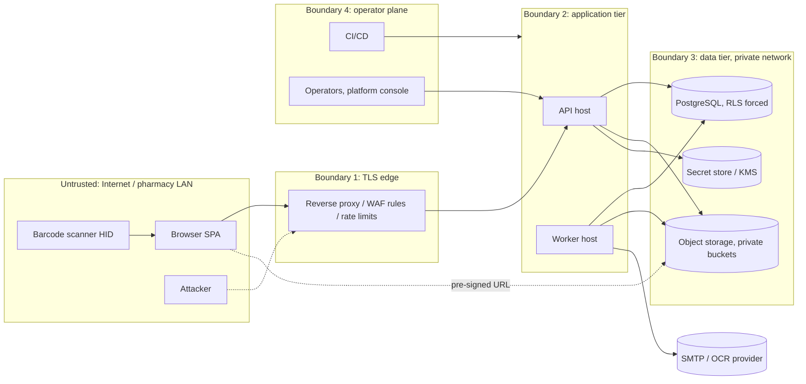
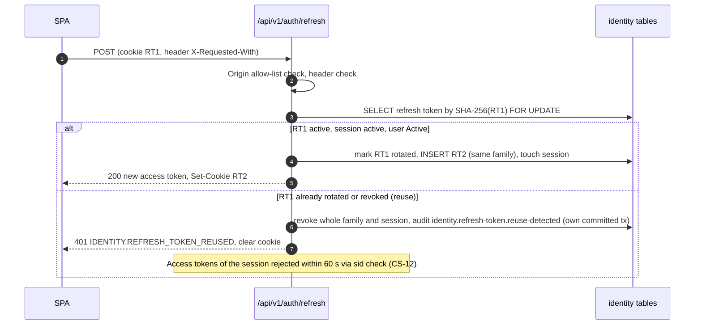
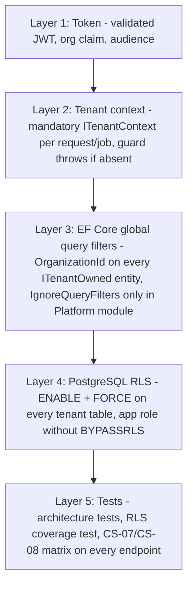
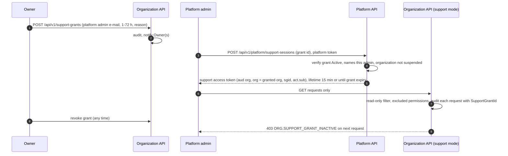

# Security Architecture

| Field | Value |
|---|---|
| Version | 1.1 |
| Status | Draft for review |
| Date | 2026-11-10 |
| Related ADRs | ADR-002 (multi-tenancy, amended 2026-11-10: RLS enabled and forced from the first release), ADR-005 (authentication), ADR-006 (file storage), ADR-007 (background jobs), ADR-008 (audit logging) |
| Related specs | SPEC-01 Identity & Access, SPEC-02 Organization & Branches, SPEC-07 Patient Records, SPEC-08 Prescriptions, SPEC-10 Notifications, Audit & Settings |
| Related BRQ / BR-G | BRQ-01, BRQ-02, BRQ-08, BRQ-12; BR-G-16, BR-G-17, BR-G-29, BR-G-30, BR-G-32 |
| Critical scenarios | CS-07, CS-08, CS-12, CS-13 |

This document defines the security architecture: threat model, authentication, authorization and tenant isolation, OWASP mappings, input and file validation, secrets, encryption, personal and health data handling, logging redaction, browser security, CI security tooling, audit integrity, platform support access, and incident response. Behavioral details (endpoints, error codes, limits) are owned by SPEC-01/02/07/10; this document gives the architecture that realizes them and cites their ids. **No statement in this document claims legal or regulatory compliance.** Applicability of Egyptian personal data protection legislation, consent, cross-border transfer and data residency are pending REG-04; retention is pending REG-05; prescription image processing by third parties is pending REG-10. OWASP ASVS and OWASP Top 10 lists are used as design checklists, not certifications.

---

## 1. Security Principles

1. **Deny by default.** Every endpoint requires an authenticated principal and a declared permission policy; the build fails when a non-anonymous endpoint lacks one (FR-01-023, SYSTEM-ARCHITECTURE AT-08).
2. **Server-side enforcement only.** UI hiding is never a control (BR-G-17).
3. **Defense in depth for tenant isolation.** Five independent layers (§4.4); a leak requires simultaneous defects in at least two.
4. **Least privilege** for users (permissions, branch scope), services (database roles, bucket credentials) and operators (no standing access to organization data).
5. **Minimize sensitive data**: collect less, mask by default, encrypt the highest-impact identifiers, log access to medical data, never log secrets or medical values.
6. **Tamper evidence** for sensitive operations: same-transaction audit plus a hash chain (§13).
7. **Secure defaults in configuration**: startup fails on missing or insecure options (DEPLOYMENT-ARCHITECTURE §4).

---

## 2. Threat Model

### 2.1 Assets

| Asset | Classification | Primary threats |
|---|---|---|
| Patient demographics, allergies, conditions, notes, prescriptions, prescription images, dispensing history | **Restricted (health data)** | Disclosure, unauthorized access by staff, cross-tenant leak, exfiltration via exports or logs |
| Credentials, refresh tokens, signing keys, MFA secrets, encryption keys | **Secret** | Theft, replay, forgery |
| Stock ledger, sales, cash, supplier balances, audit log | **Integrity-critical** | Tampering, repudiation, fraud (discounts, voids, returns, adjustments) |
| Costs, margins, supplier prices | **Confidential (commercial)** | Disclosure to unauthorized staff or other tenants |
| Staff personal data (names, e-mails, IPs, user agents) | **Confidential (personal)** | Disclosure, enumeration |
| Availability of POS | **Operational** | Denial of service, lock exhaustion, resource exhaustion |

### 2.2 Trust boundaries

### 2.3 STRIDE per major component

| Component | Spoofing | Tampering | Repudiation | Information disclosure | Denial of service | Elevation of privilege |
|---|---|---|---|---|---|---|
| **SPA (browser)** | Phishing clone; stolen access token from XSS → strict CSP, no tokens in web storage, 15-min access tokens | DOM/script injection → React escaping, CSP without `unsafe-inline` scripts, no `dangerouslySetInnerHTML` (lint rule) | — | Patient data cached in browser → no persistence of patient/prescription data, cache cleared on logout, `Cache-Control: no-store` | Large result rendering → pagination limits | Hidden UI actions invoked directly → server authorization on every endpoint |
| **Auth endpoints** (`/auth/*`) | Credential stuffing, brute force → rate limits, lockout 5/15 min, blocked-password list, optional MFA (P2) | Refresh token replay → rotation + family reuse detection (CS-12) | Disputed logins → append-only `LoginAttempt`, identity audit events | Account enumeration → identical responses, timing equalization ≤ 50 ms (FR-01-004, NFR-01-008) | Login flood, slow hashing abuse → per-IP and per-identity limits, hashing cost bounded | Platform token used on org endpoints → separate audience, rejected with 401 (FR-01-045) |
| **Business API** | Forged JWT, `alg=none`, key confusion → fixed algorithm allow-list, `kid` lookup in own JWKS, issuer/audience validation, clock skew ≤ 30 s | Mass assignment, price manipulation → explicit request DTOs, server-side pricing (`SALES.PRICE_MISMATCH`), ETag/If-Match | Staff denies a void/discount → same-transaction audit with actor and override approver | IDOR / BOLA across branches or organizations → branch handler (403), tenant filters + RLS (404) | Expensive queries, lock exhaustion → page size ≤ 100/200, statement and lock timeouts, report exports async | Privilege escalation via role editing → grant-only-what-you-hold (BR-01-009), self-modification forbidden (BR-01-008) |
| **POS manager override** | Approver impersonation → approver password re-entry, counts toward approver lockout | Reuse of a grant for another sale → single-use, bound to org/branch/requester/permission/context hash, TTL 120 s | Approver denies approving → `identity.override.granted/consumed` audit | Override endpoint as password oracle → generic `IDENTITY.OVERRIDE_DENIED`, rate limits | Brute force through override → lockout counting (FR-01-038) | Cashier approves own discount → requester ≠ approver |
| **Database** | App connecting as owner → separate roles, app role non-owner without `BYPASSRLS` | Ledger edits → `INSERT/SELECT` only on ledgers, triggers, reconciliation, audit chain | DBA changes → DB audit logging (pgaudit) for privileged roles, shipped off-host | Cross-tenant read from a missing filter → RLS forced; backups encrypted | Long transactions → `idle_in_transaction_session_timeout`, lock timeouts | SQL injection → parameterized EF Core/Npgsql only; raw SQL reviewed |
| **File storage** | Upload of disguised executable → magic-byte sniffing, allow-list | Overwrite of another object → server-generated keys, pre-signed PUT bound to key, size and type | — | Guessable URLs, public buckets → private buckets, pre-signed GET ≤ 5 min after authorization (15 min for exports per SPEC-07) | Huge uploads → size limits per purpose | Path traversal via filename → names never used as keys |
| **Background jobs / outbox** | Job runs without tenant → tenant context mandatory per payload, RLS fails closed | Poison messages → schema-validated payloads, dead-letter | Job actions → `ActorType = System` audit | Event payload leaks PHI → ids only in payloads (SPEC-04 §8.5) | Job storms → queue concurrency limits | Job running as platform role on tenant data → platform role only for enumeration (§4.4) |
| **SignalR hub** | Token in query string logged → redaction of `access_token` on hub path | Client joins foreign group → server-managed groups only | — | Notification payload leaks data → ids and keys only | Connection floods → per-user connection cap (10) | Revoked user stays connected → disconnect on `UserDeactivated`, close on token expiry |
| **Platform console / support access** | Platform admin phishing → separate store and audience, ≥ 14-char passwords, MFA mandatory for platform admins once available (OD-01-09) | Support session writes data → read-only enforcement (`ORG.SUPPORT_ACCESS_READ_ONLY`) | Operator denies access → every support request audited with `SupportGrantId` | Operator reads patient data → patients, prescriptions and exports always excluded (BR-02-017) | — | Standing access → only via Owner-granted, ≤ 72 h, single-admin grant |
| **Audit subsystem** | Forged audit rows → only the application writes; sealer role separate | Row edits → append-only privileges + hash chain + verification | — | Medical values in diffs → stored as SHA-256 hashes (BR-10-006) | Sealer outage → backlog sealed later, alert at 15 min unsealed | — |
| **CI/CD and supply chain** | Malicious PR using secrets → no secrets in PR workflows from forks, protected environments | Dependency or image tampering → lock files, pinned actions by SHA, image signing, SBOM | — | Secrets in repo → secret scanning gate | — | Compromised runner → least-privilege tokens, OIDC to cloud, short-lived credentials |

Top residual risks are listed in §17.

---

## 3. Authentication

### 3.1 Principals and stores

| Principal | Store | Login | Token audience | Notes |
|---|---|---|---|---|
| Organization user (Owner, Manager, Pharmacist, Cashier, Inventory, Accountant, custom) | `identity.users` (tenant-owned, RLS) | E-mail (platform-unique, BR-01-001) + password, optional TOTP (P2) at `/api/v1/auth/login` | `org` | One user belongs to exactly one organization in v1 (OD-01-03) |
| Platform administrator | `identity.platform_users` (`PlatformUser`, no `OrganizationId`) with `PlatformSession`, `PlatformRefreshToken` | `/api/v1/platform/auth/login` | `platform` | Created only by a deployment provisioning command; passwords ≥ 14 characters; MFA mandatory once US-01-18 ships (OD-01-09) |
| Support session (platform admin acting under a grant) | Derived from a `PlatformSession` + active `SupportAccessGrant` | `POST /api/v1/platform/support-sessions` | `org` with support claims (§10) | Read-only, no refresh token |
| System (jobs, outbox consumers) | None (in-process) | — | — | `ActorType = System`; tenant context from job payload |

Organization tokens are rejected on platform endpoints and platform tokens on organization endpoints with 401 (FR-01-045). Separate stores keep tenant RLS policies uniform: there are no rows with `organization_id IS NULL` in tenant tables.

### 3.2 Password policy and hashing

| Control | Value | Source |
|---|---|---|
| Length | 10–128 characters (platform admins ≥ 14) | FR-01-012, FR-01-045 |
| Composition | ≥ 1 letter and ≥ 1 digit; Unicode allowed (Arabic letters count as letters); no maximum-complexity rules | FR-01-012 |
| Blocked list | Platform list ≥ 10,000 common/breached passwords, offline file shipped with the image | FR-01-012 |
| Context checks | Must not contain the e-mail local part (≥ 4 chars); not equal to the last 5 passwords (`UserPasswordHistory`) | FR-01-012 |
| Breached-password check (online) | **Optional, P2, OFF by default:** k-anonymity range query (first 5 hex chars of SHA-1) against a breached-password service; enabling it requires REG-04 review because a hash prefix leaves the platform. The offline list remains the mandatory control | Decision of this document |
| Hashing | ASP.NET Core Identity v3: PBKDF2-HMAC-SHA512, ≥ 100,000 iterations, per-user salt; re-hash on login when parameters are weaker | FR-01-012 |
| Lockout | 5 consecutive failures → `Locked` for 15 minutes; failures from login **and** manager override count; unknown e-mails get the same response; 423 `IDENTITY.ACCOUNT_LOCKED` with `retryAfterSeconds` | FR-01-016, FR-01-038 |
| Rate limits (anonymous) | Login 10/min per (IP, e-mail) and 30/min per IP; forgot password 3/h per e-mail and 10/h per IP; signup 5/h per IP; token redemption 10/h per IP; enforced across nodes with ≤ 10% overshoot | FR-01-018, NFR-01-009 |
| Enumeration resistance | Identical 401 body for unknown e-mail, wrong password, deactivated user; dummy hash verification for unknown e-mails (p95 difference ≤ 50 ms); forgot-password always 202 | FR-01-004, FR-01-014, BR-01-022 |

### 3.3 Tokens

**Access token (JWT)** — lifetime 15 minutes; signed with **ES256** (decision: smaller tokens and faster verification than RS256; RS256 ≥ 2048 remains permitted by NFR-01-007 for HSM compatibility). Claims (SPEC-01 §8.4):

| Claim | Meaning |
|---|---|
| `iss` | API issuer URL (per environment) |
| `aud` | `org` or `platform` |
| `sub` | User id (or platform user id) |
| `org` | Organization id (absent for `platform`) |
| `sid` | Session id (`UserSession.Id`) |
| `stamp` | Short hash of the user's security stamp |
| `amr` | Authentication methods (`pwd`, `mfa`) |
| `iat`, `exp`, `jti` | Issue time, expiry, token id |
| `kid` (header) | Signing key id |
| Support only: `sgid`, `act` | Support grant id; `act.sub` = platform user id |

Permissions and branch assignments are **not** in the token; they are resolved per request from the authorization snapshot cache (§4.1), keeping tokens small and making changes effective ≤ 60 s (FR-01-025).

**Validation** — algorithm allow-list `ES256` (and `RS256` only if configured), reject `none`/HS*; `kid` must exist in the local key set; issuer and audience exact match; clock skew ≤ 30 s (NFR-01-012). After signature validation, the session check rejects tokens whose `sid` is revoked or whose `stamp` differs from the current security stamp, using a cache refreshed at most every 60 s (FR-01-011, NFR-01-005).

**Refresh token** — opaque 256-bit random value, stored only as SHA-256 hash; one family per session; 14-day sliding expiry, 30-day absolute (`FamilyExpiresAt`); single-use with rotation on every refresh (FR-01-007); max 10 active sessions per user (FR-01-006).

Concurrent refresh from several tabs: the SPA performs single-flight refresh with a cross-tab lock (BroadcastChannel / Web Locks API); there is no server-side grace window (OD-01-01). Test: TS-01-014 (CS-12).

**Signing key rotation** — keys live in the secret store/KMS (never in the repository or image). Rotation every 90 days: the next key is published to the verification key set ≥ 24 h before it becomes the signing key; the retired key stays in the verification set ≥ 30 minutes after its last issued token expires (≥ 45 minutes in total after switch), so rotation logs out 0 users (NFR-01-007). Emergency rotation (key compromise) removes the old key immediately and revokes all sessions issued since the suspected compromise. Data-protection keys (used for TOTP secrets and short-lived protected payloads) are persisted to the secret store, not the database.

### 3.4 Cookies and CSRF

| Cookie | Attributes |
|---|---|
| Refresh (org) | `__Host-` prefix is not usable because a `Path` is required; name `pms_rt`; `HttpOnly; Secure; SameSite=Strict; Path=/api/v1/auth`; no `Domain`; `Max-Age` = remaining sliding lifetime |
| Refresh (platform) | `pms_prt`; same attributes with `Path=/api/v1/platform/auth` |

The refresh token is the only credential sent automatically by the browser, so only the refresh/logout endpoints are CSRF-relevant. Controls (layered):

1. `SameSite=Strict` and the narrow cookie path.
2. `POST` only; requests must carry the custom header `X-Requested-With: pms-web` (forces a CORS preflight for cross-origin callers; SPEC-01 §17).
3. `Origin` (or `Referer` when `Origin` is absent) must match the configured SPA origin allow-list; otherwise 403 without touching the token.
4. CORS: the API allows only the configured SPA origins, `credentials: true` only for `/api/v1/auth/*` and `/api/v1/platform/auth/*`.

All other endpoints authenticate with the `Authorization: Bearer` header only, which browsers never attach automatically; they are not CSRF-exposed.

### 3.5 Session lifecycle

| Event | Effect | Enforcement window |
|---|---|---|
| Logout / logout-all | Revoke session(s) and token families, clear cookie | Immediate for refresh; access tokens ≤ 60 s |
| Deactivation | Revoke all refresh tokens and sessions in the same transaction, rotate security stamp, SignalR disconnect | ≤ 60 s (stricter than BR-G-30) |
| Password change | Revoke all other sessions; reset → revoke all | ≤ 60 s |
| Role / branch / scope change | Authorization snapshot invalidated | ≤ 60 s on all nodes |
| `MustChangePassword` / MFA enrollment obligation | Session restricted to the allow-listed endpoints, others 403 | Immediate (BR-01-023) |

### 3.6 Multi-factor authentication

TOTP (RFC 6238) per SPEC-01 FR-01-041..044, priority P2 in SPEC-01: secrets encrypted with data-protection keys outside the database, 10 single-use hashed recovery codes, same time step never accepted twice, 5 failed codes count toward lockout. Organization setting `RequireMfaForOwnerAndManager` (default OFF). Priority stays P2 in SPEC-01, but MFA is scheduled for V1 (RELEASE-PLAN §3) and MFA for platform administrators is a **SaaS launch gate (V1.3)**; it is also recommended for Owners of SaaS tenants (risk R-SEC-03 in §17).

### 3.7 POS manager override

A cashier's operation requiring a higher privilege (discount above the role limit BR-G-32, return approval, refund method change, void) obtains a `ManagerOverride` at `POST /api/v1/branches/{branchId}/auth/override` with the approver's credentials. The `ManagerOverride` is single-use, valid 120 s (`ManagerOverrideTtlSeconds`, 30–600), bound to organization, branch, requesting user, approving user, permission and a hash of the operation context; it creates no session for the approver (BR-01-016) and is consumed in the business transaction by the Identity facade (FR-01-039). Wrong approver passwords count toward the approver's lockout. Audit: `identity.override.granted`, `identity.override.denied` (own transaction), `identity.override.consumed`.

---

## 4. Authorization and Tenant Isolation

### 4.1 Policy model

Effective access = permission (union of the user's roles) AND branch scope (route `branchId` ∈ assigned branches, or organization-wide scope) AND organization match (conventions §5.3, FR-01-023).

| Mechanism | Design |
|---|---|
| Permission policies | One ASP.NET Core authorization policy per permission code (`perm:<code>`), registered from the module permission catalogs; endpoints declare `RequirePermission("inventory.adjustments.approve")`. Unknown permission codes fail at startup |
| Authorization snapshot | Per user: status, security stamp, permissions, branch assignments, organization-wide flag, role discount limit; loaded from the database, cached in memory 60 s keyed by `(userId, authzVersion)`, invalidated by `UserAuthorizationChanged` (Redis pub/sub when scaled out). Warm evaluation ≤ 5 ms p95 (NFR-01-003) |
| `BranchAuthorizationHandler` | For routes with `{branchId}`: branch belongs to the token organization (else **404**, indistinguishable from non-existent) AND branch ∈ snapshot scope (else **403** `IDENTITY.BRANCH_ACCESS_DENIED`) (CS-07, CS-08) |
| Body-referenced ids | Ids in request bodies (e.g., `patientId`, `destinationBranchId`, `batchId`) are resolved through tenant-filtered queries; a foreign-organization id yields 404 `COMMON.NOT_FOUND`; a same-organization id outside branch scope yields 403 |
| Resource-based checks | In application handlers via `IAuthorizationService` with the loaded resource: segregation of duties (approver ≠ submitter, BR-G-28), cash session ownership, return in the sale's branch, user-management scope (FR-01-032), field-level omission of costs without `reports.inventory.read` / `sales.sales.read-cost` |
| Privilege escalation guard | Roles and assignments may grant only permissions the actor holds; only Owners assign `OWNER` or organization-wide scope; no self-modification (BR-01-008..010) |
| Medical data | `patients.medical.*` is a separate permission family from `patients.profiles.*` (BR-07-003); responses with medical data require a successful access-log write first (fail closed, §8.2) |

**403 vs 404 semantics:** the organization boundary is never disclosed (404 for any other-organization id, same body and timing as a non-existent id); within the organization, missing permission or branch scope returns 403 with a stable code.

### 4.2 Tenant isolation layers (all present from the first release, ADR-002 amended)

| Layer | Fails closed when | Verified by |
|---|---|---|
| 1 Token | Signature, issuer, audience, expiry, session or stamp invalid → 401 | Security tests (`alg` confusion, `none`, expired, foreign audience) |
| 2 Tenant context | Handler or DbContext used without context → exception (500 + alert) | Unit tests; architecture rule |
| 3 EF filters | Entity without filter → build fails (AT-10) | Architecture test |
| 4 RLS | No `app.organization_id` set → zero rows visible, inserts rejected by `WITH CHECK` | RLS integration suite runs with RLS forced in every environment (DEPLOYMENT release gate) |
| 5 Tests | Any endpoint returning data for a foreign id → CI failure | Authorization matrix: endpoint × role × in/out-of-scope branch × other organization (SPEC-01 §18); CS-07/CS-08 scenarios in every epic (e.g., TS-01-049, TS-01-050, TS-04-006, TS-07-008) |

**RLS session variable.** ADR-002 requires `app.organization_id` to be set by a connection interceptor. Specification for implementers: the request-scoped connection sets `set_config('app.organization_id', <org>, false)` when opened and `SET LOCAL` re-asserts it at the start of every explicit transaction; Npgsql pool reset (`DISCARD ALL`) clears it on return. Policies use `current_setting('app.organization_id', true)` so an unset variable matches nothing (DATABASE-DESIGN §12). This mechanism is recorded in ADR-002 decision 9 (amended 2026-11-10).

**Database roles:** `pms_owner` (migrations, DDL), `pms_app` (runtime, non-owner, no `BYPASSRLS`, `INSERT/SELECT` only on ledger and audit tables), `pms_audit_sealer` (may only set the four seal columns of `platform.audit_logs` and update `AuditChainHead`, FR-10-004), `pms_platform` (`BYPASSRLS`, used only by platform-console endpoints and organization enumeration in job schedulers; every use audited on the platform chain), `pms_backup`, `pms_readonly`.

---

## 5. OWASP Mappings

### 5.1 OWASP Top 10 (2021)

| Category | Controls in this system |
|---|---|
| A01 Broken Access Control | Deny-by-default policies, branch handler, resource-based checks, 404 for foreign tenants, RLS, authorization matrix tests, CORS allow-list, pre-signed URLs only after authorization |
| A02 Cryptographic Failures | TLS 1.2+ (1.3 preferred), HSTS, ES256 tokens, PBKDF2-SHA512 passwords, SHA-256 token hashes, AES-256-GCM application encryption for national ID and other selected fields (§8.3), encrypted volumes, backups and buckets |
| A03 Injection | EF Core/Npgsql parameterization; raw SQL only in reviewed migrations/repositories; no dynamic `ORDER BY` from input (sort fields mapped from allow-lists); CSV/XLSX formula-injection neutralization on export (SPEC-04 §17); React output escaping |
| A04 Insecure Design | Threat model (§2), critical scenarios CS-01..13 as release gates, segregation of duties, idempotency, server-side pricing |
| A05 Security Misconfiguration | Startup options validation, security headers (§10), no default credentials, Hangfire dashboard private and authenticated, Swagger UI disabled in production, problem details without stack traces |
| A06 Vulnerable and Outdated Components | Central package management, Dependabot/Renovate, `dotnet list package --vulnerable`, `npm audit`/OSV scan, Trivy image scan, SBOM (§12) |
| A07 Identification and Authentication Failures | Lockout, rate limits, blocked passwords, enumeration resistance, refresh rotation and reuse detection, session caps, MFA (P2) |
| A08 Software and Data Integrity Failures | Pinned GitHub Actions by SHA, signed images, migration bundles built in CI, audit hash chain, outbox payload schema validation, no deserialization of polymorphic types from input |
| A09 Security Logging and Monitoring Failures | Structured logs with trace ids, audit log, `LoginAttempt`, `ApiActionLog`, alerts on lockout spikes, refresh-token reuse, audit chain failures, reconciliation drift (§14) |
| A10 Server-Side Request Forgery | No user-supplied URLs fetched; outbound calls only to configured endpoints (SMTP, OCR, object storage) via named `HttpClient`s with fixed base addresses; egress allow-list at the network level in production |

### 5.2 OWASP API Security Top 10 (2023)

| Category | Controls |
|---|---|
| API1 Broken Object Level Authorization | Every object fetched through tenant-filtered, branch-checked queries; foreign ids → 404; CS-07/CS-08 tests per endpoint |
| API2 Broken Authentication | §3 |
| API3 Broken Object Property Level Authorization | Explicit request DTOs (no binding to entities), response DTOs per permission (cost fields omitted, medical fields only with `patients.medical.read`), read-only properties ignored |
| API4 Unrestricted Resource Consumption | Page size limits (≤ 100; ≤ 200 for cursors), request body limit 1 MB default (larger only for import endpoints), upload size limits, rate limits (general 300/min per user, search 60/min per user for patient search, import/export 10/h per user), statement timeouts, async exports |
| API5 Broken Function Level Authorization | Permission per endpoint enforced by policy; platform endpoints require `platform` audience; support sessions are read-only |
| API6 Unrestricted Access to Sensitive Business Flows | Discount limits + manager override, void restrictions, approval thresholds, return windows, idempotency keys on money/stock flows, rate limits on signup and forgot-password |
| API7 Server Side Request Forgery | As A10 |
| API8 Security Misconfiguration | As A05; consistent Problem Details; `Cache-Control: no-store` on API responses |
| API9 Improper Inventory Management | Single OpenAPI document generated from code, URL major versioning, deprecation with `Sunset`, contract tests in CI, no undocumented endpoints (architecture test compares endpoint map with OpenAPI) |
| API10 Unsafe Consumption of APIs | OCR results treated as untrusted suggestions (BR-G-14), schema validation of provider responses, timeouts and retries with circuit breaker |

---

## 6. Input Validation

| Layer | Rule |
|---|---|
| Transport | JSON only (`application/json`) except upload/import endpoints; unknown properties rejected (strict deserialization) to surface client defects; max body 1 MB (configurable per endpoint) |
| Shape | FluentValidation validator per command (AT-07); errors returned as 400 `COMMON.VALIDATION_FAILED` with field `errors` (codes from spec validation rules, e.g., `VR-04-xxx`) |
| Types | UUIDs parsed strictly; money as JSON numbers parsed to `decimal` with scale checks (4 dp unit prices, 2 dp amounts, BR-G-18); integers bounded; dates ISO-8601; enumerations by name allow-list |
| Strings | Trimmed; length bounds from specs; Unicode normalization NFC; control characters rejected except in multi-line notes; Arabic text normalization only for search keys |
| Identifiers from users | Barcodes, batch numbers, document references validated against character allow-lists |
| Business | Domain invariants in aggregates; database constraints as final guards (check, unique, FK) |
| Output | No HTML rendering of user content on the server; PDF/receipt templates escape all fields |
| Client | Zod schemas mirror server rules for UX only; the server is authoritative |

---

## 7. File Upload Security

Implements ADR-006.

| Control | Design |
|---|---|
| Flow | Request upload → API authorizes (permission, branch, organization) and creates `FileObject(Pending)` → pre-signed PUT (≤ 5 min, fixed key, content type and max length conditions) → client confirms → API verifies existence, size, SHA-256, magic bytes → `Scanning` → `Active` and linked in the business transaction |
| Allow-list | Prescription images and supplier documents: JPEG, PNG, PDF; imports: CSV (UTF-8), XLSX. Type decided by magic-byte sniffing, never by extension or client `Content-Type` |
| Size limits | 10 MB images/PDF, 5 MB inventory/catalog import files (SPEC-04 FR-04-034), 20 MB other imports |
| Content hardening | Images re-encoded server-side (strips EXIF, including GPS metadata, and polyglot payloads) before `Active`; PDFs with JavaScript or embedded files rejected; XLSX parsed without formula evaluation and without external entity resolution |
| Malware scanning | ClamAV sidecar (OD-G-01 default candidate); files remain `Scanning` and undownloadable until clean; infected → `Quarantined`, alert, audit |
| Keys and names | Object key `{organizationId}/{purpose}/{yyyy}/{mm}/{fileObjectId}`; original file name stored sanitized for display only |
| Download | Authorization per owning entity (patient-related files additionally access-logged, BR-G-29) → pre-signed GET ≤ 5 min (exports: 15 min, SPEC-07), `Content-Disposition: attachment` for non-images, `X-Content-Type-Options: nosniff` |
| Buckets | Private, no public ACL or policy, server-side encryption, versioning on, separate credentials per environment with prefix-scoped permissions |
| Orphans | `Pending` > 24 h purged by `platform.file-orphan-cleanup` |
| OCR | Prescription images are sent to a third-party OCR provider only when the organization enables OCR and only after REG-10 review; provider calls carry no patient identifiers beyond the image itself |

---

## 8. Data Protection

### 8.1 Data classification and handling

| Class | Examples | Handling |
|---|---|---|
| Health data (restricted) | Allergies, conditions, patient notes, prescription content and images, dispensing history, symptoms/visit notes | `patients.medical.*` / `prescriptions.*` permissions; access-logged (BR-G-29); excluded from support grants and logs; values hashed in audit diffs (BR-10-006); free-text fields application-encrypted (§8.3) |
| Patient identifiers | Name, phone, date/year of birth, national ID (optional, OFF by default) | Masked in lists (last 4 phone digits, age only); national ID encrypted + blind index, revealed only by an access-logged action (FR-07-034) |
| Staff personal data | Names, e-mails, phone, IPs, user agents | E-mails masked in logs (first character + domain, NFR-01-011); login history retention 180 days default (NFR-01-013, pending REG-05) |
| Commercial | Costs, margins, supplier prices | Permission-gated fields; never in integration events |
| Secrets | Passwords, tokens, keys, TOTP secrets | Never stored in plaintext (hash or encrypt), never logged, never returned after creation |

### 8.2 Minimization and access logging

- Collect only SPEC-07 §8 fields; national ID collection OFF by default (`CollectNationalId`); consent records are append-only per purpose (`MedicalDataStorage`, `Notifications`) and, when `RequireConsentForMedicalData` is ON (default), medical writes require effective consent (FR-07-010, FR-07-011). Legal basis pending REG-04.
- **Access logging is fail-closed:** a handler returning medical data first writes `PatientAccessLog` (patient, user, branch context, access type, data categories, trace id); if the write fails, the response is not sent (BR-07-004, FR-07-017). One log row per successful response is verified by tests (SPEC-07 §18).
- Patient search is rate-limited to 60 requests/min per user to reduce enumeration by phone suffix (SPEC-07 §17).
- Anonymization replaces deletion for patients (FR-07-039); exports are asynchronous, private, available for 15 minutes via pre-signed URL and deleted after 7 days (FR-07-038).
- Allergy alerts are decision support only (conventions §8.3).

### 8.3 Encryption

| Scope | Decision |
|---|---|
| In transit (external) | TLS 1.2 minimum, TLS 1.3 preferred, at the edge; HSTS `max-age=31536000; includeSubDomains` (preload after domain review); modern cipher suites only (no CBC-SHA1, no RSA key exchange) |
| In transit (internal) | TLS required for PostgreSQL (`sslmode=verify-full`), object storage and Redis connections outside a single host; SMTP with STARTTLS required |
| At rest (infrastructure) | Encrypted volumes for database, WAL archive and object storage (provider-managed or LUKS); backups encrypted with a separate key before leaving the host (DEPLOYMENT-ARCHITECTURE backup strategy) |
| At rest (application-level, column) | **Decision:** AES-256-GCM envelope encryption with a per-organization data-encryption key (DEK) wrapped by a key-encryption key (KEK) held in the secret store/KMS. Encrypted fields: patient national ID (mandatory per FR-07-034) with an HMAC-SHA-256 blind index for exact lookup; and free-text health narrative fields — patient notes, allergy and condition free-text descriptions, prescription symptoms and visit notes, OCR raw text. Structured fields used for decision support (ingredient ids, severities, condition codes) remain plaintext so allergy matching works in SQL. Associated data = (table, column, row id, organization id) to prevent ciphertext swapping |
| Key rotation | KEK rotated yearly (rewrap DEKs only); DEK rotation on suspected compromise with background re-encryption job; key versions stored with ciphertext |
| Secrets in DB | TOTP secrets encrypted with data-protection keys stored outside the database (NFR-01-006) |
| Crypto-shredding | Not used for retention in v1 (retention pending REG-05); anonymization clears plaintext and ciphertext fields |

Rationale: encrypting free-text narratives limits the impact of database dumps, replica or backup exposure, and accidental SQL access by operators; these fields are not searched. Recorded in ADR-002 decision 11 (amended 2026-11-10); SPEC-07 FR-07-034 mandates the national-ID part.

---

## 9. Logging Redaction

Implements NFR-G-10, NFR-01-011, SPEC-07 NFR-07-008.

| Rule | Mechanism |
|---|---|
| No request/response bodies | Request logging logs method, route template, status, duration, sizes |
| Header redaction | `Authorization`, `Cookie`, `Set-Cookie`, `X-Api-Key` removed |
| Query strings | `access_token` (SignalR), `token`, `code`, `signature`, `X-Amz-*` parameters stripped |
| Property denylist | Serilog destructuring policy removes properties named password, token, refreshToken, secret, otp, recoveryCode, nationalId, allergies, conditions, notes, symptoms, visitNotes, diagnosis |
| Typed sensitivity | DTO properties marked `[Sensitive]` or `[PersonalData]` are masked by a destructuring policy (masked e-mail, last 4 digits of phone) |
| Exceptions | EF exception messages may contain parameter values: sensitive data logging disabled in all non-local environments; Npgsql parameter logging off |
| Verification | A log-scanning test runs on the full integration suite and fails on known sensitive fixture values (SPEC-07 §18) |
| Audit vs logs | Audit records live in the database (with hashed medical values), not in application logs |

---

## 10. Browser Security (SPA)

### 10.1 Security headers (served by the `web` nginx container and the API)

| Header | Value (SPA) |
|---|---|
| `Content-Security-Policy` | `default-src 'self'; script-src 'self'; style-src 'self'; img-src 'self' data: blob: https://<object-storage-host>; font-src 'self'; connect-src 'self' https://<api-host> wss://<api-host> https://<object-storage-host>; frame-ancestors 'none'; form-action 'self'; base-uri 'none'; object-src 'none'; upgrade-insecure-requests` |
| `Strict-Transport-Security` | `max-age=31536000; includeSubDomains` |
| `X-Content-Type-Options` | `nosniff` |
| `Referrer-Policy` | `strict-origin-when-cross-origin` (`no-referrer` on pages showing pre-signed URLs) |
| `Permissions-Policy` | `camera=(self), microphone=(), geolocation=(), payment=(), usb=()` (camera for prescription capture) |
| `Cross-Origin-Opener-Policy` | `same-origin` |
| `Cross-Origin-Resource-Policy` | `same-origin` |
| `X-Frame-Options` | `DENY` (legacy, alongside `frame-ancestors`) |
| API responses | `Cache-Control: no-store`, `Content-Type: application/json; charset=utf-8`, no `Server` version banner |

Notes: Vite builds are configured to emit no inline scripts; the pre-paint language/theme script is an external file (SYSTEM-ARCHITECTURE §13.7). Tailwind output is a static stylesheet, so `style-src 'self'` holds; components must not rely on inline `style` attributes that CSP would block (CSP Level 3 `style-src-attr` may be relaxed only if a measured need exists). CSP violations are reported to a `report-to` endpoint in staging.

### 10.2 Client-side rules

Access token in memory only (Zustand, not persisted); patient, prescription and token data never written to `localStorage`/`sessionStorage`; POS cart persistence in `sessionStorage` contains medicine ids, quantities and prices only, plus a patient id when linked (no names or medical data); all caches and stores cleared on logout and on `sessionRevoked`; no third-party scripts, analytics or fonts from external origins in v1.

---

## 11. Secrets Management

| Rule | Design |
|---|---|
| Storage | Production/staging secrets in a managed secret store or Docker/Kubernetes secrets mounted as files; local development uses .NET user secrets or an untracked `.env.local` (DEPLOYMENT-ARCHITECTURE §4) |
| Never | In the repository, container images, build logs, appsettings files, OpenAPI examples, or error responses |
| Inventory | DB connection strings per role, JWT signing keys, data-protection keys, KEKs, blind-index HMAC key, object storage credentials, SMTP credentials, OCR provider key, Redis password |
| Rotation | Signing keys 90 days (§3.3); DB and storage credentials 180 days and on staff change; KEK yearly; all rotations recorded on the platform audit chain |
| Access | Per-environment separation; production secrets readable only by the runtime identity and two named operators; CI uses OIDC federation for deployment credentials, no long-lived cloud keys |
| Detection | Secret scanning (gitleaks) on every push and PR; push protection on the repository host |
| Startup | Options validation fails startup when a required secret is missing or a known development value is detected in Production |

---

## 12. Secure Development Pipeline

| Stage (CI, GitHub Actions) | Tooling | Gate |
|---|---|---|
| Secret scanning | gitleaks + repository push protection | Any finding blocks merge |
| SAST | CodeQL (C#, TypeScript), Roslyn security analyzers, ESLint security rules (`no-unsanitized`, no `dangerouslySetInnerHTML`) | High/critical block merge |
| Dependency scanning (SCA) | `dotnet list package --vulnerable --include-transitive`, `npm audit --omit=dev` / OSV-Scanner, Dependabot | Critical blocks; high requires triage ≤ 7 days |
| Architecture and security tests | AT-01..14, deny-by-default endpoint test, RLS coverage test, authorization matrix, log-scanning test | Block |
| Container scanning | Trivy on built images (OS and library CVEs), non-root user check, read-only filesystem check | Critical blocks |
| SBOM and signing | CycloneDX SBOM per image; images signed (cosign) and verified at deploy | Unsigned image cannot deploy |
| DAST | OWASP ZAP baseline + authenticated API scan against staging using the OpenAPI document, weekly and before each release | High findings block release |
| IaC / config | Checkov or equivalent on compose/deployment manifests | High blocks |
| Workflow hardening | Actions pinned by commit SHA, minimal `GITHUB_TOKEN` permissions, no secrets for fork PRs, protected `production` environment with required reviewers | Policy |

Penetration testing by an independent party is recommended before the first SaaS production launch and annually thereafter.

---

## 13. Audit Integrity

Implements BR-G-16, ADR-008 and SPEC-10 FR-10-001..016 (normative).

| Aspect | Design |
|---|---|
| Write path | Explicit audit events for every entry in the SPEC-10 sensitive-operation catalog plus interceptor-captured field diffs, inserted into `platform.audit_logs` **in the business transaction**. Denied overrides and refresh-token reuse write in their own committed transaction because the triggering request fails (BR-01-018) |
| Content | Envelope: event code, category, outcome, actor user/type, support grant id, entity, branch, IP, user agent, correlation id; diff of changed fields only; secrets never stored; medical values stored as SHA-256 hashes (FR-10-003) |
| Immutability | App role `INSERT/SELECT` only; trigger rejects `DELETE` and any `UPDATE` except one-time setting of seal columns by the sealer role (FR-10-004); no purge in v1 (FR-10-005) |
| Chain | One chain per organization plus a `platform` chain (BR-10-004). Asynchronous sealer every 10 s seals committed rows in visibility order: `ChainSequence` gapless from 1, `PreviousHash` (64 zeros for 1), `Hash = hex(SHA-256(canonical ‖ PreviousHash))`, `AuditChainHead` updated in the same transaction; canonical serialization per SPEC-10 §8.5; chain order = seal order; p95 sealing lag ≤ 60 s (FR-10-009, NFR-10-006) |
| Verification | Nightly 02:30 `Africa/Cairo` from the last checkpoint and on demand (`audit.chain.verify`); failure conditions: hash mismatch, sequence gap, unsealed entry older than 15 min → `AUDIT.CHAIN_VERIFICATION_FAILED`, mandatory Owner notification, ops alert ≤ 5 min (FR-10-010, FR-10-011) |
| Anchoring (V1 hardening) | A database superuser could rewrite a chain consistently; to make this detectable, a daily job (`platform.audit-chain-anchor`) signs a digest of every chain head (chain key, last sequence, head hash, date) with a dedicated key, stores it in `audit_chain_anchors` and exports it to an object-storage bucket with object lock (WORM) under separate credentials; verification compares chains against the anchors (ADR-008 §4.4, amended 2026-11-10) |
| Related logs | `PatientAccessLog` (append-only, BR-G-29), `LoginAttempt`, `ApiActionLog` (180 days, operational) are separate from the chain |

ADR-008 (amended 2026-11-10), DATABASE-DESIGN §3.10 and §10 and SYSTEM-ARCHITECTURE §10 describe the same asynchronous sealer, seal columns, chain heads and anchoring.

---

## 14. Security Monitoring and Alerts

| Signal | Threshold | Action |
|---|---|---|
| Failed logins | > 50/min platform-wide or > 20/min per IP | Alert; consider edge block |
| Lockouts | > 10 in 10 min per organization | Alert Owner + ops |
| Refresh-token reuse detected | Any | Security notice to user (SPEC-01 §17), ops alert if > 5/h |
| Authorization denials (403) | > 100/10 min per user | Alert (possible enumeration / misuse) |
| 404 on foreign-organization ids | > 20/10 min per user | Alert (possible BOLA probing) |
| Audit chain verification failed or unsealed > 15 min | Any | Critical alert, Owner notification |
| Reconciliation drift | Any new finding | Critical alert (INVENTORY-ARCHITECTURE §9) |
| Support session started | Any | Owner notification and audit |
| Malware detected in upload | Any | Alert, file quarantined |
| `pms_platform` role use outside platform endpoints/jobs | Any | Critical alert |

---

## 15. Platform Administrator Support Access Model

Implements SPEC-02 BR-02-016/017, FR-02-036, SPEC-01 BR-01-019.

| Rule | Enforcement |
|---|---|
| No standing access | Platform tokens are rejected on organization endpoints; only support tokens reach them |
| Read-only | Any method other than GET/HEAD → 403 `ORG.SUPPORT_ACCESS_READ_ONLY` |
| Scope | Read permissions of the canonical list **except** `patients.profiles.read`, `patients.medical.read`, `prescriptions.prescriptions.read` and all export permissions; branch scope all branches (SPEC-02 §11) |
| Time-bound | Grant 1–72 h; support token ≤ 15 min and never beyond grant expiry; grant checked on every request (revocation effective on the next request) |
| One admin per grant | Grant names one platform administrator; at most one active grant per (organization, administrator) |
| Accountability | Each request audited (organization chain) with `SupportGrantId`; `FirstUsedAt` recorded; Owner notified when a support session starts |
| Database | Support requests run as `pms_app` with `app.organization_id` = granted organization (RLS applies); never as `pms_platform` |
| Data residency | Platform staff location and remote access to organization data pending REG-04 |

---

## 16. Incident Response Basics

| Phase | Actions |
|---|---|
| Preparation | Named security owner and deputy; contact list (hosting, DBA, legal counsel per REG-04); runbooks: key compromise, credential stuffing, tenant data leak, ransomware/restore, malicious insider; quarterly tabletop exercise |
| Detection | Alerts of §14; user reports; audit chain verification; reconciliation drift |
| Containment | Revoke sessions (per user, per organization, or platform-wide by rotating signing keys); disable accounts; suspend organization; block IPs at the edge; revoke support grants; rotate exposed credentials |
| Eradication and recovery | Patch, redeploy signed images; restore from PITR when integrity is affected (DEPLOYMENT DR runbook); verify audit chains and run reconciliation after restore |
| Notification | Affected Owners informed by the operator; any regulatory or data-subject notification obligations determined with legal counsel (REG-04) — the system does not assert any notification deadline |
| Lessons learned | Post-incident review within 10 business days; findings tracked as risks (`R-xx`) |
| Evidence | Preserve logs (export with hashes), database snapshots, audit chain heads; chain of custody documented |

---

## 17. Residual Risks

| ID | Risk | Mitigation / owner |
|---|---|---|
| R-SEC-01 | Shared POS terminals: a cashier leaves a session open and another person sells under that identity | Idle POS lock after configurable inactivity (recommended 5 min) requiring password re-entry; session cap; per-sale audit |
| R-SEC-02 | Database superuser or hosting operator can read plaintext non-encrypted data and rewrite audit chains | Column encryption for highest-impact fields, pgaudit on privileged roles, daily WORM chain anchoring (V1) |
| R-SEC-03 | MFA has P2 priority: until US-01-18/19 ship, Owners and platform admins use passwords only | MFA scheduled for V1; SaaS launch gate for platform admins (V1.3); recommended for Owners (OD-01-09) |
| R-SEC-04 | Single-region deployment and data residency undefined | REG-04; provider choice after review |
| R-SEC-05 | OCR provider processing prescription images | Disabled by default; enable only after REG-10 and a data processing agreement |
| R-SEC-06 | Email-only login excludes staff without e-mail and encourages shared mailboxes | OD-01-02 (username or mobile login) |

---

## 18. Security Test Mapping

| Area | Tests |
|---|---|
| CS-07 cross-branch → 403 | TS-01-049 and branch-scope scenarios in every epic (e.g., TS-04-006, TS-07-055, TS-08-014) |
| CS-08 cross-organization → 404 | TS-01-050, TS-02-003, TS-04-006, TS-07-008, TS-08-015 and every epic's security scenarios |
| CS-12 refresh-token reuse | TS-01-014 |
| CS-13 Rx-only / controlled without verified prescription | TS-06-156, TS-06-157, TS-06-158, TS-08-074, TS-08-075, TS-08-077 |
| Token validation | `alg` confusion, `none`, expired, wrong audience, platform vs org audience, key rotation without logout (SPEC-01 §18) |
| Enumeration | Timing difference ≤ 50 ms (NFR-01-008) |
| RLS | Every tenant table: query with no context returns 0 rows; insert with a foreign `organization_id` rejected; runs with RLS forced in CI and staging |
| Logging | Log-scanning test for secrets and medical fixture values |
| Audit | Direct update/delete by app role fails; tampering detected with correct first failing sequence (SAC-10-02) |
| DAST | ZAP baseline and authenticated scan per release |

The full plan is in `docs/test-plans/SECURITY-TEST-PLAN.md`.

---

## 19. Security Decisions

Decisions made by this document beyond the conventions file, with the ADR that records them.

| ID | Decision | Recorded in |
|---|---|---|
| SD-01 | ES256 access-token signing; 90-day key rotation with the next key published ≥ 24 h ahead and the retired key verifiable ≥ 30 min after its last token expires; emergency rotation procedure | ADR-005 §4.2 (amended 2026-11-10), §3.3 here |
| SD-02 | CSRF protection for refresh/logout: `SameSite=Strict`, path-scoped cookie, `POST` only, mandatory `X-Requested-With`, `Origin`/`Referer` allow-list, CORS credentials only on auth paths | ADR-005 §4.4 (amended), §3.4 here |
| SD-03 | Application-level AES-256-GCM envelope encryption with a per-organization data key wrapped by a KMS/secret-store key, for patient national ID (with HMAC blind index) and free-text health narratives (patient notes, allergy/condition free text, prescription notes, OCR raw text); structured decision-support fields stay plaintext | ADR-002 decision 11 (amended), §8.3 here, DATABASE-DESIGN §3.7 |
| SD-04 | Separate database roles: `pms_app` (no `BYPASSRLS`), `pms_audit_sealer` (seal columns only), `pms_platform` (`BYPASSRLS`, platform endpoints and job enumeration only, audited), `pms_owner`, `pms_readonly`, `pms_backup` | ADR-002 decision 10, ADR-008 §4.5 (amended), DATABASE-DESIGN §12.1 |
| SD-05 | Asynchronous audit sealer every 10 s plus daily signed chain-head digests exported to WORM object storage (V1 hardening) | ADR-008 §4.3–4.4 (amended), §13 here |
| SD-06 | RLS session variable set on connection open and re-asserted with `SET LOCAL` per transaction | ADR-002 decision 9 (amended), DATABASE-DESIGN §12.2 |
| SD-07 | Optional online breached-password check (k-anonymity, P2, OFF by default, requires REG-04 review); offline blocked list remains mandatory | §3.2 here |
| SD-08 | Image re-encoding (EXIF/GPS stripping), PDF JavaScript rejection and ClamAV scanning before files become downloadable | ADR-006 (OD-G-01), §7 here |
| SD-09 | Idle POS lock (recommended 5 min) and MFA as a SaaS launch gate for platform administrators (V1.3) | SPEC-01 MFA scheduling note, §3.6 and §17 here |
| SD-10 | Strict CSP without inline scripts or styles, signed images and SBOM, CodeQL/Trivy/ZAP/gitleaks gates in CI | §10, §12 here; DEPLOYMENT-ARCHITECTURE §5 |

## 20. Consistency Findings — Resolved 2026-11-10

All findings raised in the first version of this document were resolved on 2026-11-10:

- Login rate limits aligned to SPEC-01 FR-01-018 in API-DESIGN and SYSTEM-ARCHITECTURE.
- Audit sealing: SPEC-10 asynchronous sealer adopted in ADR-008 (amended), DATABASE-DESIGN, SYSTEM-ARCHITECTURE and this document; external anchoring promoted to V1.
- Application-level encryption scope recorded in ADR-002 decision 11 and DATABASE-DESIGN §3.7.
- RLS session-variable mechanics recorded in ADR-002 decision 9 and DATABASE-DESIGN §12.2; no document states RLS is deferred.
- Authorization error codes standardized on `IDENTITY.*` across specifications, stories and architecture documents.
- MFA: priority stays P2; SPEC-01 notes V1 scheduling (RELEASE-PLAN §3) and the platform-administrator launch gate (V1.3).
- JWT claims, ≤ 60 s revocation and platform principals aligned in ADR-005 (amended) with SPEC-01.
- Platform administrator store, e-mail login and support-grant shape aligned in DATABASE-DESIGN §2.3, §3.1, §3.2 with SPEC-01/SPEC-02.
- POS override entity named `ManagerOverride` in SPEC-01, SPEC-06, ADR-005 and DATABASE-DESIGN.
- SPEC-01 CS-12 citation corrected to TS-01-014.
