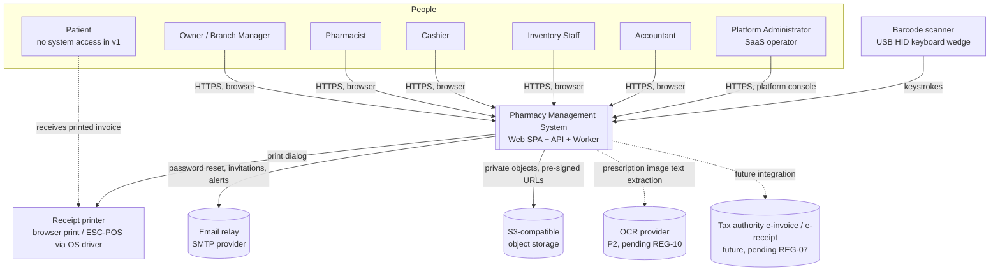
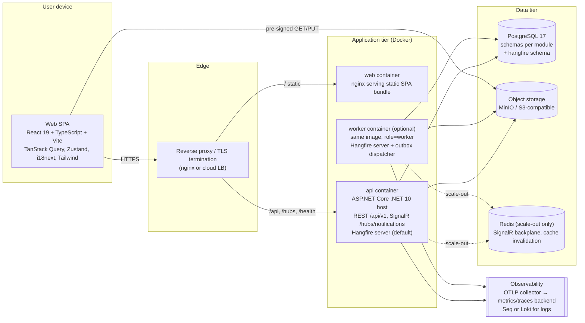
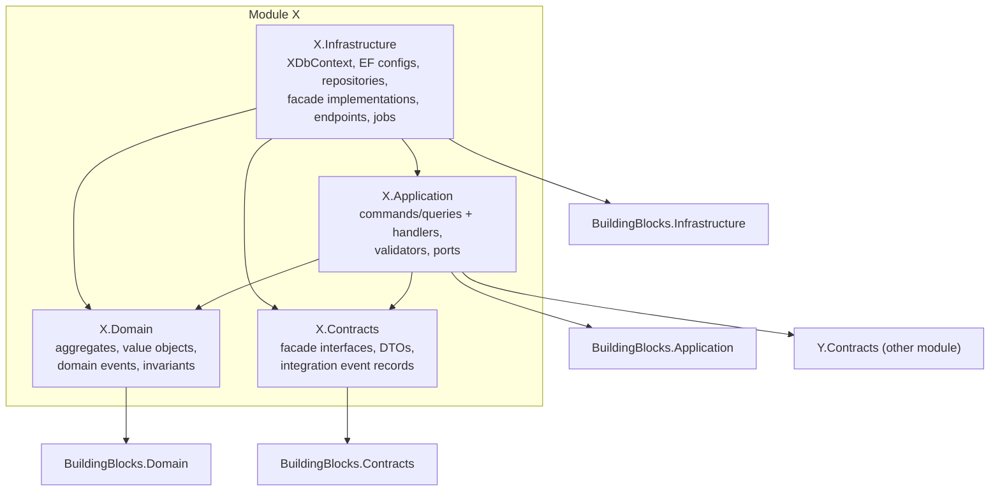
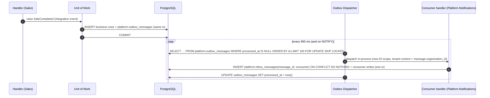
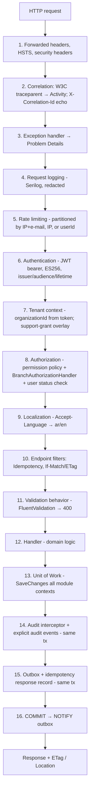

# System Architecture

| Field | Value |
|---|---|
| Version | 1.0 |
| Status | Draft for review |
| Date | 2026-11-09 |
| Authoritative inputs | [DOCUMENTATION-CONVENTIONS.md](../DOCUMENTATION-CONVENTIONS.md) (wins on conflict), `1. Project Vision.md`, `2. Master SDD.md` |
| Related ADRs | ADR-001 … ADR-010 |
| Companion documents | [DATABASE-DESIGN.md](DATABASE-DESIGN.md) · [API-DESIGN.md](API-DESIGN.md) · [SECURITY-ARCHITECTURE.md](SECURITY-ARCHITECTURE.md) · [INVENTORY-ARCHITECTURE.md](INVENTORY-ARCHITECTURE.md) · [DEPLOYMENT-ARCHITECTURE.md](DEPLOYMENT-ARCHITECTURE.md) |

This document describes the structure of the Pharmacy Management System: its system context, containers, modules and their allowed dependencies, the source tree, cross-module communication, the request pipeline, cross-cutting concerns (errors, logging, caching, real-time, background jobs), and the frontend architecture. It is a specification; it contains no application code.

---

## 1. Architectural Drivers

| Driver | Source | Architectural consequence |
|---|---|---|
| Single pharmacy, multi-branch chains and SaaS multi-organization from day one | BRQ-02, ADR-002 | `OrganizationId` on every tenant-owned row; tenant context is mandatory in every request and job; RLS enabled from Phase 0 (MVP) |
| Zero oversell, consistent stock under concurrency and failure | BRQ-05, BR-G-08..10, BR-G-19, NFR-G-06 | Inventory ledger + transactionally maintained balances, pessimistic row locks, single-database ACID transactions spanning modules (§5.3) |
| POS speed | NFR-G-01, NFR-G-02, NFR-G-09 | Keyboard-first SPA, trigram/barcode indexes, short transactions, no network round trip on the hot path that is not strictly required |
| Auditability and tamper evidence | BRQ-12, BR-G-16, ADR-008 | Audit rows written in the business transaction; hash chain sealed by a background job (§10) |
| Small team, low operational cost, clear module ownership | Master SDD §1–2 | Modular monolith (ADR-001), one deployable host, enforced boundaries via architecture tests |
| Arabic/English, RTL/LTR, themes | BRQ-13, ADR-009 | i18next namespaces per feature, Tailwind logical properties, server error `code` + localized `message` |
| Operability | BRQ-14, NFR-G-04/05/10 | Serilog JSON + OpenTelemetry, health endpoints, PITR backups ([DEPLOYMENT-ARCHITECTURE.md](DEPLOYMENT-ARCHITECTURE.md)) |

---

## 2. System Context (C4 Level 1)



External dependencies and their failure behavior:

| External system | Used for | Failure behavior |
|---|---|---|
| SMTP relay | Invitations, password reset, optional alert e-mails | Sent from Hangfire jobs with retry (5 attempts, exponential backoff up to 1 h); never blocks a business transaction |
| S3-compatible storage | Prescription images, supplier invoice scans, report exports, catalog import files | Upload endpoints return 503 `FILES.STORAGE_UNAVAILABLE`; sales and stock operations are unaffected |
| OCR provider (P2) | Suggestions for prescription items (BR-G-14) | Asynchronous job; failure leaves the prescription in manual-entry mode |
| Tax authority systems | Not in v1 (REG-07) | Design keeps an `Integrations` seam in Finance/Sales contracts; no dependency in v1 |

---

## 3. Containers (C4 Level 2)



| Container | Technology | Responsibility | Scaling unit |
|---|---|---|---|
| `web` | nginx (unprivileged) serving the Vite build | Static assets, SPA fallback, security headers, long-cache hashed assets | Stateless; any count |
| `api` | ASP.NET Core (.NET 10 LTS), single host assembling all modules | REST API, SignalR hub, authentication, Hangfire server (unless worker role split), outbox dispatcher (unless worker split) | Stateless (vertical first; horizontal with Redis backplane, see DEPLOYMENT §9) |
| `worker` (optional) | Same image, `Host__Role=Worker` | Hangfire server, outbox dispatcher, OCR, exports. No HTTP endpoints except health | Stateless; 1..n |
| PostgreSQL 17 | Primary data store; Hangfire storage (`hangfire` schema) | All business data, ledger, audit, outbox, idempotency | Vertical; read replica later for reports |
| Object storage | MinIO (local/dev), any S3-compatible service (prod) | Private buckets; metadata in `platform.file_objects` | Managed |
| Redis | Only when >1 API instance | SignalR backplane, authorization-cache invalidation pub/sub | Managed |

**Host roles.** One container image runs with `Host__Role` ∈ {`All` (default: API + jobs + dispatcher), `Api` (HTTP only), `Worker` (jobs + dispatcher only)}. The split is a configuration change, not a code change (ADR-001, ADR-007).

---

## 4. Module Map

### 4.1 Modules and responsibilities

| # | Module (project name) | DB schema | Spec | Responsibilities | Owns (canonical entities) |
|---|---|---|---|---|---|
| 1 | Identity | `identity` | SPEC-01 | Login, tokens, refresh rotation, sessions, users, roles, permissions, branch assignments, lockout, password reset | User, Role, Permission, RolePermission, UserRole, UserBranchAssignment, RefreshToken, UserSession, PasswordResetToken, LoginAttempt |
| 2 | Organization | `org` | SPEC-02 | Organization provisioning, branches, branch/org settings storage, document numbering, support access grants, subscriptions (P3) | Organization, Branch, BranchSettings, OrganizationSettings, DocumentSequence, SupportAccessGrant, Subscription |
| 3 | Catalog | `catalog` | SPEC-03 | Medicines, barcodes, reference data, ingredients, alternatives, selling prices, tax categories, import/export | Medicine, MedicineBarcode, MedicineCategory, Manufacturer, ActiveIngredient, MedicineIngredient, DosageForm, MedicineAlternative, MedicinePrice, BranchMedicinePrice, TaxCategory |
| 4 | Inventory | `inventory` | SPEC-04 | Batches, balances, ledger, FEFO allocation, adjustments, write-offs, stocktakes, transfers, reorder settings, expiry flagging, reconciliation | Batch, BatchBalance, StockMovement, StockAdjustment(+Line), WriteOff(+Line), Stocktake(+Line), StockTransfer(+Line, +Allocation), ReorderSetting |
| 5 | Procurement | `procurement` | SPEC-05 | Suppliers, purchase orders, goods receipts, supplier invoices, supplier returns, payments, supplier ledger | Supplier, SupplierContact, PurchaseOrder(+Line), GoodsReceipt(+Line), SupplierInvoice(+Line), SupplierReturn(+Line), SupplierPayment, SupplierPaymentAllocation, SupplierLedgerEntry |
| 6 | Sales | `sales` | SPEC-06 | POS sale completion, payments, invoices, voids, sales returns, refunds, cash sessions, cash movements, discount rules (P2) | Sale, SaleLine, SaleLineAllocation, Payment, SalesReturn(+Line), Refund, CashSession, CashMovement, DiscountRule |
| 7 | Patients | `patients` | SPEC-07 | Patient profiles, allergies, conditions, notes, consent, access logging, export/anonymization | Patient, PatientAllergy, PatientCondition, PatientNote, PatientConsent, PatientAccessLog |
| 8 | Prescriptions | `prescriptions` | SPEC-08 | Prescribers, prescriptions, items, attachments, verification, dispensing records, OCR suggestions, controlled register | Prescriber, Prescription, PrescriptionItem, PrescriptionAttachment, DispensingRecord, OcrExtraction, ControlledMedicineRegisterEntry |
| 9 | Finance (Finance & Reporting) | `finance` | SPEC-09 | Expenses, cash in/out orchestration, daily summaries, financial/operational reports, report exports | Expense, ExpenseCategory, DailyBranchSummary, ReportExport |
| 10 | Platform (Notifications, Audit & Settings) | `platform` | SPEC-10 | Notifications and rules, audit query API and hash-chain verification, user preferences, file metadata, outbox, background job runs | Notification, NotificationRecipient, NotificationRule, AuditLog, UserPreference, FileObject, OutboxMessage, BackgroundJobRun |

**Shared infrastructure owned by BuildingBlocks (tables in `platform` schema):** `IdempotencyRecord`, `OutboxMessage`, `InboxMessage` (consumer de-duplication; added by this document), `AuditLog` write path (sealing and chain heads are owned by Platform, SPEC-10), `FileObject` write path. `IdempotencyRecord` is placed in `platform` instead of `sales` because Procurement, Inventory and Prescriptions use it too (conventions §6 lists it as a shared infrastructure table).

**Settings ownership.** `OrganizationSettings` and `BranchSettings` tables are owned (stored and migrated) by the Organization module; the Settings API and UI of SPEC-10 read and write them only through the Organization module facade. Permissions `settings.organization.manage` / `settings.branch.manage` guard those operations.

### 4.2 Allowed dependencies (dependency matrix)

Rows are **consumers**, columns are **providers**. `S` = may call the provider's synchronous contract (query or transactional command), `E` = subscribes to the provider's integration events, `–` = forbidden. All modules may use BuildingBlocks. A module never references another module's Domain, Application or Infrastructure project, never touches another module's tables, and never joins across schemas in its own queries (exception: read-only reporting views in §4.4).

| Consumer ↓ / Provider → | Identity | Organization | Catalog | Inventory | Procurement | Sales | Patients | Prescriptions | Finance | Platform |
|---|---|---|---|---|---|---|---|---|---|---|
| **Identity** | · | S, E | – | – | – | – | – | – | – | – |
| **Organization** | – | · | – | – | – | – | – | – | – | – |
| **Catalog** | – | S | · | – | – | – | – | – | – | – |
| **Inventory** | – | S | S | · | – | – | – | – | – | – |
| **Procurement** | – | S | S | S | · | – | – | – | – | – |
| **Sales** | S | S | S | S | – | · | S | S | – | – |
| **Patients** | – | S | S | – | – | – | · | – | – | – |
| **Prescriptions** | – | S | S | – | – | E | S | · | – | – |
| **Finance** | – | S | S | S, E | S, E | S, E | – | – | · | – |
| **Platform** | S, E | S, E | E | E | E | E | E | E | E | · |

Rules derived from the matrix:

1. **The synchronous dependency graph is acyclic.** Topological order: Organization → Identity → Catalog → Inventory → Procurement → Patients → Prescriptions → Sales → Finance → Platform. A module may only call `S` contracts of modules earlier in that order. Reverse flows use events.
2. **Organization ↔ Identity:** organization provisioning publishes `OrganizationProvisioned`; Identity handles it by creating the Owner user and invitation (eventual, ≤ 5 s). Identity calls Organization synchronously to validate branch ids for assignments.
3. **Sales → Prescriptions:** sale completion calls `IPrescriptionsDispensing.RecordDispensing(...)` inside the sale transaction; void and restocking returns call `ReverseDispensing(...)` likewise. Prescriptions never calls Sales.
4. **Finance → Sales:** cash in/out (`finance.cash.manage`) is recorded through `ISalesCashLedger.RecordCashMovement(...)` because `CashMovement` is owned by Sales.
5. **Platform** is the most downstream module: it consumes events from everyone (notifications, audit-related projections) and queries Identity/Organization to resolve recipients. No business module calls Platform synchronously; the audit/outbox/file/idempotency write paths are BuildingBlocks abstractions implemented by BuildingBlocks infrastructure.

These rules are enforced by architecture tests (§6.4).

### 4.3 Module internal layering (Clean Architecture)



- **Domain**: no dependency on EF Core, ASP.NET Core, MediatR, or any other module. Pure C# + BuildingBlocks.Domain (Entity, AggregateRoot, ValueObject, `Money`, `Quantity`, `BusinessDate`, `Result`).
- **Application**: use cases. Internal requests use a mediator (MediatR-style, internal to the module, ADR-001). May reference other modules' `Contracts` only as listed in §4.2.
- **Infrastructure**: EF Core `DbContext` per module (default schema = module schema), migrations, Minimal API endpoint groups, facade implementations, Hangfire job classes, event handlers.
- **Contracts**: the only public surface of the module. Contains facade interfaces (e.g., `IInventoryAllocation`), request/response DTOs, integration event records (`StockLevelLowDetected`, `SaleCompleted`). No EF types, no domain types.

Endpoints live in the module's Infrastructure project (as Minimal API endpoint groups registered by `IModule.MapEndpoints`), so the Host only composes modules.

### 4.4 Reporting read path

Finance & Reporting needs cross-module aggregates (sales by medicine, COGS, valuation). To avoid N facade calls per report row:

- Each source module publishes **read-only SQL views** in a `reporting` schema (e.g., `reporting.v_sale_lines`, `reporting.v_batch_valuation`) whose definitions are owned and migrated by the source module and are part of its contract (versioned; breaking changes follow expand/contract).
- Finance queries only `reporting.*` views and its own `finance.*` tables, using a read-only DbContext with `NoTracking`.
- Architecture tests verify Finance SQL/EF mappings reference only `finance.*` and `reporting.*`.

---

## 5. Cross-Module Communication

### 5.1 Synchronous contracts (facades)

| Kind | Example | Transaction semantics |
|---|---|---|
| Query facade | `ICatalogQueries.GetMedicinesForSale(orgId, medicineIds)` | Read-only; may run on the caller's connection; returns DTOs |
| Transactional command facade | `IInventoryAllocation.AllocateAndDeduct(AllocationRequest)` | **Joins the caller's open transaction** (same `NpgsqlConnection` + `DbTransaction`). Must not commit, must not open its own transaction, must not publish anything outside the outbox |
| Policy facade | `IOrganizationSettings.GetBranchPolicy(branchId)` (time zone, near-expiry days, do-not-sell days) | Read-only; cacheable (§9) |

Facade methods take explicit `OrganizationId`/`BranchId` arguments and also assert them against the ambient tenant context (defense in depth).

### 5.2 Asynchronous integration events (transactional outbox)



- **Delivery guarantee:** at-least-once per consumer. Consumers are idempotent through `platform.inbox_messages (message_id, consumer_name)` primary key, inserted in the consumer's own transaction.
- **Ordering:** best-effort by outbox `id` (UUIDv7 is time-ordered). Consumers must not rely on strict ordering across aggregates; events carry the aggregate version where order matters.
- **Retries:** failed consumer execution increments `attempt_count`, sets `next_attempt_at` with exponential backoff (1 s, 5 s, 30 s, 2 min, 10 min, then hourly), and after 10 attempts moves to `failed` status with an alert (`OutboxDeadLetters > 0`).
- **Payload:** JSON, `event_type` = `<Module>.<EventName>.v<N>` (e.g., `Sales.SaleCompleted.v1`), includes `organizationId`, `branchId`, `occurredAt`, `correlationId`, `causationId`. No patient medical data in payloads (NFR-G-10); consumers query by id if needed.
- **Domain events** (inside one module) are dispatched in-process before `SaveChanges` and never leave the module; only integration events go through the outbox.
- **Wake-up:** after commit the unit of work issues `NOTIFY outbox` so the dispatcher's p95 dispatch latency stays ≤ 1 s; polling every 500 ms is the fallback.

Starter integration event catalog (details in specs):

| Event | Producer | Consumers |
|---|---|---|
| `Organization.OrganizationProvisioned.v1` | Organization | Identity (create Owner), Platform (default notification rules) |
| `Organization.BranchCreated.v1` / `BranchDeactivated.v1` | Organization | Identity (assignment cleanup), Platform |
| `Identity.UserDeactivated.v1` | Identity | Platform (SignalR disconnect, notification recipients) |
| `Inventory.StockLevelLowDetected.v1` | Inventory | Platform (notifications) |
| `Inventory.BatchNearExpiryDetected.v1` / `BatchExpired.v1` | Inventory | Platform |
| `Inventory.StockMovementsPosted.v1` | Inventory | Platform (SignalR stock hints), Finance (summary refresh) |
| `Inventory.TransferStatusChanged.v1` | Inventory | Platform (notify destination branch) |
| `Procurement.GoodsReceiptPosted.v1` | Procurement | Finance |
| `Sales.SaleCompleted.v1`, `SaleVoided.v1`, `SalesReturnCompleted.v1`, `CashSessionClosed.v1` | Sales | Finance (DailyBranchSummary), Platform, Prescriptions (status projection refresh only) |
| `Prescriptions.PrescriptionVerified.v1` | Prescriptions | Platform |
| `Platform.AuditChainBroken.v1` | Platform | Platform (alert notification to Owner + ops alert) |

### 5.3 One database transaction across modules

Business-critical workflows (BR-G-09, BR-G-19, BR-G-35) span modules, e.g., sale completion writes `sales.*`, `inventory.*`, `prescriptions.*`, `platform.audit_logs`, `platform.outbox_messages`, `platform.idempotency_records`. Distributed transactions or sagas are **not** used for these. Instead:

- All module `DbContext`s in a request scope share **one `NpgsqlConnection`** supplied by `BuildingBlocks.Infrastructure.IDbConnectionScope`.
- The `IUnitOfWork` opens one `DbTransaction` (READ COMMITTED by default; see DATABASE-DESIGN §8) and enlists every module context (`Database.UseTransaction`).
- `SaveChanges` is called per context in a fixed order (owner module first), then audit + outbox + idempotency rows, then `COMMIT`.
- This coupling is accepted under ADR-001; extracting a module into a separate service later requires replacing these transactional facades with a saga — documented as a known cost.

---

## 6. Solution and Project Structure

### 6.1 Repository layout

```text
pharmacy/
├── docs/                                   # this documentation set
├── src/
│   ├── Host/
│   │   └── Pharmacy.Host/                  # Program composition, module registration, middleware, OpenAPI, health
│   ├── BuildingBlocks/
│   │   ├── Pharmacy.BuildingBlocks.Domain/          # Entity, AggregateRoot, ValueObject, Money, Quantity, Result, DomainEvent
│   │   ├── Pharmacy.BuildingBlocks.Application/     # ICommand/IQuery, pipeline behaviors, ITenantContext, ICurrentUser, IClock, IBusinessCalendar
│   │   ├── Pharmacy.BuildingBlocks.Infrastructure/  # UoW, connection scope, outbox/inbox, idempotency, audit interceptor, EF conventions, file storage, Hangfire glue
│   │   ├── Pharmacy.BuildingBlocks.Contracts/       # IntegrationEvent base, paging DTOs, error code types
│   │   └── Pharmacy.BuildingBlocks.Web/             # ProblemDetails mapping, endpoint filters, auth handlers, rate limiting, ETag helpers
│   └── Modules/
│       ├── Identity/
│       │   ├── Pharmacy.Modules.Identity.Domain/
│       │   ├── Pharmacy.Modules.Identity.Application/
│       │   ├── Pharmacy.Modules.Identity.Infrastructure/   # IdentityDbContext, Migrations/, Endpoints/, Jobs/
│       │   └── Pharmacy.Modules.Identity.Contracts/
│       ├── Organization/   (same four projects)
│       ├── Catalog/
│       ├── Inventory/
│       ├── Procurement/
│       ├── Sales/
│       ├── Patients/
│       ├── Prescriptions/
│       ├── Finance/
│       └── Platform/
├── tests/
│   ├── Pharmacy.ArchitectureTests/             # NetArchTest rules (§6.4)
│   ├── Modules/
│   │   ├── Pharmacy.Modules.<M>.Domain.Tests/          # pure unit tests
│   │   ├── Pharmacy.Modules.<M>.Application.Tests/     # handler tests with fakes
│   │   └── Pharmacy.Modules.<M>.IntegrationTests/      # Testcontainers PostgreSQL 17, real migrations
│   ├── Pharmacy.Api.IntegrationTests/          # WebApplicationFactory: authz matrix, CS-07/CS-08, Problem Details
│   ├── Pharmacy.ConcurrencyTests/              # CS-01, CS-10, CS-11 against real PostgreSQL (hard gate NFR-G-06)
│   ├── Pharmacy.ContractTests/                 # OpenAPI snapshot + breaking-change detection
│   └── Pharmacy.TestKit/                       # builders, tenant fixtures, clock fakes
├── web/                                        # frontend (see §13)
├── deploy/
│   ├── docker/                                 # Dockerfiles (api, web)
│   ├── compose/                                # docker-compose.yml, .env.example
│   └── scripts/                                # backup/restore helpers, smoke tests
├── .github/workflows/                          # CI/CD (DEPLOYMENT-ARCHITECTURE §5)
├── Directory.Build.props                       # nullable, warnings as errors, analyzers
├── Directory.Packages.props                    # central package management
└── Pharmacy.sln
```

### 6.2 Module registration

Each module exposes one `IModule` implementation in its Infrastructure project with `Register(IServiceCollection, IConfiguration)`, `MapEndpoints(IEndpointRouteBuilder)`, `RegisterJobs(IRecurringJobRegistry)`, and `Permissions` (the module's permission catalog seeded into `identity.permissions`). The Host discovers modules from an explicit list (no assembly scanning) so that module inclusion is visible in code review.

### 6.3 Naming conventions

| Item | Convention | Example |
|---|---|---|
| Command / query | `<Verb><Noun>Command` / `Get<Noun>Query` | `CompleteSaleCommand`, `GetBatchBalancesQuery` |
| Validator | `<Command>Validator` (FluentValidation) | `CompleteSaleCommandValidator` |
| Endpoint group | `<Resource>Endpoints` | `SalesEndpoints` |
| Facade | `I<Module><Capability>` in Contracts | `IInventoryAllocation`, `ICatalogQueries` |
| Integration event | past tense record, versioned type name | `SaleCompleted` → `Sales.SaleCompleted.v1` |
| Error code | `MODULE.ERROR_NAME` | `INVENTORY.INSUFFICIENT_STOCK` |
| Hangfire job | `<module>.<job-name>` kebab | `inventory.near-expiry-scan` |

### 6.4 Architecture tests (NetArchTest-style rules)

All rules run in CI stage "architecture tests" and fail the build.

| ID | Rule |
|---|---|
| AT-01 | `*.Domain` assemblies have no dependency on `Microsoft.EntityFrameworkCore*`, `Microsoft.AspNetCore*`, `Npgsql*`, `Hangfire*`, `MediatR*`, `FluentValidation*`. |
| AT-02 | `*.Domain` of module X has no dependency on any assembly of module Y (Y ≠ X). |
| AT-03 | `*.Application` of module X depends only on X.Domain, X.Contracts, BuildingBlocks.{Domain,Application,Contracts}, and the Y.Contracts allowed by the matrix in §4.2 (`S` cells). |
| AT-04 | No assembly depends on another module's `Application` or `Infrastructure` assembly. |
| AT-05 | `*.Contracts` depends only on `BuildingBlocks.Contracts` and the BCL; contains no types deriving from `Entity` or EF types. |
| AT-06 | Only `Pharmacy.Host` references `*.Infrastructure` assemblies of modules. |
| AT-07 | Every class implementing `ICommand<>` in an Application assembly has exactly one validator or is marked `[NoValidationRequired]` with a justification string. |
| AT-08 | Every endpoint has an authorization metadata entry (`RequirePermission(...)`) or `[AllowAnonymous]` and appears in the anonymous allowlist (NFR-G-07). |
| AT-09 | Every branch-scoped route template contains `{branchId:guid}` and its endpoint carries `BranchAuthorization` metadata. |
| AT-10 | Every EF entity type mapped in a module DbContext that implements `ITenantOwned` has a global query filter on `OrganizationId`; entities not implementing it are on an explicit allowlist (e.g., `identity.permissions`). |
| AT-11 | Every `IdempotentCommand` listed in conventions §7 (sale completion, void, …) is decorated with `[RequiresIdempotencyKey]`; verified against the endpoint map. |
| AT-12 | No class outside `Inventory.Infrastructure` writes to `BatchBalance` or `StockMovement` (EF model ownership check + SQL grep in migrations). |
| AT-13 | Domain entities have no public setters on ledger types (`StockMovement`, `CashMovement`, `SupplierLedgerEntry`, `AuditLog`). |
| AT-14 | Type names do not use forbidden terminology from conventions §2 (`Tenant`, `Product`, `Lot`, `Store`, `Shift`, …) in public contracts. |

Database-level architecture checks (integration test against migrated schema): every table except the allowlist has `organization_id uuid NOT NULL`; every tenant table has RLS enabled and forced with a policy (from Phase 0 — ADR-002 amended 2026-11-10); every foreign key that crosses module schemas points from a consumer to a provider allowed by the §4.2 matrix (`S` cell) or to `org.organizations`/`org.branches`/`identity.users`, and targets only never-hard-deleted rows (see DATABASE-DESIGN §2.4).

---

## 7. Request Pipeline



| Step | Component | Behavior and failure result |
|---|---|---|
| 5 | ASP.NET Core rate limiter | `/auth/login`: 10 requests/min per (IP, normalized e-mail) and 30/min per IP (SPEC-01 FR-01-018); general authenticated API: 300/min per user; `/auth/refresh`: 30/min per IP. → 429 `COMMON.RATE_LIMITED` with `Retry-After` |
| 6 | JWT bearer | Invalid/expired token → 401 `IDENTITY.TOKEN_INVALID` / `IDENTITY.TOKEN_EXPIRED` |
| 7 | `TenantContextMiddleware` | Sets `ITenantContext { OrganizationId, UserId, SessionId, IsPlatformAdmin, SupportGrantId? }` for the scope. Missing org claim on a tenant endpoint → 401. No tenant endpoint can execute without a tenant context (guard throws, mapped to 500 and alert) |
| 8 | Authorization | Loads the user's authorization snapshot (permissions, branch assignments, org-wide flag, status) from cache (§9). Missing permission → 403 `IDENTITY.PERMISSION_DENIED`; branch not assigned → 403 `IDENTITY.BRANCH_ACCESS_DENIED`; branch belongs to another organization → 404 `COMMON.NOT_FOUND`; user deactivated/locked → 401 `IDENTITY.SESSION_REVOKED` |
| 10 | Idempotency filter | For endpoints flagged `[RequiresIdempotencyKey]`: missing header → 400 `COMMON.IDEMPOTENCY_KEY_REQUIRED`; replay/conflict semantics in API-DESIGN §9 |
| 10 | Concurrency filter | Mutable resource updates require `If-Match` → 428 `COMMON.PRECONDITION_REQUIRED` when absent, 412 `COMMON.CONCURRENCY_CONFLICT` on mismatch |
| 11 | `ValidationBehavior` | Runs all validators; failures → 400 `COMMON.VALIDATION_FAILED` with `errors` |
| 12 | Handler | Business rule violations return `Result.Failure(Error)` mapped to 409/422 per API-DESIGN §5 |
| 13–16 | `UnitOfWorkBehavior` | Only for commands. Applies transaction isolation and `SET LOCAL lock_timeout = '3s'`, `statement_timeout = '15s'` (POS commands) / `'60s'` (other commands). Retries the whole handler on `40P01` (deadlock) and `40001` (serialization failure) up to 2 additional times with 50–200 ms jittered backoff (SPEC-04 FR-04-026, SPEC-06 FR-06-037). Queries do not open explicit transactions |

The pipeline order is fixed; mediator behaviors are registered in Host in this order: Logging → Validation → Authorization (resource-based checks) → UnitOfWork (with retry) → Handler.

---

## 8. Error Handling and Logging/Observability

### 8.1 Error handling

- **Expected failures** are values (`Result`/`Error` with a stable `code`, HTTP mapping, and message resource key). They are not exceptions and are logged at `Information`.
- **Unexpected failures** are exceptions handled once by the global exception handler: mapped to 500 `COMMON.INTERNAL_ERROR` with `traceId`, no stack trace or SQL in the response, logged at `Error` with full exception.
- **Database exception translation** (in BuildingBlocks): `23505` unique violation → domain-specific code if the constraint is registered in the constraint-to-code map (e.g., `ux_medicine_barcodes_org_barcode` → 409 `CATALOG.BARCODE_DUPLICATE`), else 409 `COMMON.CONFLICT`; `23514` check violation on `ck_batch_balances_on_hand_nonneg` → 409 `INVENTORY.INSUFFICIENT_STOCK` (final guard, BR-G-10); `55P03` lock timeout → 503 `COMMON.LOCK_TIMEOUT` with `Retry-After: 1`; `40P01`/`40001` after retries exhausted → 503 `COMMON.TRANSIENT_CONFLICT`; `57014` statement timeout → 503 `COMMON.TIMEOUT`.
- Problem Details format and catalog: [API-DESIGN.md §5](API-DESIGN.md).

### 8.2 Logging (Serilog)

| Aspect | Decision |
|---|---|
| Format | Compact JSON to stdout (container), one event per line |
| Enrichers | `traceId`, `spanId`, `correlationId`, `organizationId`, `branchId`, `userId`, `sessionId` (hashed), `module`, `endpoint`, `hostRole`, `version` (NFR-G-10) |
| Levels | Default `Information`; `Microsoft.AspNetCore` `Warning`; `Microsoft.EntityFrameworkCore.Database.Command` `Warning` (SQL text never at Information in prod) |
| Redaction | Destructuring policy removes properties named `password`, `token`, `refreshToken`, `authorization`, `cookie`, `secret`, `apiKey`, `nationalId`, `allergies`, `conditions`, `notes`, `diagnosis`, `symptoms`; request/response bodies are never logged; query strings logged with `token`/`signature` params stripped. See SECURITY-ARCHITECTURE §11 |
| Sinks | stdout always; Seq (local/dev) or Loki/managed sink (staging/prod) via collector |
| Retention | Application logs 30 days hot; security-relevant logs 90 days (pending REG-05 for audit records, which live in the DB, not logs) |

### 8.3 Tracing and metrics (OpenTelemetry)

- Instrumentation: ASP.NET Core, HttpClient, Npgsql, EF Core, Hangfire job spans (custom), outbox dispatch spans (linked to originating trace via `traceparent` stored in the outbox row).
- Export: OTLP to a collector; sampling 100% for errors and for POS sale completion, 10% parent-based for other requests (configurable).
- Business/technical metrics (Prometheus-compatible names):

| Metric | Type | Labels | Used for |
|---|---|---|---|
| `pms_sale_completion_duration_seconds` | histogram | `result` | NFR-G-02 SLO |
| `pms_pos_search_duration_seconds` | histogram | `kind` (name, barcode) | NFR-G-01 |
| `pms_stock_lock_wait_seconds` | histogram | `operation` | Hot-row detection |
| `pms_insufficient_stock_total` | counter | `operation` | CS-01 monitoring |
| `pms_tx_retries_total` | counter | `reason` (deadlock, serialization) | Contention |
| `pms_outbox_pending` / `pms_outbox_dead_letters` | gauge | – | Async health |
| `pms_job_runs_total` / `pms_job_duration_seconds` | counter / histogram | `job`, `result` | Job health |
| `pms_reconciliation_mismatches` | gauge | – | Ledger integrity (must be 0) |
| `pms_audit_chain_unsealed_age_seconds` | gauge | – | Audit sealing lag |
| `pms_login_failures_total` | counter | `reason` | Security alerting |

Labels never include `organizationId` for high-cardinality reasons; per-organization analysis uses logs/traces.

### 8.4 Correlation ids

- Inbound `traceparent` (W3C) is honored; otherwise a new trace is started. `traceId` is returned in every Problem Details body and in the `X-Trace-Id` response header.
- The SPA generates an `X-Correlation-Id` (UUID) per user action (e.g., one per "Complete sale" click, reused across retries) so support can find all attempts; it is stored on `StockMovement.CorrelationId`, `AuditLog.CorrelationId` and outbox messages.

---

## 9. Caching Policy

| Data | Cache | TTL / invalidation | Notes |
|---|---|---|---|
| User authorization snapshot (permissions, branch assignments, org-wide flag, user status, security stamp) | In-memory (`IMemoryCache`), keyed `(userId, authzVersion)` | 60 s TTL; evicted on `UserAuthorizationChanged` (in-process, Redis pub/sub when scaled out) | Bounds permission/deactivation propagation to ≤ 60 s (stronger than BR-G-30's 15 min) |
| Branch policy (time zone, near-expiry days, do-not-sell days, flags) | In-memory | 5 min; evicted on settings change event | Expiry decisions read the cached do-not-sell window; changes take effect ≤ 5 min (documented in SPEC-10) |
| Organization settings (e.g., `EnforcePrescriptionForRxOnly`, `AllowDirectRestockOnReturn`) | In-memory | 5 min; evicted on change | Same |
| Permission catalog, reference data (dosage forms, categories, tax categories) | In-memory | 10 min; evicted on change | Low churn |
| Localization resources | In-memory | Process lifetime | Deployed with the build |
| JWKS / signing keys | In-memory | Reloaded on rotation signal | SECURITY §3.4 |
| POS medicine search results | **Not cached server-side** | – | Must reflect price and stock; indexes meet NFR-G-01 |
| Medicine detail for POS line (price, flags) | TanStack Query (client) | `staleTime` 60 s | Server re-validates price at completion; price changes surface as `SALES.PRICE_CHANGED` (409) |

**Never cached for decisions:** `BatchBalance` (on hand, reserved, sellable), batch status/expiry eligibility, document sequences, idempotency records, cash session state, prescription remaining quantities. These are always read inside the transaction that decides, under the locks described in [INVENTORY-ARCHITECTURE.md](INVENTORY-ARCHITECTURE.md). Stock figures shown in the UI (including SignalR hints) are informational only.

HTTP caching: API responses default to `Cache-Control: no-store` (they contain tenant data). Static SPA assets: `Cache-Control: public, max-age=31536000, immutable` for hashed files; `index.html` `no-cache`.

---

## 10. Audit Logging Architecture (summary)

Specified in ADR-008 (amended 2026-11-10) and SPEC-10, detailed in DATABASE-DESIGN §3.10 and §10.3 and SECURITY-ARCHITECTURE §13.

1. `AuditSaveChangesInterceptor` captures changes on entities marked `[Audited]` (field-level before/after, with sensitive fields masked) and explicit `IAuditEvents.Record(...)` calls for sensitive operations (SPEC-10 catalog) and inserts `platform.audit_logs` rows **in the business transaction** (BR-G-16).
2. The **asynchronous audit sealer** (`platform.audit-chain-seal`, every 10 s, one chain per organization plus the `platform` chain) seals committed unsealed rows in visibility order: gap-free `ChainSequence`, `PreviousHash`, `Hash = hex(SHA-256(canonical ‖ PreviousHash))` written to the seal columns of `platform.audit_logs`, and `AuditChainHead` updated in the same transaction (SPEC-10 FR-10-009; p95 sealing lag ≤ 60 s). Sealing asynchronously avoids serializing every audited business transaction of an organization on a chain-head lock.
3. The **audit verification job** recomputes each chain nightly (02:30 `Africa/Cairo`) from the last checkpoint and on demand, and raises `AUDIT.CHAIN_VERIFICATION_FAILED` with a mandatory Owner notification on mismatch, gap, or an entry unsealed for more than 15 minutes (FR-10-010, FR-10-011).
4. The **audit anchor job** (`platform.audit-chain-anchor`, daily) writes a signed digest of every chain head to a write-once (object-lock/WORM) bucket so that a consistent rewrite of a chain by a database superuser becomes detectable (V1 hardening, ADR-008 amendment).

---

## 11. Real-Time (SignalR)

| Aspect | Design |
|---|---|
| Hub | `/hubs/notifications` (single hub), JSON protocol, WebSockets preferred, SSE/long-polling fallback |
| Authentication | Same JWT. Browser WebSocket cannot send headers, so the token is passed as `access_token` query string **only** on the hub path; the path is excluded from access logging of query strings |
| Groups | `org:{orgId}`, `branch:{branchId}`, `user:{userId}`. On connect the server adds the connection to `user:` and `org:` groups and to `branch:` groups **only for branches in the authorization snapshot**; clients cannot join groups themselves |
| Re-authorization | On `UserAuthorizationChanged` or `UserDeactivated` the server removes the user's connections from groups / aborts them. Connections are closed when the access token expires (`CloseOnAuthenticationExpiration = true`); the client reconnects with a fresh token |
| Server → client messages | `notificationCreated {id, type, severity, titleKey, args}`, `notificationCountChanged {unread}`, `stockHint {branchId, medicineId, sellableApprox, lowStock}`, `transferStatusChanged {transferId, status}`, `exportReady {jobId}`, `sessionRevoked {}` |
| Payload rules | Ids and display keys only; no patient data; clients refetch via REST for details |
| Client → server | None in v1 except `ping` |
| Delivery | Best-effort. Missed messages are recovered by refetch on reconnect (TanStack Query invalidation of `notifications` and current POS stock queries) |
| Authority | Stock hints are never used for allocation or validation (§9) |
| Scale-out | Redis backplane when >1 API instance (DEPLOYMENT §9) |

---

## 12. Background Jobs Catalog

All jobs run in Hangfire (ADR-007) with PostgreSQL storage, except the outbox dispatcher (hosted service). Every run writes `platform.background_job_runs` (job name, organization, branch, business date, status, counts, duration). Jobs that touch tenant data iterate organizations and set the tenant context per organization (RLS session variable) before any query. Schedules are UTC cron unless "per branch local time" is stated; "per branch local time" jobs run hourly and process each branch whose local time has passed the target and whose `(job, branch, business_date)` run record does not exist.

| Job name | Owner module | Schedule | Purpose | Idempotency mechanism |
|---|---|---|---|---|
| `platform.outbox-dispatch` | BuildingBlocks (hosted service) | Continuous; poll 500 ms + `LISTEN outbox` | Deliver integration events | `FOR UPDATE SKIP LOCKED`; inbox `(message_id, consumer)` PK |
| `inventory.expiry-flagging` | Inventory | Per branch local time 00:05 | Set `Batch.Status = Expired` where `expiry_date ≤ business_date` and status `Active`; publish `BatchExpired` | Unique run key `(job, branch, business_date)`; status transition is conditional (`WHERE status='Active'`) |
| `inventory.near-expiry-scan` | Inventory | Per branch local time 06:00 | Find batches with on-hand > 0 expiring within `NearExpiryThresholdDays`; publish `BatchNearExpiryDetected` (aggregated per branch) | Run key per `(branch, business_date)`; notification dedupe key `(rule, branch, batch, business_date)` |
| `inventory.low-stock-scan` | Inventory | Every 30 min (UTC) + event-triggered debounce after `StockMovementsPosted` (≤ 1 per branch-medicine per 30 min) | Compare sellable quantity to `ReorderSetting.MinQuantity`; publish `StockLevelLowDetected` | Dedupe key `(branch, medicine, state)`; only state transitions (OK→Low) notify |
| `inventory.reconciliation` | Inventory | Daily 01:30 Africa/Cairo (low traffic) + on demand | Verify Σ movements = OnHand and BalanceAfter chain per batch; record mismatches; alert | Read-only check + upsert of `inventory.reconciliation_findings` keyed `(batch, run_date)`; never auto-corrects (INVENTORY-ARCHITECTURE §9) |
| `prescriptions.expiry` | Prescriptions | Per branch local time 00:10 | Transition prescriptions past validity (REG-01, configurable days) to `Expired` (`Verified`/`PartiallyDispensed` only) | Conditional update on status; run key per business date |
| `platform.audit-chain-seal` | Platform | Every 10 s | Seal committed audit rows into the per-organization (and `platform`) hash chain | `audit_chain_heads` row lock per chain key; seal columns set only from NULL (trigger) |
| `platform.audit-chain-anchor` | Platform | Daily 03:00 UTC | Export a signed digest of every chain head to WORM object storage | Object key per (chain, date); object lock prevents overwrite; `audit_chain_anchors` PK `(chain_key, anchor_date)` |
| `platform.audit-chain-verify` | Platform | Daily 02:30 Africa/Cairo (incremental: last 48 h + checkpoint); full weekly Sunday 03:00 | Recompute hashes; alert on break | Read-only; writes verification checkpoint row |
| `finance.report-export` | Finance | On demand (enqueued by API, 202) | Generate CSV/XLSX/PDF report into object storage; notify `exportReady` | `ReportExport.Id` is the job key; re-run overwrites the same object key; status machine `Queued→Running→Succeeded/Failed` |
| `finance.daily-branch-summary` | Finance | Event-driven (consumer of Sales/Inventory/Procurement events) + nightly rebuild per branch local time 03:00 for previous business date | Maintain `DailyBranchSummary` projection | Upsert keyed `(branch, business_date)`; nightly rebuild recomputes from source views |
| `platform.notification-cleanup` | Platform | Daily 04:00 UTC | Delete `Read`/`Dismissed` notifications older than 90 days and any older than 180 days (notifications are not ledger records) | Deterministic delete predicate; batch size 5,000 |
| `platform.idempotency-cleanup` | BuildingBlocks | Hourly | Delete idempotency records with `expires_at < now()` (24 h retention) | Deterministic predicate |
| `platform.inbox-outbox-cleanup` | BuildingBlocks | Daily 04:30 UTC | Delete processed outbox rows > 7 days and inbox rows > 14 days | Deterministic predicate |
| `prescriptions.ocr-process` | Prescriptions | On demand (enqueued on attachment upload when OCR enabled) | Call OCR provider; store `OcrExtraction` suggestions (BR-G-14) | Keyed by `(attachment_id, provider, provider_version)`; unique constraint; retries 3× |
| `identity.token-cleanup` | Identity | Daily 03:30 UTC | Delete expired/revoked refresh tokens > 30 days past expiry, expired password reset tokens, login attempts > 90 days | Deterministic predicate |
| `platform.file-orphan-cleanup` | Platform | Daily 05:00 UTC | Delete `FileObject`s in `PendingUpload` state > 24 h and their objects | Status-conditional delete |
| `catalog.import-process` | Catalog | On demand (202) | Validate and import medicine files (SPEC-03) | Import job id; per-row natural key upsert |
| `platform.email-send` | Platform | On demand | Send e-mails (invites, reset, alerts) | Message id; provider message id stored; max 5 attempts |

Concurrency limits: Hangfire queues `critical` (outbox-adjacent, seal), `default`, `reports` (max 2 concurrent workers so exports cannot starve OLTP), `ocr` (max 2).

---

## 13. Frontend Architecture

### 13.1 Stack

React 19 + TypeScript (strict) + Vite, React Router (data routers), TanStack Query v5 (server state), Zustand (client state, ADR-010), React Hook Form + Zod (forms; Zod schemas mirror backend validators, server remains authoritative), i18next (ADR-009), Tailwind CSS with logical properties, Vitest + React Testing Library, Playwright (E2E), `openapi-typescript` + `openapi-fetch` typed client (API-DESIGN §15).

### 13.2 Feature-sliced structure

```text
web/
├── src/
│   ├── app/                      # bootstrap: providers (QueryClient, i18n, theme, router), error boundary, layouts
│   │   ├── router.tsx            # route tree + lazy route modules
│   │   └── providers/
│   ├── pages/                    # route-level components (thin): compose widgets/features
│   │   ├── pos/  sales/  inventory/  procurement/  catalog/  patients/  prescriptions/
│   │   ├── finance/  reports/  settings/  admin/  auth/  platform-console/
│   ├── widgets/                  # composite UI blocks (PosCart, BatchPicker, NotificationBell, BranchSwitcher)
│   ├── features/                 # user actions with logic (complete-sale, scan-barcode, receive-goods, verify-prescription)
│   ├── entities/                 # domain-level UI + query hooks per entity (medicine, batch, sale, patient, …)
│   └── shared/
│       ├── api/                  # generated schema.d.ts, typed client, error mapping, idempotency helper
│       ├── auth/                 # token refresh, permission guards (<Can permission="...">)
│       ├── i18n/                 # i18next init, formatters (Intl.NumberFormat/DateTimeFormat, EGP)
│       ├── ui/                   # design-system primitives (Button, Dialog, DataTable, Combobox)
│       ├── hooks/                # useHotkeys, useBarcodeWedge, useDebouncedValue
│       └── lib/                  # money/quantity helpers (decimal via string + big.js-style library), dates (branch tz)
├── public/locales/{ar,en}/<namespace>.json
└── tests/e2e/
```

Import rule (enforced by ESLint boundaries plugin): `app → pages → widgets → features → entities → shared`; no upward or sideways imports between slices of the same layer except via `shared`.

### 13.3 Routes

| Path | Page | Required permission (any of) |
|---|---|---|
| `/login`, `/forgot-password`, `/reset-password` | Auth | anonymous |
| `/` | Dashboard (role-aware widgets) | authenticated |
| `/b/:branchId/pos` | POS | `sales.pos.sell` |
| `/b/:branchId/sales`, `/b/:branchId/sales/:saleId` | Sales history / detail, void, returns | `sales.sales.read` |
| `/b/:branchId/returns/:returnId` | Sales return | `sales.returns.create` |
| `/b/:branchId/cash-sessions` | Cash sessions | `sales.cash-sessions.open-close` |
| `/b/:branchId/inventory/stock` | Stock & batches | `inventory.stock.read` |
| `/b/:branchId/inventory/movements` | Ledger | `inventory.movements.read` |
| `/b/:branchId/inventory/adjustments[/:id]`, `/write-offs[/:id]`, `/stocktakes[/:id]`, `/transfers[/:id]` | Inventory documents | respective `inventory.*` |
| `/b/:branchId/procurement/purchase-orders[/:id]`, `/receipts[/:id]`, `/supplier-returns[/:id]` | Procurement documents | respective `procurement.*` |
| `/procurement/suppliers[/:id]`, `/procurement/supplier-invoices[/:id]`, `/procurement/payments` | Org-level procurement | `procurement.*` |
| `/catalog/medicines[/:id]`, `/catalog/reference-data`, `/catalog/import` | Catalog | `catalog.*` |
| `/patients[/:id]` | Patients | `patients.profiles.read` |
| `/b/:branchId/prescriptions[/:id]` | Prescriptions, verification, dispensing | `prescriptions.prescriptions.read` |
| `/b/:branchId/finance/expenses`, `/finance/cash` | Finance | `finance.*` |
| `/reports/:reportKey` | Reports, exports | `reports.*` |
| `/notifications` | Notification center | `notifications.read` |
| `/audit` | Audit log | `audit.logs.read` |
| `/settings/organization`, `/settings/branches/:branchId`, `/settings/users`, `/settings/roles`, `/settings/preferences` | Settings & administration | respective |
| `/platform/*` | Platform console (organizations, subscriptions, support grants) | `PLATFORM_ADMIN` |

Branch-scoped routes carry `:branchId`; the branch switcher only lists assigned branches, but the server validates every request (BR-G-17). Route guards hide navigation only; they are not a control.

### 13.4 TanStack Query key convention

Keys are arrays built only through per-entity key factories in `entities/<entity>/api/keys.ts`:

```text
[scope, entity, kind, params]
scope  = 'org' | ['branch', branchId]
kind   = 'list' | 'detail' | 'search' | 'summary'

['org', 'medicines', 'list', { q, categoryId, page, pageSize, sort }]
['org', 'medicines', 'detail', medicineId]
[['branch', b], 'pos-search', 'search', { q }]
[['branch', b], 'batches', 'list', { medicineId, status }]
[['branch', b], 'sales', 'detail', saleId]
['org', 'notifications', 'summary']
```

Rules: the organization id is **not** in keys (one organization per session; the whole cache is cleared on logout or organization switch by platform support). Mutations invalidate by prefix (e.g., `[['branch', b], 'batches']`). Default `staleTime` 30 s for lists, 60 s for details, 0 for stock-related queries; `retry` 1 for queries, 0 for mutations (idempotent mutations retry through the explicit idempotency helper, not TanStack retry).

### 13.5 Zustand stores

| Store | Persisted | Contents |
|---|---|---|
| `useAuthStore` | No (memory only) | access token, expiry, user summary, organization id, permissions snapshot (UI only), active branch id |
| `usePosCartStore` | `sessionStorage`, per branch + user key | cart lines (medicineId, unit, quantity, selected batch override, price snapshot for display), customer/patient link, prescription link, discounts, pending payments, **pending idempotency key** for the in-flight completion |
| `useUiPrefsStore` | `localStorage` (synced to `UserPreference` server-side) | language, theme (light/dark/system), density, sidebar state |
| `useBranchStore` | `localStorage` | last used branch id per user (validated against assignments on load) |
| `useScannerStore` | No | barcode wedge config (min length, inter-key timeout), last scan |
| `useNotificationStore` | No | SignalR connection state, unread count (seeded from REST) |

Patient data, tokens and prescriptions are never written to `localStorage`.

### 13.6 i18n namespaces

`common`, `auth`, `errors` (keys = API error codes, e.g., `INVENTORY.INSUFFICIENT_STOCK`), `validation`, `pos`, `sales`, `inventory`, `procurement`, `catalog`, `patients`, `prescriptions`, `finance`, `reports`, `notifications`, `audit`, `settings`, `platform`. Namespaces load lazily per route. Fallback language `en`; missing keys fail CI (i18next-parser + key parity check ar ↔ en). The UI prefers the server's localized `message` only when the `errors` namespace lacks the code.

### 13.7 Tailwind RTL strategy

- `<html lang dir>` set from the active language before first paint (inline script reading `useUiPrefsStore` persisted value) to avoid layout flip.
- Only logical utilities: `ms-*`/`me-*`, `ps-*`/`pe-*`, `start-*`/`end-*`, `text-start`/`text-end`, `border-s`/`border-e`, `rounded-s-*`. ESLint rule (tailwind plugin config) forbids `ml-*`, `mr-*`, `pl-*`, `pr-*`, `left-*`, `right-*`, `text-left`, `text-right`.
- Directional icons (arrows, chevrons) use an `rtl:-scale-x-100` variant; numeric fields (barcodes, quantities, money) are wrapped in `dir="ltr"` with `unicode-bidi: isolate`.
- Digits: Western Arabic digits (0–9) by default in both languages for operational accuracy; Eastern Arabic digits are a user preference (P2) through `Intl.NumberFormat` `numberingSystem`.
- Theme: `class` strategy (`dark` class on `<html>`), CSS variables for color tokens; `system` follows `prefers-color-scheme`.
- Visual regression (Playwright screenshots) for POS, receiving and dispensing in `ar`/`en` × light/dark.

### 13.8 POS performance and interaction design

| Concern | Decision |
|---|---|
| Keyboard-first | Every POS action has a shortcut: `F2` search focus, `F4` quantity, `F6` batch override (if permitted), `F8` discount, `F9` payment, `F10`/`Ctrl+Enter` complete, `Esc` cancel dialog, `Del` remove line, `↑/↓` navigate results/lines. Shortcuts are displayed in tooltips and in a `?` help overlay; focus is never lost after a line is added (returns to search box) |
| Barcode wedge | `useBarcodeWedge` listens at document level: a keystroke burst with inter-key gap ≤ 30 ms, length ≥ 6, terminated by `Enter` or `Tab`, is classified as a scan even when focus is in the search box; the burst is removed from the input and resolved by exact barcode lookup (`GET …/pos/lookup?barcode=`). Unknown barcode → audible/visual error, no line added. Thresholds configurable per device (`useScannerStore`) |
| Search | Debounce 150 ms (≤ 150 ms by requirement), minimum 2 characters (1 for numeric), in-flight requests cancelled via `AbortController`; results keyed by query; top 20 results; server p95 ≤ 300 ms (NFR-G-01) |
| Rendering | POS route code-split and prefetched after login; virtualized result list; cart line components memoized; no layout shift on line add; target ≤ 50 ms input-to-paint for adding a line from cached result |
| Stock commits | **Optimistic UI is forbidden** for sale completion, void, returns, and any stock-affecting mutation. The UI shows a blocking "Completing…" state, disables the complete button, and only shows the invoice after the 201/200 response. TanStack `onMutate` cache writes are not used for these mutations |
| Retries | The completion request carries an `Idempotency-Key` generated when the cashier first presses Complete and persisted in `usePosCartStore`; network failures/timeouts (client timeout 10 s) retry with the same key (up to 3 times, backoff 1/2/4 s) and the cashier sees "Checking status…" rather than a second sale (CS-11). The key is cleared only on a definitive response |
| Stock display | Sellable quantity shown on search results is informational (`stockHint` via SignalR and query refetch); insufficient stock is decided by the server (`INVENTORY.INSUFFICIENT_STOCK`) and the line is highlighted with the available quantity returned in the error |
| Printing | Receipt rendered as a print-specific route with CSS `@page` (80 mm and A4 templates); printing never blocks the next sale |
| Accessibility | WCAG 2.2 AA (NFR-G-08): focus rings, ARIA live region announcing line added/errors, min 4.5:1 contrast both themes |

---

## 14. Quality Attribute Scenarios (summary)

| Scenario | Response measure | Mechanism |
|---|---|---|
| 20 cashiers × 50 branches completing sales | p95 ≤ 800 ms, p99 ≤ 1.5 s | Short transactions, per-batch row locks, sequence lock taken last (INVENTORY §11) |
| Two cashiers sell the last unit | Exactly one succeeds (CS-01) | `SELECT … FOR UPDATE` + check constraint |
| DB fails mid-sale | No partial state (CS-10) | Single transaction across modules (§5.3) |
| Client retries sale completion | One sale (CS-11) | Idempotency record inserted in the same transaction |
| User loses branch assignment | Effective ≤ 60 s | Authorization snapshot cache TTL + eviction event |
| Outbox consumer fails | No lost events; alert at 10 failed attempts | Outbox retries + dead-letter metric |
| API instance crash | No data loss; in-flight transactions roll back | Stateless host, DB-backed jobs |
