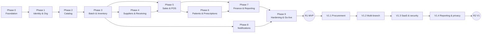

# Implementation Roadmap

**Version:** 1.0 (2026-11-10) · **Related:** [RELEASE-PLAN.md](RELEASE-PLAN.md) · [DEFINITION-OF-DONE.md](DEFINITION-OF-DONE.md) · [MASTER-TEST-STRATEGY.md](../test-plans/MASTER-TEST-STRATEGY.md) · [SPEC-STORY-TRACEABILITY.md](../SPEC-STORY-TRACEABILITY.md)

## 1. Planning assumptions

| Item | Assumption |
|---|---|
| Team | 4 full-stack developers (.NET + React), 1 QA/test engineer (automation), part-time DevOps, part-time pharmacist SME, product owner |
| Estimation | Story complexity XS 0.5 / S 1 / M 2.5 / L 4.5 ideal dev-days including unit and integration tests; focus factor 0.7 |
| MVP effort | 305 ideal dev-days of stories (RELEASE-PLAN §1) + Phase 0 (≈ 35 dev-days) + Phase 9 (≈ 40 dev-days) ≈ 380 dev-days |
| MVP calendar | 380 / (4 devs × 0.7) ≈ 136 working days ≈ **27 weeks (~6.5 months)**, including 15% contingency spread across phases |
| Branching | Trunk-based development, short-lived branches, feature flags for incomplete V1 features |
| Order principle | Build the shared foundations (tenancy, RLS, audit, idempotency, outbox, numbering, settings, localization) **before** any business module, so no module is built without them |

Phases 1–8 overlap where dependencies allow. The critical path is: Phase 0, then Identity/Org, then Catalog, then Inventory core (FEFO and ledger), then POS sale completion.

| Phase | Indicative weeks (from start) |
|---|---|
| 0 Foundation | 1–4 |
| 1 Identity & Organization | 4–8 |
| 2 Medicine Catalog | 7–10 |
| 3 Batch & Inventory | 9–14 |
| 4 Suppliers & Receiving | 13–15 |
| 5 Sales & POS | 14–20 |
| 6 Patients & Prescriptions | 18–22 |
| 7 Finance & Reporting | 21–23 |
| 8 Notifications | 20–22 |
| 9 Hardening & production readiness | 23–27 |

---

## Phase 0 — Foundation and project setup

**Objectives.** Create the solution skeleton and every cross-cutting building block, so business modules only add domain logic. Tenant isolation, including **RLS enabled from the first migration** (ADR-002 amended), audit, idempotency, and numbering exist before any business feature.

**Included stories:**
- US-02-01 tenant context and global query filters;
- US-02-03 PostgreSQL RLS;
- US-02-08 gapless document numbering;
- US-10-01 audit write pipeline;
- US-10-02 sensitive-operation catalog registry;
- US-10-17 settings registry and resolution;
- US-10-21 Arabic/English localization and RTL/LTR (infrastructure part);
- US-10-23 themes.

**Technical work (no story; tracked as tasks in the implementation plan):**
- solution structure per SYSTEM-ARCHITECTURE §6;
- BuildingBlocks: Result/errors, Problem Details middleware, FluentValidation pipeline, unit of work, `TimeProvider`, UUIDv7, money type, idempotency middleware and table, transactional outbox and dispatcher, EF Core interceptors for audit/tenant/`SET LOCAL app.organization_id`;
- Serilog plus OpenTelemetry;
- Hangfire setup;
- MinIO file storage abstraction;
- architecture tests;
- Docker Compose;
- CI pipeline (build, tests, Testcontainers with RLS, SAST, gitleaks, migration bundle);
- frontend shell: Vite, React Router, TanStack Query, Zustand, i18next with `ar`/`en`, Tailwind logical properties, theme provider, generated API client, MSW;
- TestKit builders and fixtures (TEST-DATA-STRATEGY §2).

**Dependencies:** none.

**Deliverables:**
- A running "walking skeleton": a health endpoint plus an authenticated sample endpoint in a branch-scoped route, backed by an RLS-protected table.
- An empty React shell in Arabic and English with dark mode.
- A green CI pipeline.

**Testing requirements:**
- architecture tests;
- RLS schema test (SEC-T-01);
- RLS data test with EF filters disabled (SEC-T-02);
- idempotency middleware tests (INT-I-01…06 on the sample endpoint);
- outbox rollback test;
- audit same-transaction test;
- gapless numbering concurrency test (TS-02-044).

**Completion criteria:** DoD §3; G1–G6 and G13 operating in CI; `docker compose up` produces a working stack in ≤ 10 min on a clean machine.

**Risks:**
- Over-engineering the building blocks. Mitigation: build only what the Phase 1–5 stories need.
- Hangfire.PostgreSql community package (ADR-007). Mitigation: pin the version and keep the job abstraction thin.

## Phase 1 — Identity, organization, and branches

**Objectives.** Secure login and sessions; organization and branch management; permission plus branch authorization on every endpoint; settings and preferences.

**Included stories:**
- **Identity:** US-01-02…08, US-01-10…17.
- **Organization:** US-02-02, US-02-04, US-02-05, US-02-06, US-02-07, US-02-09, US-02-10, US-02-13.
- **Audit:** US-10-03, US-10-04.
- **Settings and preferences:** US-10-18, US-10-19, US-10-20, US-10-22.

**Dependencies:** Phase 0.

**Deliverables:**
- Login, refresh and logout UI; user, role-assignment and branch-assignment administration.
- Organization provisioning via bootstrap command (`pms org provision`).
- Organization and branch settings screens; audit search.

**Testing requirements:**
- authorization matrix generator live (S1);
- cross-org isolation suite (S2, CS-08);
- CS-07;
- CS-12 refresh-token reuse (TS-01-014);
- lockout and rate limits;
- multi-node invalidation tests (TS-01-021/052/071/073).

**Completion criteria:** every endpoint in the authorization matrix is green; an Owner can provision the organization, create 2 branches, invite and assign users per role, and audit shows each action.

**Risks:**
- Permission model churn as later modules add permissions. Mitigation: a permission catalog seeded from code with an architecture test that every endpoint declares a policy.

## Phase 2 — Medicine catalog

**Objectives.** Organization-level catalog with barcodes, packs, classification, pricing, and fast bilingual search.

**Included stories:** US-03-01…12, US-03-19.

**Dependencies:** Phase 1 (permissions, settings for tax and currency).

**Deliverables:** reference-data screens, medicine editor, price management with branch override and history, search API and UI component reused by the POS.

**Testing requirements:**
- GTIN checksum unit tests;
- Arabic normalization unit tests;
- search performance PT-01 baseline at 50,000 medicines (TS-03-068);
- price history and audit;
- CS-08 on catalog endpoints.

**Completion criteria:** POS search component returns results p95 ≤ 300 ms on the volume dataset; classification drives Rx flags.

**Risks:**
- Search quality for Arabic spelling variants. Mitigation: pg_trgm plus a normalization column, with test corpus reviewed by the pharmacist SME.

## Phase 3 — Batch and inventory (core)

**Objectives.** Implement the inventory ledger, balances, FEFO allocation contract, posting guarantees, opening balances, adjustments and write-offs, expiry and low-stock detection, reconciliation, and valuation. This is the correctness core of the product.

**Included stories:** US-04-01…16, US-04-18, US-04-26.

**Dependencies:** Phases 1–2.

**Deliverables:**
- `IInventoryAllocation` (AllocateAndLock/Preview), `PostOutbound`, `ReturnToBatch`, inbound find-or-create.
- Stock overview and stock card UI; opening balance import; adjustment and write-off workflow with approvals.
- Nightly expiry, low-stock and reconciliation jobs.

**Testing requirements:**
- INV-01…10 fixture active;
- CS-01 allocation level (TS-04-026/027, 1,000-run stress);
- CS-02 (TS-04-004/023/024);
- CS-10 (TS-04-039/040/066);
- CS-11 (TS-04-041…043);
- property-based FEFO tests;
- PT-05 allocation p95 ≤ 50 ms.

**Completion criteria:**
- The 1,000-run contention test has zero oversell and zero unhandled deadlocks.
- Reconciliation detects injected drift.
- An opening balance of 5,000 lines posts within 30 s.

**Risks:**
- Lock contention on fast movers. Mitigation: deterministic lock order, 3 s `lock_timeout`, short transactions, measured in the contention test.
- Approval deadlock in single-manager branches (BR-G-28). Mitigation: Owner can approve; documented assumption.

## Phase 4 — Suppliers and goods receiving (MVP slice)

**Objectives.** Supplier records and direct goods receipt creating batches and receipt movements atomically.

**Included stories:** US-05-01…08.

**Dependencies:** Phase 3 (inbound contract).

**Deliverables:** supplier screens; goods receipt UI with batch, expiry and bonus quantities; receipt reversal; purchase history.

**Testing requirements:**
- shelf-life validation;
- receipt posting atomicity (TS-05-029, CS-10);
- idempotent posting (TS-05-028/033, CS-11);
- reversal after consumption rejected.

**Completion criteria:** E2E-04 passes; posted receipts reconcile with stock card.

**Risks:**
- Bonus-quantity costing interpretation. Mitigation: the SPEC-05 rule is reviewed with the pharmacist/accountant SME before implementation.

## Phase 5 — Sales and POS

**Objectives.** Keyboard-first POS with atomic, idempotent sale completion, payments, discounts, taxes, receipts, cash sessions, voids, and returns.

**Included stories:** US-06-01…14, US-06-16…24.

**Dependencies:** Phases 2–4 (needs stock to sell), US-01-17 (manager override).

**Deliverables:**
- POS screen with Zustand cart, scanner input, quote, payment dialog and 80 mm/A4 printing.
- Cash session open, close and Z-report.
- Sales history; void; returns with inspection disposition.

**Testing requirements:**
- CS-01 end-to-end (TS-06-080/081);
- CS-02 (TS-06-067/091);
- CS-05 (TS-06-123…125);
- CS-09 (TS-06-076/078);
- CS-10 (TS-06-085/121/129);
- CS-11 (TS-06-082/083);
- golden-file money tests;
- PT-04 sale completion p95 ≤ 800 ms;
- E2E-05…10, E2E-14.

**Completion criteria:** a full day of pilot-like operation in staging (open session, 300 sales, returns, voids, close) reconciles exactly: Z-report equals stored documents and INV-01…10 hold.

**Risks:**
- Card approved on terminal but sale rejected by server. Mitigation: pre-validate with the quote; clear UI instruction for manual terminal reversal; record the event.
- Per-branch invoice counter serialization. Mitigation: counter update is the last statement before commit; measured in the contention test.

## Phase 6 — Patients and prescriptions (MVP slice)

**Objectives.** Privacy-preserving patient profiles with allergies and consent; prescription registration, verification, and dispensing (including partial) through POS; Rx-only and controlled enforcement; controlled-medicine register.

**Included stories:**
- **Patients:** US-07-01…07.
- **Prescriptions:** US-08-01…15.
- **POS integration:** US-06-25, US-06-26, US-06-27.

**Dependencies:** Phase 5 (sale completion), Phase 0 file storage.

**Deliverables:** patient screens; prescription registration with image upload; verification queue; POS dispensing flow; controlled register view.

**Testing requirements:**
- CS-04 (TS-08-065);
- CS-13 (TS-06-156…158, TS-08-074/075/077);
- medical-data access logging (SEC-D-03);
- permission separation (SEC-D-02);
- file upload security (SEC-I-06);
- E2E-11, E2E-12.

**Completion criteria:** a pharmacist SME completes the dispensing walkthrough in Arabic without workarounds.

**Risks:**
- Regulatory answers (REG-01, REG-02) may change rules. Mitigation: the rules are settings-driven, and the questions pack is sent at Phase 0 start.

## Phase 7 — Finance and reporting (MVP slice)

**Objectives.** Core reports that distinguish revenue, profit, cash flow, and inventory valuation.

**Included stories:** US-09-01, US-09-03, US-09-05, US-09-07, US-09-08, US-09-10, US-09-18.

**Dependencies:** Phases 3, 5, 6.

**Deliverables:** daily sales, gross profit/COGS, cash session X/Z and reconciliation, current valuation, near-expiry, and CSV export.

**Testing requirements:**
- golden-file finance scenarios (FinanceDayFixture);
- property-based reconciliation identities (TS-09-019/036/046);
- PT-09 report latency;
- E2E-15.

**Completion criteria:** reports for the staging pilot day match hand-calculated golden totals to the cent.

**Risks:**
- Report queries on OLTP at scale. Mitigation: indexed queries and limits now; the DailyBranchSummary projection arrives in V1.4.

## Phase 8 — Notifications (MVP slice) and advanced-feature readiness

**Objectives.** In-app notification center for low-stock and expiry alerts. Advanced features are evaluated only, not built (ADVANCED-FEATURES go/no-go).

**Included stories:** US-10-08, US-10-09, US-10-13.

**Dependencies:** Phase 3 jobs; Phase 1 settings.

**Deliverables:** notification store, routing, and center UI; de-duplication rules; a decision record per advanced feature.

**Testing requirements:** de-duplication; branch-scoped delivery (CS-07); PT-16; E2E-16.

**Completion criteria:** a manager receives exactly one low-stock notification per medicine per branch per 24 h.

**Risks:** notification noise. Mitigation: thresholds are configurable per branch.

## Phase 9 — Security hardening, performance, deployment, production readiness → R1 MVP

**Objectives.** Make the MVP production-ready and pass all release gates.

**Included work (no new stories):**
- security test plan S1–S9 including external penetration test;
- performance plan at MVP profile and V1 baseline;
- accessibility pass;
- backup/PITR configuration and restore drill;
- production deployment automation and monitoring/alerting (DEPLOYMENT-ARCHITECTURE);
- operational runbooks;
- data migration rehearsal (opening balances);
- UAT;
- go-live checklist (RELEASE-PLAN §7);
- regulatory confirmations recorded (REG items).

**Dependencies:** Phases 0–8.

**Deliverables:** production environment; signed-off release candidate; runbooks; trained pilot users.

**Testing requirements:** gates G1–G13 all green; E2E-C1/C2 20 consecutive passes.

**Completion criteria:** RELEASE-PLAN §7 checklist complete; MVP live at the pilot pharmacy with daily reconciliation clean for 14 consecutive days.

**Risks:**
- Regulatory confirmations arrive late (R-03). Mitigation: send the questions pack at Phase 0; go-live is blocked, not development.
- E-invoicing obligation (REG-07) may force an integration before go-live (R-04).

---

## V1 increments (after R1)

| Increment | Stories | Key tests | Completion criteria |
|---|---|---|---|
| V1.1 Procurement | US-05-09…21 | CS-03 (TS-05-053), invoice matching tolerances, supplier ledger identities | PO → partial receipts → invoice → payment cycle reconciles supplier balance |
| V1.2 Multi-branch operations | US-02-11, US-02-12, US-04-17, US-04-19…25, US-04-27 | CS-06 (TS-04-049/148/153/158), stocktake during live sales (TS-04-163) | Transfer and stocktake E2E-21/22 pass; ledger invariants hold |
| V1.3 SaaS & security | US-01-01, US-01-09, US-01-18…20, US-02-14…16, US-10-05, US-10-06 | Platform/org token separation, support grant expiry, MFA | Second organization onboarded via self-signup with full isolation suite green |
| V1.4 Reporting, privacy & real-time | US-03-13…16, US-07-08…11, US-07-13, US-07-16, US-07-17, US-09-02, US-09-04, US-09-06, US-09-09, US-09-11…15, US-09-17, US-09-19…21, US-10-10…12, US-10-24 | Projection vs OLTP equality (TS-09-013), SignalR delivery ≤ 2 s, export security | Reports at V1 load meet NFR-G-03; notification p95 ≤ 2 s |

Future features (RELEASE-PLAN §6) are scheduled individually after their go/no-go review.

## Exact first development task

**T-0.1 — Create the backend solution skeleton and architecture tests.** This creates:
- the .NET 10 solution `Pharmacy.sln` with `src/Host/Pharmacy.Host`, `src/BuildingBlocks/Pharmacy.BuildingBlocks.*` and one empty module (`src/Modules/Organization/Pharmacy.Modules.Organization.{Domain,Application,Infrastructure,Contracts}`);
- `tests/Pharmacy.ArchitectureTests` with the first dependency rules (Domain has no reference to Infrastructure or EF Core; modules reference each other only through `Contracts`);
- a `/health/live` endpoint;
- a CI workflow that builds and runs the tests.

The task is complete when `dotnet test` passes locally and in CI, and an intentionally added forbidden reference makes the architecture test fail.

The full task breakdown is in [docs/superpowers/plans/2026-11-10-implementation-execution-plan.md](../superpowers/plans/2026-11-10-implementation-execution-plan.md).
