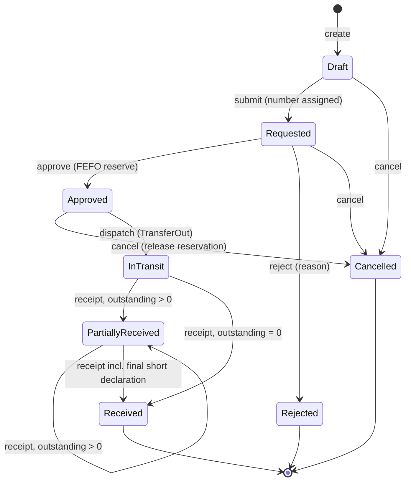
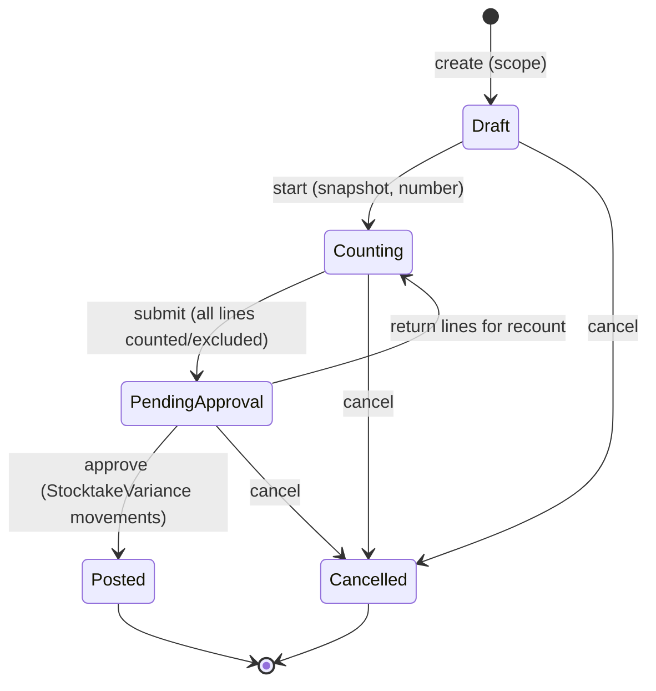

# SPEC-04: Batch & Inventory Management

**Version:** 1.0 · **Status:** Draft for review · **Owner:** Business Analysis / Architecture · **Related ADRs:** ADR-001, ADR-002, ADR-003, ADR-004, ADR-007, ADR-008, ADR-009 · **Related BRQs:** BRQ-01, BRQ-02, BRQ-04, BRQ-05, BRQ-10, BRQ-11, BRQ-12, BRQ-14

---

## 1. Purpose

Define how the system tracks physical medicine stock at **batch level per branch**, how every quantity change is recorded in an **append-only stock movement ledger**, and how stock is **allocated, reserved, adjusted, written off, counted, transferred, quarantined, and reconciled** so that:

- expired, quarantined, or do-not-sell stock is never sold, dispensed, or transferred for sale (BR-G-07);
- on-hand quantity never becomes negative and concurrent operations never oversell (BR-G-08, BR-G-10, NFR-G-06);
- every quantity change is traceable to a source document, a user, a time, and a business date (BR-G-05);
- every posting is atomic and idempotent, and leaves no partial state on failure (BR-G-09, BR-G-19).

This module owns the **single write path** to `Batch`, `BatchBalance`, and `StockMovement` (ADR-003). Every other module that changes stock (Procurement SPEC-05, Sales SPEC-06, Prescriptions SPEC-08) does so only through the Inventory contracts defined in §6.2–§6.4.

## 2. Business Context

Egyptian community pharmacies and chains hold thousands of medicines, typically several batches per medicine with different expiry dates and purchase costs. Losses come mainly from expiry, damage, shrinkage, and counting errors; customer-safety risk comes from selling expired or recalled stock. Many packs print expiry as month/year only. Medicine prices change over time and older packs may carry an older printed price, so a branch may need to sell a specific batch at a batch-specific price (subject to REG-08).

Operations that this module must support:

- **Go-live:** a new branch loads its existing shelf stock as opening balances, often thousands of lines from a spreadsheet.
- **Daily selling:** cashiers and pharmacists sell many units per minute; up to 20 concurrent cashiers per branch (NFR-G-02). The system picks batches by FEFO automatically.
- **Control:** managers approve adjustments above a value threshold; counts happen while the pharmacy stays open; expired stock is removed through write-offs.
- **Chains:** branches move stock between each other through an explicit transfer workflow with approval, dispatch, in-transit visibility, and receipt that may be short or damaged.

## 3. Scope

| Area | Included | Priority |
|---|---|---|
| Batch model | Multiple batches per medicine per branch; batch number; expiry date; unit cost; supplier; source batch link; status derivation; batch list and detail | P0 |
| Balances & ledger | `BatchBalance` (OnHand, Reserved); append-only `StockMovement` for all 15 movement types (conventions §6.2); per-batch movement sequence | P0 |
| Posting contracts | Internal contracts for inbound (find-or-create batch), outbound, reservation, and return-to-original-batch postings used by SPEC-05/06/08 | P0 |
| FEFO allocation | Allocation contract (allocate-and-lock, preview), ordering, eligibility exclusions, deterministic locking, FEFO override with permission | P0 / P1 |
| Expiry control | Business-date-based sellability; do-not-sell window; nightly `Expired` flagging; near-expiry detection | P0 |
| Opening balances | Manual entry and file import (CSV/XLSX), posting, irreversible lock | P0 |
| Stock adjustments | Reason codes, threshold-based approval with segregation of duties, reclassification | P0 / P1 |
| Write-offs | Damaged and expired write-offs, expired prefill | P0 |
| Stock views | Branch stock overview, batch detail, stock card per medicine/batch, movement history export | P0 / P1 |
| Batch maintenance | Metadata correction rules, batch selling price override | P1 |
| Low stock | `ReorderSetting` per branch per medicine; low-stock state transitions and events for SPEC-10 and SPEC-05 | P1 |
| Quarantine | Batch quarantine and release; organization-wide recall by medicine + batch number | P1 |
| Reconciliation | Nightly ledger ↔ balance reconciliation with findings and alerting | P0 |
| Stock transfers | Draft → Requested → Approved (reservation) → InTransit (TransferOut) → PartiallyReceived/Received (TransferIn), short/over/damaged/rejected handling, cancellation | P1 |
| Stocktakes | Full and cycle counts, blind count, snapshot at start, variance formula, recount, approval, variance posting while sales continue | P1 |
| Valuation data | Nightly valuation snapshot per branch/medicine/business date; as-of valuation query; reporting view for SPEC-09 | P1 |
| Multi-branch | Other-branch stock visibility with permission (P1); rebalancing suggestions (P3) | P1 / P3 |

## 4. Out of Scope

- Goods receipt documents, purchase orders, supplier returns, supplier invoices (SPEC-05). SPEC-04 provides the posting contracts they call.
- Sale, void, sales return documents and pricing resolution of sale lines (SPEC-06). SPEC-04 provides allocation and movement posting.
- Dispensing records and prescription quantities (SPEC-08).
- Medicine master data, pack size, prices (`MedicinePrice`, `BranchMedicinePrice`) and controlled/Rx flags (SPEC-03).
- Notification delivery, notification rules, and audit log storage (SPEC-10). SPEC-04 emits integration events and audit events.
- Financial reports and COGS/valuation presentation (SPEC-09). SPEC-04 supplies valuation data.
- Storage locations / shelves / bins inside a branch; unit-level serialization (REG-03); negative-stock selling; consignment stock; automatic purchase order creation; demand forecasting beyond the P3 rebalancing heuristic.
- Physical destruction procedures for expired medicines (only the write-off record and optional evidence attachment are in scope; procedure pending REG-08).

## 5. Actors and Permissions

| Actor | Description |
|---|---|
| Inventory Staff (`INVENTORY`) | Loads opening balances (if granted), creates adjustments and write-offs, runs counts, creates/dispatches/receives transfers. Cannot approve. |
| Branch Manager (`MANAGER`) | Approves adjustments, write-offs, stocktakes, transfers; quarantines batches; maintains reorder settings. |
| Pharmacist (`PHARMACIST`) | Views stock and batches; may override FEFO at POS/dispensing; may quarantine (if granted). |
| Cashier (`CASHIER`) | Views sellable stock; sells through FEFO (SPEC-06). |
| Accountant (`ACCOUNTANT`) | Reads stock, movements, valuation. |
| Owner (`OWNER`) | All permissions; locks opening balances; organization-wide recall; reads reconciliation findings. |
| System (background jobs) | Expiry flagging, near-expiry scan, low-stock scan, reconciliation, valuation snapshot, rebalancing suggestions. |
| Other modules (SPEC-05/06/08) | Call the Inventory contracts inside their own transaction. |

### 5.1 Permissions used

| Permission | Status | Grants |
|---|---|---|
| `inventory.stock.read` | Canonical | Branch stock overview, sellable quantities, FEFO preview |
| `inventory.batches.read` | Canonical | Batch list and detail |
| `inventory.batches.update-metadata` | Canonical | Correct batch number/expiry (§7 BR-04-017); with `catalog.prices.update` set/clear batch selling price override |
| `inventory.batches.override-fefo` | Canonical | Select a specific eligible batch instead of the FEFO choice |
| `inventory.movements.read` | Canonical | Movement ledger and stock card |
| `inventory.adjustments.create` / `.approve` | Canonical | Create/submit adjustments; approve/reject adjustments |
| `inventory.write-offs.create` / `.approve` | Canonical | Create/submit write-offs; approve/reject write-offs |
| `inventory.stocktakes.manage` / `.approve` | Canonical | Create/start/count/submit/cancel stocktakes; approve, return for recount, post |
| `inventory.transfers.create` / `.approve` / `.dispatch` / `.receive` | Canonical | Transfer workflow steps |
| `reports.inventory.read` | Canonical | See unit costs and values in stock views; valuation data |
| `catalog.prices.update` | Canonical | Required together with `inventory.batches.update-metadata` for batch selling price override |
| `inventory.batches.quarantine` | **New** | Quarantine and release batches; organization-wide recall (with organization-wide scope) |
| `inventory.opening-balances.manage` | **New** | Create, import, post opening balance documents; lock opening balances |
| `inventory.reorder-settings.manage` | **New** | Create/update/deactivate `ReorderSetting` |
| `inventory.stock.read-other-branches` | **New** | Read sellable quantities of other branches of the organization (no costs) |
| `inventory.reconciliation.read` | **New** | Read reconciliation runs and findings; trigger an on-demand run |

### 5.2 Default role grants (seed)

| Permission | OWNER | MANAGER | PHARMACIST | CASHIER | INVENTORY | ACCOUNTANT |
|---|---|---|---|---|---|---|
| `inventory.stock.read` | ✔ | ✔ | ✔ | ✔ | ✔ | ✔ |
| `inventory.batches.read` | ✔ | ✔ | ✔ | ✔ | ✔ | ✔ |
| `inventory.batches.update-metadata` | ✔ | ✔ | – | – | – | – |
| `inventory.batches.override-fefo` | ✔ | ✔ | ✔ | – | – | – |
| `inventory.batches.quarantine` | ✔ | ✔ | ✔ | – | – | – |
| `inventory.movements.read` | ✔ | ✔ | ✔ | – | ✔ | ✔ |
| `inventory.adjustments.create` | ✔ | ✔ | – | – | ✔ | – |
| `inventory.adjustments.approve` | ✔ | ✔ | – | – | – | – |
| `inventory.write-offs.create` | ✔ | ✔ | ✔ | – | ✔ | – |
| `inventory.write-offs.approve` | ✔ | ✔ | – | – | – | – |
| `inventory.stocktakes.manage` | ✔ | ✔ | – | – | ✔ | – |
| `inventory.stocktakes.approve` | ✔ | ✔ | – | – | – | – |
| `inventory.transfers.create` | ✔ | ✔ | – | – | ✔ | – |
| `inventory.transfers.approve` | ✔ | ✔ | – | – | – | – |
| `inventory.transfers.dispatch` / `.receive` | ✔ | ✔ | – | – | ✔ | – |
| `inventory.opening-balances.manage` | ✔ | – | – | – | – | – |
| `inventory.reorder-settings.manage` | ✔ | ✔ | – | – | ✔ | – |
| `inventory.stock.read-other-branches` | ✔ | ✔ | ✔ | – | ✔ | – |
| `inventory.reconciliation.read` | ✔ | – | – | – | – | – |
| `reports.inventory.read` | ✔ | ✔ | – | – | – | ✔ |

## 6. Functional Requirements

### 6.1 Requirement table

| ID | Requirement | Priority | BRQ | Stories |
|---|---|---|---|---|
| FR-04-001 | The system shall store each `Batch` with OrganizationId, BranchId, MedicineId, BatchNumber, ExpiryDate (date), UnitCost (`numeric(19,4)`, ≥ 0), SupplierId (nullable), SourceBatchId (nullable), SellingPriceOverride (nullable), QuarantinedAt/QuarantineReason/RecallReference (nullable), Status, CreatedAt; a batch belongs to exactly one medicine and one branch for its lifetime. | P0 | BRQ-04 | US-04-01, US-04-03 |
| FR-04-002 | The system shall maintain exactly one `BatchBalance` row per batch with integer OnHand and Reserved in base units, enforced by database check constraints `on_hand >= 0`, `reserved >= 0`, `reserved <= on_hand`, plus `LastMovementSequence` (bigint). | P0 | BRQ-05 | US-04-01, US-04-02 |
| FR-04-003 | The system shall derive batch status deterministically with precedence `Quarantined` > `Expired` > `Depleted` > `Active` (BR-04-002) and recompute it in every posting transaction that changes the batch's OnHand or quarantine state. | P0 | BRQ-04 | US-04-01, US-04-15 |
| FR-04-004 | The system shall list batches of a branch with filters medicineId, status, expiry from/to, batch number (prefix, case-insensitive), supplierId, and `onlyWithStock`, sorted by default by ExpiryDate ascending, and return batch detail including balance, sellable quantity, eligibility flags, lineage (source batch and destination batches), and the last 20 movements. | P0 | BRQ-04 | US-04-01 |
| FR-04-005 | The system shall compute sellable quantity per batch as `OnHand − Reserved` when the batch is sale-eligible (BR-04-001) and 0 otherwise, and per medicine per branch as the sum over its batches; these figures shall be computed from committed balances at query time and never cached for decisions. | P0 | BRQ-05 | US-04-01, US-04-07 |
| FR-04-006 | The system shall record every quantity change as exactly one `StockMovement` per affected batch per source line containing all canonical fields (conventions §6.2) plus `BatchSequence` = previous `LastMovementSequence` + 1 for that batch. | P0 | BRQ-04 | US-04-02 |
| FR-04-007 | The system shall update `BatchBalance` and insert the movement in the same database transaction as the source document, setting `BalanceAfter` to the batch's OnHand after applying the delta. | P0 | BRQ-05 | US-04-02 |
| FR-04-008 | The system shall reject any posting that would make OnHand negative or Reserved greater than OnHand with `INVENTORY.INSUFFICIENT_STOCK` (409) or `INVENTORY.RESERVATION_CONFLICT` (409), rolling back the whole business transaction. | P0 | BRQ-05 | US-04-02, US-04-06 |
| FR-04-009 | The system shall provide no API or facade operation that updates or deletes a stock movement; the application database role shall have no UPDATE or DELETE privilege on `inventory.stock_movements`. | P0 | BRQ-12 | US-04-02 |
| FR-04-010 | The system shall enforce the movement-type matrix (§6.3): allowed sign, required source document type, and owning module for each of the 15 movement types; a posting that violates the matrix shall be rejected as a programming error (500 `COMMON.INTERNAL_ERROR`, logged) before any write. | P0 | BRQ-04 | US-04-02 |
| FR-04-011 | The posting contract shall join the caller's open transaction, never commit or open its own transaction, and acquire all `BatchBalance` row locks needed by the document in a single lock step ordered by BatchId ascending before any balance write (BR-04-007). | P0 | BRQ-05 | US-04-02, US-04-06 |
| FR-04-012 | The inbound contract shall find an existing batch in the branch matching the receipt key (BR-04-004) and increment it, or create a new `Batch` and `BatchBalance` and post the inbound movement, returning the batch id. | P0 | BRQ-04 | US-04-03 |
| FR-04-013 | The inbound contract shall reject a batch number that already exists in the same branch for the same medicine with a different expiry date with `INVENTORY.BATCH_EXPIRY_MISMATCH` (422). | P0 | BRQ-04 | US-04-03 |
| FR-04-014 | The return-to-batch contract shall post `SaleVoid` and `TransferReturn` movements into the original batch identified by the caller regardless of the batch's current status (a returned quantity into an expired or quarantined batch remains non-sellable), shall post `SalesReturn` movements only when the original batch is sale-eligible at the current business date (not expired, outside the do-not-sell window, not `Quarantined`) and otherwise reject with 422 `INVENTORY.BATCH_NOT_SELLABLE` (reason) writing nothing, and shall recompute status. | P0 | BRQ-04 | US-04-03 |
| FR-04-015 | The system shall accept expiry input as a full date or as month/year; month/year input shall be normalized to the last calendar day of that month (BR-04-003) before validation and storage. | P0 | BRQ-04 | US-04-03, US-04-09 |
| FR-04-016 | The system shall expose the FEFO allocation contract (§6.2) accepting one or more lines (medicine, base-unit quantity, optional explicit batch, optional supplier filter) for one branch and one purpose (`Sale`, `TransferReservation`, `SupplierReturn`), returning per line an ordered list of batch allocations. | P0 | BRQ-05 | US-04-04 |
| FR-04-017 | The FEFO contract shall order eligible batches by ExpiryDate ascending, then Batch.CreatedAt (received timestamp) ascending, then Batch.Id ascending, and fill each line from the first batch onward. | P0 | BRQ-05 | US-04-04 |
| FR-04-018 | The FEFO contract shall exclude, for purposes `Sale` and `TransferReservation`, batches that are Expired by date, inside the do-not-sell window, `Quarantined`, or with sellable quantity 0 (BR-04-010). | P0 | BRQ-05 | US-04-04 |
| FR-04-019 | In allocate mode the FEFO contract shall lock the union of candidate `BatchBalance` rows of all lines with one `SELECT … FOR UPDATE` ordered by BatchId ascending, re-read batch status and balances after the lock, and allocate only from rows that are still eligible. | P0 | BRQ-05 | US-04-04, US-04-06 |
| FR-04-020 | The FEFO contract shall be all-or-nothing per request: if any line cannot be fully allocated it shall return `INVENTORY.INSUFFICIENT_STOCK` with per-line shortages (`lineKey`, `medicineId`, `requested`, `sellable`) and allocate nothing. | P0 | BRQ-05 | US-04-04 |
| FR-04-021 | The system shall provide a FEFO preview (no locks, no writes) returning the allocation the contract would produce at that moment and per-batch sellable quantities, for display at POS, dispensing, and transfer approval. | P0 | BRQ-05 | US-04-04 |
| FR-04-022 | For purpose `SupplierReturn` the FEFO contract shall consider only batches whose SupplierId equals the requested supplier (BR-G-31), shall include Expired and Quarantined batches, and shall allocate up to `OnHand − Reserved` per batch. | P1 | BRQ-06 | US-04-04 |
| FR-04-023 | Every eligibility decision shall use the branch business date computed from the branch time zone at the moment of the decision (BR-G-23) and the expiry date itself, independent of whether the nightly job has already set status `Expired`. | P0 | BRQ-05 | US-04-04, US-04-15 |
| FR-04-024 | The FEFO contract shall accept an explicit batch per line only when the actor holds `inventory.batches.override-fefo` (otherwise 403 `INVENTORY.FEFO_OVERRIDE_NOT_PERMITTED`) unless the explicit batch equals the FEFO first choice; the explicit batch must be eligible and must cover the full line quantity; the allocation shall carry `IsFefoOverride = true` and an audit entry shall be written in the same transaction. | P1 | BRQ-05 | US-04-05 |
| FR-04-025 | Posting endpoints (adjustment submit/approve, write-off submit/approve, opening balance post, transfer approve/dispatch/receive, stocktake approve) shall require an `Idempotency-Key` header and apply conventions §7 replay semantics, with the idempotency record inserted in the same transaction as the posting. | P0 | BRQ-05 | US-04-06 |
| FR-04-026 | Inventory posting transactions shall set `lock_timeout` to 3 s; a lock timeout shall return 503 `COMMON.LOCK_TIMEOUT` with `Retry-After: 1`; a deadlock or serialization failure shall be retried by the execution strategy up to 2 additional times with 50–200 ms jittered backoff and then return 503 `COMMON.TRANSIENT_CONFLICT`. | P0 | BRQ-05 | US-04-06 |
| FR-04-027 | On any failure during a posting (validation, constraint violation, lock timeout, database or process failure before commit) the system shall leave no movement, no balance change, no document state change, no consumed document number, no outbox message, no audit entry, and no idempotency record. | P0 | BRQ-05 | US-04-06 |
| FR-04-028 | The system shall write an audit entry in the same transaction for each sensitive inventory operation listed in §17 (adjustment, write-off, opening balance, FEFO override, quarantine/release/recall, metadata and price override changes, transfer and stocktake transitions, reorder setting changes). | P0 | BRQ-12 | US-04-06, US-04-11, US-04-17 |
| FR-04-029 | The system shall provide a branch stock overview per medicine with OnHand, Reserved, Sellable, Quarantined, Expired, NearExpiry, InTransitInbound, InTransitOutbound quantities, earliest sellable expiry, reorder minimum and low-stock flag, filterable by text search, category, status flags, and paginated (default 25, max 100). | P0 | BRQ-04 | US-04-07 |
| FR-04-030 | The system shall include unit cost and value fields in stock overview, batch, stock card, and movement responses only when the caller holds `reports.inventory.read`; otherwise these fields shall be omitted from the response body. | P0 | BRQ-10 | US-04-07, US-04-08 |
| FR-04-031 | The system shall provide a stock card per medicine (optionally per batch) for a branch showing movements in BatchSequence order with type, quantity delta, balance after, source document type/number/link, user, occurred-at, and business date, with cursor pagination (`cursor`, `limit` ≤ 200), date and type filters, and CSV/XLSX export of up to 100,000 rows (larger exports run as background exports). | P0 | BRQ-04 | US-04-08 |
| FR-04-032 | The system shall let a user with `inventory.opening-balances.manage` create an opening balance document (a `StockAdjustment` with Kind `OpeningBalance`) of up to 5,000 lines (medicine, batch number, expiry, unit cost, quantity in base units or packs, optional supplier, optional selling price override) and post it atomically, creating or incrementing batches with `OpeningBalance` movements. | P0 | BRQ-04 | US-04-09 |
| FR-04-033 | The system shall let a user with `inventory.opening-balances.manage` lock opening balances for a branch (`BranchSettings.OpeningBalanceLocked = true`); after locking, opening balance posting for that branch shall be rejected with `INVENTORY.OPENING_BALANCE_LOCKED` (409). | P0 | BRQ-04 | US-04-09 |
| FR-04-034 | The system shall import an opening balance file (CSV UTF-8 or XLSX, ≤ 5,000 data rows, ≤ 5 MB) into a draft opening balance document, validating every row and returning a row-level error report (row number, column, error code) without creating the draft when any row fails. | P0 | BRQ-04 | US-04-10 |
| FR-04-035 | The system shall let a user with `inventory.adjustments.create` create a stock adjustment with one or more lines (batch or new-batch details, direction Increase/Decrease, quantity > 0, reason code from §8.4) and a note (mandatory for reason `Other`, ≥ 10 characters). | P0 | BRQ-04 | US-04-11 |
| FR-04-036 | On submit the system shall compute adjustment value = Σ(abs(quantity) × batch UnitCost); when value ≤ `AdjustmentApprovalThresholdAmount` and no line concerns a controlled medicine, it shall post immediately (`AdjustmentIncrease`/`AdjustmentDecrease` movements, status `Posted`); otherwise it shall set status `PendingApproval` and emit `Inventory.InventoryDocumentPendingApproval.v1`. | P0 | BRQ-04 | US-04-11 |
| FR-04-037 | The system shall let a user with the matching approve permission, assigned to the document's branch, and different from the submitter (BR-G-28) approve a `PendingApproval` adjustment or write-off (posting it) or reject it with a mandatory reason (≥ 10 characters); self-approval shall return 403 `INVENTORY.SELF_APPROVAL_NOT_ALLOWED`. | P0 | BRQ-01 | US-04-12 |
| FR-04-038 | The system shall support a reclassification adjustment (reason `Reclassification`) that, in one document, decreases a source batch and increases a target batch (existing or new) of the same medicine by the same quantity, used to correct batch number/expiry errors after the batch has movements. | P1 | BRQ-04 | US-04-11, US-04-14 |
| FR-04-039 | The system shall let a user with `inventory.write-offs.create` create a write-off of type `Damaged` or `Expired` with lines per batch (quantity ≤ OnHand − Reserved, reason note, optional evidence file), applying the same threshold and approval rules as adjustments and posting `WriteOffDamaged` or `WriteOffExpired` movements. | P0 | BRQ-04 | US-04-13 |
| FR-04-040 | The system shall accept `Expired` write-off lines only for batches with ExpiryDate ≤ branch business date (`INVENTORY.WRITE_OFF_NOT_EXPIRED`, 422) and shall prefill a draft expired write-off with every expired batch of the branch having `OnHand − Reserved > 0`. | P0 | BRQ-04 | US-04-13 |
| FR-04-041 | The system shall allow direct correction of BatchNumber and ExpiryDate (with mandatory reason) only when the batch has exactly one movement (its originating inbound movement), has no destination batches, and is not referenced by an open transfer or stocktake; otherwise it shall return `INVENTORY.BATCH_METADATA_LOCKED` (409) and the user shall use a reclassification adjustment. | P1 | BRQ-04 | US-04-14 |
| FR-04-042 | The system shall let a user holding both `inventory.batches.update-metadata` and `catalog.prices.update` set or clear `Batch.SellingPriceOverride` (per pack, `numeric(19,4)`, > 0); the FEFO contract shall return the override on each allocation and SPEC-06 shall price an allocation at the override when set (BR-04-012). | P1 | BRQ-07 | US-04-14, US-04-04 |
| FR-04-043 | The `inventory.expiry-flagging` job shall run per branch at 00:05 branch local time and set status `Expired` for every batch with status `Active` or `Depleted` and ExpiryDate ≤ business date, emitting one `Inventory.BatchExpired.v1` per newly expired batch with OnHand > 0; reruns for the same branch and business date shall change nothing. | P0 | BRQ-11 | US-04-15 |
| FR-04-044 | The `inventory.near-expiry-scan` job shall run per branch at 06:00 branch local time and emit one aggregated `Inventory.BatchNearExpiryDetected.v1` per branch listing batches with OnHand > 0, status not `Expired`, and business date < ExpiryDate ≤ business date + `NearExpiryThresholdDays`, flagging batches that entered the window since the last successful run. | P0 | BRQ-11 | US-04-15 |
| FR-04-045 | The system shall let a user with `inventory.reorder-settings.manage` create, update, and deactivate a `ReorderSetting` per branch per medicine with MinQuantity (≥ 0) and MaxQuantity (> MinQuantity) in base units, and import up to 5,000 settings per CSV file. | P1 | BRQ-11 | US-04-16 |
| FR-04-046 | The system shall evaluate each active `ReorderSetting` after `Inventory.StockMovementsPosted.v1` (debounced ≤ 1 evaluation per branch-medicine per 30 min) and every 30 min, and on a transition Normal→Low (sellable < MinQuantity) emit `Inventory.StockLevelLowDetected.v1` with suggested order quantity, and on Low→Normal emit `Inventory.StockLevelRestored.v1`; no event shall be emitted without a state transition. | P1 | BRQ-11 | US-04-16 |
| FR-04-047 | The system shall let a user with `inventory.batches.quarantine` quarantine a batch (mandatory reason, optional recall reference) and release it (mandatory reason), without creating a stock movement, taking the batch's balance row lock so the change serializes with concurrent allocations. | P1 | BRQ-05 | US-04-17 |
| FR-04-048 | The system shall let a user with `inventory.batches.quarantine` and organization-wide scope quarantine, in one transaction, every batch of a given medicine and batch number across all branches of the organization (recall), returning the affected batches per branch and emitting `Inventory.BatchQuarantined.v1` per batch. | P1 | BRQ-05 | US-04-17 |
| FR-04-049 | The `inventory.reconciliation` job shall run daily at 01:30 Africa/Cairo and on demand, and verify per batch: OnHand = Σ QuantityDelta; last movement BalanceAfter = OnHand; BatchSequence contiguous from 1 to LastMovementSequence; Reserved = open transfer reservations + open supplier-return reservations; status = derived status; and per transfer the conservation invariant (BR-04-020). | P0 | BRQ-14 | US-04-18 |
| FR-04-050 | The reconciliation job shall record each mismatch as a `ReconciliationFinding`, never modify balances or movements, and on any new finding emit `Inventory.ReconciliationDriftDetected.v1` (critical) within 5 minutes of run completion. | P0 | BRQ-14 | US-04-18 |
| FR-04-051 | The system shall let a user with `inventory.transfers.create` assigned to the source or destination branch create a draft transfer (source ≠ destination, same organization, both branches `Active`) with lines (medicine, requested base-unit quantity), edit it while `Draft`, submit it (`Requested`, number assigned), and cancel it while `Draft`, `Requested`, or `Approved`. | P1 | BRQ-04 | US-04-19 |
| FR-04-052 | The system shall let a user with `inventory.transfers.approve` assigned to the source branch and different from the creator approve a `Requested` transfer, allocating each line by FEFO (purpose `TransferReservation`) and increasing Reserved on each allocated batch in the same transaction, or reject it with a mandatory reason. | P1 | BRQ-04 | US-04-20 |
| FR-04-053 | The system shall let a user with `inventory.transfers.dispatch` assigned to the source branch dispatch an `Approved` transfer, posting `TransferOut` movements per allocation for the dispatched quantity (≤ reserved), consuming the reservation, releasing any undispatched reservation, and setting status `InTransit`. | P1 | BRQ-04 | US-04-21 |
| FR-04-054 | The system shall show in-transit quantities (dispatched − received − returned) per transfer, medicine, and batch to users of both the source and destination branches, and include them in the stock overview as InTransitOutbound (source) and InTransitInbound (destination) without adding them to either branch's OnHand. | P1 | BRQ-04 | US-04-21, US-04-07 |
| FR-04-055 | The system shall let a user with `inventory.transfers.receive` assigned to the destination branch record one or more receipts on an `InTransit` or `PartiallyReceived` transfer, posting `TransferIn` into the linked destination batch (BR-04-005) per allocation, setting `PartiallyReceived` while outstanding quantity > 0 and `Received` when outstanding = 0. | P1 | BRQ-04 | US-04-22 |
| FR-04-056 | The system shall let the receiver record per allocation rejected quantity (with reason `Damaged`, `WrongItem`, or `Other`) and, on a final receipt, short quantity; rejected and short quantities shall be posted as `TransferReturn` into the original source batch, and the system shall create a draft `WriteOff` (Damaged) in the source branch for rejected-damaged quantities and a draft `StockAdjustment` (reason `TransitLoss`, Decrease) for short quantities, in the same transaction. | P1 | BRQ-04 | US-04-22 |
| FR-04-057 | The system shall reject receipt quantities whose sum (received + rejected + short) exceeds the outstanding quantity of the allocation with `INVENTORY.TRANSFER_OVER_RECEIPT` (422) and shall enforce per transfer Σ TransferOut = Σ TransferIn + Σ TransferReturn + outstanding in-transit. | P1 | BRQ-04 | US-04-22, US-04-18 |
| FR-04-058 | The system shall let a user with `inventory.stocktakes.manage` create a stocktake of type `Full` (all batches of the branch) or `Cycle` (selected medicines and/or categories), rejecting a start whose scope shares any batch with another stocktake in `Counting` or `PendingApproval` with `INVENTORY.STOCKTAKE_SCOPE_OVERLAP` (409). | P1 | BRQ-04 | US-04-23 |
| FR-04-059 | On start the system shall, in one transaction holding `FOR SHARE` locks on the scope's balance rows (BatchId ascending), create one line per batch in scope with `SnapshotOnHand` and `SnapshotSequence` (= LastMovementSequence), set status `Counting`, and assign the stocktake number; sales and other postings shall continue after the start transaction commits. | P1 | BRQ-04 | US-04-23 |
| FR-04-060 | The system shall let counters record per line CountedQuantity (integer ≥ 0) and CountedAt (≥ start time, ≤ now), add lines for batches found but not in scope or not in the system, hide system quantities from users without `inventory.stocktakes.approve` (blind count), and submit the stocktake to `PendingApproval` only when every line is counted or explicitly excluded (`INVENTORY.STOCKTAKE_INCOMPLETE`, 422). | P1 | BRQ-04 | US-04-24 |
| FR-04-061 | The system shall compute per line Expected = SnapshotOnHand + Σ QuantityDelta of the batch's movements with BatchSequence > SnapshotSequence and OccurredAt ≤ CountedAt, Variance = CountedQuantity − Expected, show expected, variance, and variance value to approvers, allow return of selected lines for recount, and on approval (approver ≠ submitter) post one `StocktakeVariance` movement per non-zero-variance line against the current balance. | P1 | BRQ-04 | US-04-25 |
| FR-04-062 | The system shall produce, per branch per business date at 00:30 branch local time for the previous business date, an `InventoryValuationSnapshot` per medicine with on-hand quantity and value by status bucket (sellable, near-expiry, expired, quarantined) and in-transit-outbound quantity and value, computed from the ledger, and expose `reporting.v_batch_valuation` and an as-of valuation query for any past timestamp. | P1 | BRQ-10 | US-04-26 |
| FR-04-063 | The system shall let a user with `inventory.stock.read-other-branches` view, for a medicine, the sellable quantity, near-expiry quantity, and earliest sellable expiry in every active branch of the organization, excluding costs and values. | P1 | BRQ-02 | US-04-27 |
| FR-04-064 | The system shall compute nightly rebalancing suggestions (source branch, destination branch, medicine, suggested quantity, rationale) where a destination is Low against its `ReorderSetting` and a source holds sellable stock above its MaxQuantity or near-expiry stock exceeding its 30-day sales quantity, and let an authorized user create a draft transfer from a suggestion. | P3 | BRQ-04 | US-04-28 |

### 6.2 FEFO allocation contract (internal, `IInventoryAllocation`)

Consumers: SPEC-06 (sale completion, including dispensing which is always via a sale per SPEC-08), SPEC-04 transfers (approval reservation), SPEC-05 supplier returns.

**Modes.** `AllocateAndLock` (inside the caller's transaction; returns locked allocations; the caller then posts movements or reservations through §6.4 in the same transaction) and `Preview` (no locks, no writes; informational only).

**Request** (specification example):

```json
{
  "organizationId": "0193…",
  "branchId": "0193…",
  "purpose": "Sale",
  "mode": "AllocateAndLock",
  "actorUserId": "0193…",
  "lines": [
    { "lineKey": "L1", "medicineId": "0193…", "quantityBaseUnits": 30, "explicitBatchId": null, "supplierId": null },
    { "lineKey": "L2", "medicineId": "0193…", "quantityBaseUnits": 2,  "explicitBatchId": "0193…", "supplierId": null }
  ]
}
```

**Response** (success):

```json
{
  "businessDate": "2026-11-09",
  "lines": [
    { "lineKey": "L1", "medicineId": "0193…", "requestedBaseUnits": 30,
      "allocations": [
        { "batchId": "0193…a", "batchNumber": "B2301", "expiryDate": "2027-01-31", "quantityBaseUnits": 20, "unitCost": 12.5000, "sellingPriceOverride": null, "isFefoOverride": false },
        { "batchId": "0193…b", "batchNumber": "B2307", "expiryDate": "2027-06-30", "quantityBaseUnits": 10, "unitCost": 13.1000, "sellingPriceOverride": 95.0000, "isFefoOverride": false }
      ] }
  ]
}
```

**Failure:** `INVENTORY.INSUFFICIENT_STOCK` (409) with extension `shortages: [{ lineKey, medicineId, requested, sellable }]`; `INVENTORY.BATCH_NOT_SELLABLE` (422) with `reason` ∈ {`Expired`, `DoNotSellWindow`, `Quarantined`, `WrongMedicine`, `WrongBranch`, `WrongSupplier`} for an explicit batch; `INVENTORY.FEFO_OVERRIDE_NOT_PERMITTED` (403).

**Algorithm** (normative):

1. Validate: `lines` count 1–200; each `quantityBaseUnits` integer 1–1,000,000; `purpose` known; `supplierId` required iff purpose = `SupplierReturn`; medicines belong to the organization (else 404 `COMMON.NOT_FOUND`).
2. Resolve `businessDate` = current date in the branch time zone (BR-G-23) and `doNotSellDays` from branch policy.
3. Candidate query (no lock): for each line, batch ids of the branch and medicine satisfying the purpose filter:
   - `Sale` / `TransferReservation`: `QuarantinedAt IS NULL` AND `ExpiryDate > businessDate + doNotSellDays` AND `OnHand − Reserved > 0`.
   - `SupplierReturn`: `SupplierId = supplierId` AND `OnHand − Reserved > 0` (Expired and Quarantined included).
   - Explicit batch: only that batch id (eligibility verified in step 5).
4. Lock: `SELECT … FROM inventory.batch_balances WHERE batch_id = ANY(:unionOfAllCandidateIds) ORDER BY batch_id FOR UPDATE` — one statement for the whole request; `lock_timeout` 3 s.
5. Re-read `Batch` rows (status, quarantine, expiry) and the locked balances; drop candidates no longer eligible; for an explicit batch failing eligibility return `INVENTORY.BATCH_NOT_SELLABLE` with reason.
6. Override check: for each line with `explicitBatchId`, compute the FEFO first choice (step 7 ordering without the explicit batch); if `explicitBatchId` ≠ first choice and actor lacks `inventory.batches.override-fefo` → 403 `INVENTORY.FEFO_OVERRIDE_NOT_PERMITTED`; otherwise the explicit batch must cover the full line quantity (else `INVENTORY.INSUFFICIENT_STOCK`).
7. Allocate lines in request order; FEFO lines take from eligible batches ordered by `ExpiryDate ASC, CreatedAt ASC, Id ASC`; lines of the same medicine share the same in-memory remaining sellable per batch (no double counting).
8. If any line is short → return `INVENTORY.INSUFFICIENT_STOCK` with all shortages; nothing allocated (the caller rolls back).
9. Return allocations; locks stay held until the caller's transaction ends.

**Not done by this contract:** the second candidate query after locking (stock committed after step 3 is not considered; the caller may retry — documented edge case E-06); price resolution (SPEC-06 resolves branch/organization price; the contract only returns the batch override).

### 6.3 Movement-type matrix

| Type | Sign | Source document type | Owning module | Batch resolution |
|---|---|---|---|---|
| `Receipt` | + | `GoodsReceipt` | SPEC-05 | Inbound find-or-create (BR-04-004) |
| `ReceiptReversal` | − | `GoodsReceipt` | SPEC-05 | Original receipt batch; requires OnHand − Reserved ≥ quantity |
| `Sale` | − | `Sale` | SPEC-06 | FEFO / override (§6.2) |
| `SaleVoid` | + | `Sale` | SPEC-06 | Original `SaleLineAllocation` batch (FR-04-014) |
| `SalesReturn` | + | `SalesReturn` | SPEC-06 | Original batch, only when disposition `Restocked` (conventions §10) |
| `TransferOut` | − | `StockTransfer` | SPEC-04 | Reserved allocation batch; consumes Reserved |
| `TransferIn` | + | `StockTransfer` | SPEC-04 | Linked destination batch (BR-04-005) |
| `TransferReturn` | + | `StockTransfer` | SPEC-04 | Original source batch |
| `AdjustmentIncrease` | + | `StockAdjustment` | SPEC-04 | Selected batch or new batch |
| `AdjustmentDecrease` | − | `StockAdjustment` | SPEC-04 | Selected batch |
| `WriteOffDamaged` | − | `WriteOff` | SPEC-04 | Selected batch |
| `WriteOffExpired` | − | `WriteOff` | SPEC-04 | Selected expired batch |
| `StocktakeVariance` | ± | `Stocktake` | SPEC-04 | Line batch or new found batch |
| `SupplierReturn` | − | `SupplierReturn` | SPEC-05 | FEFO purpose `SupplierReturn` or explicit; consumes Reserved when reserved in draft |
| `OpeningBalance` | + | `OpeningBalance` (`StockAdjustment` Kind `OpeningBalance`) | SPEC-04 | Inbound find-or-create |

`QuantityDelta` is never 0. `UnitCost` on every movement = the batch's UnitCost (BR-04-031).

### 6.4 Posting contracts (internal, `IInventoryLedger`)

| Operation | Effect on balance | Used by |
|---|---|---|
| `PostOutbound(batchId, type, qty, source…, consumeReservedQty)` | OnHand −= qty; Reserved −= consumeReservedQty (≤ qty) | Sale, ReceiptReversal, TransferOut, AdjustmentDecrease, WriteOff*, StocktakeVariance (−), SupplierReturn |
| `PostInbound(receiptKey or batchId, type, qty, source…)` | Find-or-create batch; OnHand += qty | Receipt, OpeningBalance, TransferIn, AdjustmentIncrease, StocktakeVariance (+) |
| `ReturnToBatch(batchId, type, qty, source…)` | OnHand += qty on the original batch | SaleVoid, SalesReturn, TransferReturn |
| `Reserve(batchId, qty, source…)` / `ReleaseReservation(batchId, qty, source…)` | Reserved ± qty; no movement | Transfer approval/cancel/partial dispatch; SPEC-05 supplier-return drafts |

Every operation: (1) asserts tenant context; (2) is called after the document's single lock step (FR-04-011) — operations on a batch not locked in the current transaction fail as a programming error; (3) writes movement + balance + status recomputation; (4) appends the batch to the transaction's `Inventory.StockMovementsPosted.v1` outbox message (one message per transaction, listing branch, medicine ids, batch ids).

### 6.5 Transaction boundaries, idempotency, and failure behavior per posting operation

| Operation | Transaction contains | Lock order | Idempotency | On failure |
|---|---|---|---|---|
| Opening balance post | Document → Posted; batches created/incremented; `OpeningBalance` movements; document number; audit; outbox; idempotency record | Document row → balance rows (BatchId asc) of existing matched batches → `DocumentSequence` | Required | Full rollback; document stays `Draft`; no number consumed |
| Adjustment submit (≤ threshold) / approve | Document → Posted; movements; status recompute; number (at submit); audit; outbox; idempotency | Document → balances asc → sequence | Required | Full rollback; status unchanged (`Draft` or `PendingApproval`) |
| Adjustment submit (> threshold) / reject | Document → PendingApproval / Rejected; number (at submit); audit; outbox | Document → sequence | Required (submit) / not required (reject, guarded by RowVersion) | Full rollback |
| Write-off submit / approve | As adjustment | As adjustment | Required | Full rollback |
| Transfer submit | Document → Requested; number; audit; outbox | Document → sequence | Not required (RowVersion guarded) | Full rollback |
| Transfer approve | Document → Approved; FEFO allocate (TransferReservation); `StockTransferAllocation` rows; Reserved += qty; audit; outbox | Document → balances asc | Required | Full rollback; no reservation |
| Transfer cancel (Approved) | Document → Cancelled; Reserved −= reserved qty; audit; outbox | Document → balances asc | Not required (RowVersion guarded) | Full rollback |
| Transfer dispatch | Document → InTransit; `TransferOut` movements; reservation consumed/released; audit; outbox; idempotency | Document → balances asc | Required | Full rollback; transfer stays `Approved` with reservation intact |
| Transfer receipt | Allocations updated; `TransferIn` into destination batches (created if needed); `TransferReturn` into source batches; auto-draft write-off/adjustment in source branch; status; audit; outbox; idempotency | Document → balances asc (union of source and destination batches) | Required | Full rollback; no destination batch created |
| Stocktake start | Lines with snapshot; status Counting; number; audit | Document → balances asc `FOR SHARE` → sequence | Not required (RowVersion guarded) | Full rollback; stays `Draft` |
| Stocktake approve | Status Posted; `StocktakeVariance` movements; new batches for found stock; audit; outbox; idempotency | Document → balances asc | Required | Full rollback; stays `PendingApproval` |
| Quarantine / release / recall | Batch fields; status; audit; outbox | Balance rows asc (all affected batches) | Not required (state-idempotent: re-quarantine of a quarantined batch returns 409 `INVENTORY.INVALID_STATE_TRANSITION`) | Full rollback |
| Contracts called by SPEC-05/06/08 | Inside the caller's transaction | Caller's document → balances asc (one lock step) → sequence | Caller's key | Caller's transaction rolls back entirely |

## 7. Business Rules

| ID | Rule | Source |
|---|---|---|
| BR-04-001 | A batch is **sale-eligible** iff `QuarantinedAt IS NULL` AND `ExpiryDate > businessDate + DoNotSellWindowDays` AND `OnHand − Reserved > 0`. Sellable quantity of an eligible batch = `OnHand − Reserved`; of any other batch = 0. | BR-G-07, BR-G-27, conventions §10 |
| BR-04-002 | Batch status = `Quarantined` if `QuarantinedAt` is set; else `Expired` if `ExpiryDate ≤ businessDate` (set by posting recomputation or nightly job); else `Depleted` if `OnHand = 0`; else `Active`. Status is a stored, derived field; eligibility decisions never rely on the stored `Expired` value alone (FR-04-023). | Conventions §6.1 |
| BR-04-003 | Expiry entered as month/year is stored as the last calendar day of that month (e.g., `03/2027` → `2027-03-31`). Pending confirmation OD-04-09. | ADR-004 |
| BR-04-004 | Inbound receipt key: (BranchId, MedicineId, normalized BatchNumber, ExpiryDate, UnitCost, SupplierId, SourceBatchId IS NULL). A match increments the batch; no match creates a batch. BatchNumber is normalized by trimming and upper-casing Latin letters; 1–40 characters. | BR-G-03, BR-G-04 |
| BR-04-005 | Destination batch for `TransferIn`: the batch in the destination branch with `SourceBatchId = source batch id`; if none exists it is created with the source batch's MedicineId, BatchNumber, ExpiryDate, UnitCost, SupplierId, SellingPriceOverride, and `SourceBatchId = source batch id`. A later transfer of the same source batch increments the same destination batch. | BR-G-04 |
| BR-04-006 | Movement sign and source document must match the matrix in §6.3; `QuantityDelta ≠ 0`; quantities are integers in base units. | BR-G-05, conventions §6.3 |
| BR-04-007 | Global lock order inside any transaction that changes stock: (1) the business document row(s) being posted, (2) all affected `BatchBalance` rows in one statement ordered by BatchId ascending, (3) `DocumentSequence` row last. No balance row may be locked after the lock step. | BR-G-10, ADR-004 |
| BR-04-008 | A stock posting, its document state change, audit entry, outbox messages, document number, and idempotency record commit together or not at all. | BR-G-09, BR-G-16, BR-G-19 |
| BR-04-009 | FEFO order: ExpiryDate ASC, Batch.CreatedAt ASC, Batch.Id ASC. | BR-G-06, ADR-004 |
| BR-04-010 | FEFO eligibility per purpose: `Sale`/`TransferReservation` → sale-eligible batches only; `SupplierReturn` → batches of that supplier with `OnHand − Reserved > 0`, including Expired and Quarantined. | BR-G-07, BR-G-31 |
| BR-04-011 | An explicit batch differing from the FEFO first choice is an override, requires `inventory.batches.override-fefo`, must itself be eligible for the purpose, must cover the whole line, and is audited. An ineligible batch can never be selected. | BR-G-06 |
| BR-04-012 | Batch selling price override semantics: per-pack price; precedence for pricing an allocation is `Batch.SellingPriceOverride` → `BranchMedicinePrice` → organization `MedicinePrice` (SPEC-03); applies only to the batch's own branch; inherited by destination batches at creation (BR-04-005); base-unit price derivation follows SPEC-03. When one sale line's allocations resolve to different prices, SPEC-06 splits the line by price (OD-04-01). Regulatory pricing limits pending REG-08. | Owner scope, BR-G-20 |
| BR-04-013 | Approval threshold: document value = Σ(abs(quantity) × UnitCost) rounded to 2 decimals. Value > `BranchSettings.AdjustmentApprovalThresholdAmount` requires approval by a different user holding the approve permission and assigned to the branch. | BR-G-28 |
| BR-04-014 | Any adjustment, write-off, or stocktake line affecting a medicine flagged controlled (SPEC-03) requires approval regardless of value (pending REG-02). | BR-G-22 |
| BR-04-015 | Decreasing operations (adjustment decrease, write-off, transfer reservation, receipt reversal) are limited to `OnHand − Reserved` of the batch at the time of posting. | BR-G-08 |
| BR-04-016 | Opening balance documents can be posted only while `BranchSettings.OpeningBalanceLocked = false`. Locking is irreversible in v1 (OD-04-04). Opening balance posting does not require approval. | Owner scope |
| BR-04-017 | Direct BatchNumber/ExpiryDate correction is allowed only for a batch with exactly one movement, no destination batches, and no open transfer/stocktake reference; otherwise corrections use a reclassification adjustment. | BR-G-25 |
| BR-04-018 | Transfer: source ≠ destination; both branches active and in the same organization; creator assigned to source or destination; approver assigned to source, holds `inventory.transfers.approve`, and ≠ creator; dispatcher assigned to source; receiver assigned to destination. | BR-G-13, BR-G-28 |
| BR-04-019 | Transfer reservation is created at approval by FEFO and held until dispatch or cancellation; undispatched reserved quantity is released at dispatch. There is no automatic reservation expiry in v1 (OD-04-05). | Conventions §10 |
| BR-04-020 | Transfer conservation: for each allocation, `DispatchedQty = ReceivedQty + RejectedQty + ShortQty + OutstandingQty`, where OutstandingQty ≥ 0; `TransferIn` total = ReceivedQty; `TransferReturn` total = RejectedQty + ShortQty. Stock in transit belongs to the source branch for valuation. | BR-G-04, BR-G-05 |
| BR-04-021 | Rejected-damaged and short transfer quantities return to the source batch via `TransferReturn` and generate draft follow-up documents in the source branch (Damaged write-off, TransitLoss adjustment) that follow normal approval rules. | BR-G-25, OD-04-10 |
| BR-04-022 | A batch can be in scope of at most one stocktake in `Counting` or `PendingApproval` at a time. | Owner scope |
| BR-04-023 | Stocktake variance = Counted − (SnapshotOnHand + Σ deltas with BatchSequence > SnapshotSequence and OccurredAt ≤ CountedAt). Posting applies the variance to the current balance; if current OnHand + variance < Reserved or < 0, the line cannot be posted (`INVENTORY.STOCKTAKE_VARIANCE_CONFLICT`) and must be recounted. | Owner scope |
| BR-04-024 | Stocktake submit requires every line counted or excluded (excluded lines post no variance). Approver ≠ submitter. Blind count hides SnapshotOnHand and Expected from users without `inventory.stocktakes.approve`. | BR-G-28 |
| BR-04-025 | Low-stock state is evaluated on branch sellable quantity of the medicine (excluding expired, in-window, quarantined, reserved, and in-transit). Events are emitted only on state transitions. Suggested order quantity (base units) = max(0, MaxQuantity − (sellable + InTransitInbound)); suggested packs = that quantity divided by PackSize, rounded up. | BRQ-11 |
| BR-04-026 | Near-expiry: `businessDate < ExpiryDate ≤ businessDate + NearExpiryThresholdDays` (default 90). | BR-G-27 |
| BR-04-027 | Quarantine blocks sale, dispensing, and transfer reservation/dispatch from the batch; it permits write-off (`Damaged`; `Expired` if expired), supplier return, stocktake counting, and `SaleVoid`/`TransferReturn` returns into the batch (a `SalesReturn` restock is forbidden, BR-04-032). Quarantine and release create no stock movement. | Conventions §10 |
| BR-04-028 | Reconciliation never corrects data; corrections are made by authorized adjustments after investigation. | ADR-003, BR-G-25 |
| BR-04-029 | `BusinessDate` on every movement = branch business date at posting time; back-dating is not supported. | BR-G-23 |
| BR-04-030 | Document numbers (BR-G-24) use prefixes `ADJ` (adjustment), `OPB` (opening balance), `WOF` (write-off), `TRF` (transfer, source branch sequence), `STK` (stocktake), assigned in the submit transaction (adjustment, write-off, transfer), start transaction (stocktake), or post transaction (opening balance). Rejected and cancelled documents keep their numbers. | BR-G-24 |
| BR-04-031 | Movement UnitCost = batch UnitCost; transfers carry the source batch's UnitCost to the destination batch; adjustments and found-stock increases into a new batch use the user-entered unit cost (default `Medicine.LastPurchaseCost`). | BR-G-04, BR-G-20 |
| BR-04-032 | `SaleVoid` and `TransferReturn` quantities return to the original batch irrespective of batch status (the batch stays non-sellable if expired or quarantined). A `SalesReturn` restock into an expired, do-not-sell-window, or `Quarantined` batch is forbidden: the contract rejects it with `INVENTORY.BATCH_NOT_SELLABLE` and SPEC-06 offers only `Discarded` (`SALES.RESTOCK_NOT_ALLOWED`, BR-06-024). | BR-G-12, conventions §10, BR-06-024 |
| BR-04-033 | Inventory documents are never hard-deleted. Drafts can be cancelled (transfers, stocktakes) or abandoned as `Draft` (adjustments, write-offs, opening balances may be discarded only while `Draft` and unnumbered, which removes the draft row). | BR-G-34 |

## 8. Data Requirements

### 8.1 Entities (schema `inventory`)

| Entity | Key fields (in addition to conventions §6 standard columns) | Notes |
|---|---|---|
| `Batch` | MedicineId, BranchId, BatchNumber (varchar 40), ExpiryDate (date), UnitCost numeric(19,4), SupplierId?, SourceBatchId?, SellingPriceOverride numeric(19,4)?, QuarantinedAt?, QuarantinedBy?, QuarantineReason (varchar 500)?, RecallReference (varchar 100)?, Status, RowVersion | Index (organization_id, branch_id, medicine_id, expiry_date, created_at, id); unique partial index on receipt key (BR-04-004); unique (branch_id, source_batch_id) where source_batch_id is not null |
| `BatchBalance` | BatchId (PK/FK), OrganizationId, BranchId, MedicineId, OnHand int, Reserved int, LastMovementSequence bigint | `ck_batch_balances_on_hand_nonneg`, `ck_batch_balances_reserved_nonneg`, `ck_batch_balances_reserved_le_on_hand` |
| `StockMovement` | Conventions §6.2 fields + `BatchSequence` bigint | Unique (batch_id, batch_sequence); append-only; indexes per ADR-003 §4.7; partitionable by business_date |
| `StockAdjustment` | Number?, Kind (`Standard`, `OpeningBalance`), Status, Note, ValueAmount numeric(19,2), SubmittedBy/At, ApprovedBy/At, RejectedBy/At, RejectionReason, OriginTransferId? | Opening balances use Kind `OpeningBalance` |
| `StockAdjustmentLine` | BatchId? (null for new batch), NewBatch fields (BatchNumber, ExpiryDate, UnitCost, SupplierId?, SellingPriceOverride?), Direction, Quantity, ReasonCode, LineNote, PairKey (reclassification) | |
| `WriteOff` / `WriteOffLine` | Type (`Damaged`, `Expired`), Number, Status, approval fields, EvidenceFileId?, OriginTransferId? / BatchId, Quantity, Note | |
| `Stocktake` / `StocktakeLine` | Type (`Full`, `Cycle`), ScopeMedicineIds[], ScopeCategoryIds[], Number, Status, StartedAt/By, SubmittedAt/By, ApprovedAt/By / BatchId? (null for found batch until posting), FoundBatch fields, SnapshotOnHand, SnapshotSequence, CountedQuantity?, CountedAt?, CountedBy?, Excluded bool, ExcludeReason, RecountRequested bool, Expected (computed at submit and at post), Variance, VarianceValue | |
| `StockTransfer` / `StockTransferLine` / `StockTransferAllocation` | SourceBranchId, DestinationBranchId, Number, Status, CreatedBy, ApprovedBy, DispatchedBy/At, RejectionReason, CancelReason / MedicineId, RequestedQty / SourceBatchId, DestinationBatchId?, ReservedQty, DispatchedQty, ReceivedQty, RejectedQty, RejectReasonCode, ShortQty | Transfer is branch-scoped to the source branch (`BranchId = SourceBranchId`) and readable from the destination branch |
| `ReorderSetting` | BranchId, MedicineId, MinQuantity, MaxQuantity, IsActive, LowStockState (`Normal`, `Low`), LowStockSince?, LastEvaluatedAt | Unique (branch_id, medicine_id) |
| `ReconciliationFinding` (**new**) | RunId (BackgroundJobRun), BranchId, BatchId?, TransferId?, CheckCode (`ON_HAND_SUM`, `BALANCE_AFTER`, `SEQUENCE_GAP`, `RESERVED_SUM`, `STATUS_DERIVATION`, `TRANSFER_CONSERVATION`), ExpectedValue, ActualValue, DetectedAt, FirstDetectedRunId, Resolved bool | Upsert keyed (batch/transfer, check_code, run_date); never deleted |
| `InventoryValuationSnapshot` (**new**) | BranchId, BusinessDate, MedicineId, Qty/Value per bucket (Sellable, NearExpiry, Expired, Quarantined, InTransitOutbound) | Unique (branch_id, business_date, medicine_id); only medicines with any non-zero bucket; monthly partitions |

| Entity (cont.) | Key fields | Notes |
|---|---|---|
| `RebalancingSuggestion` (**new**, P3) | SourceBranchId, DestinationBranchId, MedicineId, SuggestedQuantity, Rationale (`SourceAboveMax`, `NearExpirySurplus`), Status (`Open`, `Converted`, `Expired`), GeneratedRunId, ConvertedTransferId? | Open rows expire at the next nightly run; converted rows retained |

New `BranchSettings` fields (owned by SPEC-02, consumed here): `AdjustmentApprovalThresholdAmount` numeric(19,2) default 1,000.00 (OD-04-03), `OpeningBalanceLocked` bool default false. Existing: `NearExpiryThresholdDays` (90), `DoNotSellWindowDays` (0), time zone.

### 8.2 Transfer state machine



### 8.3 Stocktake state machine



Adjustment / write-off: `Draft → PendingApproval → Posted | Rejected`, or `Draft → Posted` when below threshold.

### 8.4 Reason codes

| Document | Codes |
|---|---|
| StockAdjustment (Standard) | `CountCorrection`, `DataEntryError`, `FoundStock`, `TheftOrLoss`, `TransitLoss`, `Reclassification`, `Other` |
| WriteOff | Type `Damaged` (note required) / `Expired` |
| Transfer rejection at receipt | `Damaged`, `WrongItem`, `Other` |
| Stocktake exclusion | `NotAccessible`, `CountedInOtherStocktake`, `Other` |

### 8.5 Integration events (outbox, `Inventory.*.v1`)

`StockMovementsPosted`, `StockLevelLowDetected`, `StockLevelRestored`, `BatchNearExpiryDetected`, `BatchExpired`, `BatchQuarantined`, `BatchReleased`, `TransferStatusChanged`, `InventoryDocumentPendingApproval`, `ReconciliationDriftDetected`. Payloads carry ids, quantities, and statuses only — never unit costs or values; authorized consumers query costs through the reporting contracts.

`StockLevelLowDetected.v1` payload (consumed by SPEC-10 notifications and SPEC-05 purchase suggestions):

```json
{ "organizationId": "…", "branchId": "…", "medicineId": "…", "sellableQuantity": 18, "minQuantity": 30, "maxQuantity": 120,
  "inTransitInboundQuantity": 0, "suggestedOrderQuantityBaseUnits": 102, "suggestedOrderPacks": 4, "packSize": 30, "detectedAt": "2026-11-09T09:15:00Z" }
```

## 9. Validation Rules

| ID | Field / Object | Rule | Error code |
|---|---|---|---|
| VR-04-001 | Any quantity | Integer, 1 ≤ q ≤ 1,000,000 base units (stocktake counted quantity: 0 ≤ q ≤ 1,000,000) | `INVENTORY.INVALID_QUANTITY` |
| VR-04-002 | BatchNumber | 1–40 characters after trim; letters, digits, `-`, `/`, `.` | `INVENTORY.BATCH_NUMBER_INVALID` |
| VR-04-003 | ExpiryDate (inbound new batch) | Valid date or MM/YYYY; ≤ business date + 15 years; for receipts and transfers > business date; opening balances and found stock may be ≤ business date (batch flagged Expired) | `INVENTORY.EXPIRY_DATE_INVALID` |
| VR-04-004 | UnitCost | 0 ≤ cost ≤ 9,999,999.9999, max 4 decimals | `INVENTORY.UNIT_COST_INVALID` |
| VR-04-005 | SellingPriceOverride | Null or 0 < price ≤ 9,999,999.9999, max 4 decimals | `INVENTORY.SELLING_PRICE_INVALID` |
| VR-04-006 | Batch number vs expiry | Same branch + medicine + normalized batch number must not exist with a different expiry | `INVENTORY.BATCH_EXPIRY_MISMATCH` |
| VR-04-007 | Medicine reference | Medicine exists in the organization and is `Active` (inactive medicines may still be decreased, written off, counted, and returned) | `INVENTORY.MEDICINE_INACTIVE` |
| VR-04-008 | Branch | Target branch `Active` for any posting | `INVENTORY.BRANCH_INACTIVE` |
| VR-04-009 | Adjustment line | ReasonCode in §8.4; note ≥ 10 chars when `Other`; Decrease quantity ≤ OnHand − Reserved | `INVENTORY.REASON_REQUIRED` / `INVENTORY.INSUFFICIENT_STOCK` |
| VR-04-010 | Reclassification | Exactly one decrease and one increase per PairKey, same medicine, same quantity, target ≠ source | `INVENTORY.RECLASSIFICATION_INVALID` |
| VR-04-011 | Expired write-off line | Batch ExpiryDate ≤ business date | `INVENTORY.WRITE_OFF_NOT_EXPIRED` |
| VR-04-012 | Document lines | 1–500 lines (opening balance 1–5,000); no duplicate batch in one document (except reclassification pair) | `INVENTORY.DOCUMENT_LINES_INVALID` |
| VR-04-013 | Approval / rejection reason | Rejection, quarantine, release, metadata correction, cancel reasons: 10–500 characters | `INVENTORY.REASON_REQUIRED` |
| VR-04-014 | Transfer branches | Source ≠ destination; both active; same organization | `INVENTORY.TRANSFER_SAME_BRANCH` / `INVENTORY.BRANCH_INACTIVE` |
| VR-04-015 | Transfer receipt | Received + rejected + short ≤ outstanding per allocation; short only on final receipt | `INVENTORY.TRANSFER_OVER_RECEIPT` |
| VR-04-016 | Transfer dispatch | Dispatched ≤ reserved per allocation; total dispatched > 0 | `INVENTORY.TRANSFER_QUANTITY_INVALID` |
| VR-04-017 | Stocktake scope | Cycle: ≥ 1 medicine or category; Full: none; overlap check at start | `INVENTORY.STOCKTAKE_SCOPE_INVALID` / `INVENTORY.STOCKTAKE_SCOPE_OVERLAP` |
| VR-04-018 | CountedAt | StartedAt ≤ CountedAt ≤ now + 1 minute clock tolerance | `INVENTORY.COUNTED_AT_INVALID` |
| VR-04-019 | ReorderSetting | 0 ≤ Min < Max ≤ 1,000,000 | `INVENTORY.REORDER_SETTING_INVALID` |
| VR-04-020 | Import file | CSV UTF-8 (with or without BOM) or XLSX; ≤ 5 MB; ≤ 5,000 data rows; required headers present | `INVENTORY.IMPORT_FILE_INVALID` / `INVENTORY.IMPORT_VALIDATION_FAILED` |
| VR-04-021 | Explicit batch | Belongs to branch and medicine of the line; eligible for purpose | `INVENTORY.BATCH_NOT_SELLABLE` |
| VR-04-022 | State transition | Action allowed only from the states in §8.2/§8.3/§8.4 | `INVENTORY.INVALID_STATE_TRANSITION` |
| VR-04-023 | Pagination | `pageSize` ≤ 100; ledger `limit` ≤ 200 | `COMMON.VALIDATION_FAILED` |

## 10. API Requirements

Base: `/api/v1`. Branch-scoped routes prefix `/branches/{branchId}`. All mutating document updates use `If-Match` (412 `COMMON.CONCURRENCY_CONFLICT`).

| Method | Path | Purpose | Permission | Idempotency |
|---|---|---|---|---|
| GET | `/branches/{branchId}/inventory/stock` | Branch stock overview | `inventory.stock.read` | – |
| GET | `/branches/{branchId}/inventory/batches` | Batch list | `inventory.batches.read` | – |
| GET | `/branches/{branchId}/inventory/batches/{batchId}` | Batch detail | `inventory.batches.read` | – |
| PATCH | `/branches/{branchId}/inventory/batches/{batchId}/metadata` | Correct batch number/expiry | `inventory.batches.update-metadata` | – (If-Match) |
| PUT | `/branches/{branchId}/inventory/batches/{batchId}/selling-price-override` | Set/clear price override | `inventory.batches.update-metadata` + `catalog.prices.update` | – (If-Match) |
| POST | `/branches/{branchId}/inventory/batches/{batchId}/quarantine` | Quarantine batch | `inventory.batches.quarantine` | – |
| POST | `/branches/{branchId}/inventory/batches/{batchId}/release` | Release batch | `inventory.batches.quarantine` | – |
| POST | `/inventory/recalls` | Organization-wide quarantine by medicine + batch number | `inventory.batches.quarantine` (org-wide scope) | Required |
| POST | `/branches/{branchId}/inventory/fefo-preview` | FEFO preview | `inventory.stock.read` | – |
| GET | `/branches/{branchId}/inventory/movements` | Movement ledger (cursor) | `inventory.movements.read` | – |
| GET | `/branches/{branchId}/inventory/medicines/{medicineId}/stock-card` | Stock card | `inventory.movements.read` | – |
| POST | `/branches/{branchId}/inventory/medicines/{medicineId}/stock-card/export` | Stock card export | `inventory.movements.read` + `reports.export` | – |
| POST | `/branches/{branchId}/inventory/opening-balances` | Create draft | `inventory.opening-balances.manage` | – |
| PUT | `/branches/{branchId}/inventory/opening-balances/{id}` | Replace draft lines | `inventory.opening-balances.manage` | – (If-Match) |
| POST | `/branches/{branchId}/inventory/opening-balances/import` | Import file → draft | `inventory.opening-balances.manage` | – |
| POST | `/branches/{branchId}/inventory/opening-balances/{id}/post` | Post | `inventory.opening-balances.manage` | Required |
| POST | `/branches/{branchId}/inventory/opening-balances/lock` | Lock opening balances | `inventory.opening-balances.manage` | – |
| GET/POST | `/branches/{branchId}/inventory/adjustments` | List / create draft | `inventory.adjustments.create` (read: `inventory.movements.read`) | – |
| GET/PUT | `/branches/{branchId}/inventory/adjustments/{id}` | Detail / update draft | as above | – (If-Match) |
| POST | `/branches/{branchId}/inventory/adjustments/{id}/submit` | Submit (post or pending) | `inventory.adjustments.create` | Required |
| POST | `/branches/{branchId}/inventory/adjustments/{id}/approve` | Approve and post | `inventory.adjustments.approve` | Required |
| POST | `/branches/{branchId}/inventory/adjustments/{id}/reject` | Reject | `inventory.adjustments.approve` | – (If-Match) |
| GET/POST | `/branches/{branchId}/inventory/write-offs` | List / create draft | `inventory.write-offs.create` | – |
| POST | `/branches/{branchId}/inventory/write-offs/expired-prefill` | Draft with all expired batches | `inventory.write-offs.create` | – |
| POST | `/branches/{branchId}/inventory/write-offs/{id}/submit` \| `/approve` \| `/reject` | Workflow | `.create` / `.approve` | Required (submit, approve) |
| GET/PUT | `/branches/{branchId}/inventory/reorder-settings[/{medicineId}]` | List / upsert | `inventory.stock.read` / `inventory.reorder-settings.manage` | – |
| POST | `/branches/{branchId}/inventory/reorder-settings/import` | CSV import | `inventory.reorder-settings.manage` | – |
| GET | `/branches/{branchId}/inventory/low-stock` | Current Low medicines with suggestions | `inventory.stock.read` | – |
| GET | `/branches/{branchId}/inventory/near-expiry` | Near-expiry and expired batches | `inventory.stock.read` | – |
| GET/POST | `/branches/{branchId}/inventory/transfers` | List (as source or destination) / create draft | `inventory.transfers.create` (read: any `inventory.transfers.*`) | – |
| GET/PUT | `/branches/{branchId}/inventory/transfers/{id}` | Detail / update draft | as above | – (If-Match) |
| POST | `/branches/{branchId}/inventory/transfers/{id}/submit` \| `/cancel` | Submit / cancel | `inventory.transfers.create` | – (If-Match) |
| POST | `/branches/{branchId}/inventory/transfers/{id}/approve` | Approve + reserve | `inventory.transfers.approve` | Required |
| POST | `/branches/{branchId}/inventory/transfers/{id}/reject` | Reject | `inventory.transfers.approve` | – (If-Match) |
| POST | `/branches/{branchId}/inventory/transfers/{id}/dispatch` | Dispatch | `inventory.transfers.dispatch` | Required |
| POST | `/branches/{branchId}/inventory/transfers/{id}/receipts` | Record receipt | `inventory.transfers.receive` | Required |
| GET | `/branches/{branchId}/inventory/in-transit` | In-transit inbound/outbound | `inventory.stock.read` | – |
| GET/POST | `/branches/{branchId}/inventory/stocktakes` | List / create | `inventory.stocktakes.manage` | – |
| POST | `/branches/{branchId}/inventory/stocktakes/{id}/start` \| `/submit` \| `/cancel` | Workflow | `inventory.stocktakes.manage` | – (If-Match) |
| GET/PUT | `/branches/{branchId}/inventory/stocktakes/{id}/lines[/{lineId}]` | Read lines (blind) / record count | `inventory.stocktakes.manage` | – |
| POST | `/branches/{branchId}/inventory/stocktakes/{id}/return-for-recount` | Recount | `inventory.stocktakes.approve` | – (If-Match) |
| POST | `/branches/{branchId}/inventory/stocktakes/{id}/approve` | Approve + post variances | `inventory.stocktakes.approve` | Required |
| GET | `/branches/{branchId}/inventory/valuation?asOf=` | As-of valuation | `reports.inventory.read` | – |
| GET | `/inventory/valuation-snapshots` | Snapshot rows (branch/date filters) | `reports.inventory.read` | – |
| GET | `/inventory/medicines/{medicineId}/branch-availability` | Other-branch visibility | `inventory.stock.read-other-branches` | – |
| GET | `/inventory/rebalancing-suggestions` | Suggestions | `inventory.transfers.create` | – |
| GET/POST | `/inventory/reconciliation-runs[/{runId}/findings]` | Runs, findings, on-demand run | `inventory.reconciliation.read` | – |

## 11. Authorization Requirements

1. Every endpoint enforces conventions §5.3: permission AND branch assignment (or organization-wide scope) AND organization from token (BR-G-17).
2. Missing permission → 403 `IDENTITY.PERMISSION_DENIED`; branch not assigned → 403 `IDENTITY.BRANCH_ACCESS_DENIED` (CS-07); branch, batch, document, or medicine of another organization → 404 `COMMON.NOT_FOUND` with no data (CS-08).
3. A resource id that exists in the organization but belongs to a different branch than `{branchId}` → 404 `COMMON.NOT_FOUND` (prevents id probing across branches via a permitted branch route).
4. Transfers: readable via either the source or the destination branch route by users assigned to that branch; each action additionally requires assignment to the side named in BR-04-018.
5. Segregation of duties (BR-G-28): approval of adjustments, write-offs, stocktakes, and transfers by the creator/submitter → 403 `INVENTORY.SELF_APPROVAL_NOT_ALLOWED`.
6. Costs and values only with `reports.inventory.read` (FR-04-030). Other-branch views never include costs.
7. Organization-wide endpoints (`/inventory/recalls`, `/inventory/reconciliation-runs`, `/inventory/medicines/{id}/branch-availability`, `/inventory/rebalancing-suggestions`) require organization-wide scope except branch-availability (permission alone, restricted to quantities).
8. Internal contracts (§6.2, §6.4) receive the actor and its permissions from the caller; the FEFO override permission check is performed inside the contract.

## 12. Error Handling

All errors use RFC 9457 Problem Details with `code`, `traceId`, `errors`.

| Code | HTTP | Meaning |
|---|---|---|
| `INVENTORY.INSUFFICIENT_STOCK` | 409 | Not enough sellable/available quantity; extension `shortages` |
| `INVENTORY.RESERVATION_CONFLICT` | 409 | Posting would make Reserved > OnHand |
| `INVENTORY.BATCH_NOT_SELLABLE` | 422 | Explicit batch ineligible; extension `reason` |
| `INVENTORY.FEFO_OVERRIDE_NOT_PERMITTED` | 403 | Explicit non-FEFO batch without permission |
| `INVENTORY.BATCH_EXPIRY_MISMATCH` | 422 | Same batch number, different expiry |
| `INVENTORY.BATCH_METADATA_LOCKED` | 409 | Direct correction not allowed |
| `INVENTORY.BATCH_NUMBER_INVALID`, `.EXPIRY_DATE_INVALID`, `.UNIT_COST_INVALID`, `.SELLING_PRICE_INVALID`, `.INVALID_QUANTITY`, `.REASON_REQUIRED`, `.DOCUMENT_LINES_INVALID`, `.RECLASSIFICATION_INVALID`, `.REORDER_SETTING_INVALID`, `.COUNTED_AT_INVALID`, `.STOCKTAKE_SCOPE_INVALID`, `.TRANSFER_QUANTITY_INVALID` | 422 | Field/business validation (field errors in `errors`) |
| `INVENTORY.MEDICINE_INACTIVE`, `INVENTORY.BRANCH_INACTIVE` | 422 | Inactive reference |
| `INVENTORY.WRITE_OFF_NOT_EXPIRED` | 422 | Expired write-off on non-expired batch |
| `INVENTORY.OPENING_BALANCE_LOCKED` | 409 | Opening balances locked |
| `INVENTORY.IMPORT_FILE_INVALID` | 400 | Unreadable file, wrong type/size, missing headers |
| `INVENTORY.IMPORT_VALIDATION_FAILED` | 422 | Row errors; extension `rowErrors: [{row, column, code}]` (max 1,000 listed + total count) |
| `INVENTORY.INVALID_STATE_TRANSITION` | 409 | Action not allowed in current state |
| `INVENTORY.SELF_APPROVAL_NOT_ALLOWED` | 403 | Segregation of duties |
| `INVENTORY.TRANSFER_SAME_BRANCH` | 422 | Source = destination |
| `INVENTORY.TRANSFER_OVER_RECEIPT` | 422 | Receipt exceeds outstanding |
| `INVENTORY.STOCKTAKE_SCOPE_OVERLAP` | 409 | Batch already in an active stocktake |
| `INVENTORY.STOCKTAKE_INCOMPLETE` | 422 | Uncounted, non-excluded lines |
| `INVENTORY.STOCKTAKE_VARIANCE_CONFLICT` | 409 | Variance would breach OnHand ≥ Reserved ≥ 0; extension lists lines |
| `COMMON.LOCK_TIMEOUT` | 503 | Lock wait > 3 s; `Retry-After: 1` |
| `COMMON.TRANSIENT_CONFLICT` | 503 | Deadlock/serialization after 2 retries |
| `COMMON.IDEMPOTENCY_KEY_REQUIRED` | 400 | Missing key on required endpoint |
| `COMMON.IDEMPOTENCY_KEY_REUSED` | 422 | Same key, different request hash |
| `COMMON.CONCURRENCY_CONFLICT` / `COMMON.PRECONDITION_REQUIRED` | 412 / 428 | If-Match mismatch / missing |
| `IDENTITY.PERMISSION_DENIED` / `IDENTITY.BRANCH_ACCESS_DENIED` | 403 | Authorization |
| `COMMON.NOT_FOUND` | 404 | Unknown or other-organization resource |

Database check-constraint violations are translated (`ck_batch_balances_on_hand_nonneg` → `INVENTORY.INSUFFICIENT_STOCK`; `ck_batch_balances_reserved_le_on_hand` → `INVENTORY.RESERVATION_CONFLICT`) as the final guard; reaching them in normal flow indicates a missed pre-check and is logged at `Warning`.

## 13. Edge Cases

| ID | Case | Expected behavior |
|---|---|---|
| E-01 | Batch expires at midnight while a cart is open | Completion re-checks eligibility under lock with the current business date; the line fails with `INVENTORY.INSUFFICIENT_STOCK` (FEFO) or `INVENTORY.BATCH_NOT_SELLABLE` (explicit) |
| E-02 | Branch in time zone `Africa/Cairo` at 23:30 local on expiry day minus one | Batch sellable; at 00:00 local it is not, even before the 00:05 flagging job |
| E-03 | Do-not-sell window changed from 0 to 30 days | Takes effect ≤ 5 min (branch policy cache); batches with expiry ≤ date + 30 stop being allocated |
| E-04 | Same medicine on two lines of one sale | Allocated sequentially from shared remaining quantities; no double allocation |
| E-05 | Two sales with overlapping batch sets in different line orders | Single lock statement ordered by BatchId → no deadlock |
| E-06 | Receipt commits between FEFO candidate query and lock | New batch not considered in this allocation; if short, `INSUFFICIENT_STOCK`; retry succeeds |
| E-07 | Quarantine concurrent with a sale on the same batch | Serialized by the balance row lock; whichever commits first wins; the sale either completes before quarantine or excludes the batch |
| E-08 | Sales return restock into a batch that expired (or was quarantined) since the sale | Restock rejected (`INVENTORY.BATCH_NOT_SELLABLE`; SPEC-06 returns `SALES.RESTOCK_NOT_ALLOWED`); no `SalesReturn` movement; the line can only be `Discarded` (BR-04-032, BR-06-024) |
| E-09 | Transfer approved, batch expires before dispatch | Dispatch fails `INVENTORY.BATCH_NOT_SELLABLE` (reason Expired); user cancels and re-creates, or approver re-approves after cancel; reservation remains until cancel |
| E-10 | Transfer destination already has a directly received batch with the same number/expiry/cost | Separate destination batch (different lineage, BR-04-005) |
| E-11 | Source batch selling price override changed after first transfer | Existing destination batch keeps its own override; change is not propagated |
| E-12 | Stocktake: counted 0 but units sold after CountedAt | Current + variance < 0 → `INVENTORY.STOCKTAKE_VARIANCE_CONFLICT`; recount required |
| E-13 | Stocktake: CountedAt entered from a paper sheet hours later | Expected uses movements up to CountedAt; timestamp resolution 1 s; residual risk of sales in the same second (OD-04-06) |
| E-14 | Found batch not in system during stocktake | Line with batch number, expiry, unit cost; posting creates batch with positive `StocktakeVariance` |
| E-15 | Opening balance file with the same batch twice | Rows merged by receipt key into one line with summed quantity; reported as info |
| E-16 | Opening balance with already-expired batch | Accepted; batch created as `Expired`; non-sellable |
| E-17 | Adjustment of exactly the threshold value | Posts directly (≤ threshold) |
| E-18 | Only one user holds approve permission and is the submitter | Document stays `PendingApproval` until another approver exists (OD-04-02) |
| E-19 | Reconciliation runs while sales are posting | Runs in a REPEATABLE READ read-only snapshot; no false drift from in-flight transactions |
| E-20 | Medicine deactivated with stock on hand | Existing batches keep balances; cannot receive new stock; sale blocked by SPEC-03/06 rules; write-offs and adjustments allowed |
| E-21 | Branch deactivated with stock or open transfers | SPEC-02 blocks deactivation while OnHand > 0 or transfers are open (dependency) |
| E-22 | Client retries transfer dispatch after a timeout | Same key → replay of the original response; one set of `TransferOut` movements |

## 14. Acceptance Criteria

| ID | Criterion |
|---|---|
| SAC-04-01 | For every posting type, the sum of movement deltas per batch equals OnHand, verified by the reconciliation job with zero findings after the full automated test suite. |
| SAC-04-02 | CS-01: in 1,000 runs of 20 concurrent single-unit allocations against a batch with 1 unit, exactly one succeeds each run, OnHand = 0, one `Sale` movement. |
| SAC-04-03 | CS-02: expired and do-not-sell-window batches are never returned by FEFO for `Sale`/`TransferReservation` and are rejected when selected explicitly. |
| SAC-04-04 | CS-06: a transfer with a short receipt ends with Σ TransferOut = Σ TransferIn + Σ TransferReturn and in-transit quantities visible to both branches until receipt. |
| SAC-04-05 | CS-10: injected failures at each step of every posting operation leave ledger, balances, document state, sequences, outbox, and audit unchanged. |
| SAC-04-06 | CS-11: repeated requests with the same `Idempotency-Key` on every posting endpoint produce one effect and identical responses. |
| SAC-04-07 | CS-07/CS-08: every endpoint returns 403 for unassigned branches and 404 for other-organization ids. |
| SAC-04-08 | Adjustments, write-offs, stocktakes, and transfers above threshold or requiring approval cannot be approved by their creator/submitter. |
| SAC-04-09 | A go-live branch can load 5,000 opening balance lines from one file and post them in one transaction within NFR-04-003. |

## 15. Dependencies

| Dependency | Direction | Contract |
|---|---|---|
| SPEC-01 Identity | Consumed | Permissions, branch assignments, actor identity |
| SPEC-02 Organization | Consumed | Branch status, time zone, `BranchSettings` (thresholds, windows, `OpeningBalanceLocked`), `DocumentSequence`; branch deactivation blocked while stock/transfers exist |
| SPEC-03 Catalog | Consumed | Medicine existence/status, PackSize, controlled flag, categories, `LastPurchaseCost`, price resolution for BR-04-012 |
| SPEC-05 Procurement | Provider to | `PostInbound` (Receipt), `PostOutbound` (ReceiptReversal, SupplierReturn), FEFO `SupplierReturn`, `Reserve`/`ReleaseReservation`; consumes `StockLevelLowDetected` and `/low-stock`; provides open supplier-return reservation totals for reconciliation |
| SPEC-06 Sales | Provider to | FEFO `Sale`, `PostOutbound` (Sale), `ReturnToBatch` (SaleVoid, SalesReturn); price override per allocation |
| SPEC-08 Prescriptions | Indirect | Dispensing allocates via SPEC-06 sale; batch per dispensing record from the allocation |
| SPEC-09 Finance | Provider to | `InventoryValuationSnapshot`, `reporting.v_batch_valuation`, as-of valuation, movement unit costs for COGS |
| SPEC-10 Platform | Provider to / consumes | Integration events → notifications; audit writer; `BackgroundJobRun`; `FileObject` for write-off evidence |
| ADR-003, ADR-004, ADR-007 | Governing | Ledger, FEFO/locking, jobs |

## 16. Non-Functional Requirements

| ID | Requirement |
|---|---|
| NFR-04-001 | FEFO `AllocateAndLock` for a request of ≤ 10 lines with ≤ 50 candidate batches per line completes p95 ≤ 50 ms and p99 ≤ 120 ms database time without contention, measured at 500,000 batches per organization. |
| NFR-04-002 | Adjustment, write-off, transfer dispatch/receipt, and stocktake approval with ≤ 200 lines complete p95 ≤ 1 s server time; stocktake approval with 5,000 lines p95 ≤ 15 s. |
| NFR-04-003 | Opening balance posting of 5,000 lines completes p95 ≤ 30 s; import validation of a 5,000-row file p95 ≤ 10 s. |
| NFR-04-004 | Stock overview (10,000 medicines in branch, page 25) p95 ≤ 500 ms; stock card first page at 20 million movements per organization p95 ≤ 300 ms. |
| NFR-04-005 | Zero oversell and zero negative balances (NFR-G-06): the CS-01 suite (SAC-04-02) and a 30-minute soak with 20 cashiers × 5 branches sharing 50 hot batches report 0 negative balances, 0 reconciliation findings, and 0 deadlocks. |
| NFR-04-006 | Reconciliation of 500,000 batches and 20 million movements completes ≤ 30 min, holds no row locks, and increases p95 sale completion by ≤ 10% during its run. |
| NFR-04-007 | Expiry flagging completes ≤ 5 min per 100,000 batches per branch run; near-expiry scan ≤ 5 min per branch. |
| NFR-04-008 | `StockLevelLowDetected` is emitted ≤ 60 s after the commit of the posting that causes the transition in event-triggered mode (≤ 30 min in scan mode). |
| NFR-04-009 | `ReconciliationDriftDetected` notification reaches OWNER users ≤ 5 min after the run ends. |
| NFR-04-010 | Stocktake count entry screen supports ≥ 1 line saved per 2 s of user input with p95 save ≤ 300 ms; fully keyboard operable (NFR-G-08 pattern). |
| NFR-04-011 | All inventory screens render correctly in Arabic RTL and English LTR, with locale-formatted dates, integers, and money (ADR-009). |
| NFR-04-012 | Valuation snapshot job completes ≤ 10 min per branch at 10,000 medicines; as-of valuation query for one branch p95 ≤ 5 s (NFR-G-03). |

## 17. Security and Privacy Considerations

- Sensitive operations audited in the same transaction (FR-04-028): opening balance post and lock; adjustment submit/approve/reject; write-off submit/approve/reject; FEFO override; quarantine, release, recall; batch metadata correction and selling price override change (old/new values); transfer submit/approve/reject/cancel/dispatch/receipt; stocktake start/submit/recount/approve/cancel; reorder setting change; on-demand reconciliation run.
- Unit costs and values are commercially sensitive: gated by `reports.inventory.read` and excluded from other-branch views and from integration event payloads.
- Ledger immutability enforced at the database privilege level (FR-04-009); DBA access to inventory tables is audited outside the application (DEPLOYMENT/SECURITY architecture).
- No patient data is stored in inventory entities; movements reference sales by id only.
- Import files are scanned for type and size, parsed server-side without formula evaluation (XLSX cell formulas are read as cached values; CSV cells starting with `=`, `+`, `-`, `@` are treated as text on export to prevent formula injection).
- Rate limit for import and export endpoints: 10 requests per user per hour.

## 18. Testing Considerations

- **Concurrency suite (CS-01, NFR-04-005):** real PostgreSQL (Testcontainers), parallel transactions with barriers to force simultaneous lock acquisition; assertions on balances, movement counts, and absence of deadlocks.
- **Failure injection (CS-10):** interceptor that throws after N SQL commands for N = 1..k across every posting operation; connection kill before commit; assertions that ledger, balances, documents, sequences, outbox, audit, idempotency tables are unchanged.
- **Idempotency (CS-11):** same key concurrently and sequentially; same key with different body → 422.
- **Business-date boundary (CS-02):** clock injected at 23:59:59 and 00:00:00 `Africa/Cairo`, including a daylight-saving transition date.
- **Property-based tests** for FEFO ordering and allocation (random batches/quantities: allocations sum to request, order respected, no ineligible batch).
- **Reconciliation as a test oracle:** run after every integration test class; any finding fails the build.
- **Authorization matrix:** each endpoint × {no permission, unassigned branch, other organization}.
- Test IDs `TS-04-001…` are declared in story files of EPIC-04.

## 19. Open Decisions

| ID | Decision | Options | Recommendation |
|---|---|---|---|
| OD-04-01 | Sale line whose FEFO allocations have different selling prices (batch overrides) | (a) SPEC-06 splits the line per price; (b) charge the first allocation's price for the whole line; (c) restrict allocation to one price | (a) — preserves BR-G-20 snapshots; owned with SPEC-06 |
| OD-04-02 | Segregation of duties in single-user branches | (a) no waiver (document waits); (b) OWNER may self-approve with re-authentication and audit flag | (a) for v1; revisit with pilot feedback |
| OD-04-03 | Default `AdjustmentApprovalThresholdAmount` | 0 (everything approved), 1,000.00 EGP, per-organization default | 1,000.00 EGP, editable per branch |
| OD-04-04 | Opening balance lock reversibility | (a) irreversible; (b) OWNER unlock with audit | (a) |
| OD-04-05 | Stale transfer reservations | (a) none, aged-reservation report > 7 days; (b) auto-cancel after N days | (a) |
| OD-04-06 | Sales during counting of the same medicine | (a) timestamp-based expected (current spec); (b) optional per-stocktake sales freeze for scoped medicines | (a), with training note; (b) as P2 |
| OD-04-07 | Propagation of batch metadata corrections across transfer lineage | (a) none — use reclassification per branch; (b) automatic propagation | (a) |
| OD-04-08 | Valuation snapshot granularity and retention | per medicine per day (current) vs per batch; retention pending REG-05 | per medicine per day; batch-level via as-of query |
| OD-04-09 | Month/year expiry normalization | last day of month vs first day of month | last day of month; confirm with pharmacist advisor |
| OD-04-10 | Accounting for short transfer receipts | (a) `TransferReturn` to source + TransitLoss draft adjustment; (b) dedicated in-transit loss write-off at destination | (a) |

## 20. Regulatory Review Items

- REG-02 — controlled-medicine stock adjustments, write-offs, and counts may require register entries or authority reporting; BR-04-014 forces approval pending review.
- REG-03 — batch-level traceability is implemented; national track-and-trace or serialization requirements are not.
- REG-05 — retention periods for stock movements, adjustments, write-offs, stocktakes, transfers, and valuation snapshots.
- REG-08 — pricing rules for medicines (batch selling price override, printed-price handling) and handling/destruction of expired medicines.
- REG-11 — restocking of returned medicines into batches (consumed via SPEC-06 disposition).
