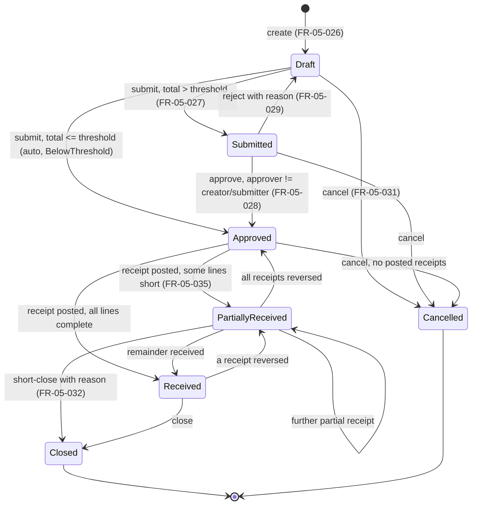

# SPEC-05: Suppliers & Procurement

**Version:** 1.0 · **Status:** Draft for review · **Owner:** Product / Business Analysis · **Related ADRs:** ADR-001 (modular monolith), ADR-002 (multi-tenancy), ADR-003 / ADR-004 (inventory ledger & locking), ADR-007 (background jobs), ADR-008 (audit) · **Related BRQs:** BRQ-01, BRQ-02, BRQ-04, BRQ-05, BRQ-06, BRQ-10, BRQ-11, BRQ-12, BRQ-15

---

## 1. Purpose

This specification defines how an organization manages its suppliers and the full procure-to-pay cycle: purchase orders, goods receipts (with or without a purchase order) that create batches in a branch, supplier invoices with matching, supplier returns, supplier payments, the supplier ledger with outstanding balances and aging, and (P2) supplier analytics and purchasing suggestions. It is the only module that brings purchased stock into a branch; all stock effects are executed through the Inventory module contract defined in SPEC-04.

## 2. Business Context

Egyptian community pharmacies buy mostly from pharmaceutical distributors (wholesalers) and occasionally directly from manufacturers. Characteristics that shape this specification:

- Deliveries frequently arrive **without a formal purchase order** (phone/WhatsApp orders to the distributor's sales representative). Direct receipt must therefore be first-class and is in the MVP.
- Distributors commonly give **bonus (free) quantities** (e.g., "10 + 1") and line discounts. The true cost of a base unit is therefore lower than the invoice unit price.
- Medicine packs show the expiry often as **month/year only**. Pharmacies refuse short-dated goods; a configurable minimum remaining shelf life is required.
- Suppliers grant **credit terms** (payment terms in days, informal credit limits); payment is by cash, bank transfer, or (often post-dated) cheque.
- **Returns to supplier** of expired, near-expiry, damaged, or recalled stock are routine and settled as debit notes against the supplier balance.
- Tax treatment of purchases and electronic invoicing obligations are not decided by this specification (REG-06, REG-07).

## 3. Scope

| Area | Priority | MVP |
|---|---|---|
| Supplier master data (org-level), activation/deactivation, contacts | P0/P1 | Yes |
| Goods receipt without PO (direct receipt), batch registration, bonus quantities, shelf-life checks, posting through the Inventory contract | P0 | Yes |
| Goods receipt reversal (whole receipt, only if not consumed) | P1 | Yes (justified: the only way to correct a mis-keyed receipt while preserving supplier traceability required by BR-G-31) |
| Goods receipt list, detail, purchase history | P1 | Yes |
| Purchase orders (Draft → … → Closed/Cancelled), approval threshold, credit-limit check | P1 | No |
| Goods receipt against PO, partial receiving, over-receipt tolerance (CS-03) | P1 | No |
| Supplier invoices, 2-way / 3-way matching, discounts, tax snapshot | P1 | No |
| Supplier returns with FEFO / selected batch and debit note | P1 | No |
| Supplier payments (cash / bank transfer / cheque), allocations, reversal | P1 | No |
| Supplier ledger, opening balances, outstanding balances, aging | P1 | No |
| Purchasing suggestions from ReorderSetting and low-stock events | P2 | No |
| Supplier performance metrics, supplier price comparison | P2 | No |

## 4. Out of Scope

- General ledger / double-entry accounting, GRNI (goods received not invoiced) accrual postings, and VAT returns (SPEC-09 reports only; full accounting is not in v1).
- Supplier self-service portal, EDI, electronic ordering to distributors, and ingestion of electronic supplier invoices from tax-authority systems (see OD-05-11, REG-07).
- Multi-currency purchasing; all procurement amounts are in EGP.
- Cheque lifecycle management (clearing, bouncing, post-dated cheque register) beyond recording cheque details (OD-05-09).
- Consignment stock and supplier-owned inventory.
- External market price data for price comparison (only internal historical receipt/invoice prices are used).
- Stock transfers between branches (SPEC-04), stock adjustments and write-offs (SPEC-04).

## 5. Actors and Permissions

### 5.1 Actors

| Actor | Role code(s) | Typical use in this module |
|---|---|---|
| Owner | `OWNER` | All procurement actions, approvals, settings |
| Branch Manager | `MANAGER` | Supplier maintenance, PO approval, receipt reversal, shelf-life overrides, supplier return posting |
| Inventory Staff | `INVENTORY` | Draft POs, receive goods, draft supplier returns |
| Pharmacist | `PHARMACIST` | Receive goods in small branches without inventory staff |
| Accountant | `ACCOUNTANT` | Supplier invoices, payments, ledger, aging |
| System | — | Background jobs (reconciliation, suggestions refresh), integration event handlers |

### 5.2 Permissions used by this module

Canonical permissions (DOCUMENTATION-CONVENTIONS §5.2) plus **new permissions introduced by this spec (marked NEW)**. Default role grants are seeds; organizations may change them.

| Permission | NEW | Purpose | Default roles |
|---|---|---|---|
| `procurement.suppliers.read` | | View suppliers and contacts | OWNER, MANAGER, INVENTORY, PHARMACIST, ACCOUNTANT |
| `procurement.suppliers.manage` | | Create/update/deactivate/reactivate suppliers; manage contacts | OWNER, MANAGER |
| `procurement.purchase-orders.read` | | View POs, suggestions, supplier performance, price comparison | OWNER, MANAGER, INVENTORY, ACCOUNTANT |
| `procurement.purchase-orders.create` | | Create/edit/submit draft POs; create POs from suggestions | OWNER, MANAGER, INVENTORY |
| `procurement.purchase-orders.approve` | | Approve/reject submitted POs; close POs | OWNER, MANAGER |
| `procurement.purchase-orders.cancel` | | Cancel POs | OWNER, MANAGER |
| `procurement.receipts.read` | NEW | View goods receipts and purchase history | OWNER, MANAGER, INVENTORY, PHARMACIST, ACCOUNTANT |
| `procurement.receipts.create` | | Create/edit/delete draft goods receipts | OWNER, MANAGER, INVENTORY, PHARMACIST |
| `procurement.receipts.post` | | Post goods receipts | OWNER, MANAGER, INVENTORY, PHARMACIST |
| `procurement.receipts.reverse` | NEW | Reverse posted goods receipts | OWNER, MANAGER |
| `procurement.receipts.override-shelf-life` | NEW | Accept a batch below the minimum remaining shelf life | OWNER, MANAGER |
| `procurement.supplier-invoices.read` | NEW | View supplier invoices | OWNER, MANAGER, ACCOUNTANT |
| `procurement.supplier-invoices.manage` | | Create/edit/post/cancel supplier invoices | OWNER, ACCOUNTANT |
| `procurement.supplier-invoices.approve-variance` | NEW | Post an invoice with matching variances beyond tolerance | OWNER, MANAGER |
| `procurement.supplier-returns.read` | NEW | View supplier returns | OWNER, MANAGER, INVENTORY, ACCOUNTANT |
| `procurement.supplier-returns.create` | | Create/edit/discard draft supplier returns | OWNER, MANAGER, INVENTORY |
| `procurement.supplier-returns.post` | | Post supplier returns | OWNER, MANAGER |
| `procurement.supplier-payments.create` | | Record payments and allocate unapplied credit | OWNER, ACCOUNTANT |
| `procurement.supplier-payments.reverse` | NEW | Reverse a recorded supplier payment | OWNER |
| `procurement.supplier-ledger.read` | NEW | View supplier ledger, payments, balances, aging | OWNER, MANAGER, ACCOUNTANT |
| `procurement.supplier-ledger.manage` | NEW | Record supplier opening balances | OWNER, ACCOUNTANT |
| `inventory.batches.override-fefo` | | Choose a specific batch for a supplier return | (SPEC-04) |
| `reports.organization.read` | | Org-wide (cross-branch) balances, purchase history, analytics | (SPEC-09) |
| `reports.export` | | Export aging and history | (SPEC-09) |

## 6. Functional Requirements

| ID | Requirement | Priority | BRQ | Stories |
|---|---|---|---|---|
| FR-05-001 | The system shall let a user create an organization-level supplier with: code (1–20 chars; auto-generated as `SUP-NNNNN` when omitted), Arabic name and/or English name (at least one, each 2–200 chars), tax registration number (optional), commercial registration number (optional), payment terms in days (integer 0–365, default 0), credit limit (`numeric(19,2)` ≥ 0 or empty meaning no limit), phone, email, address, and notes; the new supplier's status shall be Active and it shall be visible to all branches of the organization. | P0 | BRQ-06 | US-05-01 |
| FR-05-002 | The system shall reject a supplier whose code or tax registration number (after removing spaces and hyphens) already exists in the same organization, compared case-insensitively, including inactive suppliers. | P0 | BRQ-06 | US-05-01 |
| FR-05-003 | The system shall let a user update supplier fields using optimistic concurrency (`If-Match`), returning 412 on a stale version, and shall record before/after values of changed fields in the audit log. | P0 | BRQ-06, BRQ-12 | US-05-01 |
| FR-05-004 | The system shall list suppliers with paging (default 25, max 100), sorting by code or name, and filtering by status and by a search term matching code, Arabic name, English name (partial, case-insensitive), tax registration number, or phone. | P0 | BRQ-06 | US-05-01 |
| FR-05-005 | The system shall let a user deactivate an Active supplier or reactivate an Inactive supplier with a reason (10–500 chars); suppliers shall never be hard-deleted. | P1 | BRQ-06 | US-05-02 |
| FR-05-006 | The system shall block an Inactive supplier from being set on a new or edited purchase order, goods receipt, or supplier invoice, and from PO submission and goods receipt posting (`PROCUREMENT.SUPPLIER_INACTIVE`), while still allowing supplier returns, payments, ledger views, and reports for that supplier. | P1 | BRQ-06 | US-05-02 |
| FR-05-007 | The system shall let a user add, edit, and remove supplier contacts (name 2–100 chars, job title, Egyptian mobile or landline, email, notes, primary flag), with at most 20 contacts per supplier and at most one primary contact (setting a new primary clears the previous one in the same transaction). | P1 | BRQ-06 | US-05-03 |
| FR-05-008 | The system shall let a user create a Draft goods receipt for a branch with: supplier (Active), optional purchase order, supplier delivery note number (optional, ≤ 50 chars), supplier invoice reference (optional, ≤ 50 chars), supplier delivery date (not after the branch business date, not more than 90 days before it), and notes (≤ 1,000 chars). | P0 | BRQ-04, BRQ-06 | US-05-04 |
| FR-05-009 | The system shall let a user add up to 500 lines to a Draft goods receipt, each with: Active medicine, batch number (1–50 chars, trimmed), expiry date (entered as a full date or as month/year, the latter stored as the last day of that month), optional manufacture date (< expiry date and ≤ business date), paid quantity in packs (integer 0–100,000), bonus quantity in packs (integer 0–100,000), unit cost per pack (`numeric(19,4)` ≥ 0), and line discount percent (0–100, 2 decimals); paid + bonus quantity shall be ≥ 1 pack and unit cost shall be > 0 when paid quantity > 0. | P0 | BRQ-04, BRQ-06 | US-05-04 |
| FR-05-010 | The system shall compute per line: gross amount = paid packs × unit cost per pack (rounded to 2 decimals), discount amount = gross × discount % (rounded to 2 decimals), net amount = gross − discount, received base units = (paid packs + bonus packs) × snapshotted PackSize, and effective unit cost per base unit = net amount ÷ received base units (rounded to 4 decimals, AwayFromZero); the receipt total shall be the sum of line net amounts (amounts exclude tax). | P0 | BRQ-06, BRQ-10 | US-05-04 |
| FR-05-011 | The system shall allow editing and deleting a goods receipt only while it is Draft; a Draft receipt shall have no effect on stock, purchase orders, or supplier balances, and deleting a Draft shall be audited. | P0 | BRQ-06 | US-05-04 |
| FR-05-012 | The system shall allow posting a goods receipt without a purchase order only when the organization setting `AllowReceiptWithoutPurchaseOrder` is true (default true); otherwise it shall reject posting with `PROCUREMENT.PURCHASE_ORDER_REQUIRED`. | P0 | BRQ-06 | US-05-04 |
| FR-05-013 | The system shall reject any receipt line whose expiry date is on or before the branch business date with `PROCUREMENT.BATCH_EXPIRED`; no permission overrides this rule. | P0 | BRQ-04, BRQ-05 | US-05-05 |
| FR-05-014 | The system shall reject a receipt line whose remaining shelf life (expiry date − branch business date, in days) is below the branch setting `MinRemainingShelfLifeDaysOnReceipt` (default 180) with `PROCUREMENT.SHELF_LIFE_BELOW_MINIMUM`, unless the posting user holds `procurement.receipts.override-shelf-life` and the line carries an override reason of 10–500 chars, in which case the override (user, reason, remaining days) is stored on the line and audited. | P0 | BRQ-04 | US-05-05 |
| FR-05-015 | The system shall re-evaluate all line validations at posting time against the posting business date, reject a receipt containing the same medicine and batch number with different expiry dates (`PROCUREMENT.BATCH_EXPIRY_CONFLICT`), and require explicit confirmation (`confirmExpiryMismatch = true`) when an existing batch in the branch has the same medicine and batch number but a different expiry date. | P0 | BRQ-04 | US-05-05 |
| FR-05-016 | The system shall post a Draft goods receipt in a single database transaction that: re-validates it, assigns a gapless number `{BranchCode}-RCV-{YYYY}-{NNNNNN}`, sets status Posted, invokes the SPEC-04 Inventory receipt contract for every line (creating or incrementing a batch and appending one `Receipt` stock movement per line with `SourceDocumentType = GoodsReceipt` and the line id), updates linked purchase-order lines, writes audit entries, and enqueues the outbox event `procurement.goods-receipt.posted`. | P0 | BRQ-04, BRQ-05, BRQ-06 | US-05-06 |
| FR-05-017 | The system shall add a receipt line's base units to an existing batch only when organization, branch, medicine, normalized batch number (trimmed, upper-case), expiry date, unit cost (4 decimals), and supplier are all equal and that batch's status is Active or Depleted (a Depleted batch becomes Active); otherwise it shall create a new batch. | P0 | BRQ-04 | US-05-06 |
| FR-05-018 | The system shall create each new batch with the receipt's supplier as `Batch.SupplierId`, the line's effective unit cost as `Batch.UnitCost`, and status Active, and shall reject a line whose merge key matches a Quarantined batch with `PROCUREMENT.BATCH_QUARANTINED`. | P0 | BRQ-04, BRQ-05 | US-05-06 |
| FR-05-019 | The system shall, on posting, update each received medicine's reference `LastPurchaseCost` to the effective unit cost per base unit of the last line for that medicine in the receipt, through the SPEC-03 catalog contract in the same transaction. | P1 | BRQ-03, BRQ-06 | US-05-06 |
| FR-05-020 | The system shall require an `Idempotency-Key` header on goods receipt posting; a retry with the same key and same request hash shall return the original response without creating additional movements, batches, or numbers; the same key with a different request hash shall return 422 `COMMON.IDEMPOTENCY_KEY_REUSED`. | P0 | BRQ-05 | US-05-06 |
| FR-05-021 | The system shall lock the goods receipt row before posting so that, of concurrent posting requests for the same receipt with different idempotency keys, exactly one succeeds and the others receive 409 `PROCUREMENT.RECEIPT_NOT_DRAFT`. | P0 | BRQ-05 | US-05-06 |
| FR-05-022 | The system shall roll back the entire posting (status, number, batches, balances, movements, PO quantities, audit, outbox) when any step fails, leaving the receipt Draft and no gap in the document sequence. | P0 | BRQ-05 | US-05-06 |
| FR-05-023 | The system shall reverse a Posted goods receipt as a whole, with a reason (10–500 chars) and an `Idempotency-Key`, only when (a) for every line the batch's available quantity (OnHand − Reserved) ≥ the line's received base units and (b) no non-cancelled supplier invoice line references the receipt; reversal shall append one `ReceiptReversal` movement per line, set status Reversed, decrement linked PO line received quantities, and recompute PO status in one transaction; otherwise it shall return 422 `PROCUREMENT.RECEIPT_QUANTITY_CONSUMED` (listing offending line ids) or 422 `PROCUREMENT.RECEIPT_INVOICED`. | P1 | BRQ-04, BRQ-06 | US-05-07 |
| FR-05-024 | The system shall list goods receipts of a branch with paging and filters (status, supplier, PO, number, medicine, posting date range) and show receipt detail including each line's resulting batch id, batch number, expiry, effective unit cost, and shelf-life override. | P1 | BRQ-06 | US-05-08 |
| FR-05-025 | The system shall provide purchase history by medicine and by supplier from Posted (not Reversed) receipt lines, showing posting date, branch, supplier, receipt number, batch, paid and bonus packs, unit cost per pack, discount %, and effective unit cost per base unit; cross-branch history requires organization-wide scope or `reports.organization.read`. | P1 | BRQ-06, BRQ-10 | US-05-08 |
| FR-05-026 | The system shall let a user create and edit a Draft purchase order for one branch and one Active supplier with expected delivery date (≥ business date), notes, and up to 500 lines (one line per medicine) each with ordered packs (integer 1–100,000), expected bonus packs (integer 0–100,000), and expected unit cost per pack (`numeric(19,4)` > 0, defaulting to `LastPurchaseCost × PackSize`); the PO number `{BranchCode}-PO-{YYYY}-{NNNNNN}` shall be assigned at creation. | P1 | BRQ-06 | US-05-09 |
| FR-05-027 | The system shall submit a Draft PO with ≥ 1 line, computing its total (Σ ordered packs × expected unit cost, line-rounded to 2 decimals); when the total ≤ branch setting `PurchaseOrderApprovalThreshold` (default 0.00 EGP) it shall move directly to Approved with approval recorded as "below threshold"; otherwise it shall move to Submitted and notify users holding `procurement.purchase-orders.approve` for that branch. | P1 | BRQ-06, BRQ-11 | US-05-10 |
| FR-05-028 | The system shall let a user holding `procurement.purchase-orders.approve` approve a Submitted PO only if the user is neither the PO's creator nor its submitter (`PROCUREMENT.SELF_APPROVAL_NOT_ALLOWED`), recording approver and timestamp. | P1 | BRQ-01, BRQ-06 | US-05-10 |
| FR-05-029 | The system shall let an approver reject a Submitted PO with a reason (10–500 chars), returning it to Draft and notifying the submitter. | P1 | BRQ-06 | US-05-10 |
| FR-05-030 | The system shall, at PO submission, compare (supplier outstanding balance + open PO value of that supplier's Approved/PartiallyReceived POs not yet received + this PO total) with the supplier credit limit; when exceeded it shall require `acknowledgeCreditLimit = true` if organization setting `SupplierCreditLimitMode` = `Warn` (default) and reject with `PROCUREMENT.CREDIT_LIMIT_EXCEEDED` if it is `Block`. | P1 | BRQ-06 | US-05-10 |
| FR-05-031 | The system shall let a user cancel a PO in Draft, Submitted, or Approved status with a reason (10–500 chars) provided no Posted receipt references it (`PROCUREMENT.PURCHASE_ORDER_HAS_RECEIPTS`). | P1 | BRQ-06 | US-05-11 |
| FR-05-032 | The system shall let a user holding `procurement.purchase-orders.approve` close a PartiallyReceived PO (short-close, reason 10–500 chars required) or a Received PO; a Closed or Cancelled PO shall accept no further receipts. | P1 | BRQ-06 | US-05-11 |
| FR-05-033 | The system shall allow a goods receipt against a PO only when the PO is Approved or PartiallyReceived and has the same branch and supplier; every receipt line shall reference a PO line of the same medicine; the system shall pre-fill outstanding packs (ordered − received) per line and show price variance (amount and %) between the receipt unit cost and the PO expected unit cost. | P1 | BRQ-06 | US-05-12 |
| FR-05-034 | The system shall, at posting, lock the referenced PO lines and reject the receipt with `PROCUREMENT.OVER_RECEIPT_TOLERANCE_EXCEEDED` when a line's cumulative posted paid packs would exceed floor(ordered packs × (1 + `OverReceiptTolerancePercent` / 100)) (default tolerance 0%); bonus packs are not subject to the tolerance. | P1 | BRQ-05, BRQ-06 | US-05-12 |
| FR-05-035 | The system shall derive PO status after each receipt posting or reversal: Received when every line's received paid packs ≥ ordered packs, PartiallyReceived when any line has received packs > 0, and Approved when all received packs return to 0. | P1 | BRQ-06 | US-05-12, US-05-07 |
| FR-05-036 | The system shall let a user create a Draft supplier invoice for a branch and supplier with the supplier's invoice number (1–50 chars, unique per supplier in the organization among non-cancelled invoices), invoice date (≤ business date), due date (default invoice date + supplier payment terms days), supplier-stated total, header additional discount amount, and up to 500 lines each referencing a Posted receipt line of the same supplier and branch. | P1 | BRQ-06 | US-05-13 |
| FR-05-037 | The system shall compute invoice lines and totals: line net = round2(invoiced packs × invoice unit cost per pack) − round2(that × discount %); line tax = round2(line net × snapshotted tax rate of the medicine's TaxCategory); invoice total = Σ line net − header discount + Σ line tax; tax rates are configuration pending REG-06. | P1 | BRQ-06, BRQ-15 | US-05-13 |
| FR-05-038 | The system shall track per receipt line the invoiced paid packs (from Posted invoices), reject invoice lines that exceed received − already invoiced packs (`PROCUREMENT.INVOICE_QUANTITY_EXCEEDS_RECEIVED`), and expose each receipt's invoicing status NotInvoiced / PartiallyInvoiced / FullyInvoiced. | P1 | BRQ-06 | US-05-13 |
| FR-05-039 | The system shall match each invoice line by comparing the invoice unit cost per pack with the receipt line unit cost (2-way) and, for PO-linked receipt lines, also with the PO expected unit cost (3-way), flagging a line whose absolute variance exceeds organization setting `InvoicePriceTolerancePercent` (default 2.00%), and shall flag the invoice when abs(supplier-stated total − computed total) > `InvoiceTotalToleranceAmount` (default 1.00 EGP). | P1 | BRQ-06 | US-05-14 |
| FR-05-040 | The system shall post a Draft supplier invoice in one transaction (number `{BranchCode}-SINV-{YYYY}-{NNNNNN}`, status Posted, one `Invoice` credit entry in the supplier ledger, audit) and, when any line or the total is flagged, only if the posting user holds `procurement.supplier-invoices.approve-variance` and supplies a variance reason (10–500 chars); posting shall not change batch unit costs. | P1 | BRQ-06, BRQ-10 | US-05-14 |
| FR-05-041 | The system shall cancel a Draft supplier invoice, or a Posted invoice with no active payment allocations, with a reason (10–500 chars), appending an `InvoiceCancellation` debit ledger entry for Posted invoices and releasing the invoiced quantities of the referenced receipt lines. | P1 | BRQ-06 | US-05-15 |
| FR-05-042 | The system shall let a user create a Draft supplier return for a branch and supplier with a reason code (`Expired`, `NearExpiry`, `Damaged`, `Recall`, `Overstock`, `WrongItem`, `Other`) and up to 200 lines (medicine, quantity in base units); the system shall allocate each line FEFO across eligible batches or to a single batch selected by a user holding `inventory.batches.override-fefo`, and shall reserve the allocated quantities (`BatchBalance.Reserved`) in the same transaction; editing or discarding the draft shall adjust or release reservations atomically. | P1 | BRQ-04, BRQ-06 | US-05-16 |
| FR-05-043 | The system shall treat a batch as eligible for a supplier return only when it belongs to the return's branch, its `SupplierId` equals the return's supplier, and its available quantity (OnHand − Reserved) covers the allocation; batches with status Expired or Quarantined are eligible; ineligible batch selection returns `PROCUREMENT.RETURN_BATCH_SUPPLIER_MISMATCH` or `INVENTORY.INSUFFICIENT_STOCK`. | P1 | BRQ-04, BRQ-06 | US-05-16 |
| FR-05-044 | The system shall post a Draft supplier return with an `Idempotency-Key` in one transaction that assigns number `{BranchCode}-SRT-{YYYY}-{NNNNNN}`, releases its reservations, appends one negative `SupplierReturn` stock movement per allocation, computes the return value Σ round2(quantity × batch unit cost), appends a `DebitNote` ledger entry for that value, writes audit, and enqueues `procurement.supplier-return.posted`; any failure rolls back everything. | P1 | BRQ-04, BRQ-05, BRQ-06 | US-05-17 |
| FR-05-045 | The system shall record a supplier payment for a branch with an `Idempotency-Key`: supplier, payment date (≤ business date), method (`Cash`, `BankTransfer`, `Cheque`), amount (> 0, 2 decimals), method details (bank transfer reference required; cheque number, bank name, and cheque due date required), notes, and optional allocations; it shall assign number `{BranchCode}-SPY-{YYYY}-{NNNNNN}` and append a `Payment` debit ledger entry in the same transaction. | P1 | BRQ-06, BRQ-10 | US-05-18 |
| FR-05-046 | The system shall accept allocations only to Posted or PartiallyPaid invoices of the same supplier and branch, each allocation ≤ the invoice's outstanding amount and the sum ≤ the payment's unallocated amount, locking the invoice rows; it shall set invoice status PartiallyPaid or Paid accordingly and propose an oldest-due-date-first allocation by default. | P1 | BRQ-06 | US-05-18 |
| FR-05-047 | The system shall let a user allocate a payment's remaining unallocated amount to invoices after the payment was recorded, under the same rules as FR-05-046, with an `Idempotency-Key`. | P1 | BRQ-06 | US-05-19 |
| FR-05-048 | The system shall reverse a supplier payment with a reason (10–500 chars) and an `Idempotency-Key` by appending a `PaymentReversal` credit ledger entry and compensating allocation rows, restoring each affected invoice's outstanding amount and status; a payment can be reversed once (`PROCUREMENT.PAYMENT_ALREADY_REVERSED`). | P1 | BRQ-06, BRQ-12 | US-05-19 |
| FR-05-049 | The system shall let a user record one opening balance per supplier per branch (amount ≠ 0, positive = owed to supplier, as-of date, reference) only before any other ledger entry exists for that supplier and branch (`PROCUREMENT.OPENING_BALANCE_EXISTS`). | P1 | BRQ-06 | US-05-20 |
| FR-05-050 | The system shall show a supplier ledger statement per supplier (optionally per branch) with chronological entries (date, type, document number, debit, credit, running balance), opening balance for the selected period, and closing balance, using cursor pagination. | P1 | BRQ-06, BRQ-10 | US-05-20 |
| FR-05-051 | The system shall report, as of a chosen date, each supplier's outstanding balance (Σ credits − Σ debits) split into aging buckets 0–30, 31–60, 61–90, and > 90 days by invoice age (as-of date − invoice date) of each invoice's outstanding amount, plus unapplied credits (unallocated payments and debit notes), overdue amount (past due date), and totals; it shall be exportable to CSV and XLSX with `reports.export`. | P1 | BRQ-06, BRQ-10 | US-05-21 |
| FR-05-052 | The system shall compute purchasing suggestions per branch for medicines with a ReorderSetting where (sellable on hand + on order) ≤ minimum, with suggested packs = ceil((maximum − (sellable on hand + on order)) ÷ PackSize), on order = Σ outstanding packs × PackSize on Approved/PartiallyReceived POs, preferred supplier = supplier of the latest Posted receipt of that medicine in the branch, flag medicines with an unprocessed `inventory.low-stock.detected` event, and let the user create one Draft PO per selected supplier from selected suggestions. | P2 | BRQ-06, BRQ-11 | US-05-22 |
| FR-05-053 | The system shall compute per supplier for a period and branch scope: on-time delivery % (POs whose first posted receipt date ≤ expected delivery date ÷ POs with an expected date and ≥ 1 receipt), fill rate % (Σ min(received, ordered) packs ÷ Σ ordered packs on non-cancelled POs), price variance % (Σ (receipt − PO expected unit cost) × packs ÷ Σ PO expected cost × packs), and return rate % (Σ posted supplier return value ÷ Σ posted receipt net value), each to 1 decimal place. | P2 | BRQ-06, BRQ-10 | US-05-23 |
| FR-05-054 | The system shall compare, for a selected medicine and period, each supplier's last, minimum, maximum, and quantity-weighted average unit cost per pack and effective unit cost per base unit, bonus ratio (bonus ÷ paid packs), and number of receipts, using only Posted receipt lines and Posted invoice lines of the organization. | P2 | BRQ-06, BRQ-10 | US-05-24 |
| FR-05-055 | The system shall write an audit log entry, in the same transaction, for every supplier create/update/deactivate/reactivate, contact change, receipt post/reverse/draft deletion, shelf-life override, PO submit/approve/reject/cancel/close, invoice post/cancel and variance approval, supplier return post, payment record/allocation/reversal, and opening balance. | P0 | BRQ-12 | US-05-01, US-05-02, US-05-06, US-05-07, US-05-10, US-05-14, US-05-17, US-05-18, US-05-19, US-05-20 |

## 7. Business Rules

| ID | Rule | Source |
|---|---|---|
| BR-05-001 | Suppliers are organization-level master data, shared by all branches; documents (POs, receipts, invoices, returns, payments) are branch-scoped. | BR-G-01, BR-G-02 |
| BR-05-002 | Supplier code and normalized tax registration number are unique per organization including inactive suppliers. | Analysis |
| BR-05-003 | Suppliers referenced by any document are never hard-deleted; they are deactivated. An Inactive supplier cannot be used on new POs, receipts, or invoices but can still be paid, returned to, and reported on. | BR-G-33 |
| BR-05-004 | Receipt and PO quantities are whole packs; stock is recorded in base units = packs × PackSize snapshotted on the line at creation. | Conventions §6.3 |
| BR-05-005 | **Bonus costing (decision):** bonus packs are received into the same batch as the paid packs of that line, and the line's net amount is spread over all received base units; `Batch.UnitCost` = net amount ÷ (paid + bonus) base units, rounded to 4 decimals. No separate zero-cost batch is created. (Confirmation: OD-05-01.) | Analysis |
| BR-05-006 | Batch number and expiry date are mandatory on every receipt line. A month/year expiry is stored as the last calendar day of that month. | BR-G-03, BR-G-04 |
| BR-05-007 | Stock with expiry ≤ branch business date is never received. Stock with remaining shelf life below `MinRemainingShelfLifeDaysOnReceipt` is received only with `procurement.receipts.override-shelf-life` and a reason. | BR-G-07, BR-G-27 |
| BR-05-008 | **Batch merge (decision):** a receipt line increments an existing batch only if medicine, branch, normalized batch number, expiry date, unit cost (4 dp), and supplier all match and the batch is Active or Depleted; otherwise a new batch is created. Batches are never merged across suppliers (preserves BR-G-31) or across costs (preserves COGS accuracy). | BR-G-04, BR-G-31 |
| BR-05-009 | A line matching a Quarantined batch is rejected; a quarantined (e.g., recalled) batch number cannot be replenished. | Conventions §10 note |
| BR-05-010 | Posting a receipt, its batch/balance/movement effects, PO updates, number assignment, and audit commit together or not at all. | BR-G-09, BR-G-19 |
| BR-05-011 | Goods receipts, supplier invoices, supplier returns, and supplier payments get gapless per-branch per-type per-year numbers assigned in the posting transaction (`RCV`, `SINV`, `SRT`, `SPY`). POs are numbered at creation (`PO`), not required to be gapless. | BR-G-24 |
| BR-05-012 | A posted receipt is corrected only by whole-receipt reversal (status Reversed + `ReceiptReversal` movements), allowed only if none of its quantities have been consumed or reserved and it is not invoiced. Partial corrections use SPEC-04 adjustments or supplier returns. | BR-G-25 |
| BR-05-013 | A PO whose total exceeds the branch `PurchaseOrderApprovalThreshold` requires approval by a different user than its creator and submitter. | BR-G-28 (by analogy) |
| BR-05-014 | Receipts against a PO are allowed only in Approved or PartiallyReceived status; cumulative paid packs per PO line ≤ floor(ordered × (1 + OverReceiptTolerancePercent/100)); bonus packs are not limited by the PO. | Analysis |
| BR-05-015 | Batch unit cost is fixed at receipt. Supplier invoice price variances are recorded on the invoice line for reporting and do not revalue batches or past COGS (OD-05-02). | BR-G-20 |
| BR-05-016 | Payables are recognized when a supplier invoice is posted, not when goods are received. The supplier balance is the sum of supplier ledger entries. | Analysis |
| BR-05-017 | Invoiced paid packs per receipt line ≤ received paid packs on that line. | Analysis |
| BR-05-018 | Supplier returns come only from batches received from the same supplier in the same branch, up to available quantity; FEFO by default, explicit batch selection requires `inventory.batches.override-fefo`; Expired and Quarantined batches may be returned. | BR-G-06, BR-G-31 |
| BR-05-019 | Draft supplier returns reserve the allocated quantities; posting converts the reservation into a `SupplierReturn` movement. | Conventions §10 note |
| BR-05-020 | A supplier return's value (debit note) = Σ round2(returned base units × batch unit cost). | BR-G-18 |
| BR-05-021 | Payment allocations: each ≤ invoice outstanding; Σ allocations ≤ payment amount; allocations only to invoices of the same supplier and branch; unallocated remainder is an unapplied credit. | Analysis |
| BR-05-022 | Supplier ledger entries and payment allocations are append-only; corrections are reversing entries (`InvoiceCancellation`, `PaymentReversal`, compensating allocations). | BR-G-25 |
| BR-05-023 | Money uses `numeric(19,4)` for unit costs and `numeric(19,2)` for amounts, rounded AwayFromZero at line level; prices, costs, discounts, PackSize, and tax rates are snapshotted on lines. All amounts are EGP. | BR-G-18, BR-G-20 |
| BR-05-024 | Supplier credit limit is checked at PO submission in `Warn` (acknowledge) or `Block` mode; an empty credit limit means no check. | Analysis |
| BR-05-025 | Ledger sign convention: credit increases the amount owed to the supplier (`OpeningBalance` positive, `Invoice`, `PaymentReversal`); debit decreases it (`OpeningBalance` negative, `InvoiceCancellation`, `Payment`, `DebitNote`). | Analysis |

### 7.1 Purchase order state machine



### 7.2 Document states

| Document | Transitions |
|---|---|
| GoodsReceipt | Draft → Posted (post) → Reversed (reverse). Draft may be deleted. |
| SupplierInvoice | Draft → Posted → PartiallyPaid → Paid; Paid/PartiallyPaid → Posted/PartiallyPaid on payment reversal; Draft or Posted (no active allocations) → Cancelled. |
| SupplierReturn | Draft → Posted. Draft may be discarded (reservations released). |
| SupplierPayment | Recorded (immutable) → reversed flag set once. |

## 8. Data Requirements

All tables are in schema `procurement` and follow conventions §6 (UUIDv7 `Id`, `OrganizationId`, audit columns, `xmin` row version on mutable aggregates).

### 8.1 Entities

| Entity | Key fields (beyond conventions) | Notes |
|---|---|---|
| `Supplier` | Code, NameAr, NameEn, TaxRegistrationNumber (normalized digits), CommercialRegistrationNumber, PaymentTermsDays, CreditLimit `numeric(19,2)` NULL, Phone, Email, Address, Notes, IsActive, DeactivatedAt, DeactivationReason | Org-level; unique (OrganizationId, upper(Code)); unique (OrganizationId, TaxRegistrationNumber) where not null |
| `SupplierContact` | SupplierId, Name, JobTitle, Phone, Email, Notes, IsPrimary | Partial unique index: one IsPrimary per supplier |
| `PurchaseOrder` | BranchId, SupplierId, Number, Status, ExpectedDeliveryDate, Notes, TotalAmount, CreatedBy, SubmittedBy/At, ApprovedBy/At, ApprovalMode (`Manual`/`BelowThreshold`), RejectionReason, CancelledBy/At/Reason, ClosedBy/At/Reason, CreditLimitAcknowledgedBy | Status per §6.1 |
| `PurchaseOrderLine` | PurchaseOrderId, MedicineId, PackSize (snapshot), OrderedPacks, ExpectedBonusPacks, ExpectedUnitCostPerPack `numeric(19,4)`, LineAmount, ReceivedPaidPacks, ReceivedBonusPacks | Unique (PurchaseOrderId, MedicineId) |
| `GoodsReceipt` | BranchId, SupplierId, PurchaseOrderId NULL, Number NULL until posted, Status, SupplierDeliveryNoteNumber, SupplierInvoiceReference, SupplierDeliveryDate, BusinessDate (posting), TotalNetAmount, PostedBy/At, ReversedBy/At, ReversalReason, InvoicingStatus (derived) | Status `Draft`, `Posted`, `Reversed` |
| `GoodsReceiptLine` | GoodsReceiptId, PurchaseOrderLineId NULL, MedicineId, PackSize (snapshot), BatchNumber, BatchNumberNormalized, ExpiryDate, ManufactureDate, PaidPacks, BonusPacks, UnitCostPerPack, DiscountPercent, GrossAmount, DiscountAmount, NetAmount, ReceivedBaseUnits, EffectiveUnitCost `numeric(19,4)`, BatchId NULL until posted, ShelfLifeOverrideBy, ShelfLifeOverrideReason, RemainingShelfLifeDays, InvoicedPaidPacks | |
| `SupplierInvoice` | BranchId, SupplierId, Number (internal), SupplierInvoiceNumber, InvoiceDate, DueDate, Status, SubtotalNet, HeaderDiscountAmount, TaxAmount, TotalAmount, SupplierStatedTotal, PaidAmount, OutstandingAmount, HasVariance, VarianceApprovedBy, VarianceReason, CancelledBy/At/Reason | Status per §6.1; unique (OrganizationId, SupplierId, upper(SupplierInvoiceNumber)) where Status ≠ Cancelled |
| `SupplierInvoiceLine` | SupplierInvoiceId, GoodsReceiptLineId, MedicineId, InvoicedPacks, UnitCostPerPack, DiscountPercent, NetAmount, TaxCategoryId, TaxRate (snapshot), TaxAmount, ReceiptUnitCostPerPack (snapshot), PoUnitCostPerPack NULL, PriceVariancePercent, IsFlagged | |
| `SupplierReturn` | BranchId, SupplierId, Number NULL until posted, Status, ReasonCode, Notes, TotalValue, PostedBy/At | Status `Draft`, `Posted` |
| `SupplierReturnLine` | SupplierReturnId, MedicineId, BatchId, QuantityBaseUnits, UnitCost (batch snapshot), LineValue, SelectionMode (`Fefo`/`Manual`) | One row per batch allocation |
| `SupplierPayment` | BranchId, SupplierId, Number, PaymentDate, Method, Amount, AllocatedAmount, BankReference, ChequeNumber, ChequeBankName, ChequeDueDate, Notes, IsReversed, ReversedBy/At, ReversalReason | Immutable except allocation totals/reversal flags |
| `SupplierPaymentAllocation` | SupplierPaymentId, SupplierInvoiceId, Amount (signed; negative = compensating), CreatedAt, CreatedBy | Append-only |
| `SupplierLedgerEntry` | SupplierId, BranchId, EntryType (`OpeningBalance`, `Invoice`, `InvoiceCancellation`, `Payment`, `PaymentReversal`, `DebitNote`), Debit, Credit, SourceDocumentType, SourceDocumentId, DocumentNumber, BusinessDate, OccurredAt, UserId | Append-only; index (OrganizationId, SupplierId, BranchId, OccurredAt, Id) |

No new entities are introduced beyond the canonical model; `PurchaseOrderItem` in the owner's SDD maps to canonical `PurchaseOrderLine`.

### 8.2 Settings introduced (owned by SPEC-10 settings store)

| Setting | Level | Type / range | Default |
|---|---|---|---|
| `AllowReceiptWithoutPurchaseOrder` | Organization | bool | true |
| `OverReceiptTolerancePercent` | Organization | decimal 0.00–20.00 | 0.00 |
| `InvoicePriceTolerancePercent` | Organization | decimal 0.00–20.00 | 2.00 |
| `InvoiceTotalToleranceAmount` | Organization | `numeric(19,2)` 0.00–100.00 EGP | 1.00 |
| `SupplierCreditLimitMode` | Organization | `Warn` \| `Block` | `Warn` |
| `MinRemainingShelfLifeDaysOnReceipt` | Branch | integer 0–1095 | 180 |
| `PurchaseOrderApprovalThreshold` | Branch | `numeric(19,2)` ≥ 0 EGP | 0.00 (every PO with total > 0 requires approval) |

### 8.3 Cross-module contracts required

| Provider | Contract (in-process facade) | Used by |
|---|---|---|
| SPEC-04 Inventory | `ReceiveStock(branchId, supplierId, lines[medicineId, batchNumber, expiryDate, unitCost, baseUnits, sourceLineId], sourceDocument)` → batchId per line; applies BR-05-008 merge key; appends `Receipt` movements; must join the caller's transaction | FR-05-016–018 |
| SPEC-04 Inventory | `ReverseReceipt(sourceDocumentId)` → `ReceiptReversal` movements, fails with `INVENTORY.INSUFFICIENT_STOCK` if available < quantity | FR-05-023 |
| SPEC-04 Inventory | `GetEligibleBatches(branchId, medicineId, supplierId)` (FEFO-ordered), `Reserve`, `Release`, `IssueReserved(type = SupplierReturn)` | FR-05-042–044 |
| SPEC-04 Inventory | `GetSellableOnHand(branchId, medicineIds)`, `GetReorderSettings(branchId)`, integration event `inventory.low-stock.detected` | FR-05-052 |
| SPEC-03 Catalog | `GetMedicines(ids)` (status, PackSize, TaxCategory, LastPurchaseCost), `UpdateLastPurchaseCost` | FR-05-009, 019, 026, 037 |
| SPEC-02 Organization | Branch business date & code, `DocumentSequence` next number (row-locked), settings | FR-05-016, 026, 040, 044, 045 |
| SPEC-10 | Audit writer, notifications, outbox | FR-05-027, 029, 055 |

### 8.4 Integration events published (outbox)

`procurement.goods-receipt.posted`, `procurement.goods-receipt.reversed`, `procurement.purchase-order.submitted`, `procurement.purchase-order.approved`, `procurement.supplier-invoice.posted`, `procurement.supplier-return.posted`, `procurement.supplier-payment.recorded`, `procurement.supplier-payment.reversed`. Payloads carry ids and amounts only.

## 9. Validation Rules

Field validation failures return 400 `COMMON.VALIDATION_FAILED` with field-level codes in `errors`; business-rule failures return 422; state conflicts return 409.

| ID | Field / Object | Rule | Error code |
|---|---|---|---|
| VR-05-001 | Supplier.NameAr / NameEn | At least one present; each 2–200 chars after trim | `PROCUREMENT.SUPPLIER_NAME_REQUIRED` |
| VR-05-002 | Supplier.Code | 1–20 chars `[A-Za-z0-9-]`; unique per org | `PROCUREMENT.SUPPLIER_CODE_DUPLICATE` (409) |
| VR-05-003 | Supplier.TaxRegistrationNumber | Digits only after removing spaces/hyphens, 9 digits (A-candidate, REG-07); unique per org | `PROCUREMENT.SUPPLIER_TAX_NUMBER_INVALID` / `PROCUREMENT.SUPPLIER_TAX_NUMBER_DUPLICATE` (409) |
| VR-05-004 | Supplier.PaymentTermsDays / CreditLimit | Integer 0–365 / ≥ 0 with 2 decimals or empty | `PROCUREMENT.SUPPLIER_TERMS_INVALID` |
| VR-05-005 | Phone (supplier/contact) | Egyptian mobile `01[0125]` + 8 digits, or landline 0 + 8–9 digits; optional `+20` prefix | `PROCUREMENT.PHONE_INVALID` |
| VR-05-006 | Email | RFC 5322 basic format, ≤ 254 chars | `PROCUREMENT.EMAIL_INVALID` |
| VR-05-007 | SupplierContact count | ≤ 20 per supplier | `PROCUREMENT.CONTACT_LIMIT_EXCEEDED` (422) |
| VR-05-008 | Reason fields (deactivate, reject, cancel, close, reverse, override, variance) | 10–500 chars after trim | `PROCUREMENT.REASON_REQUIRED` |
| VR-05-009 | GoodsReceipt.SupplierDeliveryDate | ≤ business date and ≥ business date − 90 days | `PROCUREMENT.RECEIPT_DATE_INVALID` |
| VR-05-010 | Receipt line medicine | Exists in org and Active | `PROCUREMENT.MEDICINE_INACTIVE` (422) |
| VR-05-011 | Receipt line BatchNumber | 1–50 chars after trim; printable characters only | `PROCUREMENT.BATCH_NUMBER_INVALID` |
| VR-05-012 | Receipt line ExpiryDate | > business date | `PROCUREMENT.BATCH_EXPIRED` (422) |
| VR-05-013 | Receipt line remaining shelf life | ≥ `MinRemainingShelfLifeDaysOnReceipt` or valid override | `PROCUREMENT.SHELF_LIFE_BELOW_MINIMUM` (422) / `PROCUREMENT.SHELF_LIFE_OVERRIDE_NOT_PERMITTED` (403) |
| VR-05-014 | Receipt line ManufactureDate | < ExpiryDate and ≤ business date | `PROCUREMENT.MANUFACTURE_DATE_INVALID` |
| VR-05-015 | Receipt line quantities | PaidPacks, BonusPacks integers 0–100,000; Paid + Bonus ≥ 1 | `PROCUREMENT.INVALID_QUANTITY` |
| VR-05-016 | Receipt line UnitCostPerPack / DiscountPercent | ≥ 0 (> 0 if PaidPacks > 0), ≤ 4 decimals, ≤ 1,000,000 / 0–100 | `PROCUREMENT.INVALID_UNIT_COST` / `PROCUREMENT.INVALID_DISCOUNT` |
| VR-05-017 | Receipt | 1–500 lines; same medicine + batch number must have the same expiry within the receipt | `PROCUREMENT.RECEIPT_NO_LINES` / `PROCUREMENT.LINE_LIMIT_EXCEEDED` / `PROCUREMENT.BATCH_EXPIRY_CONFLICT` (422) |
| VR-05-018 | Receipt vs existing batch | Same medicine + batch number with different expiry requires `confirmExpiryMismatch = true` | `PROCUREMENT.BATCH_EXPIRY_MISMATCH_CONFIRMATION_REQUIRED` (422) |
| VR-05-019 | Receipt vs PO | PO Approved/PartiallyReceived, same branch & supplier; each line references a PO line with same medicine | `PROCUREMENT.PURCHASE_ORDER_NOT_RECEIVABLE` (409) / `PROCUREMENT.PURCHASE_ORDER_MISMATCH` (422) / `PROCUREMENT.PURCHASE_ORDER_LINE_MISMATCH` (422) |
| VR-05-020 | Receipt vs PO tolerance | Cumulative paid packs ≤ floor(ordered × (1 + tol/100)) | `PROCUREMENT.OVER_RECEIPT_TOLERANCE_EXCEEDED` (422) |
| VR-05-021 | PurchaseOrder lines | 1–500; one per medicine; OrderedPacks 1–100,000; ExpectedUnitCostPerPack > 0 | `PROCUREMENT.PURCHASE_ORDER_NO_LINES` / `PROCUREMENT.PURCHASE_ORDER_DUPLICATE_MEDICINE` / `PROCUREMENT.INVALID_QUANTITY` / `PROCUREMENT.INVALID_UNIT_COST` |
| VR-05-022 | PurchaseOrder.ExpectedDeliveryDate | ≥ business date at creation/edit | `PROCUREMENT.EXPECTED_DATE_INVALID` |
| VR-05-023 | SupplierInvoice.SupplierInvoiceNumber | 1–50 chars; unique per supplier among non-cancelled invoices | `PROCUREMENT.SUPPLIER_INVOICE_NUMBER_DUPLICATE` (409) |
| VR-05-024 | SupplierInvoice dates | InvoiceDate ≤ business date; DueDate ≥ InvoiceDate | `PROCUREMENT.INVOICE_DATE_INVALID` |
| VR-05-025 | SupplierInvoice lines | Reference Posted receipt lines of same supplier & branch; InvoicedPacks 1..(received − invoiced) | `PROCUREMENT.INVOICE_RECEIPT_MISMATCH` (422) / `PROCUREMENT.INVOICE_QUANTITY_EXCEEDS_RECEIVED` (422) |
| VR-05-026 | SupplierInvoice header discount | 0 ≤ discount ≤ Σ line net | `PROCUREMENT.INVALID_DISCOUNT` |
| VR-05-027 | SupplierReturn lines | 1–200; quantity integer ≥ 1 base unit; batch eligible | `PROCUREMENT.RETURN_NO_LINES` / `PROCUREMENT.INVALID_QUANTITY` / `PROCUREMENT.RETURN_BATCH_SUPPLIER_MISMATCH` (422) / `INVENTORY.INSUFFICIENT_STOCK` (422) |
| VR-05-028 | SupplierPayment.Amount / PaymentDate | > 0, 2 decimals, ≤ 100,000,000 / ≤ business date | `PROCUREMENT.PAYMENT_AMOUNT_INVALID` / `PROCUREMENT.PAYMENT_DATE_INVALID` |
| VR-05-029 | SupplierPayment method details | BankTransfer → BankReference 1–100 chars; Cheque → ChequeNumber 1–30, ChequeBankName 2–100, ChequeDueDate within payment date − 30 … + 365 days | `PROCUREMENT.PAYMENT_METHOD_DETAILS_REQUIRED` |
| VR-05-030 | Allocations | Invoice Posted/PartiallyPaid, same supplier & branch; amount > 0 and ≤ outstanding; Σ ≤ unallocated | `PROCUREMENT.ALLOCATION_INVOICE_INVALID` / `PROCUREMENT.ALLOCATION_EXCEEDS_OUTSTANDING` / `PROCUREMENT.ALLOCATION_EXCEEDS_PAYMENT` (422) |
| VR-05-031 | Opening balance | Amount ≠ 0, 2 decimals; no prior ledger entry for supplier+branch | `PROCUREMENT.OPENING_BALANCE_INVALID` / `PROCUREMENT.OPENING_BALANCE_EXISTS` (409) |
| VR-05-032 | Idempotency-Key on required endpoints | Present, valid UUID | `COMMON.IDEMPOTENCY_KEY_REQUIRED` (400) |

## 10. API Requirements

### 10.1 Endpoints

All paths are prefixed `/api/v1`. `{branchId}` is validated against the caller's assignments. Updates of mutable resources require `If-Match` (412 `COMMON.CONCURRENCY_CONFLICT` on mismatch).

| Method | Path | Purpose | Permission | Idempotency |
|---|---|---|---|---|
| GET | `/suppliers` | List/search suppliers | `procurement.suppliers.read` | — |
| POST | `/suppliers` | Create supplier | `procurement.suppliers.manage` | Optional |
| GET | `/suppliers/{supplierId}` | Supplier detail incl. contacts | `procurement.suppliers.read` | — |
| PUT | `/suppliers/{supplierId}` | Update supplier | `procurement.suppliers.manage` | — (If-Match) |
| POST | `/suppliers/{supplierId}/deactivate` | Deactivate | `procurement.suppliers.manage` | — |
| POST | `/suppliers/{supplierId}/reactivate` | Reactivate | `procurement.suppliers.manage` | — |
| POST | `/suppliers/{supplierId}/contacts` | Add contact | `procurement.suppliers.manage` | — |
| PUT / DELETE | `/suppliers/{supplierId}/contacts/{contactId}` | Edit / remove contact | `procurement.suppliers.manage` | — |
| GET | `/branches/{branchId}/goods-receipts` | List receipts | `procurement.receipts.read` | — |
| POST | `/branches/{branchId}/goods-receipts` | Create draft receipt | `procurement.receipts.create` | Optional |
| GET | `/branches/{branchId}/goods-receipts/{receiptId}` | Receipt detail | `procurement.receipts.read` | — |
| PUT | `/branches/{branchId}/goods-receipts/{receiptId}` | Replace draft header & lines | `procurement.receipts.create` | — (If-Match) |
| DELETE | `/branches/{branchId}/goods-receipts/{receiptId}` | Delete draft | `procurement.receipts.create` | — |
| POST | `/branches/{branchId}/goods-receipts/{receiptId}/validate` | Dry-run validation returning errors and warnings | `procurement.receipts.create` | — |
| POST | `/branches/{branchId}/goods-receipts/{receiptId}/post` | Post receipt | `procurement.receipts.post` (+ `procurement.receipts.override-shelf-life` if overrides present) | **Required** |
| POST | `/branches/{branchId}/goods-receipts/{receiptId}/reverse` | Reverse receipt | `procurement.receipts.reverse` | **Required** |
| GET | `/branches/{branchId}/purchase-history` | History by `medicineId` / `supplierId` | `procurement.receipts.read` | — |
| GET | `/purchase-history` | Org-wide history | `procurement.receipts.read` + `reports.organization.read` | — |
| GET | `/branches/{branchId}/purchase-orders` | List POs | `procurement.purchase-orders.read` | — |
| POST | `/branches/{branchId}/purchase-orders` | Create draft PO | `procurement.purchase-orders.create` | Optional |
| GET / PUT | `/branches/{branchId}/purchase-orders/{poId}` | Detail / edit draft | read / create | — (If-Match on PUT) |
| POST | `/branches/{branchId}/purchase-orders/{poId}/submit` | Submit | `procurement.purchase-orders.create` | — |
| POST | `/branches/{branchId}/purchase-orders/{poId}/approve` | Approve | `procurement.purchase-orders.approve` | — |
| POST | `/branches/{branchId}/purchase-orders/{poId}/reject` | Reject to Draft | `procurement.purchase-orders.approve` | — |
| POST | `/branches/{branchId}/purchase-orders/{poId}/cancel` | Cancel | `procurement.purchase-orders.cancel` | — |
| POST | `/branches/{branchId}/purchase-orders/{poId}/close` | Close | `procurement.purchase-orders.approve` | — |
| GET | `/branches/{branchId}/purchase-orders/{poId}/receivable-lines` | Outstanding packs per line | `procurement.receipts.create` | — |
| GET | `/branches/{branchId}/supplier-invoices` | List invoices | `procurement.supplier-invoices.read` | — |
| POST | `/branches/{branchId}/supplier-invoices` | Create draft invoice | `procurement.supplier-invoices.manage` | Optional |
| GET / PUT | `/branches/{branchId}/supplier-invoices/{invoiceId}` | Detail / edit draft | read / manage | — (If-Match on PUT) |
| GET | `/branches/{branchId}/suppliers/{supplierId}/uninvoiced-receipt-lines` | Receipt lines available to invoice | `procurement.supplier-invoices.manage` | — |
| POST | `/branches/{branchId}/supplier-invoices/{invoiceId}/match` | Dry-run matching result | `procurement.supplier-invoices.manage` | — |
| POST | `/branches/{branchId}/supplier-invoices/{invoiceId}/post` | Post invoice | `procurement.supplier-invoices.manage` (+ `approve-variance` if flagged) | **Required** |
| POST | `/branches/{branchId}/supplier-invoices/{invoiceId}/cancel` | Cancel invoice | `procurement.supplier-invoices.manage` | **Required** |
| GET | `/branches/{branchId}/supplier-returns` | List returns | `procurement.supplier-returns.read` | — |
| GET | `/branches/{branchId}/supplier-returns/eligible-batches?supplierId=&medicineId=` | Eligible batches FEFO-ordered | `procurement.supplier-returns.create` | — |
| POST | `/branches/{branchId}/supplier-returns` | Create draft (reserves) | `procurement.supplier-returns.create` | Optional |
| GET / PUT / DELETE | `/branches/{branchId}/supplier-returns/{returnId}` | Detail / edit / discard draft | read / create / create | — (If-Match on PUT) |
| POST | `/branches/{branchId}/supplier-returns/{returnId}/post` | Post return | `procurement.supplier-returns.post` | **Required** |
| GET | `/branches/{branchId}/supplier-payments` | List payments | `procurement.supplier-ledger.read` | — |
| GET | `/branches/{branchId}/suppliers/{supplierId}/open-invoices` | Invoices with outstanding amount, oldest due first | `procurement.supplier-payments.create` | — |
| POST | `/branches/{branchId}/supplier-payments` | Record payment (+ allocations) | `procurement.supplier-payments.create` | **Required** |
| GET | `/branches/{branchId}/supplier-payments/{paymentId}` | Payment detail | `procurement.supplier-ledger.read` | — |
| POST | `/branches/{branchId}/supplier-payments/{paymentId}/allocations` | Allocate unapplied amount | `procurement.supplier-payments.create` | **Required** |
| POST | `/branches/{branchId}/supplier-payments/{paymentId}/reverse` | Reverse payment | `procurement.supplier-payments.reverse` | **Required** |
| POST | `/branches/{branchId}/suppliers/{supplierId}/opening-balance` | Record opening balance | `procurement.supplier-ledger.manage` | **Required** |
| GET | `/suppliers/{supplierId}/ledger?branchId=&from=&to=&cursor=&limit=` | Ledger statement | `procurement.supplier-ledger.read` | — |
| GET | `/branches/{branchId}/supplier-aging?asOf=` | Balances & aging (branch) | `procurement.supplier-ledger.read` | — |
| GET | `/supplier-aging?asOf=` | Balances & aging (org-wide) | `procurement.supplier-ledger.read` + `reports.organization.read` | — |
| POST | `/branches/{branchId}/supplier-aging/export` | Export CSV/XLSX | `procurement.supplier-ledger.read` + `reports.export` | — |
| GET | `/branches/{branchId}/purchase-suggestions` | Suggestions (P2) | `procurement.purchase-orders.read` | — |
| POST | `/branches/{branchId}/purchase-suggestions/create-orders` | Draft POs from suggestions (P2) | `procurement.purchase-orders.create` | Optional (recommended) |
| GET | `/suppliers/{supplierId}/performance?from=&to=&branchId=` | Performance metrics (P2) | `procurement.purchase-orders.read` | — |
| GET | `/medicines/{medicineId}/supplier-prices?from=&to=&branchId=` | Price comparison (P2) | `procurement.purchase-orders.read` | — |

Example: post receipt response (200)

```json
{
  "id": "0193a1c2-7f00-7c3e-9a51-3b6f2a9d0e11",
  "number": "CAI01-RCV-2026-000418",
  "status": "Posted",
  "businessDate": "2026-11-09",
  "totalNetAmount": 1020.00,
  "lines": [
    { "lineId": "0193a1c2-...", "medicineId": "0193...", "batchId": "0193...", "batchCreated": true,
      "paidPacks": 10, "bonusPacks": 1, "receivedBaseUnits": 220, "effectiveUnitCost": 4.6364 }
  ]
}
```

### 10.2 Transaction boundaries and idempotency

| Operation | Single-transaction contents | Locks (in order) | Idempotency |
|---|---|---|---|
| Goods receipt posting | Receipt status/number; batch create/increment; `BatchBalance` update; `Receipt` movements; PO line received packs + PO status; `LastPurchaseCost`; audit; outbox | `GoodsReceipt` row → `DocumentSequence` row → `PurchaseOrderLine` rows (by id) → matching `Batch`/`BatchBalance` rows (by batch id) | Required; key scope (OrganizationId, UserId, Key), 24 h, request hash over route + body |
| Goods receipt reversal | Status Reversed; `ReceiptReversal` movements; balances; PO lines/status; audit; outbox | `GoodsReceipt` → `PurchaseOrderLine` rows → `BatchBalance` rows (by batch id) | Required |
| Supplier return draft save | Return lines; reservation increase/decrease on `BatchBalance.Reserved` | `SupplierReturn` → `BatchBalance` rows (by batch id) | Optional |
| Supplier return posting | Status/number; release reservations; `SupplierReturn` movements; `DebitNote` ledger entry; audit; outbox | `SupplierReturn` → `DocumentSequence` → `BatchBalance` rows (by batch id) | Required |
| Supplier invoice posting / cancellation | Status/number; `Invoice` / `InvoiceCancellation` ledger entry; receipt line invoiced packs; audit | `SupplierInvoice` → `DocumentSequence` → `GoodsReceiptLine` rows (by id) | Required |
| Supplier payment / allocation / reversal | Payment; allocations; invoice paid/outstanding/status; ledger entry; audit; outbox | `SupplierPayment` → `DocumentSequence` → `SupplierInvoice` rows (by id) | Required |

A request that fails validation or a business rule does not store an idempotency record that blocks a corrected retry with a new key; a request that fails with 5xx stores no record, so a retry with the same key re-executes.

## 11. Authorization Requirements

- Every endpoint enforces conventions §5.3: permission AND branch assignment (or organization-wide scope) AND organization from token, evaluated on the backend (BR-G-17).
- Branch-scoped resources accessed with a `branchId` the user is not assigned to return 403 `COMMON.FORBIDDEN` (CS-07); resources of another organization return 404 `COMMON.NOT_FOUND` (CS-08), including supplier ids, PO ids, and receipt ids passed in request bodies.
- A document id that exists in the organization but belongs to a different branch than the route `branchId` returns 404.
- Org-level supplier endpoints require only the permission; supplier ledger and aging results are filtered to the user's assigned branches unless the user has organization-wide scope.
- Segregation of duties: PO approver ≠ PO creator and ≠ submitter (FR-05-028).
- Shelf-life override and variance approval are checked against the posting user's permissions at posting time, not at draft time.

## 12. Error Handling

- Responses use RFC 9457 Problem Details with `code`, `traceId`, `errors`; messages localized per `Accept-Language` (ar/en).
- Status mapping: 400 field validation (`COMMON.VALIDATION_FAILED`), 403 permission or branch denied (`COMMON.FORBIDDEN`, `PROCUREMENT.SHELF_LIFE_OVERRIDE_NOT_PERMITTED`, `PROCUREMENT.VARIANCE_APPROVAL_NOT_PERMITTED`), 404 not found / other organization, 409 state conflicts (`PROCUREMENT.RECEIPT_NOT_DRAFT`, `PROCUREMENT.PURCHASE_ORDER_INVALID_TRANSITION`, duplicates), 412 stale `If-Match`, 422 business rules, 500 unexpected (no partial state; BR-G-19).
- Multi-line validation errors identify the line by index and id, e.g. `errors["lines[3].expiryDate"] = [{ "code": "PROCUREMENT.BATCH_EXPIRED", ... }]`.
- Error codes introduced by this spec: `PROCUREMENT.SUPPLIER_NAME_REQUIRED`, `SUPPLIER_CODE_DUPLICATE`, `SUPPLIER_TAX_NUMBER_INVALID`, `SUPPLIER_TAX_NUMBER_DUPLICATE`, `SUPPLIER_TERMS_INVALID`, `SUPPLIER_INACTIVE`, `SUPPLIER_STATUS_UNCHANGED`, `PHONE_INVALID`, `EMAIL_INVALID`, `CONTACT_LIMIT_EXCEEDED`, `REASON_REQUIRED`, `RECEIPT_DATE_INVALID`, `MEDICINE_INACTIVE`, `BATCH_NUMBER_INVALID`, `BATCH_EXPIRED`, `SHELF_LIFE_BELOW_MINIMUM`, `SHELF_LIFE_OVERRIDE_NOT_PERMITTED`, `MANUFACTURE_DATE_INVALID`, `INVALID_QUANTITY`, `INVALID_UNIT_COST`, `INVALID_DISCOUNT`, `RECEIPT_NO_LINES`, `LINE_LIMIT_EXCEEDED`, `BATCH_EXPIRY_CONFLICT`, `BATCH_EXPIRY_MISMATCH_CONFIRMATION_REQUIRED`, `BATCH_QUARANTINED`, `PURCHASE_ORDER_REQUIRED`, `RECEIPT_NOT_DRAFT`, `RECEIPT_NOT_POSTED`, `RECEIPT_QUANTITY_CONSUMED`, `RECEIPT_INVOICED`, `PURCHASE_ORDER_NOT_RECEIVABLE`, `PURCHASE_ORDER_MISMATCH`, `PURCHASE_ORDER_LINE_MISMATCH`, `OVER_RECEIPT_TOLERANCE_EXCEEDED`, `PURCHASE_ORDER_NO_LINES`, `PURCHASE_ORDER_DUPLICATE_MEDICINE`, `EXPECTED_DATE_INVALID`, `PURCHASE_ORDER_INVALID_TRANSITION`, `SELF_APPROVAL_NOT_ALLOWED`, `CREDIT_LIMIT_EXCEEDED`, `CREDIT_LIMIT_ACKNOWLEDGEMENT_REQUIRED`, `PURCHASE_ORDER_HAS_RECEIPTS`, `SUPPLIER_INVOICE_NUMBER_DUPLICATE`, `INVOICE_DATE_INVALID`, `INVOICE_RECEIPT_MISMATCH`, `INVOICE_QUANTITY_EXCEEDS_RECEIVED`, `INVOICE_NOT_DRAFT`, `INVOICE_VARIANCE_APPROVAL_REQUIRED`, `VARIANCE_APPROVAL_NOT_PERMITTED`, `INVOICE_HAS_ALLOCATIONS`, `RETURN_NO_LINES`, `RETURN_BATCH_SUPPLIER_MISMATCH`, `RETURN_NOT_DRAFT`, `PAYMENT_AMOUNT_INVALID`, `PAYMENT_DATE_INVALID`, `PAYMENT_METHOD_DETAILS_REQUIRED`, `ALLOCATION_INVOICE_INVALID`, `ALLOCATION_EXCEEDS_OUTSTANDING`, `ALLOCATION_EXCEEDS_PAYMENT`, `PAYMENT_ALREADY_REVERSED`, `OPENING_BALANCE_INVALID`, `OPENING_BALANCE_EXISTS` (all prefixed `PROCUREMENT.`).
- Common codes used (assumed defined platform-wide by SPEC-10/architecture): `COMMON.VALIDATION_FAILED`, `COMMON.FORBIDDEN`, `COMMON.NOT_FOUND`, `COMMON.CONCURRENCY_CONFLICT`, `COMMON.IDEMPOTENCY_KEY_REQUIRED`, `COMMON.IDEMPOTENCY_KEY_REUSED`. Inventory code used: `INVENTORY.INSUFFICIENT_STOCK`.

## 13. Edge Cases

| # | Case | Expected behavior |
|---|---|---|
| E-01 | Line with only bonus packs (paid 0, bonus 5) | Allowed; net 0.00, effective unit cost 0.0000; merges only with a batch whose unit cost is 0.0000 |
| E-02 | Same batch number delivered twice at different cost | Two batches (BR-05-008); FEFO treats them by expiry, then batch id |
| E-03 | Same batch received from two suppliers | Two batches, each with its own `SupplierId` |
| E-04 | Business date changes (midnight Cairo) between draft save and posting, making a line expired | Posting rejected with `PROCUREMENT.BATCH_EXPIRED` (FR-05-015) |
| E-05 | Medicine deactivated after draft created | Posting rejected `PROCUREMENT.MEDICINE_INACTIVE` |
| E-06 | PackSize changed in catalog after draft/PO line created | Line keeps its snapshot PackSize; base units computed from snapshot |
| E-07 | Two receipts against the same PO line posted concurrently, each within tolerance alone but not together | PO line row lock serializes; second fails `OVER_RECEIPT_TOLERANCE_EXCEEDED` |
| E-08 | PO cancelled while a draft receipt references it | Posting the draft fails `PURCHASE_ORDER_NOT_RECEIVABLE` |
| E-09 | Receipt reversal after one unit of a merged batch was sold, but batch still has enough units from an earlier receipt | Allowed: condition is batch available ≥ line base units (stock is fungible within a batch) |
| E-10 | Receipt reversal while a draft supplier return reserves the batch | Reserved is excluded from available; reversal rejected if available < quantity |
| E-11 | Supplier invoice for a receipt that is later reversed | Not possible: reversal blocked while invoiced (FR-05-023) |
| E-12 | Payment reversed after invoice cancelled | Invoice cannot be cancelled while it has active allocations; reverse payment first |
| E-13 | Rounding: 10 packs × 12.3333 with bonus 1, PackSize 3 | Gross 123.33; base units 33; unit cost 3.7373; inventory value 123.33 vs 33 × 3.7373 = 123.33 — residual ≤ 0.00005 × base units accepted and documented |
| E-14 | Supplier deactivated with Draft PO / receipt / invoice | Drafts remain editable except the supplier field; submission/posting blocked |
| E-15 | Opening balance attempted after a payment exists | Rejected `OPENING_BALANCE_EXISTS` |
| E-16 | Payment amount exceeds total outstanding | Allowed; remainder is unapplied credit (advance) shown in aging |
| E-17 | Cheque due date (post-dated) after payment date | Allowed within +365 days; ledger entry dated by payment date (OD-05-09) |
| E-18 | Suggestion for a medicine with no prior receipt | Preferred supplier "Unassigned"; user must pick a supplier before creating a PO |

## 14. Acceptance Criteria

| ID | Spec-level acceptance criterion |
|---|---|
| SAC-05-01 | A direct receipt with paid and bonus quantities posts atomically, creating or merging batches per BR-05-008 with the BR-05-005 unit cost, and produces exactly one `Receipt` movement per line. |
| SAC-05-02 | Expired lines are always rejected; short-dated lines are rejected unless overridden by a permitted user with a reason, and overrides are audited. |
| SAC-05-03 | CS-03: a PO received partially then fully transitions Approved → PartiallyReceived → Received, and over-receipt beyond tolerance is rejected even under concurrency. |
| SAC-05-04 | CS-11: retries of receipt posting, supplier return posting, and supplier payment with the same Idempotency-Key produce a single effect and the same response. |
| SAC-05-05 | A posted receipt can be reversed only while unconsumed and uninvoiced, and reversal restores balances, PO quantities, and status. |
| SAC-05-06 | POs above the approval threshold cannot be approved by their creator or submitter. |
| SAC-05-07 | Supplier invoices cannot over-invoice received quantities and require variance approval outside tolerance; posting creates a ledger credit. |
| SAC-05-08 | Supplier returns draw only from batches of the same supplier, reserve stock while draft, and post a movement and debit note atomically. |
| SAC-05-09 | Payments allocate within outstanding amounts, update invoice status, and can be reversed only by compensating entries. |
| SAC-05-10 | Supplier balance always equals the sum of ledger entries; aging buckets sum to the outstanding invoice total. |
| SAC-05-11 | Every endpoint denies cross-branch access with 403 and cross-organization access with 404. |

## 15. Dependencies

| Dependency | Needed for |
|---|---|
| SPEC-01 Identity & Access | Permissions, roles, user identity for SoD |
| SPEC-02 Organization & Branches | Branch business date, branch code, `DocumentSequence`, settings scope |
| SPEC-03 Medicine Catalog | Medicine status, PackSize, TaxCategory, LastPurchaseCost |
| SPEC-04 Batch & Inventory | Receipt/reversal/reservation/issue contracts (§8.3), ReorderSetting, low-stock events, batch merge key alignment |
| SPEC-09 Finance & Reporting | Consumes payments (cash flow) and receipt values; report export framework |
| SPEC-10 Notifications, Audit & Settings | Audit writer, notifications for PO approval, settings store, outbox |

## 16. Non-Functional Requirements

| ID | Requirement |
|---|---|
| NFR-05-001 | Goods receipt posting p95 ≤ 2 s for 100 lines and ≤ 6 s for 500 lines, measured server-side with 10 concurrent postings per branch. |
| NFR-05-002 | Supplier search p95 ≤ 300 ms at 5,000 suppliers per organization; other list/detail endpoints follow NFR-G-03. |
| NFR-05-003 | Supplier ledger page (100 entries) p95 ≤ 500 ms for a supplier with 50,000 ledger entries. |
| NFR-05-004 | Branch aging report p95 ≤ 5 s for 1,000 suppliers and 50,000 posted invoices; org-wide aging over larger data runs as a background export. |
| NFR-05-005 | Under 10 parallel retries of the same posting/payment request with the same Idempotency-Key, exactly 1 effect is persisted (0 duplicate movements, ledger entries, or numbers) — release gate (CS-11). |
| NFR-05-006 | Under 5 concurrent receipt postings against the same PO line, cumulative received paid packs never exceed the tolerance limit — release gate (CS-03). |
| NFR-05-007 | Nightly reconciliation job verifies, per supplier and branch, that the stored outstanding amounts of invoices and payments equal values recomputed from ledger and allocation rows; any difference > 0.00 EGP raises a notification to users with `procurement.supplier-ledger.read` within 1 hour of job completion. |
| NFR-05-008 | Receiving screen supports barcode scan-to-add-line with lookup p95 ≤ 300 ms (NFR-G-01), full keyboard operation, and WCAG 2.2 AA (NFR-G-08). |
| NFR-05-009 | All procurement screens render in Arabic (RTL) and English (LTR) with EGP amounts formatted per locale (2 decimals) and dates per locale (BRQ-13). |

## 17. Security and Privacy Considerations

- Supplier data contains business contact data only; no patient data is processed in this module.
- Supplier financial data (balances, credit limits, payments) is restricted to `procurement.supplier-ledger.read` holders; supplier list responses omit credit limit and balance for users without that permission.
- Bank references and cheque numbers are not written to logs (NFR-G-10).
- All posting, reversal, override, approval, and payment operations are audited with user, timestamp, branch, before/after state (BR-G-16, FR-05-055).
- Tenant isolation via `OrganizationId` filters and RLS applies to all `procurement` tables (ADR-002).
- Idempotency records store a request hash, not request bodies containing financial details.

## 18. Testing Considerations

- **CS-03** (partial receipt then remainder) is covered by TS-05-056 – TS-05-058 in US-05-12; concurrent over-receipt by TS-05-059.
- **CS-11** (idempotent retry) is covered for receipt posting (TS-05-028), supplier return posting (TS-05-082), and supplier payments (TS-05-088), plus receipt reversal (TS-05-033).
- **CS-07 / CS-08** cross-branch 403 and cross-organization 404 are covered in each story touching branch-scoped endpoints.
- **CS-10** style rollback: fault injection after inventory movements are written but before commit must leave no batch, movement, number, or PO change (TS-05-029, TS-05-083).
- Property-based tests for line computation (FR-05-010, FR-05-037) over random quantities/costs verifying BR-G-18 rounding.
- Reconciliation tests: Σ ledger = Σ invoice outstanding − unapplied credits + opening balances after random operation sequences.
- Integration tests run against PostgreSQL (Testcontainers), not in-memory providers, because locking semantics are under test.

## 19. Open Decisions

| ID | Decision needed | Current default in this spec |
|---|---|---|
| OD-05-01 | Bonus costing: spread net cost over paid + bonus units (one batch) vs. separate zero-cost bonus quantity | Spread cost, single batch (BR-05-005); needs accountant confirmation |
| OD-05-02 | Whether supplier invoice price variances revalue remaining batch stock | No revaluation (BR-05-015) |
| OD-05-03 | Aging basis: invoice date vs. due date | Invoice date, with separate overdue column |
| OD-05-04 | Organization-level (central) supplier payments allocating across branches | Payments are branch-scoped; allocations within the same branch |
| OD-05-05 | Whether cash supplier payments must be drawn from a POS cash session (creating a `CashMovement`) | No link to cash sessions in v1 |
| OD-05-06 | Applying debit notes against specific invoices | Debit notes remain unapplied credits reducing balance |
| OD-05-07 | Capturing the printed public selling price per batch at receipt (regulated pricing, REG-08) | Not captured |
| OD-05-08 | Default `MinRemainingShelfLifeDaysOnReceipt` | 180 days |
| OD-05-09 | Cheque lifecycle (post-dated register, clearing, bounce handling) | Details recorded only; bounce handled by payment reversal |
| OD-05-10 | Line-level (partial) receipt reversal | Whole-receipt reversal only |
| OD-05-11 | Importing supplier e-invoices from the tax authority system | Out of scope (REG-07) |
| OD-05-12 | Tax registration number format validation (9 digits) | 9 digits after normalization; to be confirmed |

## 20. Regulatory Review Items

- **REG-03** — batch-level traceability and any national track-and-trace obligations for received stock (batch number/expiry capture, serialization).
- **REG-05** — retention periods for purchase, receipt, supplier invoice, return, and payment records.
- **REG-06** — tax (VAT) applicability and rates on purchased medicines and goods; whether input tax is excluded from batch cost.
- **REG-07** — electronic invoicing obligations affecting supplier invoices and tax registration number formats.
- **REG-08** — pricing rules for medicines that may affect captured purchase/public prices.
