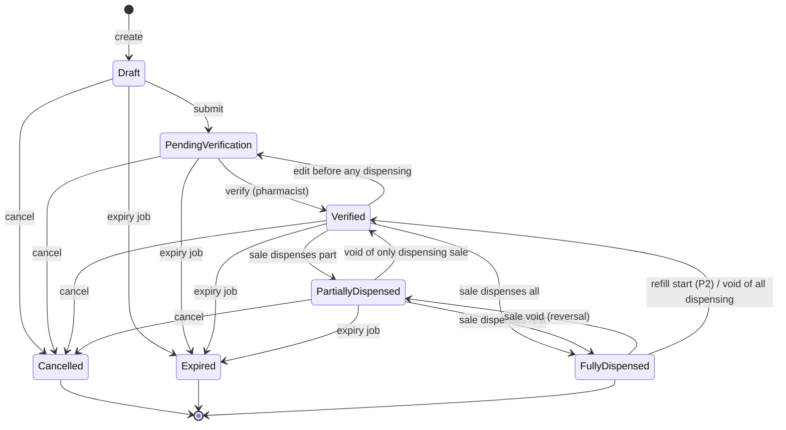

# SPEC-08: Prescription Management

| Field | Value |
|---|---|
| Version | 1.0 |
| Status | Draft — for review |
| Owner | Business Analysis / Architecture |
| Related ADRs | ADR-001 (modular monolith), ADR-002 (multi-tenancy), ADR-004 (allocation locks), ADR-006 (files), ADR-007 (background jobs), ADR-008 (audit), ADR-009 (localization) |
| Related BRQs | BRQ-09 (primary), BRQ-01, BRQ-02, BRQ-05, BRQ-08, BRQ-12, BRQ-13, BRQ-15 |
| Epic | EPIC-08 |

## 1. Purpose

Define the functional and non-functional requirements for registering prescriptions, storing prescription images privately, verifying prescriptions by a pharmacist, and recording traceable (including partial) dispensing of prescription items through POS sales. The spec also defines the controls that block the sale of prescription-only and controlled medicines without a linked, verified prescription, the controlled-medicine register, and the post-MVP decision-support features (allergy alerts, OCR suggestions, drug interaction alerts), substitution, refills, and dispensing labels.

The system is a record-keeping and workflow tool. It does not diagnose, prescribe, or decide on behalf of the pharmacist. Every clinical decision (verification, substitution, override) is made and recorded by an identified, authorized user.

## 2. Business Context

Egyptian community pharmacies receive mostly paper prescriptions written by doctors in clinics and hospitals. A patient frequently cannot or does not buy every item at once (cost, stock availability), so one prescription is dispensed over several visits. The pharmacy needs to know, at every visit, what was prescribed, what was already dispensed, from which batch, by which pharmacist, and what remains.

Prescription-only medicines and controlled medicines (narcotics/psychotropics) carry additional handling obligations whose exact content in Egypt is pending regulatory review (REG-01, REG-02, REG-08). The product therefore ships configurable controls with conservative defaults (`EnforcePrescriptionForRxOnly` = ON) and never claims compliance.

Dispensing is always performed through a POS sale (SPEC-06): stock deduction, batch allocation (FEFO), payment, and invoice are owned by Sales and Inventory; this module validates the prescription linkage and records `DispensingRecord` rows inside the same database transaction (BR-G-09, BR-G-19).

## 3. Scope

In scope:
1. Organization settings for prescriptions (validity days, attachment rules, feature toggles).
2. Prescriber (doctor) master data at organization level.
3. Prescription registration in a branch: header, optional patient, prescriber, prescription date, validity.
4. Prescription items: catalog medicine or free-text medicine name (resolved before verification), dosage, frequency, duration, route, instructions, prescribed quantity in packs or base units, dispensed and remaining quantity.
5. Prescription attachments (JPEG, PNG, PDF, HEIC) in private object storage via `FileObject`, malware scanning hook, pre-signed URL access after authorization (ADR-006).
6. Status lifecycle `Draft → PendingVerification → Verified → PartiallyDispensed → FullyDispensed`, plus `Cancelled` and `Expired`; status history.
7. Pharmacist verification with checklist and per-item acknowledgement (BR-G-14).
8. Dispensing through POS sales with `DispensingRecord` per batch allocation; partial dispensing over multiple visits (CS-04); concurrency safety.
9. Enforcement at sale completion for prescription-only (BR-G-21) and controlled medicines (BR-G-22) (CS-13).
10. Reversal of dispensing when a sale is voided.
11. Controlled-medicine register entries, read and export.
12. Post-MVP: generic substitution (P2), allergy alerts reusing SPEC-07 (P2), dispensing labels (P2), refills (P2), OCR suggestions (P3), drug interaction alerts integration contract (P3).

## 4. Out of Scope

1. Sale cart, payments, FEFO allocation, invoice numbering, void and return processing — SPEC-06 (this spec only defines the prescription hooks).
2. Batch stock, movements, and balances — SPEC-04.
3. Medicine flags `IsPrescriptionOnly` and `IsControlled`, `MedicineAlternative`, active ingredients — SPEC-03 (consumed here).
4. Patient profile, allergies, consent, access log storage — SPEC-07 (consumed here).
5. Electronic prescriptions received from external systems (no national e-prescription integration in v1).
6. Verification of prescriber license numbers against any registry.
7. Any built-in drug interaction, allergy cross-reactivity, or dosage-range data. No data source is bundled or invented (REG-09).
8. Clinical dose checking, diagnosis, or prescribing suggestions.
9. Regulatory submission/reporting of the controlled-medicine register to any authority (pending REG-02).
10. Insurance / third-party payer claims for prescriptions.

## 5. Actors and Permissions

### 5.1 Actors

| Actor | Role code(s) | Interaction |
|---|---|---|
| Pharmacist | `PHARMACIST` | Registers, verifies, resolves items, dispenses, approves substitutions, overrides alerts, dispenses controlled medicines |
| Cashier | `CASHIER` | Registers draft prescriptions and uploads images (if granted); completes sales of non-prescription lines; cannot verify or dispense prescription lines by default |
| Branch Manager | `MANAGER` | Reads, cancels prescriptions, reads the controlled register |
| Owner | `OWNER` | All of the above; manages prescription settings |
| Accountant | `ACCOUNTANT` | No prescription access by default |
| System (background jobs) | n/a | Expiry job, malware scan callback, OCR job |
| External providers | n/a | Malware scanner, OCR provider (P3), drug interaction source (P3) — all behind abstractions |

### 5.2 Permissions used

| Permission | Status | Purpose | Default roles |
|---|---|---|---|
| `prescriptions.prescriptions.read` | Canonical | List/view prescriptions, attachments, history, labels; read prescribers | OWNER, MANAGER, PHARMACIST |
| `prescriptions.prescriptions.create` | Canonical | Create/edit draft prescriptions and items, upload attachments, submit, create prescriber inline, request OCR and decide OCR suggestions | OWNER, MANAGER, PHARMACIST, CASHIER |
| `prescriptions.prescriptions.verify` | Canonical | Verify, resolve free-text items, record substitutions, acknowledge allergy alerts, start refills | OWNER, PHARMACIST |
| `prescriptions.prescriptions.cancel` | Canonical | Cancel prescriptions | OWNER, MANAGER, PHARMACIST |
| `prescriptions.dispense` | Canonical | Link sale lines to prescription items (dispensing), load dispensing context | OWNER, PHARMACIST |
| `prescriptions.controlled.dispense` | Canonical | Dispense controlled medicines (BR-G-22) | PHARMACIST (OWNER only if the owner is a pharmacist; see OD-08-10) |
| `prescriptions.prescribers.manage` | **New** | Update and deactivate prescriber records | OWNER, MANAGER, PHARMACIST |
| `prescriptions.controlled-register.read` | **New** | Read and export the controlled-medicine register | OWNER, MANAGER, PHARMACIST |
| `prescriptions.interactions.override` | **New** | Override Contraindicated/Major drug interaction alerts with reason (P3) | PHARMACIST |
| `settings.organization.manage` | Canonical | Update prescription settings | OWNER |
| `sales.pos.sell` / `sales.sales.void` | Canonical (SPEC-06) | Required alongside `prescriptions.dispense` to complete/void the sale | per SPEC-06 |
| `patients.profiles.read` | Canonical (SPEC-07) | Required alongside `prescriptions.prescriptions.read` to view a patient's prescription history | per SPEC-07 |

## 6. Functional Requirements

| ID | Requirement | Priority | BRQ | Stories |
|---|---|---|---|---|
| FR-08-001 | The system shall provide the organization setting `PrescriptionValidityDays` (integer 1–365, default 30) and snapshot its value onto each prescription at creation as `ValidityDays`; later setting changes shall not alter existing prescriptions. | P1 | BRQ-09, BRQ-15 | US-08-01 |
| FR-08-002 | The system shall provide the organization settings `PrescriptionAttachmentMaxSizeMb` (integer 1–20, default 10), `PrescriptionAttachmentMaxCount` (integer 1–20, default 10) and `RequireAttachmentForVerification` (boolean, default OFF). | P1 | BRQ-09, BRQ-15 | US-08-01 |
| FR-08-003 | The system shall provide the organization feature toggles `AllowGenericSubstitution` (default OFF), `RequireConsentForSubstitution` (default ON), `AllowPrescriptionRefills` (default OFF), `OcrEnabled` (default OFF) and `DrugInteractionChecksEnabled` (default OFF), and shall reject enabling `OcrEnabled` or `DrugInteractionChecksEnabled` with `PRESCRIPTIONS.PROVIDER_NOT_CONFIGURED` when no provider is configured for the deployment. Every settings change shall be audited with old and new values. | P1 | BRQ-09, BRQ-15, BRQ-12 | US-08-01 |
| FR-08-004 | The system shall maintain organization-level `Prescriber` records (FullName required 2–150 chars; Specialty, ClinicName, Phone, LicenseNumber optional), support create, update, deactivate, and search by name, phone, or license number prefix returning ≤ 20 results, and shall label `LicenseNumber` as "unverified" in every UI and API response (`licenseVerified: false`). | P1 | BRQ-09 | US-08-02 |
| FR-08-005 | The system shall create a prescription in status `Draft` in the branch given in the route and assign a human-readable number `{BranchCode}-RX-{yyyy}-{seq6}` unique per branch per calendar year. | P0 | BRQ-09, BRQ-02 | US-08-03 |
| FR-08-006 | The system shall capture prescription header fields: optional `PatientId` (active patient of the same organization), `PrescriberId` (existing active prescriber) or an inline new prescriber, `PrescriptionDate` (≤ branch business date), and `Notes` (≤ 1,000 chars), and shall compute `ExpiresOn = PrescriptionDate + ValidityDays`; the prescription is valid through `ExpiresOn` inclusive. | P0 | BRQ-09 | US-08-03 |
| FR-08-007 | The system shall allow header and item edits only in `Draft`, `PendingVerification`, and `Verified` without any dispensing, using `If-Match`; an edit to a `Verified` prescription shall return it to `PendingVerification` and clear its verification; any edit after the first dispensing shall be rejected with `PRESCRIPTIONS.IMMUTABLE_AFTER_DISPENSING`. | P0 | BRQ-09, BRQ-12 | US-08-03, US-08-04 |
| FR-08-008 | The system shall add prescription items that reference exactly one of an active catalog `MedicineId` or a `FreeTextMedicineName` (2–200 chars), with a maximum of 30 active items per prescription; removing an item in an editable status shall mark it `IsRemoved = true` and keep the row. | P0 | BRQ-09 | US-08-04 |
| FR-08-009 | The system shall capture per item: `Dosage` (≤ 100 chars), `Frequency` (≤ 100 chars), `DurationDays` (1–365, optional), `Route` (enum `Oral`, `Topical`, `Injection`, `Inhalation`, `Ophthalmic`, `Otic`, `Nasal`, `Rectal`, `Vaginal`, `Other`), `Instructions` (≤ 500 chars), `PrescribedQuantity` (integer 1–9,999) and `PrescribedUnit` (`Pack` or `BaseUnit`). | P0 | BRQ-09 | US-08-04 |
| FR-08-010 | The system shall compute and store `PrescribedQuantityBaseUnits` (= quantity × `PackSize` for `Pack`, = quantity for `BaseUnit`) once the item has a catalog medicine, and maintain `DispensedQuantityBaseUnits` (net of reversals) and `RemainingQuantityBaseUnits` = max(0, prescribed − dispensed). | P0 | BRQ-09 | US-08-04 |
| FR-08-011 | The system shall accept attachment uploads of type JPEG, PNG, PDF, or HEIC detected by file signature (magic bytes), not by extension alone, up to `PrescriptionAttachmentMaxSizeMb` and `PrescriptionAttachmentMaxCount` active attachments per prescription, storing the object in a private bucket and its metadata (content type, size, SHA-256) in `FileObject` linked by `PrescriptionAttachment`. | P0 | BRQ-09, BRQ-08 | US-08-05 |
| FR-08-012 | The system shall submit every uploaded attachment to the malware scanning abstraction and track `ScanStatus` (`Pending`, `Clean`, `Infected`, `ScanFailed`, `NotScanned`); an `Infected` object shall be removed from the bucket within 60 s of the verdict while its metadata is kept, and the uploader shall be notified; `NotScanned` shall be permitted only when the deployment environment is not Production. | P0 | BRQ-09, BRQ-12 | US-08-05 |
| FR-08-013 | The system shall issue a pre-signed GET URL with a lifetime of 300 s for an attachment only after authorizing the caller (permission, branch, organization) and only when `ScanStatus` is `Clean` (or `NotScanned` outside Production), and shall record each issuance in `AuditLog` and, when the prescription has a patient, in `PatientAccessLog`. | P0 | BRQ-09, BRQ-08, BRQ-12 | US-08-06 |
| FR-08-014 | The system shall allow attachments to be added in any status except `Cancelled` and `Expired`, allow unlinking (`IsRemoved = true`, `FileObject` retained) only before verification, and reject unlinking after the prescription has been verified with `PRESCRIPTIONS.ATTACHMENT_LOCKED`. | P1 | BRQ-09, BRQ-12 | US-08-05 |
| FR-08-015 | The system shall transition `Draft → PendingVerification` on submit only when the prescription has ≥ 1 active item, a prescriber, and a `PrescriptionDate` that is not later than the business date and not earlier than (business date − `ValidityDays`). | P0 | BRQ-09 | US-08-07 |
| FR-08-016 | The system shall require a patient at submit and at verification when any active item references a medicine with `IsControlled = true`, or a medicine with `IsPrescriptionOnly = true` while `EnforcePrescriptionForRxOnly` is ON; otherwise a patient is optional. | P0 | BRQ-09, BRQ-08 | US-08-07 |
| FR-08-017 | The system shall transition `PendingVerification → Verified` only by a user holding `prescriptions.prescriptions.verify` in the prescription's branch, storing `VerifiedBy`, `VerifiedAt`, `ChecklistVersion`, and the checklist acknowledgements. | P0 | BRQ-09, BRQ-01 | US-08-08 |
| FR-08-018 | The system shall require at verification the acknowledgement of every checklist entry of the active checklist version (v1: prescriber and date legible; patient identity matches; attachment content matches the registered items when an attachment exists) and an explicit per-item verification flag for every active item, rejecting otherwise with `PRESCRIPTIONS.CHECKLIST_INCOMPLETE`. | P0 | BRQ-09 | US-08-08 |
| FR-08-019 | The system shall reject verification while any active item is free-text, and shall let a verifier resolve a free-text item to an active catalog medicine, retaining the original free text and recording `ResolvedBy` and `ResolvedAt`. | P0 | BRQ-09, BRQ-03 | US-08-08 |
| FR-08-020 | The system shall require ≥ 1 attachment with `ScanStatus = Clean` at verification when `RequireAttachmentForVerification` is ON or any active item is a controlled medicine, rejecting otherwise with `PRESCRIPTIONS.ATTACHMENT_REQUIRED`. | P0 | BRQ-09 | US-08-08 |
| FR-08-021 | The system shall list prescriptions of a branch with filters (status, prescription date range, created date range, patient, prescriber, number, `hasRemaining`) and offset pagination (default 25, max 100), returning only summary fields (number, date, status, patient display name, prescriber name, item count, remaining item count). | P1 | BRQ-09 | US-08-09 |
| FR-08-022 | The system shall return prescription detail including items with prescribed, dispensed, and remaining quantities, attachments metadata, and dispensing records (sale number, batch number, expiry date, quantity, pharmacist, date/time), and shall write a `PatientAccessLog` entry for every detail read of a prescription that has a patient (BR-G-29). | P1 | BRQ-09, BRQ-08 | US-08-09 |
| FR-08-023 | The system shall record every status transition in an immutable `PrescriptionStatusHistory` row (from, to, user or `System`, timestamp UTC, reason) and expose it in the detail view. | P1 | BRQ-09, BRQ-12 | US-08-09 |
| FR-08-024 | The system shall write an `AuditLog` entry in the same transaction for: create, header/item edit, submit, verify, item resolution, cancel, attachment upload/unlink, substitution, alert override, refill start, OCR suggestion decision, and controlled-register export (BR-G-16). | P0 | BRQ-12 | US-08-03, US-08-08, US-08-10 |
| FR-08-025 | The system shall list a patient's prescriptions across the branches the caller is assigned to (or all branches for organization-wide scope), excluding branches outside the caller's scope without revealing their existence. | P1 | BRQ-08, BRQ-09 | US-08-09 |
| FR-08-026 | The system shall cancel a prescription from `Draft`, `PendingVerification`, `Verified`, or `PartiallyDispensed` with a mandatory reason (5–500 chars), retain all existing dispensing records, and reject any further dispensing. | P1 | BRQ-09 | US-08-10 |
| FR-08-027 | The system shall run a daily expiry job at 00:30 branch local time that sets `Expired` on prescriptions in `Draft`, `PendingVerification`, `Verified`, or `PartiallyDispensed` whose `ExpiresOn` < branch business date, records a `BackgroundJobRun`, writes status history with actor `System`, and is idempotent when re-run on the same date. | P1 | BRQ-09 | US-08-11 |
| FR-08-028 | The system shall evaluate `ExpiresOn` against the branch business date during every dispensing validation, independent of whether the expiry job has run, and reject expired prescriptions with `PRESCRIPTIONS.EXPIRED`. | P0 | BRQ-09 | US-08-11, US-08-12 |
| FR-08-029 | The system shall provide a dispensing context for a prescription in `Verified` or `PartiallyDispensed` returning, per active item, the medicine, prescribed/dispensed/remaining base units, approved substitutes, the Rx-only/controlled flags, and any open alerts, for the POS to add lines to the cart. | P0 | BRQ-09, BRQ-07 | US-08-12 |
| FR-08-030 | The system shall accept an optional `prescriptionItemId` on each sale line at sale completion (SPEC-06) and, inside the sale transaction, validate: same organization and branch, prescription status `Verified` or `PartiallyDispensed`, not expired, line medicine equals the item medicine or an approved substitute, line quantity in base units ≤ remaining, and the completing user holds `prescriptions.dispense`; any failure rejects the whole sale. | P0 | BRQ-09, BRQ-05 | US-08-12 |
| FR-08-031 | The system shall create, in the sale transaction, one `DispensingRecord` per sale line allocation (batch) linking `PrescriptionItemId`, `SaleId`, `SaleLineId`, `BatchId`, prescribed and dispensed `MedicineId`, `QuantityBaseUnits`, `PharmacistUserId`, `DispensedAt`, and `FillNumber`, update the item quantities, and recompute the prescription status (`PartiallyDispensed` when any item has dispensed > 0 and any item has remaining > 0; `FullyDispensed` when every active item has remaining = 0). | P0 | BRQ-09, BRQ-04 | US-08-12 |
| FR-08-032 | The system shall lock the affected `PrescriptionItem` rows (`SELECT … FOR UPDATE`, ordered by item id, before batch balance locks) during dispensing validation so that concurrent sales can never dispense more than the remaining quantity. | P0 | BRQ-09, BRQ-05 | US-08-12 |
| FR-08-033 | The system shall, when the medicine has `AllowSplitPack = false` and the remaining quantity is not a multiple of `PackSize`, allow a dispensed quantity exceeding the remaining by less than one pack only with reason code `PackRounding`, record the excess on the `DispensingRecord`, and set the item remaining to 0. | P1 | BRQ-09 | US-08-12 |
| FR-08-034 | The system shall set the sale's `PatientId` to the prescription's patient when the prescription has a patient, and reject a sale whose explicitly selected patient differs from the linked prescription's patient with `PRESCRIPTIONS.PATIENT_MISMATCH`. | P1 | BRQ-09, BRQ-08 | US-08-12 |
| FR-08-035 | The system shall, when `EnforcePrescriptionForRxOnly` is ON, reject the whole sale with `PRESCRIPTIONS.PRESCRIPTION_REQUIRED` if any line of a medicine with `IsPrescriptionOnly = true` lacks a valid `prescriptionItemId`; when OFF, the sale shall complete and an audit entry `RxOnlySoldWithoutPrescription` shall be written per such line. | P0 | BRQ-09, BRQ-15 | US-08-13 |
| FR-08-036 | The system shall reject the whole sale if any line of a medicine with `IsControlled = true` lacks a valid `prescriptionItemId` (`PRESCRIPTIONS.PRESCRIPTION_REQUIRED`, regardless of `EnforcePrescriptionForRxOnly`) or the completing user lacks `prescriptions.controlled.dispense` (`PRESCRIPTIONS.CONTROLLED_DISPENSE_FORBIDDEN`). | P0 | BRQ-09, BRQ-15 | US-08-13 |
| FR-08-037 | The system shall, in the same transaction as a sale void (SPEC-06), create a compensating `DispensingRecord` (negative quantity, `ReversesDispensingRecordId`) for every dispensing record of the voided sale, recompute item quantities and status (`FullyDispensed`/`PartiallyDispensed` → `PartiallyDispensed`/`Verified`), and leave `Cancelled` or `Expired` statuses unchanged. | P1 | BRQ-09, BRQ-12 | US-08-14 |
| FR-08-038 | The system shall leave dispensed and remaining quantities unchanged when a sales return is created for a dispensed line (pending OD-08-02 / REG-11), and shall expose the related sales return reference on the dispensing record view. | P1 | BRQ-09 | US-08-14 |
| FR-08-039 | The system shall create, in the dispensing transaction, one append-only `ControlledMedicineRegisterEntry` per controlled-medicine `DispensingRecord`, numbered `{BranchCode}-CMR-{yyyy}-{seq6}` gaplessly per branch per year, capturing date/time, medicine, strength, batch number, quantity, patient name and patient id, prescriber name and license number as entered, prescription number, sale number, pharmacist, and branch running balance of that medicine after the movement; void reversals shall create compensating entries. | P1 | BRQ-09, BRQ-12 | US-08-15 |
| FR-08-040 | The system shall let holders of `prescriptions.controlled-register.read` view the register per branch for a date range ≤ 366 days with cursor pagination and export it to CSV and PDF, auditing every export (format pending REG-02). | P1 | BRQ-09, BRQ-12 | US-08-15 |
| FR-08-041 | The system shall, when `AllowGenericSubstitution` is ON, let a verifier record on a `Verified` or `PartiallyDispensed` item a `PrescriptionItemSubstitution` with an active substitute medicine different from the prescribed one, reason (`GenericSubstitution`, `OutOfStock`, `PatientRequest`, `Other` + text 5–500 chars), substitute quantity in base units, and `PatientConsentObtained` (must be true when `RequireConsentForSubstitution` is ON), indicating whether the substitute is a catalog `MedicineAlternative`. | P2 | BRQ-09 | US-08-16 |
| FR-08-042 | The system shall permit dispensing of a substitute only through an active approved substitution, record both prescribed and dispensed medicine and the substitution id on the `DispensingRecord`, decrement the item remaining proportionally to the substitute quantity, and apply controlled-medicine rules when the substitute is controlled. | P2 | BRQ-09 | US-08-16 |
| FR-08-043 | The system shall, for prescriptions with a patient, call the SPEC-07 allergy check for all active item medicines at verification and in the dispensing context, display each alert with the decision-support disclaimer, and require an acknowledgement with reason (10–500 chars) stored in `PrescriptionAlertOverride` before the item can be verified or dispensed. | P2 | BRQ-08, BRQ-09 | US-08-17 |
| FR-08-044 | The system shall generate dispensing labels as a PDF for the dispensing records of a sale, one label per dispensing line, containing patient name (or "—"), medicine name and strength, dose instructions (dosage, frequency, route, instructions), quantity, dispensing date, prescription number, branch name and phone, in Arabic, English, or both. | P2 | BRQ-09, BRQ-13 | US-08-18 |
| FR-08-045 | The system shall, when `AllowPrescriptionRefills` is ON, accept `RefillsAllowed` (0–11) at registration and let a verifier start a refill on a `FullyDispensed`, non-expired prescription with `RefillsUsed < RefillsAllowed`, which sets status `Verified`, increments `RefillsUsed` and `CurrentFillNumber`, and resets each active item's remaining to its prescribed quantity for the new fill. | P2 | BRQ-09 | US-08-19 |
| FR-08-046 | The system shall, when `OcrEnabled` is ON, accept an OCR request on a `Clean` attachment of an editable prescription, create an `OcrExtraction` in status `Queued`, process it in a background job via the OCR provider abstraction (timeout 120 s, 3 retries with exponential back-off), and store per-field suggestions with confidence 0.00–1.00, provider name and version, and status `Completed` or `Failed`. | P3 | BRQ-09 | US-08-20 |
| FR-08-047 | The system shall present OCR suggestions field by field, highlight fields below `OcrLowConfidenceThreshold` (default 0.80), and copy a value into the prescription only on an explicit user decision `Accepted` or `Edited` per field; no OCR outcome shall change prescription status, verify an item, or create a dispensing record (BR-G-14). | P3 | BRQ-09 | US-08-21 |
| FR-08-048 | The system shall define a drug interaction provider integration contract (request: organization id, list of medicines with active ingredient identifiers and source-specific codes; response: source name, source version, checked-at, list of interactions with severity, involved ingredients, description, source reference) and shall ship with no interaction data and no default provider (REG-09). | P3 | BRQ-09, BRQ-15 | US-08-22 |
| FR-08-049 | The system shall, when `DrugInteractionChecksEnabled` is ON, check interactions among the prescription's active items and the patient's other `Verified`/`PartiallyDispensed` prescriptions at verification and in the dispensing context, display severity (`Contraindicated`, `Major`, `Moderate`, `Minor`, `Unknown`), source name and version, and the decision-support disclaimer, and show "Interaction check unavailable" without blocking when the provider fails or exceeds 2 s. | P3 | BRQ-09 | US-08-22 |
| FR-08-050 | The system shall block verification and dispensing of items involved in a `Contraindicated` or `Major` interaction until a user holding `prescriptions.interactions.override` records an override with reason (10–500 chars), stored in `PrescriptionAlertOverride` and audited. | P3 | BRQ-09, BRQ-12 | US-08-22 |

## 7. Business Rules

| ID | Rule | Source |
|---|---|---|
| BR-08-001 | A prescription belongs to the branch in which it was registered for its lifetime and, in v1, can be dispensed only in that branch. | BR-G-01, BR-G-02, OD-08-01 |
| BR-08-002 | A patient is optional for prescriptions containing only medicines that are neither prescription-only nor controlled; it is mandatory when any item is controlled, or prescription-only while `EnforcePrescriptionForRxOnly` is ON. | BR-G-21, BR-G-22 |
| BR-08-003 | `ExpiresOn = PrescriptionDate + ValidityDays` (snapshotted); the prescription is dispensable through `ExpiresOn` inclusive in branch business date; default validity 30 days pending REG-01. | REG-01 |
| BR-08-004 | Prescriber license numbers are free text entered by staff and are never presented as verified. | — |
| BR-08-005 | A free-text item must be resolved to an active catalog medicine before verification and therefore before any dispensing. | BR-G-14 |
| BR-08-006 | A prescription must be verified by a user holding `prescriptions.prescriptions.verify`, with every item individually acknowledged, before any dispensing. | BR-G-14 |
| BR-08-007 | Only prescriptions in `Verified` or `PartiallyDispensed` status with `ExpiresOn ≥ business date` can be dispensed. | BR-G-15 |
| BR-08-008 | Dispensing happens only through a completed sale; each batch allocation of a prescription-linked sale line produces exactly one `DispensingRecord` (medicine, batch, quantity, pharmacist, sale). | BR-G-15, BR-G-09 |
| BR-08-009 | Net dispensed quantity of an item never exceeds its prescribed quantity, except the pack-rounding excess of less than one pack with reason `PackRounding`. | BR-G-15 |
| BR-08-010 | Prescription status after dispensing or reversal is derived from item quantities: all items remaining = 0 → `FullyDispensed`; some dispensed → `PartiallyDispensed`; none dispensed → `Verified`. `Cancelled` and `Expired` are never overwritten by derivation. | — |
| BR-08-011 | Header and items are immutable after the first dispensing; an edit to a `Verified` prescription without dispensing returns it to `PendingVerification`. | BR-G-11 (analogy) |
| BR-08-012 | OCR output is a suggestion only; it never sets status, verifies items, or dispenses. | BR-G-14 |
| BR-08-013 | Allergy and interaction alerts are decision support; the system never invents reference data, and an override always records user, time, and reason. | §8.3 writing rules, REG-09 |
| BR-08-014 | Controlled medicines are dispensed only by a holder of `prescriptions.controlled.dispense`, only against a verified prescription with a patient, and each dispensing creates a register entry. | BR-G-22, REG-02 |
| BR-08-015 | When `EnforcePrescriptionForRxOnly` is ON, a sale containing a prescription-only medicine line without a valid prescription link is rejected in full. | BR-G-21, REG-01 |
| BR-08-016 | Prescriptions, items, attachments metadata, dispensing records, OCR extractions, and register entries are never hard-deleted by application users. | BR-G-34, REG-05 |
| BR-08-017 | Corrections to dispensing and to the controlled register are made only by compensating entries. | BR-G-25 |
| BR-08-018 | Attachment content is served only via short-lived pre-signed URLs after authorization and only when the scan verdict permits it. | ADR-006 |
| BR-08-019 | A substitution requires a pharmacist decision, a reason, and a patient-consent flag; substitution policy is pending REG-08. | REG-08 |
| BR-08-020 | Every read of prescription detail or attachment of a prescription with a patient is access-logged. | BR-G-29 |
| BR-08-021 | Refills are disabled by default and allowed only when enabled by the organization; refill legality is pending REG-01. | REG-01 |
| BR-08-022 | `Cancelled` and `Expired` are terminal. `FullyDispensed` leaves only by refill start or by void reversal. | — |

### 7.1 Status lifecycle



## 8. Data Requirements

Schema `prescriptions`. All tables carry `Id uuid` (UUIDv7), `OrganizationId`, audit columns; branch-scoped tables carry `BranchId`; mutable aggregates carry `RowVersion` (`xmin`).

| Entity | Key fields | Notes |
|---|---|---|
| `Prescriber` | FullName, NormalizedName, Specialty?, ClinicName?, Phone?, LicenseNumber?, IsActive | Org-level master data; soft-deactivated (BR-G-33) |
| `Prescription` | BranchId, Number, Status, PatientId?, PrescriberId, PrescriberNameSnapshot, PrescriberLicenseSnapshot?, PrescriptionDate (date), ValidityDays, ExpiresOn (date), Notes?, VerifiedBy?, VerifiedAt?, ChecklistVersion?, ChecklistAcknowledgements (jsonb)?, RefillsAllowed (default 0), RefillsUsed, CurrentFillNumber (default 0), CancelReason?, CancelledBy?, CancelledAt?, RowVersion | Unique (OrganizationId, BranchId, Number) |
| `PrescriptionItem` | PrescriptionId, LineNo, MedicineId?, FreeTextMedicineName?, ResolvedBy?, ResolvedAt?, Dosage?, Frequency?, DurationDays?, Route?, Instructions?, PrescribedQuantity, PrescribedUnit, PrescribedQuantityBaseUnits?, DispensedQuantityBaseUnits (default 0), RemainingQuantityBaseUnits, ItemVerifiedBy?, ItemVerifiedAt?, IsRemoved, RowVersion | Check: `MedicineId IS NOT NULL OR FreeTextMedicineName IS NOT NULL`; `DispensedQuantityBaseUnits >= 0`; `RemainingQuantityBaseUnits >= 0` |
| `PrescriptionAttachment` | PrescriptionId, FileObjectId, ContentType, SizeBytes, Sha256, ScanStatus, ScanCompletedAt?, IsRemoved, UploadedBy | Object key never exposed |
| `PrescriptionStatusHistory` (**new**) | PrescriptionId, FromStatus?, ToStatus, ChangedBy (user id or null for System), ChangedAt, Reason? | Append-only |
| `DispensingRecord` | BranchId, PrescriptionId, PrescriptionItemId, SaleId, SaleLineId, SaleLineAllocationId, BatchId, PrescribedMedicineId, DispensedMedicineId, SubstitutionId?, QuantityBaseUnits (signed; negative for reversal), RoundingExcessBaseUnits (default 0), RoundingReason?, PharmacistUserId, DispensedAt, BusinessDate, FillNumber, ReversesDispensingRecordId? | Append-only |
| `PrescriptionItemSubstitution` (**new**, P2) | PrescriptionItemId, SubstituteMedicineId, SubstituteQuantityBaseUnits, Reason, ReasonText?, PatientConsentObtained, IsCatalogAlternative, ApprovedBy, ApprovedAt, IsActive | One active substitution per item |
| `PrescriptionAlertOverride` (**new**, P2/P3) | PrescriptionId, PrescriptionItemId?, AlertType (`Allergy`, `Interaction`), AlertKey, Severity, SourceName?, SourceVersion?, Reason, OverriddenBy, OverriddenAt | Append-only |
| `OcrExtraction` (P3) | PrescriptionId, PrescriptionAttachmentId, Status (`Queued`, `Processing`, `Completed`, `Failed`), ProviderName, ProviderVersion?, Attempts, FailureCode?, Fields (jsonb: [{fieldKey, suggestedValue, confidence, decision `Pending`/`Accepted`/`Edited`/`Rejected`, finalValue?, decidedBy?, decidedAt?}]), RequestedBy, CompletedAt? | Raw provider payload not stored in logs |
| `ControlledMedicineRegisterEntry` | BranchId, EntryNumber, EntryType (`Dispensing`, `Reversal`), OccurredAt, BusinessDate, MedicineId, MedicineNameSnapshot, StrengthSnapshot, BatchId, BatchNumberSnapshot, QuantityBaseUnits (signed), BalanceAfterBaseUnits, PatientId, PatientNameSnapshot, PrescriberNameSnapshot, PrescriberLicenseSnapshot?, PrescriptionId, PrescriptionNumber, SaleId, SaleNumber, PharmacistUserId, DispensingRecordId, ReversesEntryId? | Append-only; numbered via `DocumentSequence` |

Settings added to `OrganizationSettings`: `PrescriptionValidityDays`, `PrescriptionAttachmentMaxSizeMb`, `PrescriptionAttachmentMaxCount`, `RequireAttachmentForVerification`, `AllowGenericSubstitution`, `RequireConsentForSubstitution`, `AllowPrescriptionRefills`, `OcrEnabled`, `OcrLowConfidenceThreshold` (0.50–0.99, default 0.80), `DrugInteractionChecksEnabled`, `DispensingLabelSize` (default `50x30mm`). `EnforcePrescriptionForRxOnly` is canonical (BR-G-21).

Indexes (minimum): `prescriptions(OrganizationId, BranchId, Status, PrescriptionDate desc)`, `prescriptions(OrganizationId, PatientId)`, `prescription_items(PrescriptionId)`, `dispensing_records(PrescriptionItemId)`, `dispensing_records(SaleId)`, `controlled_medicine_register_entries(OrganizationId, BranchId, BusinessDate, EntryNumber)`, `prescribers(OrganizationId, NormalizedName)`.

Sale line contract extension (owned by SPEC-06, consumed here):

```json
{
  "lines": [
    { "medicineId": "0190f0a2-…", "quantity": 1, "unit": "Pack",
      "prescriptionItemId": "0190f0b7-…", "roundingReason": null }
  ],
  "patientId": "0190f0c1-…"
}
```

## 9. Validation Rules

| ID | Field / Object | Rule | Error code |
|---|---|---|---|
| VR-08-001 | Setting `PrescriptionValidityDays` | Integer 1–365 | `PRESCRIPTIONS.SETTING_OUT_OF_RANGE` |
| VR-08-002 | Settings `PrescriptionAttachmentMaxSizeMb` / `MaxCount` | Integer 1–20 each | `PRESCRIPTIONS.SETTING_OUT_OF_RANGE` |
| VR-08-003 | Setting `OcrLowConfidenceThreshold` | Decimal 0.50–0.99, 2 decimals | `PRESCRIPTIONS.SETTING_OUT_OF_RANGE` |
| VR-08-004 | Toggle `OcrEnabled` / `DrugInteractionChecksEnabled` = true | Provider configured in deployment | `PRESCRIPTIONS.PROVIDER_NOT_CONFIGURED` |
| VR-08-005 | Prescriber.FullName | Required, 2–150 chars after trim | `PRESCRIPTIONS.PRESCRIBER_NAME_REQUIRED` |
| VR-08-006 | Prescriber.Phone / LicenseNumber / Specialty / ClinicName | ≤ 30 / ≤ 50 / ≤ 100 / ≤ 150 chars | `PRESCRIPTIONS.FIELD_TOO_LONG` |
| VR-08-007 | Prescription.PrescriberId | Exists in organization and `IsActive` | `PRESCRIPTIONS.PRESCRIBER_INVALID` |
| VR-08-008 | Prescription.PatientId | Exists in organization and active | `PRESCRIPTIONS.PATIENT_INVALID` |
| VR-08-009 | Prescription.PrescriptionDate | ≤ branch business date | `PRESCRIPTIONS.DATE_IN_FUTURE` |
| VR-08-010 | Prescription.PrescriptionDate | `PrescriptionDate + ValidityDays ≥ business date` | `PRESCRIPTIONS.ALREADY_EXPIRED` |
| VR-08-011 | Prescription.Notes | ≤ 1,000 chars | `PRESCRIPTIONS.FIELD_TOO_LONG` |
| VR-08-012 | Update request | `If-Match` equals current ETag | `PRESCRIPTIONS.VERSION_MISMATCH` (412) |
| VR-08-013 | Item | Exactly one of MedicineId / FreeTextMedicineName | `PRESCRIPTIONS.ITEM_MEDICINE_XOR_TEXT` |
| VR-08-014 | Item.MedicineId | Exists in org catalog and `Active` | `PRESCRIPTIONS.MEDICINE_INVALID` |
| VR-08-015 | Item.FreeTextMedicineName | 2–200 chars after trim | `PRESCRIPTIONS.FIELD_TOO_LONG` |
| VR-08-016 | Item.PrescribedQuantity | Integer 1–9,999; `PrescribedUnit` ∈ {Pack, BaseUnit} | `PRESCRIPTIONS.QUANTITY_INVALID` |
| VR-08-017 | Item.DurationDays / Route | 1–365 when present / value in enum | `PRESCRIPTIONS.QUANTITY_INVALID` / `PRESCRIPTIONS.ROUTE_INVALID` |
| VR-08-018 | Item count | ≤ 30 active items | `PRESCRIPTIONS.ITEM_LIMIT_REACHED` |
| VR-08-019 | Attachment type | File is non-empty and its signature is JPEG, PNG, PDF, or HEIC | `PRESCRIPTIONS.ATTACHMENT_TYPE_NOT_ALLOWED` (415) |
| VR-08-020 | Attachment size | ≤ `PrescriptionAttachmentMaxSizeMb` MiB | `PRESCRIPTIONS.ATTACHMENT_TOO_LARGE` (413) |
| VR-08-021 | Attachment count | Active attachments < `PrescriptionAttachmentMaxCount` | `PRESCRIPTIONS.ATTACHMENT_LIMIT_REACHED` |
| VR-08-022 | Submit | ≥ 1 active item | `PRESCRIPTIONS.NO_ITEMS` |
| VR-08-023 | Submit / verify | Patient present when BR-08-002 requires | `PRESCRIPTIONS.PATIENT_REQUIRED` |
| VR-08-024 | Verify | No free-text items | `PRESCRIPTIONS.ITEM_UNRESOLVED` |
| VR-08-025 | Verify | All checklist entries and all items acknowledged | `PRESCRIPTIONS.CHECKLIST_INCOMPLETE` |
| VR-08-026 | Verify | Clean attachment present when FR-08-020 requires | `PRESCRIPTIONS.ATTACHMENT_REQUIRED` |
| VR-08-027 | Cancel reason / override reason | 5–500 chars / 10–500 chars | `PRESCRIPTIONS.CANCEL_REASON_REQUIRED` / `PRESCRIPTIONS.OVERRIDE_REASON_REQUIRED` |
| VR-08-028 | Dispensing: prescription status | `Verified` or `PartiallyDispensed` | `PRESCRIPTIONS.NOT_DISPENSABLE` |
| VR-08-029 | Dispensing: expiry | `ExpiresOn ≥ business date` | `PRESCRIPTIONS.EXPIRED` |
| VR-08-030 | Dispensing: branch | Sale branch = prescription branch | `PRESCRIPTIONS.BRANCH_MISMATCH` |
| VR-08-031 | Dispensing: medicine | Line medicine = item medicine or active substitute | `PRESCRIPTIONS.MEDICINE_MISMATCH` |
| VR-08-032 | Dispensing: quantity | Sum of lines per item (base units) ≤ remaining (+ < 1 pack with `PackRounding`) | `PRESCRIPTIONS.QUANTITY_EXCEEDS_REMAINING` / `PRESCRIPTIONS.ROUNDING_REASON_REQUIRED` |
| VR-08-033 | Dispensing: patient | Sale patient null or equal to prescription patient | `PRESCRIPTIONS.PATIENT_MISMATCH` |
| VR-08-034 | Sale line Rx-only / controlled | Valid `prescriptionItemId` required per FR-08-035/036 | `PRESCRIPTIONS.PRESCRIPTION_REQUIRED` |
| VR-08-035 | Dispensing: open alerts | No unacknowledged allergy alert / unoverridden Contraindicated/Major interaction | `PRESCRIPTIONS.ALERT_OVERRIDE_REQUIRED` |
| VR-08-036 | Substitution | Feature ON; substitute active and ≠ prescribed; reason valid; consent true when required | `PRESCRIPTIONS.SUBSTITUTION_DISABLED` / `PRESCRIPTIONS.SUBSTITUTION_INVALID` / `PRESCRIPTIONS.SUBSTITUTION_REASON_REQUIRED` / `PRESCRIPTIONS.CONSENT_REQUIRED` |
| VR-08-037 | Refill | Feature ON; `RefillsUsed < RefillsAllowed`; `RefillsAllowed` 0–11 | `PRESCRIPTIONS.REFILLS_DISABLED` / `PRESCRIPTIONS.NO_REFILLS_REMAINING` |
| VR-08-038 | OCR request | Feature ON; attachment `Clean`; prescription editable | `PRESCRIPTIONS.FEATURE_DISABLED` / `PRESCRIPTIONS.OCR_SOURCE_INVALID` |
| VR-08-039 | OCR field decision | Field decision currently `Pending` | `PRESCRIPTIONS.OCR_FIELD_ALREADY_DECIDED` |
| VR-08-040 | Controlled register query | `to − from ≤ 366` days, `from ≤ to` | `PRESCRIPTIONS.REGISTER_RANGE_TOO_LARGE` |

All validation errors are RFC 9457 Problem Details with HTTP 422 unless another status is stated; field-level errors appear in `errors`.

## 10. API Requirements

Base: `/api/v1`. Branch-scoped paths prefixed with `/branches/{branchId}`. All mutating requests on mutable resources use `If-Match`.

| Method | Path | Purpose | Permission | Idempotency |
|---|---|---|---|---|
| GET | `/settings/prescriptions` | Read prescription settings | `prescriptions.prescriptions.read` | n/a |
| PUT | `/settings/prescriptions` | Update prescription settings | `settings.organization.manage` | If-Match |
| GET | `/prescribers?q=&page=&pageSize=` | Search prescribers | `prescriptions.prescriptions.read` | n/a |
| POST | `/prescribers` | Create prescriber | `prescriptions.prescriptions.create` | Optional `Idempotency-Key` |
| PATCH | `/prescribers/{prescriberId}` | Update prescriber | `prescriptions.prescribers.manage` | If-Match |
| POST | `/prescribers/{prescriberId}/deactivate` | Deactivate prescriber | `prescriptions.prescribers.manage` | If-Match |
| GET | `/branches/{branchId}/prescriptions` | List/search | `prescriptions.prescriptions.read` | n/a |
| POST | `/branches/{branchId}/prescriptions` | Create draft (header + optional items) | `prescriptions.prescriptions.create` | Optional `Idempotency-Key` |
| GET | `/branches/{branchId}/prescriptions/{id}` | Detail (access-logged) | `prescriptions.prescriptions.read` | n/a |
| PATCH | `/branches/{branchId}/prescriptions/{id}` | Edit header | `prescriptions.prescriptions.create` | If-Match |
| POST | `/branches/{branchId}/prescriptions/{id}/items` | Add item | `prescriptions.prescriptions.create` | If-Match (prescription) |
| PATCH | `/branches/{branchId}/prescriptions/{id}/items/{itemId}` | Edit item | `prescriptions.prescriptions.create` | If-Match |
| DELETE | `/branches/{branchId}/prescriptions/{id}/items/{itemId}` | Remove item (soft) | `prescriptions.prescriptions.create` | If-Match |
| POST | `/branches/{branchId}/prescriptions/{id}/items/{itemId}/resolve` | Resolve free-text item | `prescriptions.prescriptions.verify` | If-Match |
| POST | `/branches/{branchId}/prescriptions/{id}/submit` | Draft → PendingVerification | `prescriptions.prescriptions.create` | If-Match |
| POST | `/branches/{branchId}/prescriptions/{id}/verify` | PendingVerification → Verified | `prescriptions.prescriptions.verify` | If-Match |
| POST | `/branches/{branchId}/prescriptions/{id}/cancel` | Cancel | `prescriptions.prescriptions.cancel` | If-Match |
| GET | `/branches/{branchId}/prescriptions/{id}/history` | Status history | `prescriptions.prescriptions.read` | n/a |
| POST | `/branches/{branchId}/prescriptions/{id}/attachments` | Upload (multipart/form-data) | `prescriptions.prescriptions.create` | Optional `Idempotency-Key` |
| GET | `/branches/{branchId}/prescriptions/{id}/attachments` | List attachment metadata | `prescriptions.prescriptions.read` | n/a |
| POST | `/branches/{branchId}/prescriptions/{id}/attachments/{attachmentId}/access-url` | Issue pre-signed URL (300 s) | `prescriptions.prescriptions.read` | n/a |
| DELETE | `/branches/{branchId}/prescriptions/{id}/attachments/{attachmentId}` | Unlink before verification | `prescriptions.prescriptions.create` | n/a |
| GET | `/branches/{branchId}/prescriptions/{id}/dispensing-context` | Items/remaining/alerts for POS | `prescriptions.dispense` | n/a |
| POST | `/branches/{branchId}/sales` (SPEC-06) | Sale completion incl. dispensing | `sales.pos.sell` + `prescriptions.dispense` (+ `prescriptions.controlled.dispense`) | **Required** |
| POST | `/branches/{branchId}/sales/{saleId}/void` (SPEC-06) | Void incl. dispensing reversal | `sales.sales.void` | **Required** |
| GET | `/branches/{branchId}/sales/{saleId}/dispensing-labels?lang=ar\|en\|both` | Labels PDF (P2) | `prescriptions.prescriptions.read` | n/a |
| POST | `/branches/{branchId}/prescriptions/{id}/items/{itemId}/substitutions` | Record substitution (P2) | `prescriptions.prescriptions.verify` | If-Match |
| POST | `/branches/{branchId}/prescriptions/{id}/alert-overrides` | Acknowledge allergy / override interaction | `prescriptions.prescriptions.verify` (Allergy) / `prescriptions.interactions.override` (Interaction) | Optional `Idempotency-Key` |
| GET | `/branches/{branchId}/prescriptions/{id}/interaction-check` | Run/return interaction check (P3) | `prescriptions.prescriptions.read` | n/a |
| POST | `/branches/{branchId}/prescriptions/{id}/refills` | Start refill (P2) | `prescriptions.prescriptions.verify` | If-Match |
| POST | `/branches/{branchId}/prescriptions/{id}/attachments/{attachmentId}/ocr` | Request OCR (P3) | `prescriptions.prescriptions.create` | Optional `Idempotency-Key` |
| GET | `/branches/{branchId}/prescriptions/{id}/ocr-extractions/{extractionId}` | Read OCR suggestions | `prescriptions.prescriptions.read` | n/a |
| POST | `/branches/{branchId}/prescriptions/{id}/ocr-extractions/{extractionId}/fields/{fieldKey}/decision` | Accept / edit / reject a suggestion | `prescriptions.prescriptions.create` | If-Match |
| GET | `/branches/{branchId}/controlled-register?from=&to=&medicineId=&cursor=&limit=` | Read register | `prescriptions.controlled-register.read` | n/a |
| POST | `/branches/{branchId}/controlled-register/exports` | Export CSV/PDF | `prescriptions.controlled-register.read` | Optional `Idempotency-Key` |
| GET | `/patients/{patientId}/prescriptions` | Patient's prescriptions across permitted branches | `prescriptions.prescriptions.read` + `patients.profiles.read` | n/a |

Example — verify request:

```json
{
  "checklistVersion": 1,
  "checklist": { "prescriberAndDateLegible": true, "patientIdentityMatches": true, "attachmentMatchesItems": true },
  "itemAcknowledgements": [ { "itemId": "0190f0b7-…", "verified": true } ]
}
```

Example — drug interaction provider contract (P3, provider-agnostic):

```json
{
  "request": {
    "organizationId": "0190…",
    "medicines": [
      { "medicineId": "0190…", "ingredients": [ { "ingredientId": "0190…", "sourceCode": "<source-specific code or null>" } ] }
    ]
  },
  "response": {
    "sourceName": "<licensed source name>", "sourceVersion": "<version>", "checkedAt": "2026-11-09T10:15:00Z",
    "interactions": [
      { "severity": "Major", "ingredientIds": ["0190…", "0190…"], "description": "<text from source>", "sourceReference": "<source id>" }
    ]
  }
}
```

No values in this example are clinical data; the provider is the sole source of interaction content.

## 11. Authorization Requirements

1. Every endpoint enforces permission, branch assignment, and organization on the backend (BR-G-17). Cross-organization identifiers return 404 `PRESCRIPTIONS.NOT_FOUND`; a branch outside the caller's assignment returns 403 `COMMON.FORBIDDEN` (CS-07, CS-08).
2. A prescription id whose `BranchId` differs from the route `branchId` returns 404 `PRESCRIPTIONS.NOT_FOUND`.
3. Sale completion with prescription-linked lines requires `sales.pos.sell` and `prescriptions.dispense`; with controlled lines additionally `prescriptions.controlled.dispense` (403 `PRESCRIPTIONS.CONTROLLED_DISPENSE_FORBIDDEN`, whole sale rejected).
4. The pharmacist recorded on `DispensingRecord` is the authenticated user who completes the sale; no "on behalf of" field exists in v1.
5. Pre-signed URLs are generated only after authorization; the URL itself carries no additional authorization and expires after 300 s.
6. `PLATFORM_ADMIN` has no access unless a valid `SupportAccessGrant` exists (SPEC-02); support access to attachments is denied in v1 even with a grant (pending REG-04).

## 12. Error Handling

| HTTP | Code | When |
|---|---|---|
| 400 | (framework) | Malformed JSON / multipart |
| 403 | `COMMON.FORBIDDEN` | Missing permission or branch not assigned |
| 403 | `PRESCRIPTIONS.CONTROLLED_DISPENSE_FORBIDDEN` | Controlled line without `prescriptions.controlled.dispense` |
| 404 | `PRESCRIPTIONS.NOT_FOUND` | Prescription/item/attachment/extraction not found in org+branch |
| 409 | `PRESCRIPTIONS.INVALID_STATUS_TRANSITION` | Action not allowed in current status |
| 409 | `PRESCRIPTIONS.IMMUTABLE_AFTER_DISPENSING` | Edit after first dispensing |
| 409 | `PRESCRIPTIONS.ATTACHMENT_NOT_AVAILABLE` | URL requested while scan `Pending`/`Infected`/`ScanFailed` |
| 409 | `PRESCRIPTIONS.ATTACHMENT_LOCKED` | Unlink after verification |
| 409 | `PRESCRIPTIONS.OCR_FIELD_ALREADY_DECIDED` | Second decision on same OCR field |
| 412 | `PRESCRIPTIONS.VERSION_MISMATCH` | `If-Match` mismatch |
| 413 | `PRESCRIPTIONS.ATTACHMENT_TOO_LARGE` | Size limit |
| 415 | `PRESCRIPTIONS.ATTACHMENT_TYPE_NOT_ALLOWED` | Type not allowed |
| 422 | Codes in §9 | Business validation |
| 422 | `COMMON.IDEMPOTENCY_KEY_REUSED` | Same key, different payload |
| 503 | `PRESCRIPTIONS.PROVIDER_UNAVAILABLE` | Storage or scanner unavailable on upload (upload not persisted) |

Dispensing errors raised inside sale completion abort the whole sale transaction (BR-G-19): no sale, no stock movement, no dispensing record, no register entry. The Problem Details `errors` map identifies the failing line as `lines[n].prescriptionItemId`.

## 13. Edge Cases

1. Patient buys 1 of 3 prescribed packs on day 1, 2 on day 10 (CS-04) → two sales, two (or more, per batch) dispensing records, final status `FullyDispensed`.
2. Second visit after `ExpiresOn` but before the nightly job → dispensing rejected `PRESCRIPTIONS.EXPIRED`; job later sets `Expired`.
3. Two pharmacists dispense the same remaining quantity concurrently → one sale succeeds, the other fails `PRESCRIPTIONS.QUANTITY_EXCEEDS_REMAINING`.
4. One sale line allocates from two batches (FEFO) → two dispensing records for one sale line.
5. Two sale lines in one sale reference the same item → the sum is validated against remaining.
6. Prescribed 20 tablets, PackSize 14, `AllowSplitPack = false` → first dispensing of 1 pack (14), remaining 6; second dispensing of 1 pack requires `PackRounding` and records 8 excess.
7. Medicine becomes `Inactive` after verification → SPEC-06 rejects selling inactive medicines, so the item cannot be dispensed; it remains open until a substitution (P2) is recorded or the prescription is cancelled or expires.
8. Medicine's `IsPrescriptionOnly` flag changes after registration → enforcement uses the flag value at sale completion time.
9. Prescription with patient, sale started without patient → sale patient is set automatically from the prescription.
10. Sale voided after prescription `Expired` → quantities reversed, status remains `Expired`.
11. Sale voided after prescription `Cancelled` → quantities reversed, status remains `Cancelled`.
12. Upload succeeds but scanner never responds → `ScanStatus` becomes `ScanFailed` after 10 min; attachment cannot be viewed; user may re-upload.
13. HEIC uploaded from iPhone → stored as-is; preview conversion pending OD-08-04.
14. OCR suggests a medicine not in the catalog → suggestion can only populate a free-text item, which still must be resolved before verification.
15. Interaction provider down at verification → banner "Interaction check unavailable"; verification proceeds; dispensing context re-checks.
16. Controlled medicine sold by cashier role with `prescriptions.dispense` but without `prescriptions.controlled.dispense` → whole sale rejected.
17. Same user registers and verifies → allowed in v1 (OD-08-03).
18. Free-text item resolved to a controlled medicine → patient and clean attachment become required at verification.

## 14. Acceptance Criteria

| ID | Criterion |
|---|---|
| SAC-08-01 | A prescription can be registered with header, items (catalog or free text), and images, and progresses Draft → PendingVerification → Verified only through the defined actions. |
| SAC-08-02 | No dispensing is possible against a prescription that is not `Verified`/`PartiallyDispensed`, is expired, belongs to another branch, or has unresolved items. |
| SAC-08-03 | CS-04: a prescription is dispensed across two sales on different dates, each producing dispensing records with medicine, batch, quantity, pharmacist, and sale; remaining quantities and statuses are correct after each visit. |
| SAC-08-04 | CS-13: with enforcement ON, a sale with a prescription-only line lacking a verified prescription link is rejected with no stock or money effect; a controlled line is rejected without a link or without the controlled permission regardless of the setting. |
| SAC-08-05 | Attachments are private, scanned, and accessible only through 300 s pre-signed URLs after authorization, with access logged. |
| SAC-08-06 | Voiding a dispensing sale restores remaining quantities and creates compensating dispensing and register entries. |
| SAC-08-07 | OCR suggestions never change status or dispense; every accepted value is an explicit per-field user decision. |
| SAC-08-08 | Interaction checks are disabled without a configured licensed source, and Contraindicated/Major alerts require an audited override. |
| SAC-08-09 | Cross-branch access returns 403 and cross-organization access returns 404 on every endpoint. |

## 15. Dependencies

| Dependency | Needed for |
|---|---|
| SPEC-01 Identity & Access | Permissions, roles, user identity for verifier/pharmacist |
| SPEC-02 Organization & Branches | Branch code, business date, time zone, `DocumentSequence`, `OrganizationSettings`, `EnforcePrescriptionForRxOnly` |
| SPEC-03 Medicine Catalog | `Medicine` (`IsPrescriptionOnly`, `IsControlled`, `PackSize`, `AllowSplitPack`, strength), `MedicineAlternative`, `ActiveIngredient`, medicine search |
| SPEC-04 Batch & Inventory | Batch number/expiry, FEFO allocation, branch balance for register running balance |
| SPEC-06 Sales & POS | Sale completion transaction, `SaleLine.PrescriptionItemId`, `SaleLineAllocation`, void, returns |
| SPEC-07 Patient Records | Patient lookup, allergy check facade, `PatientAccessLog` |
| SPEC-10 Notifications, Audit & Settings | `AuditLog`, `FileObject`, `Notification`, `BackgroundJobRun`, settings UI |
| ADR-006 / ADR-007 | Object storage + pre-signed URLs; Hangfire jobs (expiry, scan timeout, OCR) |
| External | Malware scanner (OD-08-05), OCR provider (OD-08-06, REG-10), drug interaction source (OD-08-07, REG-09) |

## 16. Non-Functional Requirements

| ID | Requirement |
|---|---|
| NFR-08-001 | Prescription detail GET with 30 items and 50 dispensing records: p95 ≤ 500 ms server time; list p95 ≤ 500 ms at 1,000,000 prescriptions per organization. |
| NFR-08-002 | Prescription validation inside sale completion adds ≤ 150 ms p95 for up to 10 prescription-linked lines, keeping NFR-G-02 targets. |
| NFR-08-003 | Zero over-dispensing: in a test of 50 parallel sales against one item with remaining = 1, exactly one succeeds and dispensed ≤ prescribed (hard gate). |
| NFR-08-004 | Attachment upload of a 10 MiB file: server processing (excluding network transfer) p95 ≤ 2 s; malware scan verdict p95 ≤ 60 s after upload. |
| NFR-08-005 | Pre-signed URL issuance p95 ≤ 200 ms; URL lifetime exactly 300 s; objects encrypted at rest (server-side encryption) and transferred over TLS 1.2+. |
| NFR-08-006 | Expiry job processes 100,000 eligible prescriptions per organization in ≤ 5 minutes in batches of ≤ 1,000 rows per transaction. |
| NFR-08-007 | Dispensing-context GET p95 ≤ 500 ms excluding external interaction provider time; interaction provider call timeout 2 s. |
| NFR-08-008 | OCR extraction completes (status `Completed` or `Failed`) within 180 s p95 after request, excluding provider outages. |
| NFR-08-009 | Dispensing labels PDF for ≤ 30 labels generated in ≤ 2 s p95; Arabic text rendered right-to-left with correct glyph shaping. |
| NFR-08-010 | Registration, verification, and dispensing screens meet WCAG 2.2 AA (NFR-G-08) and are fully usable in `ar` (RTL) and `en` (LTR). |
| NFR-08-011 | Logs never contain prescription item text, patient names, OCR text, or attachment content (NFR-G-10). |
| NFR-08-012 | Controlled register export for 1 branch × 366 days (≤ 50,000 entries) completes in ≤ 30 s; larger exports run as background export. |

## 17. Security and Privacy Considerations

1. Prescription data is patient health data: access is permission- and branch-scoped, detail and attachment reads are access-logged (BR-G-29), and logs exclude clinical text (NFR-08-011).
2. Attachments: private buckets, random object keys unrelated to patient data, content-type verification by signature, malware scanning before viewing, short-lived pre-signed URLs, `Content-Disposition: inline` with sanitized file name, no client-side caching headers (`Cache-Control: no-store`).
3. EXIF metadata (including GPS) is retained in the stored original; a stripped copy for viewing is pending OD-08-04.
4. OCR and interaction providers are third-party processors; no data is sent until the provider is selected and the privacy review (REG-10, REG-04) is complete; toggles default OFF.
5. Only the minimum fields needed are sent to providers (attachment image for OCR; ingredient identifiers only — no patient identifiers — for interaction checks).
6. Controlled register entries snapshot patient and prescriber names; access requires a dedicated permission and exports are audited.
7. Audit entries are written in the same transaction as the change (BR-G-16) and are hash-chained (ADR-008).
8. No feature in this module is presented as diagnosis, prescribing, or clinical approval; alert screens carry the disclaimer: "Decision support only. Information depends on the configured reference source and may be incomplete. The pharmacist remains responsible for the dispensing decision."

## 18. Testing Considerations

1. Concurrency tests for dispensing (NFR-08-003) run against PostgreSQL (Testcontainers), not in-memory providers.
2. CS-04 (partial dispensing across two visits) and CS-13 (Rx-only / controlled without verified prescription) are implemented as integration tests across SPEC-06/SPEC-08 (TS IDs in US-08-12 and US-08-13).
3. CS-07/CS-08 tests on every endpoint group (branch → 403, organization → 404).
4. Atomicity: fault injection after dispensing record insert proves full rollback of sale, movements, dispensing records, register entries (CS-10 analogue).
5. Idempotent retry of sale completion with prescription lines produces one set of dispensing records (CS-11).
6. Malware scanning tested with the EICAR test file; OCR and interaction providers tested with fake adapters only — no real clinical data in test fixtures.
7. Expiry tested around the branch time zone boundary (`Africa/Cairo`, 23:59 / 00:00 / 00:30).

## 19. Open Decisions

| ID | Decision needed | Default until decided |
|---|---|---|
| OD-08-01 | Allow dispensing of a prescription in a branch other than the registering branch (same organization)? | Not allowed (`PRESCRIPTIONS.BRANCH_MISMATCH`) |
| OD-08-02 | Should a sales return of a dispensed line restore the prescription's remaining quantity? (linked REG-11) | No restoration |
| OD-08-03 | Four-eyes rule: must the verifier differ from the registrant (at least for controlled medicines)? | Same user allowed |
| OD-08-04 | HEIC preview conversion and EXIF-stripped viewing copy. | Original served; HEIC may not preview in all browsers |
| OD-08-05 | Malware scanning engine (self-hosted vs managed service). | Abstraction only; `NotScanned` outside Production |
| OD-08-06 | OCR provider selection, data location, processor terms (REG-10, REG-04). | OCR disabled |
| OD-08-07 | Licensed drug interaction source and mapping of catalog ingredients to source codes (REG-09). | Interaction checks disabled |
| OD-08-08 | Dispensing label sizes and printer support beyond 50×30 mm PDF. | 50×30 mm PDF |
| OD-08-09 | Acceptance of pack-rounding excess (< 1 pack) when split packs are not allowed. | Allowed with reason `PackRounding` |
| OD-08-10 | Restrict `prescriptions.controlled.dispense` to users flagged as licensed pharmacists in SPEC-01 (REG-08). | Permission-based only; seeded to `PHARMACIST` |
| OD-08-11 | Refill semantics: maximum refills, minimum interval between fills, whether refills extend validity (REG-01). | Max 11, no interval, validity not extended |
| OD-08-12 | Whether the prescription number must be gapless. | Unique per branch per year, gaps allowed |

## 20. Regulatory Review Items

REG-01, REG-02, REG-04, REG-05, REG-08, REG-09, REG-10, REG-11.
