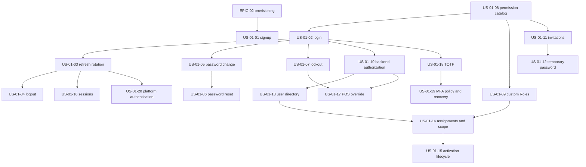

# EPIC-01: Identity & Access

**Specification:** [SPEC-01 Identity & Access Management](../../specs/SPEC-01-IDENTITY-ACCESS.md) · **Related BRQs:** BRQ-01, BRQ-02, BRQ-12, BRQ-13

## Epic Goal

Provide secure identity, authentication, sessions, role and permission evaluation, user lifecycle, and POS manager re-authentication for Organization users and platform administrators.

## Scope

In scope: self-signup/bootstrap, email/password login, token rotation and reuse detection, logout, password policy and reset, lockout, permission catalog and system/custom Roles, backend permission/Branch/Organization enforcement, invitations, user activation/deactivation, session management, POS override re-authentication, MFA and platform-administrator authentication. PostgreSQL RLS is enabled and forced from MVP. MFA and platform-administrator authentication are V1 and are marked outside the initial MVP.

## Story List

| Story | Title | Priority | Complexity | Requirements | MVP |
|---|---|---|---|---|---|
| [US-01-01](US-01-01-organization-self-signup.md) | Organization self-signup and Owner verification | P1 | M | FR-01-001, FR-01-002, FR-01-012, FR-01-018, FR-01-040 | No (RELEASE-PLAN §3 override) |
| [US-01-02](US-01-02-login-with-email-and-password.md) | Login with email and password | P0 | M | FR-01-003, FR-01-004, FR-01-005, FR-01-006 | Yes |
| [US-01-03](US-01-03-refresh-token-rotation-and-reuse-detection.md) | Refresh-token rotation and reuse detection | P0 | M | FR-01-007, FR-01-008, FR-01-009, FR-01-040 | Yes |
| [US-01-04](US-01-04-logout-and-logout-all-devices.md) | Logout and logout all devices | P0 | S | FR-01-010, FR-01-011 | Yes |
| [US-01-05](US-01-05-password-policy-and-change-own-password.md) | Password policy and change own password | P0 | M | FR-01-012, FR-01-013, FR-01-040 | Yes |
| [US-01-06](US-01-06-forgot-and-reset-password.md) | Forgot and reset password | P0 | M | FR-01-012, FR-01-014, FR-01-015, FR-01-018, FR-01-040 | Yes |
| [US-01-07](US-01-07-account-lockout-and-login-history.md) | Account lockout and login history | P0 | M | FR-01-016, FR-01-017, FR-01-018, FR-01-040 | Yes |
| [US-01-08](US-01-08-permission-catalog-and-system-roles.md) | Permission catalog and system Roles | P0 | S | FR-01-019, FR-01-020 | Yes |
| [US-01-09](US-01-09-manage-custom-roles.md) | Manage custom Roles | P1 | M | FR-01-021, FR-01-022, FR-01-025, FR-01-040 | No (RELEASE-PLAN §3 override) |
| [US-01-10](US-01-10-backend-authorization-enforcement.md) | Backend authorization enforcement | P0 | M | FR-01-023, FR-01-024, FR-01-025 | Yes |
| [US-01-11](US-01-11-invite-user-and-accept-invitation.md) | Invite user and accept invitation | P0 | M | FR-01-012, FR-01-018, FR-01-026, FR-01-027, FR-01-040 | Yes |
| [US-01-12](US-01-12-temporary-password-and-admin-reset.md) | Temporary password and admin reset | P1 | S | FR-01-028, FR-01-029, FR-01-040 | Yes |
| [US-01-13](US-01-13-user-directory-and-profile.md) | View and update users in management scope | P0 | M | FR-01-030, FR-01-032 | Yes |
| [US-01-14](US-01-14-manage-user-roles-and-branch-scope.md) | Manage user Roles and Branch scope | P0 | M | FR-01-022, FR-01-025, FR-01-031, FR-01-032, FR-01-033, FR-01-040 | Yes |
| [US-01-15](US-01-15-activate-and-deactivate-users.md) | Activate and deactivate users | P0 | M | FR-01-011, FR-01-032, FR-01-033, FR-01-034, FR-01-040 | Yes |
| [US-01-16](US-01-16-manage-user-sessions.md) | Manage own and in-scope user sessions | P1 | M | FR-01-006, FR-01-011, FR-01-035, FR-01-036, FR-01-040 | Yes |
| [US-01-17](US-01-17-pos-manager-override-reauthentication.md) | Re-authenticate a manager for a POS override | P0 | M | FR-01-037, FR-01-038, FR-01-039, FR-01-040 | Yes |
| [US-01-18](US-01-18-enroll-and-authenticate-with-totp.md) | Enroll and authenticate with TOTP | P2 | L | FR-01-041, FR-01-042 | No |
| [US-01-19](US-01-19-enforce-and-administer-mfa.md) | Enforce and administer MFA | P2 | M | FR-01-040, FR-01-043, FR-01-044 | No |
| [US-01-20](US-01-20-platform-administrator-authentication.md) | Authenticate platform administrators separately | P1 | M | FR-01-045 | No |

## MVP Marking

MVP includes signup/bootstrap, organization-user authentication and token lifecycle, password lifecycle, lockout, Roles/permissions, backend authorization, invitations, user lifecycle, sessions, and POS manager override. TOTP MFA and platform-administrator authentication are V1; platform authentication must be available before onboarding a second Organization.

## Dependency Diagram

## Critical Scenario Coverage

| Scenario | Covered by |
|---|---|
| CS-07: user assigned to Branch A calls Branch B and receives 403 | US-01-10, US-01-13, US-01-14, US-01-17 |
| CS-08: cross-Organization resource returns 404 without data leakage | US-01-10, US-01-13, US-01-14, US-01-15, US-01-16, US-01-17, US-01-19 |
| CS-12: rotated refresh-token reuse revokes the entire family | US-01-03 |

## Totals

20 stories · 45 functional requirements (FR-01-001–FR-01-045) · Existing scenarios TS-01-001–TS-01-063; new scenarios TS-01-064–TS-01-095.
