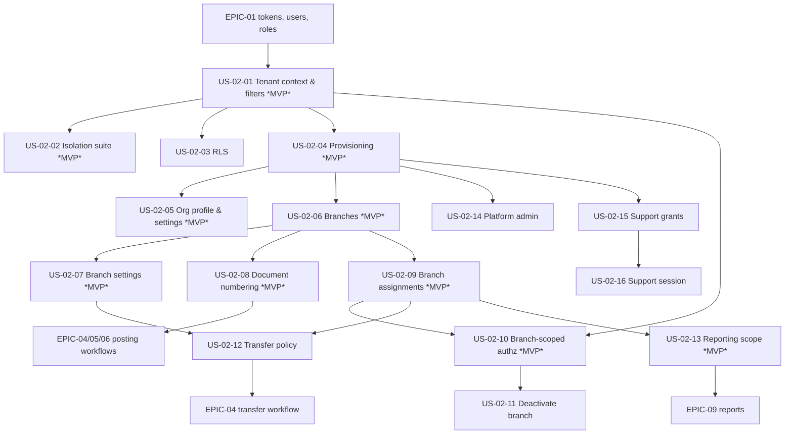

# EPIC-02: Organization & Branch Management

**Specification:** [SPEC-02](../../specs/SPEC-02-ORGANIZATION-BRANCHES.md) · **Related BRQs:** BRQ-01, BRQ-02, BRQ-04, BRQ-10, BRQ-12, BRQ-15

## Epic Goal
Represent pharmacy organizations and their branches, keep each organization's data strictly isolated, confine every user to their assigned branches, and provide the branch settings, document numbering, and organization policies (transfers, reporting scope, support access) that all other modules consume.

## Scope
- Tenant isolation: organization context from token, global query filters, write stamping, RLS, cross-organization 404, isolation test suite (CS-08).
- Organization provisioning (platform API and bootstrap command), organization profile and settings.
- Branch create/update/deactivate/reactivate, branch settings, document numbering sequences.
- User branch scope and assignments; branch-scoped authorization (CS-07) and branch inventory ownership.
- Stock transfer route/approval policy (workflow in EPIC-04) and reporting scope policy (reports in EPIC-09).
- Platform administration (list, suspend, reactivate) and Owner-granted read-only support sessions.

Out of scope: see SPEC-02 §4.

## Story List

| Story | Title | Priority | Complexity | Requirements | MVP |
|---|---|---|---|---|---|
| [US-02-01](US-02-01-tenant-context-and-query-filters.md) | Tenant context resolution and global query filters | P0 | M | FR-02-001, FR-02-002, FR-02-003, FR-02-004, FR-02-005 | Yes |
| [US-02-02](US-02-02-cross-organization-isolation-test-suite.md) | Cross-organization isolation test suite | P0 | M | FR-02-004, FR-02-006 | Yes |
| [US-02-03](US-02-03-postgresql-row-level-security.md) | PostgreSQL Row-Level Security defense in depth | P0 | M | FR-02-007 | Yes (ADR-002 amended 2026-11-10; OD-02-08 resolved) |
| [US-02-04](US-02-04-provision-organization.md) | Provision an organization | P0 | M | FR-02-008, FR-02-009, FR-02-010 | Yes |
| [US-02-05](US-02-05-organization-profile-and-settings.md) | View and update organization profile and settings | P1 | S | FR-02-011, FR-02-012 | Yes |
| [US-02-06](US-02-06-create-and-update-branches.md) | Create and update branches | P0 | M | FR-02-013, FR-02-014, FR-02-015, FR-02-016 | Yes |
| [US-02-07](US-02-07-branch-settings.md) | Configure branch settings | P0 | M | FR-02-020, FR-02-021 | Yes |
| [US-02-08](US-02-08-document-numbering-sequences.md) | Gapless document numbering sequences | P0 | M | FR-02-014, FR-02-022, FR-02-023, FR-02-024, FR-02-025 | Yes |
| [US-02-09](US-02-09-user-branch-assignments.md) | Manage user branch scope and assignments | P0 | M | FR-02-016, FR-02-026, FR-02-027, FR-02-028 | Yes |
| [US-02-10](US-02-10-branch-scoped-authorization.md) | Enforce branch-scoped authorization and branch inventory ownership | P0 | S | FR-02-029, FR-02-030 | Yes |
| [US-02-11](US-02-11-deactivate-and-reactivate-branch.md) | Deactivate and reactivate a branch | P1 | M | FR-02-017, FR-02-018, FR-02-019 | No |
| [US-02-12](US-02-12-stock-transfer-policy.md) | Stock transfer route and approval policy | P1 | S | FR-02-012, FR-02-031, FR-02-032 | No |
| [US-02-13](US-02-13-organization-reporting-scope.md) | Organization-level reporting scope | P1 | S | FR-02-033 | Yes |
| [US-02-14](US-02-14-platform-organization-administration.md) | Platform administration of organizations | P1 | M | FR-02-034, FR-02-035 | No |
| [US-02-15](US-02-15-manage-support-access-grants.md) | Owner manages support access grants | P1 | S | FR-02-036, FR-02-037 | No |
| [US-02-16](US-02-16-support-session-read-only-access.md) | Platform administrator read-only support session | P1 | M | FR-02-037, FR-02-038, FR-02-039, FR-02-040 | No |

**MVP marking:** 11 of 16 stories are MVP (single organization, 1–2 branches). The multi-organization data model and isolation enforcement (US-02-01, US-02-02) are MVP even though only one organization is deployed; the MVP organization is created with the bootstrap command of US-02-04. RLS (US-02-03) is enabled from Phase 0 and is part of the MVP (OD-02-08 resolved 2026-11-10, ADR-002 amended).

## Dependency Diagram

## Critical Scenario Coverage

| CS | Test scenarios |
|---|---|
| CS-07 Unauthorized cross-branch access → 403 | TS-02-053, TS-02-057, TS-02-071 |
| CS-08 Unauthorized cross-organization access → 404, no data leaked | TS-02-003, TS-02-009, TS-02-010, TS-02-011, TS-02-015, TS-02-036, TS-02-052, TS-02-054, TS-02-071, TS-02-075, TS-02-088 |

## Totals
- Stories: 16 (10 MVP) · Acceptance criteria: 106 · Test scenarios: TS-02-001 … TS-02-088
