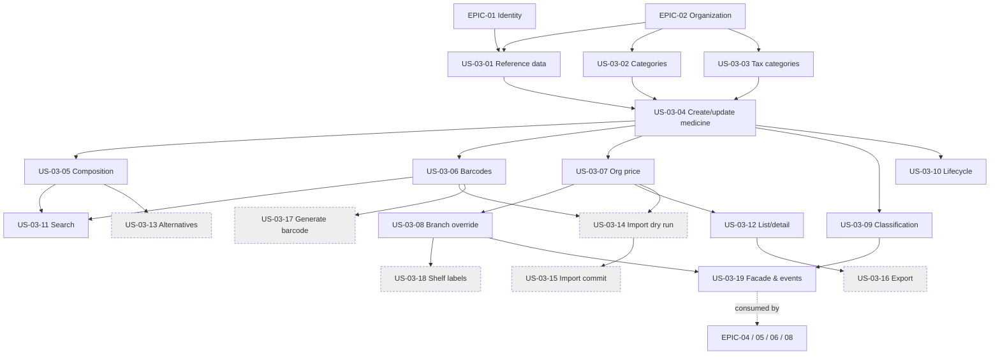

# EPIC-03: Medicine Catalog

**Specification:** [SPEC-03 Medicine Catalog](../../specs/SPEC-03-MEDICINE-CATALOG.md) · **Related BRQs:** BRQ-01, BRQ-02, BRQ-03, BRQ-07, BRQ-09, BRQ-10, BRQ-11, BRQ-12, BRQ-13, BRQ-15

## Epic Goal

Give each organization one accurate, bilingual, searchable medicine catalog — with reference data, composition, pack data, barcodes, prices (organization default + branch override with history), prescription classification, alternatives, and bulk import/export — that SPEC-04 (inventory), SPEC-05 (procurement), SPEC-06 (POS), and SPEC-08 (prescriptions) consume through a stable facade.

## Scope

In scope: everything in SPEC-03 §3. Out of scope: SPEC-03 §4 (batches, stock, expiry, supplier item codes, discounts, interaction data, national registries).

## MVP Marking

MVP: reference data, medicine create/update, ingredient composition, barcode management and GTIN validation, pack/base-unit and split-pack fields, prescription classification, organization and branch pricing with history, Arabic-normalized search at NFR-G-01, list/detail, medicine lifecycle, and the catalog facade/events.

V1: alternatives and import/export. Future: internal barcode generation and shelf labels. No official national drug database is assumed; external catalog sources require licensing approval under REG-09.

## Story List

| Story | Title | Priority | Complexity | Requirements | MVP |
|---|---|---|---|---|---|
| [US-03-01](US-03-01-manage-manufacturers-ingredients-dosage-forms.md) | Manage manufacturers, active ingredients, and dosage forms | P0 | M | FR-03-001, FR-03-002, FR-03-003, FR-03-004, FR-03-045 | Yes |
| [US-03-02](US-03-02-manage-hierarchical-categories.md) | Manage hierarchical medicine categories | P0 | S | FR-03-004, FR-03-005, FR-03-030, FR-03-045 | Yes |
| [US-03-03](US-03-03-manage-tax-categories.md) | Manage tax categories | P0 | S | FR-03-006, FR-03-044, FR-03-045 | Yes |
| [US-03-04](US-03-04-create-and-update-medicine.md) | Create and update a medicine | P0 | M | FR-03-007, FR-03-008, FR-03-009, FR-03-010, FR-03-011, FR-03-012, FR-03-018, FR-03-024, FR-03-045 | Yes |
| [US-03-05](US-03-05-define-active-ingredient-composition.md) | Define active-ingredient composition and strength | P0 | S | FR-03-013, FR-03-045 | Yes |
| [US-03-06](US-03-06-manage-medicine-barcodes.md) | Manage medicine barcodes and barcode lookup | P0 | M | FR-03-014, FR-03-015, FR-03-016, FR-03-017, FR-03-044, FR-03-045 | Yes |
| [US-03-07](US-03-07-manage-organization-selling-price.md) | Manage organization selling price with history | P0 | M | FR-03-018, FR-03-019, FR-03-020, FR-03-021, FR-03-044, FR-03-045 | Yes |
| [US-03-08](US-03-08-branch-price-override.md) | Branch price override and effective price | P1 | S | FR-03-021, FR-03-022, FR-03-023, FR-03-044, FR-03-045 | Yes |
| [US-03-09](US-03-09-set-prescription-classification.md) | Set and change prescription classification | P0 | S | FR-03-024, FR-03-025, FR-03-044, FR-03-045 | Yes |
| [US-03-10](US-03-10-deactivate-reactivate-delete-medicine.md) | Deactivate, reactivate, and delete a medicine | P0 | S | FR-03-026, FR-03-044, FR-03-045 | Yes |
| [US-03-11](US-03-11-search-medicines.md) | Search medicines in Arabic and English | P0 | L | FR-03-017, FR-03-027, FR-03-028, FR-03-029, FR-03-045 | Yes |
| [US-03-12](US-03-12-list-and-view-medicines.md) | List, filter, and view medicine details | P0 | M | FR-03-030, FR-03-031, FR-03-045 | Yes |
| [US-03-13](US-03-13-manage-alternative-medicines.md) | Manage alternative medicines and suggestions | P1 | M | FR-03-032, FR-03-033, FR-03-045 | No |
| [US-03-14](US-03-14-import-medicines-dry-run.md) | Import medicines: template and dry-run validation | P1 | L | FR-03-034, FR-03-035, FR-03-036, FR-03-045 | No |
| [US-03-15](US-03-15-import-medicines-commit.md) | Import medicines: idempotent commit | P1 | M | FR-03-036, FR-03-037, FR-03-044, FR-03-045 | No |
| [US-03-16](US-03-16-export-medicines.md) | Export medicines | P1 | S | FR-03-038, FR-03-045 | No |
| [US-03-17](US-03-17-generate-internal-barcode.md) | Generate internal barcode | P2 | S | FR-03-039, FR-03-045 | No |
| [US-03-18](US-03-18-print-shelf-labels.md) | Print shelf labels | P2 | M | FR-03-040, FR-03-045 | No |
| [US-03-19](US-03-19-catalog-facade-and-integration-events.md) | Catalog facade, effective sale info, and integration events | P0 | M | FR-03-011, FR-03-023, FR-03-041, FR-03-042, FR-03-043, FR-03-045 | Yes |

## Dependency Diagram

Dashed-border nodes are post-MVP: US-03-13–US-03-16 are V1; US-03-17–US-03-18 are Future.

## Totals

19 stories · 45 FRs (FR-03-001 … FR-03-045) · Existing scenarios TS-03-001–TS-03-049; new scenarios TS-03-050–TS-03-101.

## Cross-cutting Scenarios Covered

| CS | Covered by |
|---|---|
| CS-07 (cross-branch → 403) | US-03-08, US-03-11, US-03-18, US-03-19 |
| CS-08 (cross-organization → 404) | Every story (FR-03-045) |
| CS-11 (idempotent retry) | US-03-15 |
