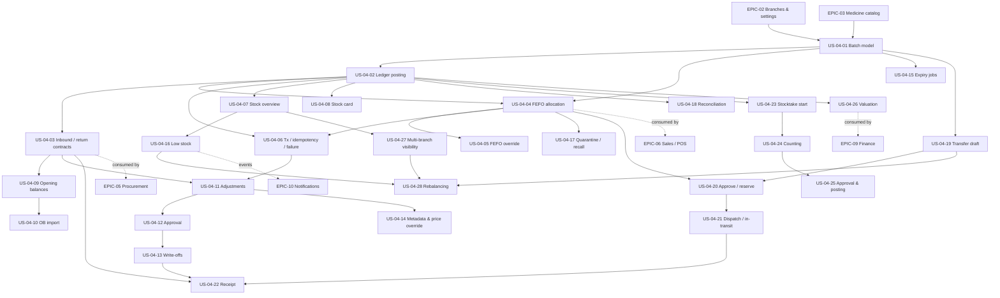

# EPIC-04: Batch & Inventory Management

**Specification:** [SPEC-04](../../specs/SPEC-04-BATCH-INVENTORY.md) · **Related ADRs:** ADR-003, ADR-004, ADR-007 · **Related BRQs:** BRQ-04, BRQ-05, BRQ-10, BRQ-11, BRQ-12, BRQ-14

## Epic Goal

Track every unit of medicine stock at batch level per branch with an immutable movement ledger, allocate stock by FEFO without ever overselling or selling expired/quarantined stock, and give branches controlled workflows for opening balances, adjustments, write-offs, counts, and transfers — all atomic, idempotent, auditable, and continuously reconciled.

## Scope

- Batch model, balances, append-only ledger, posting contracts used by SPEC-05/06/08.
- FEFO allocation (allocate-and-lock, preview, override) and expiry/do-not-sell enforcement.
- Opening balances (manual + import, lock), stock adjustments with approval, damaged/expired write-offs.
- Stock overview, batch detail, stock card, valuation data for SPEC-09.
- Nightly expiry flagging, near-expiry detection, low-stock detection, reconciliation.
- Quarantine/recall, batch metadata correction and selling price override.
- Stock transfers (request → approve/reserve → dispatch → receive with short/rejected handling).
- Stocktakes (full/cycle, blind, snapshot, variance, approval).
- Multi-branch visibility (P1) and rebalancing suggestions (P3).

Out of scope: see SPEC-04 §4.

## MVP Marking

MVP (single organization, 1–2 branches) = batch inventory with FEFO, adjustments, expiry blocking, opening balances, stock views, write-offs, reconciliation, valuation data for core reports, and batch corrections needed at go-live. Transfers, stocktakes, quarantine/recall, low-stock alerts, and multi-branch features are post-MVP (P1/P3): MVP organizations have at most two branches, can correct counts with adjustments, and can move stock between two branches with a paired adjustment if needed before transfers are delivered.

## Story List

| Story | Title | Priority | Complexity | Requirements | MVP |
|---|---|---|---|---|---|
| [US-04-01](US-04-01-batch-model-and-batch-views.md) | Batch model, status derivation, and batch views | P0 | M | FR-04-001, FR-04-002, FR-04-003, FR-04-004, FR-04-005 | Yes |
| [US-04-02](US-04-02-stock-movement-ledger-posting.md) | Stock movement ledger and posting service | P0 | L | FR-04-002, FR-04-006, FR-04-007, FR-04-008, FR-04-009, FR-04-010, FR-04-011 | Yes |
| [US-04-03](US-04-03-inbound-and-return-to-batch-contracts.md) | Inbound find-or-create and return-to-batch contracts | P0 | M | FR-04-001, FR-04-012, FR-04-013, FR-04-014, FR-04-015 | Yes |
| [US-04-04](US-04-04-fefo-allocation-service.md) | FEFO allocation service | P0 | L | FR-04-016, FR-04-017, FR-04-018, FR-04-019, FR-04-020, FR-04-021, FR-04-022, FR-04-023, FR-04-042 | Yes |
| [US-04-05](US-04-05-fefo-override.md) | FEFO override with permission | P1 | S | FR-04-024 | Yes |
| [US-04-06](US-04-06-posting-transactions-idempotency-and-failure.md) | Posting transactions, idempotency, and failure guarantees | P0 | M | FR-04-008, FR-04-011, FR-04-019, FR-04-025, FR-04-026, FR-04-027, FR-04-028 | Yes |
| [US-04-07](US-04-07-branch-stock-overview.md) | Branch stock overview | P0 | M | FR-04-005, FR-04-029, FR-04-030, FR-04-054 | Yes |
| [US-04-08](US-04-08-stock-card-and-movement-history.md) | Stock card and movement history | P0 | M | FR-04-030, FR-04-031 | Yes |
| [US-04-09](US-04-09-opening-balance-documents.md) | Opening balance documents and lock | P0 | M | FR-04-015, FR-04-032, FR-04-033 | Yes |
| [US-04-10](US-04-10-opening-balance-file-import.md) | Opening balance file import | P0 | M | FR-04-034 | Yes |
| [US-04-11](US-04-11-stock-adjustments.md) | Stock adjustments with reason codes | P0 | M | FR-04-028, FR-04-035, FR-04-036, FR-04-038 | Yes |
| [US-04-12](US-04-12-adjustment-and-write-off-approval.md) | Adjustment and write-off approval | P0 | S | FR-04-037 | Yes |
| [US-04-13](US-04-13-damaged-and-expired-write-offs.md) | Damaged and expired write-offs | P0 | M | FR-04-039, FR-04-040 | Yes |
| [US-04-14](US-04-14-batch-metadata-correction-and-price-override.md) | Batch metadata correction and selling price override | P1 | S | FR-04-038, FR-04-041, FR-04-042 | Yes |
| [US-04-15](US-04-15-expiry-flagging-and-near-expiry-detection.md) | Nightly expiry flagging and near-expiry detection | P0 | M | FR-04-003, FR-04-023, FR-04-043, FR-04-044 | Yes |
| [US-04-16](US-04-16-reorder-settings-and-low-stock-detection.md) | Reorder settings and low-stock detection | P1 | M | FR-04-045, FR-04-046 | Yes (RELEASE-PLAN §3 override) |
| [US-04-17](US-04-17-batch-quarantine-and-recall.md) | Batch quarantine, release, and recall | P1 | M | FR-04-028, FR-04-047, FR-04-048 | No |
| [US-04-18](US-04-18-ledger-balance-reconciliation.md) | Ledger ↔ balance reconciliation job | P0 | M | FR-04-049, FR-04-050, FR-04-057 | Yes |
| [US-04-19](US-04-19-transfer-drafting-and-submission.md) | Transfer drafting, submission, and cancellation | P1 | M | FR-04-051 | No |
| [US-04-20](US-04-20-transfer-approval-and-reservation.md) | Transfer approval with reservation, rejection | P1 | M | FR-04-052 | No |
| [US-04-21](US-04-21-transfer-dispatch-and-in-transit.md) | Transfer dispatch and in-transit visibility | P1 | M | FR-04-053, FR-04-054 | No |
| [US-04-22](US-04-22-transfer-receipt.md) | Transfer receipt with short, over, and rejected quantities | P1 | L | FR-04-055, FR-04-056, FR-04-057 | No |
| [US-04-23](US-04-23-stocktake-creation-and-start.md) | Stocktake creation and start with snapshot | P1 | M | FR-04-058, FR-04-059 | No |
| [US-04-24](US-04-24-stocktake-blind-counting-and-submission.md) | Stocktake blind counting and submission | P1 | M | FR-04-060 | No |
| [US-04-25](US-04-25-stocktake-approval-and-variance-posting.md) | Stocktake review, recount, approval, and variance posting | P1 | L | FR-04-061 | No |
| [US-04-26](US-04-26-inventory-valuation-data.md) | Inventory valuation snapshot and as-of valuation | P1 | M | FR-04-062 | Yes |
| [US-04-27](US-04-27-multi-branch-stock-visibility.md) | Multi-branch stock visibility | P1 | S | FR-04-063 | No |
| [US-04-28](US-04-28-rebalancing-suggestions.md) | Multi-branch rebalancing suggestions | P3 | M | FR-04-064 | No |

MVP stories: 18 of 28.

## Dependency Diagram

## Critical Scenario Coverage

| CS | Test scenarios |
|---|---|
| CS-01 (with EPIC-06) | TS-04-026, TS-04-027 |
| CS-02 | TS-04-023, TS-04-024, TS-04-036, TS-04-109 |
| CS-06 | TS-04-049, TS-04-148, TS-04-153, TS-04-158 |
| CS-07 / CS-08 | Every story with an endpoint (e.g., TS-04-006, TS-04-136, TS-04-188, TS-04-189) |
| CS-10 | TS-04-039, TS-04-040, TS-04-066, TS-04-151, TS-04-179 |
| CS-11 | TS-04-041, TS-04-042, TS-04-043, TS-04-067, TS-04-144, TS-04-150, TS-04-159, TS-04-179 |

## New Identifiers Introduced by this Epic

- Permissions: `inventory.batches.quarantine`, `inventory.opening-balances.manage`, `inventory.reorder-settings.manage`, `inventory.stock.read-other-branches`, `inventory.reconciliation.read`.
- Entities: `ReconciliationFinding`, `InventoryValuationSnapshot`, `RebalancingSuggestion` (P3); fields `StockMovement.BatchSequence`, `BatchBalance.LastMovementSequence`, `Batch.SellingPriceOverride`, `Batch.QuarantinedAt/QuarantineReason/RecallReference`, `StockAdjustment.Kind`.
- Settings: `BranchSettings.AdjustmentApprovalThresholdAmount`, `BranchSettings.OpeningBalanceLocked`.
- Error codes: see SPEC-04 §12.
- Jobs: `inventory.valuation-snapshot` (00:30 branch local) and `inventory.rebalancing-suggestions` (nightly, P3), in addition to `inventory.expiry-flagging`, `inventory.near-expiry-scan`, `inventory.low-stock-scan`, and `inventory.reconciliation` defined in SYSTEM-ARCHITECTURE.
- Test scenarios: TS-04-001 to TS-04-193.
