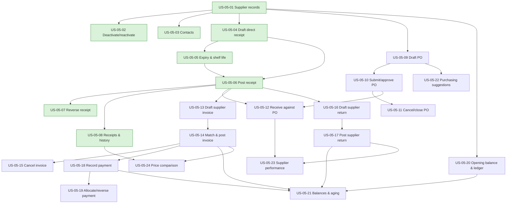

# EPIC-05: Suppliers & Procurement

**Specification:** [SPEC-05 Suppliers & Procurement](../../specs/SPEC-05-SUPPLIERS-PROCUREMENT.md) · **Related BRQs:** BRQ-04, BRQ-05, BRQ-06, BRQ-10, BRQ-12

## Epic Goal

Give an organization a controlled procure-to-pay cycle: maintain suppliers, bring purchased stock into a branch as traceable batches (with or without a purchase order, including Egyptian-style bonus quantities), match supplier invoices, return stock to suppliers, pay suppliers, and know exactly how much is owed to each supplier and for how long.

## Scope

- Supplier master data and contacts (org-level).
- Direct goods receipts (MVP) and receipts against purchase orders, posted atomically through the SPEC-04 Inventory contract with batch merge rules, shelf-life checks, idempotency, and whole-receipt reversal.
- Purchase orders with approval threshold, segregation of duties, credit-limit check, partial receiving, over-receipt tolerance (CS-03).
- Supplier invoices with 2-way / 3-way matching and variance approval.
- Supplier returns with FEFO / chosen batch, reservations, and debit notes.
- Supplier payments with allocations and reversals; supplier ledger, opening balances, balances and aging.
- Future: automated purchasing suggestions, supplier performance, and supplier price comparison.

Out of scope: see SPEC-05 §4.

## MVP Marking

MVP includes supplier records and contacts; direct goods receipt draft creation, batch/expiry and shelf-life validation, posting, reversal, and receipt history. Purchase orders (including partial receiving), supplier invoices and matching, supplier returns, supplier payments, supplier ledger, and aging are V1. Supplier performance, price comparison, and automated purchasing suggestions are Future.

## Story List

| Story | Title | Priority | Complexity | Requirements | MVP |
|---|---|---|---|---|---|
| [US-05-01](US-05-01-manage-supplier-records.md) | Manage supplier records | P0 | M | FR-05-001, FR-05-002, FR-05-003, FR-05-004, FR-05-055 | Yes |
| [US-05-02](US-05-02-deactivate-reactivate-supplier.md) | Deactivate and reactivate a supplier | P1 | S | FR-05-005, FR-05-006, FR-05-055 | Yes |
| [US-05-03](US-05-03-manage-supplier-contacts.md) | Manage supplier contacts | P1 | S | FR-05-007 | Yes |
| [US-05-04](US-05-04-create-draft-direct-goods-receipt.md) | Create a draft direct goods receipt | P0 | M | FR-05-008, FR-05-009, FR-05-010, FR-05-011, FR-05-012 | Yes |
| [US-05-05](US-05-05-validate-batch-expiry-and-shelf-life.md) | Validate batch expiry and shelf life on receipt | P0 | S | FR-05-013, FR-05-014, FR-05-015 | Yes |
| [US-05-06](US-05-06-post-goods-receipt-to-inventory.md) | Post a goods receipt to inventory | P0 | L | FR-05-016, FR-05-017, FR-05-018, FR-05-019, FR-05-020, FR-05-021, FR-05-022, FR-05-055 | Yes |
| [US-05-07](US-05-07-reverse-posted-goods-receipt.md) | Reverse a posted goods receipt | P1 | M | FR-05-023, FR-05-035, FR-05-055 | Yes |
| [US-05-08](US-05-08-view-goods-receipts-and-purchase-history.md) | View goods receipts and purchase history | P1 | S | FR-05-024, FR-05-025 | Yes |
| [US-05-09](US-05-09-create-draft-purchase-order.md) | Create and edit a draft purchase order | P1 | M | FR-05-026 | No |
| [US-05-10](US-05-10-submit-and-approve-purchase-order.md) | Submit, approve, and reject a purchase order | P1 | M | FR-05-027, FR-05-028, FR-05-029, FR-05-030, FR-05-055 | No |
| [US-05-11](US-05-11-cancel-and-close-purchase-order.md) | Cancel and close a purchase order | P1 | S | FR-05-031, FR-05-032 | No |
| [US-05-12](US-05-12-receive-goods-against-purchase-order.md) | Receive goods against a purchase order | P1 | M | FR-05-033, FR-05-034, FR-05-035 | No |
| [US-05-13](US-05-13-draft-supplier-invoice-from-receipts.md) | Draft a supplier invoice from receipts | P1 | M | FR-05-036, FR-05-037, FR-05-038 | No |
| [US-05-14](US-05-14-match-and-post-supplier-invoice.md) | Match and post a supplier invoice | P1 | M | FR-05-039, FR-05-040, FR-05-055 | No |
| [US-05-15](US-05-15-cancel-supplier-invoice.md) | Cancel a supplier invoice | P1 | S | FR-05-041 | No |
| [US-05-16](US-05-16-draft-supplier-return-with-reservation.md) | Draft a supplier return with batch reservation | P1 | M | FR-05-042, FR-05-043 | No |
| [US-05-17](US-05-17-post-supplier-return-and-debit-note.md) | Post a supplier return and debit note | P1 | M | FR-05-044, FR-05-055 | No |
| [US-05-18](US-05-18-record-supplier-payment.md) | Record a supplier payment with allocations | P1 | M | FR-05-045, FR-05-046, FR-05-055 | No |
| [US-05-19](US-05-19-allocate-credit-and-reverse-payment.md) | Allocate unapplied credit and reverse a payment | P1 | M | FR-05-047, FR-05-048, FR-05-055 | No |
| [US-05-20](US-05-20-supplier-opening-balance-and-ledger.md) | Supplier opening balance and ledger statement | P1 | M | FR-05-049, FR-05-050, FR-05-055 | No |
| [US-05-21](US-05-21-supplier-balances-and-aging.md) | Supplier balances and aging report | P1 | M | FR-05-051 | No |
| [US-05-22](US-05-22-purchasing-suggestions.md) | Purchasing suggestions from reorder levels | P2 | M | FR-05-052 | No |
| [US-05-23](US-05-23-supplier-performance-metrics.md) | Supplier performance metrics | P2 | M | FR-05-053 | No |
| [US-05-24](US-05-24-supplier-price-comparison.md) | Supplier price comparison | P2 | S | FR-05-054 | No |

Totals: 24 stories (8 MVP), 55 functional requirements, and 104 test scenarios (TS-05-001 … TS-05-104).

## Critical Scenario Coverage

| CS | Covered by |
|---|---|
| CS-03 Partial receiving against a PO, then remainder | US-05-12 (TS-05-053) |
| CS-07 Cross-branch access → 403 | Every branch-scoped story (e.g., TS-05-030, TS-05-060, TS-05-085, TS-05-090) |
| CS-08 Cross-organization access → 404 | US-05-01 (TS-05-005), US-05-06 (TS-05-030), US-05-17 (TS-05-085) and others |
| CS-10 Failure mid-posting → full rollback | US-05-06 (TS-05-029), US-05-17 (TS-05-083) |
| CS-11 Duplicate request with same Idempotency-Key | US-05-06 (TS-05-028), US-05-07 (TS-05-033), US-05-17 (TS-05-073), US-05-18 (TS-05-077) |

## Dependency Diagram

External dependencies: SPEC-01 (permissions), SPEC-02 (branches, business date, document sequences, settings), SPEC-03 (medicines), SPEC-04 (inventory receipt/reservation contracts, ReorderSetting), SPEC-10 (audit, notifications).

Green nodes are MVP stories.
