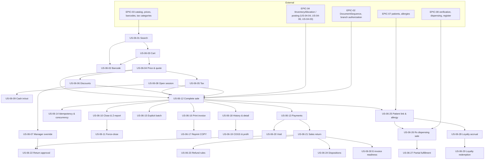

# EPIC-06: Sales & Point of Sale

**Specification:** [SPEC-06 Sales & POS](../../specs/SPEC-06-SALES-POS.md) · **Related BRQs:** BRQ-01, BRQ-05, BRQ-07, BRQ-09, BRQ-10, BRQ-12, BRQ-13, BRQ-15

## Epic Goal

Let cashiers and pharmacists sell medicines quickly and safely at the counter: find or scan the medicine, build the cart in packs or base units, apply controlled discounts and configured taxes, take cash/card/split payments, and complete each sale as one atomic, idempotent operation that deducts stock FEFO through `IInventoryAllocation`, records money in the cashier's cash session, and issues a gapless sales invoice. Corrections happen only through restricted voids or sales returns with inspected dispositions, and prescription-only and controlled medicines are sold only against verified prescriptions.

## Scope

- In: POS search and barcode scanning, client-side (Zustand) cart, price resolution (batch override → branch override → organization price), quote, discounts with role limits and manager override, taxes (inclusive/exclusive; rates pending REG-06), Cash/Card/split payments, atomic sale completion, idempotency and concurrency safety, 80 mm / A4 invoices in Arabic/English with COPY reprints, sales history, COGS and gross profit, voids, returns with approval, refund method rules and dispositions, patient link with allergy decision support, prescription dispensing with partial fulfillment, cash sessions (open, cash in/out, blind close, Z-report, force-close).
- P3 (not MVP): loyalty accrual/redemption (OD-06-08), e-invoice data readiness (REG-07).
- Out: offline POS (OD-06-01), card terminal / payment gateway integration (OD-06-04), mobile wallets (OD-06-03), cross-branch returns, cash rounding (OD-06-02).

## Critical Scenario Coverage

| CS | Test scenarios |
|---|---|
| CS-01 | TS-06-080, TS-06-081 |
| CS-02 | TS-06-067, TS-06-091, TS-06-145 |
| CS-05 | TS-06-123, TS-06-124, TS-06-125 |
| CS-09 | TS-06-076, TS-06-078 |
| CS-10 | TS-06-085, TS-06-121, TS-06-129, TS-06-155 |
| CS-11 | TS-06-082, TS-06-083, TS-06-118, TS-06-127, TS-06-132 |
| CS-13 | TS-06-156, TS-06-157, TS-06-158 |
| CS-07 / CS-08 | Security scenarios in every story with an endpoint |

## Story List

MVP column: "Yes (MVP)" marks stories in the MVP release (single organization, 1–2 branches).

| Story | Title | Priority | Complexity | Requirements | MVP |
|---|---|---|---|---|---|
| [US-06-01](US-06-01-pos-medicine-search.md) | POS Medicine Search | P0 | M | FR-06-001, FR-06-002, FR-06-003 | Yes (MVP) |
| [US-06-02](US-06-02-barcode-scanning.md) | Barcode Scanning and Unknown Barcode Handling | P0 | M | FR-06-004, FR-06-005, FR-06-006 | Yes (MVP) |
| [US-06-03](US-06-03-pos-cart-pack-and-unit-quantities.md) | POS Cart with Pack and Base-Unit Quantities | P0 | M | FR-06-007, FR-06-008, FR-06-009, FR-06-010 | Yes (MVP) |
| [US-06-04](US-06-04-price-resolution-and-quote.md) | Price Resolution and Server Quote | P0 | M | FR-06-011, FR-06-012 | Yes (MVP) |
| [US-06-05](US-06-05-tax-calculation.md) | Tax Calculation per Tax Category | P0 | S | FR-06-013, FR-06-014 | Yes (MVP) |
| [US-06-06](US-06-06-line-and-invoice-discounts.md) | Line and Invoice Discounts within Role Limits | P0 | M | FR-06-015, FR-06-016, FR-06-017 | Yes (MVP) |
| [US-06-07](US-06-07-manager-discount-override.md) | Manager Override at the POS | P0 | M | FR-06-017, FR-06-018, FR-06-019 | Yes (MVP) |
| [US-06-08](US-06-08-open-cash-session.md) | Open Cash Session with Opening Float | P0 | S | FR-06-020, FR-06-021 | Yes (MVP) |
| [US-06-09](US-06-09-cash-in-and-cash-out.md) | Cash In and Cash Out Movements | P1 | S | FR-06-022 | Yes (MVP) |
| [US-06-10](US-06-10-close-cash-session-and-z-report.md) | Close Cash Session with Blind Count and Z-Report | P0 | M | FR-06-023, FR-06-024, FR-06-025, FR-06-026 | Yes (MVP) |
| [US-06-11](US-06-11-force-close-cash-session.md) | Force-Close Another User's Cash Session | P1 | S | FR-06-027 | Yes (MVP) |
| [US-06-12](US-06-12-complete-sale-atomically.md) | Complete a Sale Atomically | P0 | L | FR-06-021, FR-06-028, FR-06-029, FR-06-030, FR-06-031, FR-06-032, FR-06-033 | Yes (MVP) |
| [US-06-13](US-06-13-cash-card-and-split-payments.md) | Cash, Card, and Split Payments with Change | P0 | M | FR-06-034, FR-06-035 | Yes (MVP) |
| [US-06-14](US-06-14-sale-idempotency-and-concurrency.md) | Sale Completion Idempotency, Concurrency, and Failure Safety | P0 | M | FR-06-036, FR-06-037 | Yes (MVP) |
| [US-06-15](US-06-15-explicit-batch-selection-at-pos.md) | Explicit Batch Selection at the POS (FEFO Override) | P2 | S | FR-06-038 | No |
| [US-06-16](US-06-16-print-sales-invoice-and-receipt.md) | Print Sales Invoice as 80 mm Receipt or A4 Invoice | P0 | M | FR-06-039 | Yes (MVP) |
| [US-06-17](US-06-17-reprint-with-copy-marking.md) | Reprint Sales Invoice with COPY Marking | P1 | S | FR-06-040 | Yes (MVP) |
| [US-06-18](US-06-18-sales-history-and-detail.md) | Sales History Search and Sale Detail | P1 | M | FR-06-041, FR-06-042 | Yes (MVP) |
| [US-06-19](US-06-19-line-cogs-and-gross-profit.md) | Line COGS and Gross Profit | P1 | S | FR-06-043 | Yes (MVP) |
| [US-06-20](US-06-20-void-sale.md) | Void a Sale | P1 | M | FR-06-044, FR-06-045 | Yes (MVP) |
| [US-06-21](US-06-21-create-sales-return.md) | Create a Sales Return with Refund | P0 | L | FR-06-046, FR-06-047, FR-06-048, FR-06-050, FR-06-053 | Yes (MVP) |
| [US-06-22](US-06-22-return-approval.md) | Return Approval Above Threshold or Outside Window | P1 | M | FR-06-047, FR-06-049 | Yes (MVP) |
| [US-06-23](US-06-23-refund-method-rules.md) | Refund Method Rules and Cash-in-Drawer Limit | P0 | M | FR-06-050, FR-06-051, FR-06-052 | Yes (MVP) |
| [US-06-24](US-06-24-return-disposition-inspection.md) | Return Disposition Inspection (Restock or Discard) | P0 | M | FR-06-053, FR-06-054, FR-06-055 | Yes (MVP) |
| [US-06-25](US-06-25-link-patient-and-allergy-check.md) | Link a Patient to a Sale with Allergy Decision Support | P1 | M | FR-06-056, FR-06-057 | Yes (MVP) |
| [US-06-26](US-06-26-prescription-dispensing-sale.md) | Prescription-Linked Sale with Rx-Only and Controlled Enforcement | P0 | L | FR-06-058, FR-06-059, FR-06-060, FR-06-061 | Yes (MVP) |
| [US-06-27](US-06-27-partial-prescription-fulfillment.md) | Partial Prescription Fulfillment at the POS | P0 | S | FR-06-061, FR-06-062 | Yes (MVP) |
| [US-06-28](US-06-28-loyalty-points-accrual.md) | Loyalty Points Accrual | P3 | M | FR-06-063 | No |
| [US-06-29](US-06-29-loyalty-points-redemption.md) | Loyalty Points Redemption as Payment | P3 | M | FR-06-064 | No |
| [US-06-30](US-06-30-e-invoice-data-readiness.md) | Electronic Invoice / Receipt Data Readiness | P3 | S | FR-06-065 | No |

Totals: 30 stories (26 in MVP), 65 functional requirements.

## Dependency Diagram

## Suggested Implementation Order (MVP)

1. US-06-08, US-06-01, US-06-03, US-06-04, US-06-05 → 2. US-06-12, US-06-13, US-06-14 (hard gates CS-01/09/10/11) → 3. US-06-02, US-06-06, US-06-07, US-06-16, US-06-10 → 4. US-06-21, US-06-23, US-06-24, US-06-22 → 5. US-06-25, US-06-26, US-06-27 → 6. US-06-09, US-06-11, US-06-17, US-06-18, US-06-19, US-06-20.

## Key Risks

- Card approved on the standalone terminal but sale rejected by the server (stock or price) requires a manual terminal reversal; mitigated by quote-before-pay and POS instruction (CS-09).
- Branch-wide `DocumentSequence` lock serializes the final step of all sales in a branch; mitigated by taking it last (NFR-06-003 load test).
- Client/server pricing drift; mitigated by shared golden vectors (NFR-06-008).
- Unconfirmed tax, prescription, controlled-medicine, returns, and e-invoice rules (REG-01, REG-02, REG-06, REG-07, REG-11) are configuration-driven, not hard-coded.
