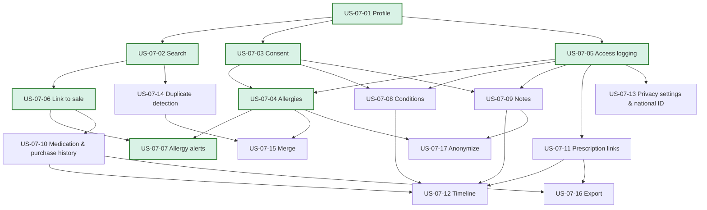

# EPIC-07: Patients & Medical Records

**Specification:** [SPEC-07 Patients & Medical Records](../../specs/SPEC-07-PATIENT-RECORDS.md) · **BRQs:** BRQ-08 (primary), BRQ-07, BRQ-09, BRQ-12, BRQ-15

## Epic Goal
Give pharmacists an organization-level patient record — minimal demographics, consent, allergies, conditions, notes, and derived history — with privacy by design: separate demographic and medical permissions, access logging on every medical read (BR-G-29), masking in lists, and anonymization instead of deletion. Provide exact-ingredient allergy alerts at POS and dispensing as decision support only.

## Scope
- In: profile CRUD (no hard delete), search with Arabic normalization, consent, allergies, access logging, sale linking, allergy alerts and acknowledgements, conditions, notes, medication/purchase/prescription history, timeline, privacy settings and optional national ID, duplicate detection, merge, export, anonymization.
- Out: diagnosis, dose/interaction/cross-reactivity checking, insurance, patient portal, prescription workflow (EPIC-08), sale workflow (EPIC-06), notification sending (EPIC-10).

## MVP Marking
MVP = basic patient profile with allergies, search, link to sale, and access logging. MVP stories: **US-07-01 … US-07-07** (consent US-07-03 is MVP because medical writes are consent-gated by default; allergy alerts US-07-07 are MVP because they are the reason allergies are captured). Post-MVP: US-07-08 … US-07-17.

## Story List

| Story | Title | Priority | Complexity | Requirements |
|---|---|---|---|---|
| US-07-01 | Create and Maintain Patient Profile **(MVP)** | P0 | M | FR-07-001, FR-07-002, FR-07-003, FR-07-004, FR-07-005 |
| US-07-02 | Search Patients by Phone, Name, and Code **(MVP)** | P0 | M | FR-07-002, FR-07-006, FR-07-007, FR-07-008, FR-07-009 |
| US-07-03 | Record Patient Consent for Medical Data and Notifications **(MVP)** | P0 | S | FR-07-010, FR-07-011, FR-07-012 |
| US-07-04 | Record and Manage Patient Allergies **(MVP)** | P0 | M | FR-07-011, FR-07-013, FR-07-014, FR-07-015, FR-07-016, FR-07-017, FR-07-020 |
| US-07-05 | Log and Review Medical Data Access **(MVP)** | P0 | M | FR-07-017, FR-07-018, FR-07-019, FR-07-020 |
| US-07-06 | Link a Patient to a Sale at the POS **(MVP)** | P0 | S | FR-07-001, FR-07-006, FR-07-021, FR-07-022 |
| US-07-07 | Allergy Alert and Acknowledgement at POS and Dispensing **(MVP)** | P0 | L | FR-07-017, FR-07-023, FR-07-024, FR-07-025, FR-07-026 |
| US-07-08 | Manage Chronic Conditions | P1 | S | FR-07-011, FR-07-017, FR-07-027 |
| US-07-09 | Record Restricted Pharmacist Notes | P1 | S | FR-07-011, FR-07-017, FR-07-028 |
| US-07-10 | View Medication and Purchase History | P1 | M | FR-07-017, FR-07-029, FR-07-030 |
| US-07-11 | View Prescription History Links | P1 | S | FR-07-017, FR-07-031 |
| US-07-12 | Patient Interaction Timeline | P2 | M | FR-07-017, FR-07-032 |
| US-07-13 | Configure Patient Privacy Settings and Optional National ID | P1 | M | FR-07-033, FR-07-034 |
| US-07-14 | Detect Duplicate Patients | P2 | M | FR-07-035 |
| US-07-15 | Merge Duplicate Patients | P2 | L | FR-07-036, FR-07-037 |
| US-07-16 | Export a Patient's Data (Data Subject Request) | P2 | M | FR-07-017, FR-07-038 |
| US-07-17 | Anonymize a Patient | P2 | M | FR-07-039, FR-07-040 |

Totals: 17 stories · 124 acceptance criteria · test scenarios TS-07-001 … TS-07-115.

## Dependency Diagram

External dependencies: SPEC-01 (auth, POS override re-authentication), SPEC-02 (organization/branch context), SPEC-03 (`ActiveIngredient`, `MedicineIngredient`), SPEC-06 (sale completion hook, sales query), SPEC-08 (prescriptions, dispensing records), SPEC-10 (audit, settings, files, background jobs, notification consent consumer).

## Cross-Cutting Scenario Coverage

| CS | Covered by |
|---|---|
| CS-07 (cross-branch → 403) | TS-07-055, TS-07-074 |
| CS-08 (cross-organization → 404) | TS-07-008, TS-07-016, TS-07-023, TS-07-031, TS-07-038, TS-07-045, TS-07-055, TS-07-063, TS-07-068, TS-07-074, TS-07-078, TS-07-083, TS-07-090, TS-07-095, TS-07-102, TS-07-108, TS-07-115 |
| CS-11 (idempotent retry) | TS-07-100, TS-07-107, TS-07-114 |
