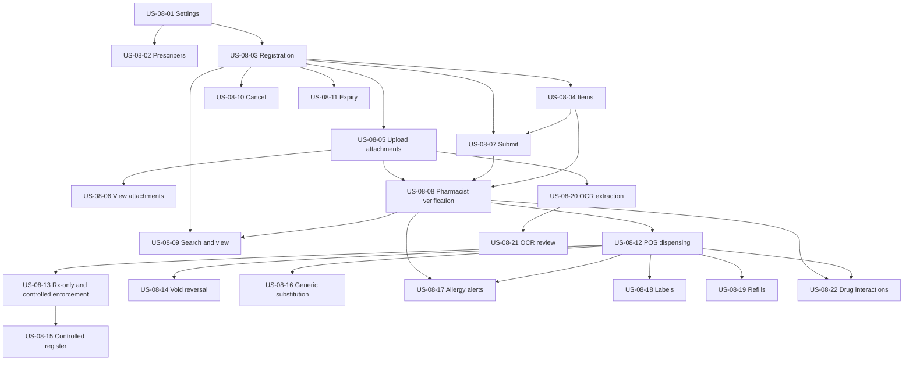

# EPIC-08: Prescriptions

## Epic Goal

Register and manage prescriptions and ensure pharmacist-verified dispensing is traceable through the POS, including partial fills, prescription-only and controlled medicine safeguards, and reversal when a sale is voided.

## Scope

The epic covers prescription settings, prescriber records, registration and items, private attachments, submit and pharmacist verification, search and history, cancellation and expiry, dispensing through the POS, enforcement, void reversal, controlled-medicine records, and post-MVP substitution, allergy decision support, labels, refills, OCR, and drug-interaction decision support.

MVP includes settings, prescribers, registration, items, attachment upload/view, submission and pharmacist verification, search, cancellation, expiry, POS dispensing with partial dispensing, Rx-only/controlled enforcement, and reversal on void. Generic substitution, allergy/interaction decision support, dispensing labels, and refills are post-MVP according to SPEC-08 priorities. OCR extraction and suggestion review are Future (P3). OCR suggestions are never auto-approved (BR-G-14). Drug-interaction alerts are decision support only, require a configured licensed external source, and ship without interaction data or a default provider (REG-09).

PostgreSQL Row-Level Security is enabled from MVP. Prescription and attachment reads remain organization- and branch-scoped, with patient medical reads logged under BR-G-29.

## Story List

| Story | Title | Priority | Complexity | Requirements | MVP |
|---|---|---|---|---|---|
| [US-08-01](US-08-01-prescription-settings.md) | Prescription Settings | P1 | M | FR-08-001–003 | Yes |
| [US-08-02](US-08-02-manage-prescribers.md) | Manage Prescribers | P1 | S | FR-08-004 | Yes |
| [US-08-03](US-08-03-register-prescription.md) | Register a Prescription | P0 | M | FR-08-005–007, FR-08-024 | Yes |
| [US-08-04](US-08-04-prescription-items.md) | Prescription Items | P0 | M | FR-08-007–010 | Yes |
| [US-08-05](US-08-05-upload-prescription-attachments.md) | Upload Prescription Attachments | P0 | M | FR-08-011, FR-08-012, FR-08-014, FR-08-024 | Yes |
| [US-08-06](US-08-06-view-prescription-attachments.md) | View Prescription Attachments | P0 | S | FR-08-013 | Yes |
| [US-08-07](US-08-07-submit-for-verification.md) | Submit for Verification | P0 | S | FR-08-015, FR-08-016 | Yes |
| [US-08-08](US-08-08-pharmacist-verification.md) | Pharmacist Verification | P0 | M | FR-08-017–020, FR-08-024 | Yes |
| [US-08-09](US-08-09-search-and-view-prescriptions.md) | Search and View Prescriptions | P1 | M | FR-08-021–023, FR-08-025 | Yes |
| [US-08-10](US-08-10-cancel-prescription.md) | Cancel a Prescription | P1 | S | FR-08-026 | Yes |
| [US-08-11](US-08-11-prescription-expiry.md) | Prescription Expiry | P1 | S | FR-08-027–028 | Yes |
| [US-08-12](US-08-12-dispense-through-pos.md) | Dispense Prescription Items Through POS (Partial Dispensing) | P0 | L | FR-08-028–034 | Yes |
| [US-08-13](US-08-13-rx-only-and-controlled-enforcement.md) | Enforce Prescription for Rx-only and Controlled Medicines at Sale | P0 | M | FR-08-035–036 | Yes |
| [US-08-14](US-08-14-reverse-dispensing-on-void.md) | Reverse Dispensing When a Sale Is Voided | P1 | M | FR-08-037–038 | Yes |
| [US-08-15](US-08-15-controlled-medicine-register.md) | Controlled Medicine Register | P1 | M | FR-08-039–040 | Yes (RELEASE-PLAN §3 override) |
| [US-08-16](US-08-16-generic-substitution.md) | Generic Substitution | P2 | M | FR-08-041–042 | No |
| [US-08-17](US-08-17-allergy-alerts.md) | Allergy Alerts at Verification and Dispensing | P2 | S | FR-08-043 | No |
| [US-08-18](US-08-18-dispensing-labels.md) | Dispensing Labels | P2 | M | FR-08-044 | No |
| [US-08-19](US-08-19-prescription-refills.md) | Prescription Refills | P2 | M | FR-08-045 | No |
| [US-08-20](US-08-20-ocr-extraction.md) | OCR Extraction Suggestions | P3 | L | FR-08-046 | No |
| [US-08-21](US-08-21-ocr-suggestion-review.md) | Review and Decide OCR Suggestions | P3 | M | FR-08-047 | No |
| [US-08-22](US-08-22-drug-interaction-checks.md) | Drug Interaction Checks and Overrides | P3 | L | FR-08-048–050 | No |

## Dependency Diagram

## Critical Scenario Coverage

| Scenario | Coverage |
|---|---|
| CS-04 Partial dispensing across visits | US-08-12, TS-08-065 |
| CS-07 Branch access denied (403) | Branch-scoped story authorization tests, including US-08-12 and US-08-19–22 |
| CS-08 Cross-organization access denied (404) | Branch-scoped story authorization tests, including US-08-12 and US-08-19–22 |
| CS-10 Atomic rollback | US-08-12, TS-08-072 |
| CS-11 Idempotent retry | US-08-12, TS-08-072 |
| CS-13 Rx-only/controlled medicine without required prescription is blocked | US-08-13, TS-08-074–080 |
