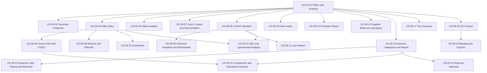

# EPIC-09: Finance and Reporting

## Goal

Provide accurate, auditable financial and operational reports that distinguish net sales, COGS, gross profit, cash flow, and inventory valuation.

## Scope

Branch and organization reports, projection reconciliation, finance and inventory analytics, expenses, exports, and dashboards. MVP includes the daily sales report, gross profit/COGS report, current stock valuation, near-expiry report, cash session Z-report/reconciliation, and CSV export. All other capabilities are post-MVP.

## Stories

| Story | Title | Priority | Complexity | Requirements | MVP |
|---|---|---|---|---|---|
| US-09-01 | Report Filters and Scoping | P0 | M | FR-09-001–005 | Yes |
| US-09-02 | DailyBranchSummary Projection, Late Corrections, and Nightly Reconciliation | P1 | L | FR-09-006–010 | No |
| US-09-03 | Daily Sales Report | P0 | M | FR-09-006, FR-09-011–012 | Yes |
| US-09-04 | Sales Analysis by Cashier, Medicine, Category, Payment Method, and Hour | P1 | M | FR-09-013–014 | No |
| US-09-05 | Gross Profit and COGS Report | P0 | M | FR-09-006, FR-09-015–017 | Yes |
| US-09-06 | Returns and Refunds Report | P1 | M | FR-09-018 | No |
| US-09-07 | Cash Session X/Z Report and Cash Reconciliation | P0 | M | FR-09-019–022 | Yes |
| US-09-08 | Current Inventory Valuation (Stock on Hand) | P0 | M | FR-09-023–024 | Yes |
| US-09-09 | Historical Inventory Valuation | P1 | M | FR-09-025–027 | No |
| US-09-10 | Near-Expiry and Expired Stock Report | P0 | M | FR-09-028 | Yes |
| US-09-11 | Inventory Loss Report | P1 | M | FR-09-029 | No |
| US-09-12 | Purchase Report | P1 | M | FR-09-030 | No |
| US-09-13 | Supplier Balances and Aging | P1 | M | FR-09-031–032 | No |
| US-09-14 | Expense Categories and Expense Reporting | P1 | L | FR-09-033–035 | No |
| US-09-15 | Expense Cash Payout and Reversal | P1 | M | FR-09-036–037 | No |
| US-09-16 | Expense Approval Workflow | P2 | M | FR-09-038 | No |
| US-09-17 | Tax Summary Report | P1 | M | FR-09-039 | No |
| US-09-18 | Synchronous CSV Report Export | P0 | M | FR-09-040–042 | Yes |
| US-09-19 | Background Report Exports | P1 | L | FR-09-042–045 | No |
| US-09-20 | Branch and Organization Dashboard | P1 | M | FR-09-046 | No |
| US-09-21 | Branch Comparison and Operating Summary | P1 | L | FR-09-047–048 | No |
| US-09-22 | ABC and Operational Analytics | P3 | L | FR-09-049–050 | No |

## Dependencies

