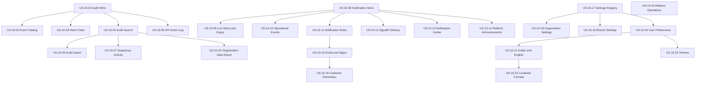

# EPIC-10: Notifications, Audit, and Settings

## Goal

Provide tamper-evident audit records, permission-aware notifications, configurable organization and branch settings, and localized user preferences.

## Scope

Audit write/search/export and verification, operational notifications, notification delivery, localization, settings, platform operations, and organization data export. MVP includes audit log write and search, in-app low-stock and near-expiry notifications, organization and branch settings, user language/theme preferences, Arabic/English RTL/LTR, and light/dark/system themes. SignalR real-time delivery is V1. Email/SMS/customer notifications and advanced audit reports are post-MVP.

## Stories

| Story | Title | Priority | Complexity | Requirements | MVP |
|---|---|---|---|---|---|
| US-10-01 | Audit Log Write Pipeline | P0 | L | FR-10-001–005 | Yes |
| US-10-02 | Sensitive Operation Catalog Registry | P0 | M | FR-10-006–008 | Yes |
| US-10-03 | Per-Organization Audit Hash Chain and Verification | P0 | L | FR-10-004, FR-10-009–011 | Yes (RELEASE-PLAN §3 override) |
| US-10-04 | Audit Log Search and Filter | P0 | M | FR-10-012–013 | Yes |
| US-10-05 | Audit Log Export | P1 | M | FR-10-014 | No |
| US-10-06 | API Action Log | P1 | M | FR-10-015–016 | No |
| US-10-07 | Suspicious Activity Reports | P2 | M | FR-10-017 | No |
| US-10-08 | Notification Store, Default Routing, and Notification Center API | P0 | M | FR-10-018–024 | Yes |
| US-10-09 | Low-Stock and Expiry Notifications | P0 | M | FR-10-025–026 | Yes |
| US-10-10 | Operational Event Notifications | P1 | M | FR-10-027 | No |
| US-10-11 | Notification Rule Management | P1 | M | FR-10-028 | No |
| US-10-12 | Real-Time Notification Delivery and Recovery | P1 | L | FR-10-029–031 | V1 |
| US-10-13 | Notification Center Interface | P0 | M | FR-10-032 | Yes |
| US-10-14 | Platform Announcements | P2 | M | FR-10-033 | No |
| US-10-15 | Email and Digest Notifications | P2 | L | FR-10-034–035 | No |
| US-10-16 | Customer Refill Reminders | P3 | M | FR-10-036 | No |
| US-10-17 | Settings Registry and Resolution | P0 | M | FR-10-037–039 | Yes |
| US-10-18 | Organization Settings | P0 | M | FR-10-040–041 | Yes |
| US-10-19 | Branch Settings and Overrides | P0 | M | FR-10-042 | Yes |
| US-10-20 | User Language and Theme Preferences | P0 | S | FR-10-043 | Yes |
| US-10-21 | Arabic-English Localization and RTL-LTR | P0 | L | FR-10-044–045 | Yes |
| US-10-22 | Localized Digits Dates Money and Medicine Names | P0 | M | FR-10-046–049 | Yes |
| US-10-23 | Light Dark and System Themes | P0 | M | FR-10-050–051 | Yes |
| US-10-24 | Platform Health Jobs and Backups | P1 | L | FR-10-052–054 | No |
| US-10-25 | Organization Data Export | P3 | L | FR-10-055 | No |

## Dependencies

